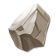

# Blessing

Blessing raises the stats of your equipment parts (Weapon, Headwear, Hair, Emoji, Clothes, Face Acc., Suit). The highest level in the game data is **+31**.

## How blessing works

- Use Blessing Gems to add Bless Points and increase the success rate of blessing.
- Failed blessings add Bless Points to the part. When enough points are accumulated, blessing succeeds.
- After Lv.8, failed blessings may downgrade the equipment. Use Prayer Water to prevent downgrades.
- Quick Bless unlocks at Second Lt. Rank, using the highest-level Blessing Gems and Prayer Water automatically. Blessing stops when Prayer Water runs out.
- You can put up to **4 Blessing Gems** into one bless.
- **Base Rate** = the gems' Bless Points ÷ the points the level needs. When the points already saved on the part plus the new gems reach the requirement, the bless is a sure success.
- **Rank Bonus**: from Major up, your Military rank adds a share of the base rate (table below). **Total Rate** = base + bonus, at most 100%.
-  **Prayer Water** can be used from +8: a failed bless then does not downgrade the part.

## Blessing Gems

| Gem | Bless Points | Where to get |
|---|---|---|
|  Lv.1 Blessing Gem | **5** | Loop Quest Reward Team Expedition Store Purchase Guild Store Exchanges |
|  Lv.2 Blessing Gem | **15** | Loop Quest Reward Team Expedition Store Purchase |
|  Lv.3 Blessing Gem | **50** | Loop Quest Reward Team Expedition Store Purchase Sky of City |
|  Lv.4 Blessing Gem | **165** | Event Rewards Secret Merchant Sky of City |
|  Lv.5 Blessing Gem | **500** | Event Rewards Secret Merchant Sky of City |

## Bless Points and chance per level

The same for every part. Chance = the Base Rate of one bless with 4 gems of one kind and no saved points (before the rank bonus). "Sure success" = the most Lv.5 Gems it can take, because failed blesses keep their points.

| Level | Bless Points needed | 4 × Lv.5 Blessing Gem | 4 × Lv.4 Blessing Gem | 4 × Lv.3 Blessing Gem | 4 × Lv.2 Blessing Gem | 4 × Lv.1 Blessing Gem | Sure success |
|---|---|---|---|---|---|---|---|
| +0 → +1 | 20 | 100% | 100% | 100% | 100% | 100% | 1 Lv.5 |
| +1 → +2 | 40 | 100% | 100% | 100% | 100% | 50% | 1 Lv.5 |
| +2 → +3 | 200 | 100% | 100% | 100% | 30% | 10% | 1 Lv.5 |
| +3 → +4 | 800 | 100% | 82.50% | 25% | 7.50% | 2.50% | 2 Lv.5 |
| +4 → +5 | 2,400 | 83.33% | 27.50% | 8.33% | 2.50% | 0.83% | 5 Lv.5 |
| +5 → +6 | 4,000 | 50% | 16.50% | 5% | 1.50% | 0.50% | 8 Lv.5 |
| +6 → +7 | 10,000 | 20% | 6.60% | 2% | 0.60% | 0.20% | 20 Lv.5 |
| +7 → +8 | 28,000 | 7.14% | 2.36% | 0.71% | 0.21% | 0.07% | 56 Lv.5 |
| +8 → +9 | 38,000 | 5.26% | 1.74% | 0.53% | 0.16% | 0.05% | 76 Lv.5 |
| +9 → +10 | 50,000 | 4% | 1.32% | 0.40% | 0.12% | 0.04% | 100 Lv.5 |
| +10 → +11 | 72,000 | 2.78% | 0.92% | 0.28% | 0.08% | 0.03% | 144 Lv.5 |
| +11 → +12 | 120,000 | 1.67% | 0.55% | 0.17% | 0.05% | 0.02% | 240 Lv.5 |
| +12 → +13 | 165,000 | 1.21% | 0.40% | 0.12% | 0.04% | 0.01% | 330 Lv.5 |
| +13 → +14 | 215,000 | 0.93% | 0.31% | 0.09% | 0.03% | 0.01% | 430 Lv.5 |
| +14 → +15 | 255,000 | 0.78% | 0.26% | 0.08% | 0.02% | 0.01% | 510 Lv.5 |
| +15 → +16 | - | - | - | - | - | - | - |
| +16 → +17 | 15,000 | 13.33% | 4.40% | 1.33% | 0.40% | 0.13% | 30 Lv.5 |
| +17 → +18 | 27,000 | 7.41% | 2.44% | 0.74% | 0.22% | 0.07% | 54 Lv.5 |
| +18 → +19 | 36,000 | 5.56% | 1.83% | 0.56% | 0.17% | 0.06% | 72 Lv.5 |
| +19 → +20 | 75,000 | 2.67% | 0.88% | 0.27% | 0.08% | 0.03% | 150 Lv.5 |
| +20 → +21 | 80,000 | 2.50% | 0.82% | 0.25% | 0.07% | 0.03% | 160 Lv.5 |
| +21 → +22 | 100,000 | 2% | 0.66% | 0.20% | 0.06% | 0.02% | 200 Lv.5 |
| +22 → +23 | 125,000 | 1.60% | 0.53% | 0.16% | 0.05% | 0.02% | 250 Lv.5 |
| +23 → +24 | 175,000 | 1.14% | 0.38% | 0.11% | 0.03% | 0.01% | 350 Lv.5 |
| +24 → +25 | 250,000 | 0.80% | 0.26% | 0.08% | 0.02% | 0.01% | 500 Lv.5 |
| +25 → +26 | 300,000 | 0.67% | 0.22% | 0.07% | 0.02% | 0.01% | 600 Lv.5 |
| +26 → +27 | 347,500 | 0.58% | 0.19% | 0.06% | 0.02% | 0.01% | 695 Lv.5 |
| +27 → +28 | 400,000 | 0.50% | 0.17% | 0.05% | 0.01% | 0.01% | 800 Lv.5 |
| +28 → +29 | 452,500 | 0.44% | 0.15% | 0.04% | 0.01% | 0% | 905 Lv.5 |
| +29 → +30 | 505,000 | 0.40% | 0.13% | 0.04% | 0.01% | 0% | 1,010 Lv.5 |
| +30 → +31 | 557,500 | 0.36% | 0.12% | 0.04% | 0.01% | 0% | 1,115 Lv.5 |

The game data has no Bless Points value for +15 → +16.

## Rank Bonus

Extra chance = base rate × the rank's bonus. Example: a 40% base rate at a +15% rank gives 40% + 6% = 46%.

| Rank | Bonus |
|---|---|
|  Major | +15% |
|  Lt Colonel | +20% |
|  Colonel | +25% |
|  Major General | +30% |
|  Lt. General | +35% |
|  General | +40% |
|  Marshal | +45% |
|  Grand Marshal | +50% |
|  The Supreme Marshal | +55% |

## Stats by level

<b>Weapon</b>

| Level | ATK | DEF | HP |
|---|---|---|---|
| +1 | 47 | 25 | 87 |
| +2 | 109 | 62 | 177 |
| +3 | 190 | 112 | 351 |
| +4 | 288 | 174 | 570 |
| +5 | 397 | 249 | 831 |
| +6 | 517 | 336 | 1,137 |
| +7 | 648 | 432 | 1,477 |
| +8 | 791 | 538 | 1,848 |
| +9 | 946 | 656 | 2,263 |
| +10 | 1,111 | 780 | 2,699 |
| +11 | 1,288 | 917 | 3,179 |
| +12 | 1,484 | 1,068 | 3,712 |
| +13 | 1,708 | 1,242 | 4,323 |
| +14 | 1,957 | 1,424 | 5,082 |
| +15 | 2,250 | 1,638 | 5,973 |
| +16 | 2,464 | 1,798 | 6,305 |
| +17 | 2,689 | 1,973 | 6,669 |
| +18 | 2,925 | 2,157 | 7,050 |
| +19 | 3,173 | 2,351 | 7,454 |
| +20 | 3,443 | 2,558 | 7,886 |
| +21 | 3,727 | 2,782 | 8,350 |
| +22 | 4,054 | 3,014 | 8,826 |
| +23 | 4,437 | 3,286 | 9,385 |
| +24 | 4,876 | 3,598 | 10,027 |
| +25 | 5,371 | 3,950 | 10,752 |
| +26 | 5,922 | 4,342 | 11,560 |
| +27 | 6,333 | 4,634 | 12,160 |
| +28 | 6,800 | 4,966 | 12,844 |
| +29 | 7,267 | 5,298 | 13,527 |
| +30 | 7,734 | 5,630 | 14,211 |
| +31 | 8,201 | 5,962 | 14,894 |

<b>Headwear</b>

| Level | ATK | DEF | HP |
|---|---|---|---|
| +1 | 47 | 25 | 87 |
| +2 | 109 | 62 | 177 |
| +3 | 190 | 112 | 351 |
| +4 | 288 | 174 | 570 |
| +5 | 397 | 249 | 831 |
| +6 | 517 | 336 | 1,137 |
| +7 | 648 | 432 | 1,477 |
| +8 | 791 | 538 | 1,848 |
| +9 | 946 | 656 | 2,263 |
| +10 | 1,111 | 780 | 2,699 |
| +11 | 1,288 | 917 | 3,179 |
| +12 | 1,484 | 1,068 | 3,712 |
| +13 | 1,708 | 1,242 | 4,323 |
| +14 | 1,957 | 1,424 | 5,082 |
| +15 | 2,250 | 1,638 | 5,973 |
| +16 | 2,464 | 1,798 | 6,305 |
| +17 | 2,689 | 1,973 | 6,669 |
| +18 | 2,925 | 2,157 | 7,050 |
| +19 | 3,173 | 2,351 | 7,454 |
| +20 | 3,443 | 2,558 | 7,886 |
| +21 | 3,727 | 2,782 | 8,350 |
| +22 | 4,054 | 3,014 | 8,826 |
| +23 | 4,437 | 3,286 | 9,385 |
| +24 | 4,876 | 3,598 | 10,027 |
| +25 | 5,371 | 3,950 | 10,752 |
| +26 | 5,922 | 4,342 | 11,560 |
| +27 | 6,435 | 4,634 | 12,243 |
| +28 | 6,958 | 4,966 | 12,968 |
| +29 | 7,481 | 5,298 | 13,693 |
| +30 | 8,004 | 5,630 | 14,418 |
| +31 | 8,527 | 5,962 | 15,143 |

<b>Hair</b>

| Level | ATK | DEF | HP |
|---|---|---|---|
| +1 | 25 | 19 | 111 |
| +2 | 63 | 48 | 195 |
| +3 | 114 | 87 | 418 |
| +4 | 177 | 135 | 697 |
| +5 | 253 | 193 | 1,031 |
| +6 | 342 | 261 | 1,421 |
| +7 | 441 | 336 | 1,856 |
| +8 | 549 | 418 | 2,330 |
| +9 | 670 | 510 | 2,859 |
| +10 | 797 | 607 | 3,416 |
| +11 | 937 | 713 | 4,029 |
| +12 | 1,092 | 831 | 4,709 |
| +13 | 1,270 | 966 | 5,489 |
| +14 | 1,458 | 1,109 | 6,554 |
| +15 | 1,679 | 1,277 | 7,804 |
| +16 | 1,812 | 1,379 | 8,389 |
| +17 | 1,959 | 1,490 | 9,033 |
| +18 | 2,112 | 1,607 | 9,706 |
| +19 | 2,275 | 1,731 | 10,420 |
| +20 | 2,448 | 1,863 | 11,180 |
| +21 | 2,635 | 2,005 | 11,999 |
| +22 | 2,832 | 2,155 | 13,117 |
| +23 | 3,064 | 2,331 | 14,430 |
| +24 | 3,321 | 2,527 | 15,888 |
| +25 | 3,600 | 2,739 | 17,467 |
| +26 | 3,900 | 2,968 | 19,168 |
| +27 | 4,145 | 3,154 | 20,555 |
| +28 | 4,412 | 3,357 | 22,069 |
| +29 | 4,679 | 3,561 | 23,583 |
| +30 | 4,946 | 3,764 | 25,097 |
| +31 | 5,213 | 3,967 | 26,611 |

<b>Emoji</b>

| Level | ATK | DEF | HP |
|---|---|---|---|
| +1 | 25 | 19 | 111 |
| +2 | 63 | 48 | 195 |
| +3 | 114 | 87 | 418 |
| +4 | 177 | 135 | 697 |
| +5 | 253 | 193 | 1,031 |
| +6 | 342 | 261 | 1,421 |
| +7 | 441 | 336 | 1,856 |
| +8 | 549 | 418 | 2,330 |
| +9 | 670 | 510 | 2,859 |
| +10 | 797 | 607 | 3,416 |
| +11 | 937 | 713 | 4,029 |
| +12 | 1,092 | 831 | 4,709 |
| +13 | 1,270 | 966 | 5,489 |
| +14 | 1,458 | 1,109 | 6,554 |
| +15 | 1,679 | 1,277 | 7,804 |
| +16 | 1,812 | 1,379 | 8,389 |
| +17 | 1,959 | 1,490 | 9,033 |
| +18 | 2,112 | 1,607 | 9,706 |
| +19 | 2,275 | 1,731 | 10,420 |
| +20 | 2,448 | 1,863 | 11,180 |
| +21 | 2,635 | 2,005 | 11,999 |
| +22 | 2,832 | 2,155 | 13,117 |
| +23 | 3,064 | 2,331 | 14,430 |
| +24 | 3,321 | 2,527 | 15,888 |
| +25 | 3,600 | 2,739 | 17,467 |
| +26 | 3,900 | 2,968 | 19,168 |
| +27 | 4,168 | 3,172 | 20,686 |
| +28 | 4,446 | 3,384 | 22,265 |
| +29 | 4,725 | 3,596 | 23,845 |
| +30 | 5,004 | 3,808 | 25,424 |
| +31 | 5,282 | 4,021 | 27,003 |

<b>Clothes</b>

| Level | ATK | DEF | HP |
|---|---|---|---|
| +1 | 25 | 19 | 111 |
| +2 | 63 | 48 | 195 |
| +3 | 114 | 87 | 418 |
| +4 | 177 | 135 | 697 |
| +5 | 253 | 193 | 1,031 |
| +6 | 342 | 261 | 1,421 |
| +7 | 441 | 336 | 1,856 |
| +8 | 549 | 418 | 2,330 |
| +9 | 670 | 510 | 2,859 |
| +10 | 797 | 607 | 3,416 |
| +11 | 937 | 713 | 4,029 |
| +12 | 1,092 | 831 | 4,709 |
| +13 | 1,270 | 966 | 5,489 |
| +14 | 1,458 | 1,109 | 6,554 |
| +15 | 1,679 | 1,277 | 7,804 |
| +16 | 1,812 | 1,379 | 8,389 |
| +17 | 1,959 | 1,490 | 9,033 |
| +18 | 2,112 | 1,607 | 9,706 |
| +19 | 2,275 | 1,731 | 10,420 |
| +20 | 2,448 | 1,863 | 11,180 |
| +21 | 2,635 | 2,005 | 11,999 |
| +22 | 2,832 | 2,155 | 13,117 |
| +23 | 3,064 | 2,331 | 14,430 |
| +24 | 3,321 | 2,527 | 15,888 |
| +25 | 3,600 | 2,739 | 17,467 |
| +26 | 3,900 | 2,968 | 19,168 |
| +27 | 4,145 | 3,154 | 20,555 |
| +28 | 4,412 | 3,357 | 22,069 |
| +29 | 4,679 | 3,561 | 23,583 |
| +30 | 4,946 | 3,764 | 25,097 |
| +31 | 5,213 | 3,967 | 26,611 |

<b>Face Acc.</b>

| Level | ATK | DEF | HP |
|---|---|---|---|
| +1 | 25 | 19 | 111 |
| +2 | 63 | 48 | 195 |
| +3 | 114 | 87 | 418 |
| +4 | 177 | 135 | 697 |
| +5 | 253 | 193 | 1,031 |
| +6 | 342 | 261 | 1,421 |
| +7 | 441 | 336 | 1,856 |
| +8 | 549 | 418 | 2,330 |
| +9 | 670 | 510 | 2,859 |
| +10 | 797 | 607 | 3,416 |
| +11 | 937 | 713 | 4,029 |
| +12 | 1,092 | 831 | 4,709 |
| +13 | 1,270 | 966 | 5,489 |
| +14 | 1,458 | 1,109 | 6,554 |
| +15 | 1,679 | 1,277 | 7,804 |
| +16 | 1,812 | 1,379 | 8,389 |
| +17 | 1,959 | 1,490 | 9,033 |
| +18 | 2,112 | 1,607 | 9,706 |
| +19 | 2,275 | 1,731 | 10,420 |
| +20 | 2,448 | 1,863 | 11,180 |
| +21 | 2,635 | 2,005 | 11,999 |
| +22 | 2,832 | 2,155 | 13,117 |
| +23 | 3,064 | 2,331 | 14,430 |
| +24 | 3,321 | 2,527 | 15,888 |
| +25 | 3,600 | 2,739 | 17,467 |
| +26 | 3,900 | 2,968 | 19,168 |
| +27 | 4,168 | 3,172 | 20,686 |
| +28 | 4,446 | 3,384 | 22,265 |
| +29 | 4,725 | 3,596 | 23,845 |
| +30 | 5,004 | 3,808 | 25,424 |
| +31 | 5,282 | 4,021 | 27,003 |

<b>Suit</b>

| Level | ATK | DEF | HP |
|---|---|---|---|
| +1 | 25 | 19 | 111 |
| +2 | 63 | 48 | 195 |
| +3 | 114 | 87 | 418 |
| +4 | 177 | 135 | 697 |
| +5 | 253 | 193 | 1,031 |
| +6 | 342 | 261 | 1,421 |
| +7 | 441 | 336 | 1,856 |
| +8 | 549 | 418 | 2,330 |
| +9 | 670 | 510 | 2,859 |
| +10 | 797 | 607 | 3,416 |
| +11 | 937 | 713 | 4,029 |
| +12 | 1,092 | 831 | 4,709 |
| +13 | 1,270 | 966 | 5,489 |
| +14 | 1,458 | 1,109 | 6,554 |
| +15 | 1,679 | 1,277 | 7,804 |
| +16 | 1,812 | 1,379 | 8,389 |
| +17 | 1,959 | 1,490 | 9,033 |
| +18 | 2,112 | 1,607 | 9,706 |
| +19 | 2,275 | 1,731 | 10,420 |
| +20 | 2,448 | 1,863 | 11,180 |
| +21 | 2,635 | 2,005 | 11,999 |
| +22 | 2,832 | 2,155 | 13,117 |
| +23 | 3,064 | 2,331 | 14,430 |
| +24 | 3,321 | 2,527 | 15,888 |
| +25 | 3,600 | 2,739 | 17,467 |
| +26 | 3,900 | 2,968 | 19,168 |
| +27 | 4,168 | 3,172 | 20,686 |
| +28 | 4,446 | 3,384 | 22,265 |
| +29 | 4,725 | 3,596 | 23,845 |
| +30 | 5,004 | 3,808 | 25,424 |
| +31 | 5,282 | 4,021 | 27,003 |

## Set effects

Bonuses for blessing your parts up to these levels:

| Level | Set | Bonus | Skill |
|---|---|---|---|
| +10 | Brave | STA +100, DEF +300, DMG- +80 | - |
| +12 | Fearless | STR +200, ATK +400, DMG+ +80 | - |
| +14 | Reckless | Toughness +400, Anti-crit +351, Burst DMG- +300 | **Fury**: CRIT +200 for every 10 Rage gained in battle |
| +15 | Tough | Luck +500, CRIT +450, Burst DMG+ +300 | **Revenge**: ATK +2.5% with every 10% HP lost |
| +17 | Recast Set Stats | STR +300, ATK +500, STA +200, DEF +300, DMG- +200, Anti-crit +400 | - |
| +19 | Recast Set Stats | STR +350, ATK +700, STA +250, DEF +400, Anti-crit +500, CRIT +500 | - |
| +21 | Recast Set Stats | STR +400, ATK +800, STA +300, DEF +500, Anti-crit +600 | - |
| +23 | Recast Set Stats | STR +450, ATK +1,000, STA +350, DEF +700, Anti-crit +700 | - |
| +26 | Recast Set Stats | STR +500, ATK +2,000, STA +400, DEF +1,000, Anti-crit +800 | - |
| +28 | Recast Set Stats | STR +550, ATK +2,500, STA +450, DEF +1,200, Anti-crit +900 | - |
| +31 | Recast Set Stats | STR +600, ATK +3,000, STA +500, DEF +1,500, Anti-crit +1,000 | - |
