# Equipment Advance

## How advancing works

- There are 7 equipment pieces. Advancing raises a piece's quality, from **White** up to **Pink +9**, and with it the piece's stats.
- Each advance costs materials and Coins. Most materials drop in **Solo Adventure** stages (table below).
- Some qualities also unlock a bonus stat that the piece keeps from then on.
- From **Pink** the piece gets a new look and "Intricate." in front of its name (for example **Intricate.Combat Weapon**).

<a class="wiki-card" href="equipment-advance/brain-barrier.html">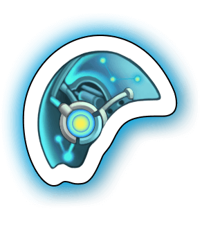Brain BarrierEvery quality: stats, bonus, materials and Coins to advance.</a>
<a class="wiki-card" href="equipment-advance/alloy-armor.html">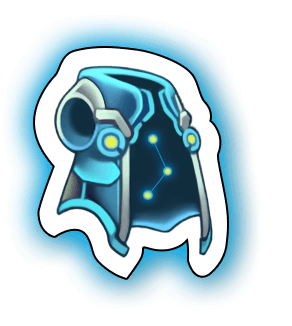Alloy ArmorEvery quality: stats, bonus, materials and Coins to advance.</a>
<a class="wiki-card" href="equipment-advance/gas-mask.html">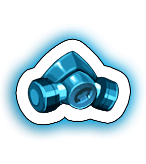Gas MaskEvery quality: stats, bonus, materials and Coins to advance.</a>
<a class="wiki-card" href="equipment-advance/battle-headset.html">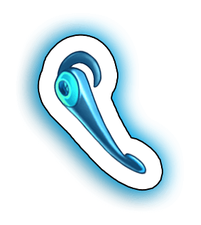Battle HeadsetEvery quality: stats, bonus, materials and Coins to advance.</a>
<a class="wiki-card" href="equipment-advance/night-vision.html">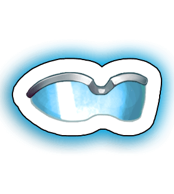Night VisionEvery quality: stats, bonus, materials and Coins to advance.</a>
<a class="wiki-card" href="equipment-advance/combat-set.html">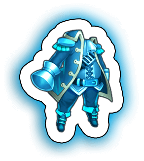Combat SetEvery quality: stats, bonus, materials and Coins to advance.</a>
<a class="wiki-card" href="equipment-advance/combat-weapon.html">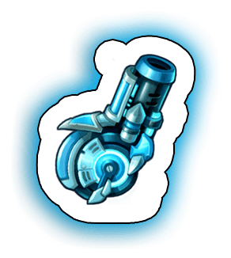Combat WeaponEvery quality: stats, bonus, materials and Coins to advance.</a>

## Materials and where to get them

| Material | Where to Get |
|---|---|
| 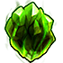 Magic Stone I | Team Expedition - Old Ruins Team Expedition - Forest Altar |
| 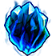 Magic Stone II | Team Expedition - Dark Castle Team Expedition - Demon Forest |
| 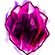 Magic Stone III | Secret Merchant |
| 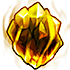 Magic Stone IV | Secret Merchant |
| 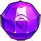 Upgrade Stone | Team Expedition AP Chest Reward Online Reward Sky of City |
| 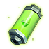 Green Crystal | Solo Adventure 1-3 Solo Adventure 2-3 |
| 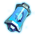 Blue Crystal | Solo Adventure 3-3 Solo Adventure 4-6 |
| 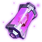 Purple Crystal | Solo Adventure 6-6 Solo Adventure 8-3 Solo Adventure 10-3 |
| 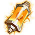 Orange Crystal | Solo Adventure 11-3 Solo Adventure 12-6 Solo Adventure Stage14-6 Solo Adventure Stage16-6 |
|  Green Alloy | Solo Adventure 1-6 Solo Adventure 2-6 |
| 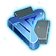 Blue Alloy | Solo Adventure 3-3 Solo Adventure 5-3 |
| 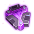 Purple Alloy | Solo Adventure 6-3 Solo Adventure 8-3 Solo Adventure 9-3 |
| 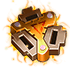 Orange Alloy | Solo Adventure 10-3 Solo Adventure 11-6 Solo Adventure Stage14-3 Solo Adventure Stage16-3 |
| 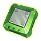 Green Chip | Solo Adventure 1-3 Solo Adventure 2-3 |
| 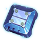 Blue Chip | Solo Adventure 3-6 Solo Adventure 5-3 |
| 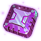 Purple Chip | Solo Adventure 7-3 Solo Adventure 8-6 |
| 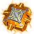 Orange Chip | Solo Adventure 12-3 Solo Adventure 13-6 Solo Adventure Stage15-6 Solo Adventure Stage17-6 |
| 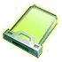 Green Disk | Solo Adventure 1-6 Solo Adventure 2-6 |
| 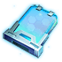 Blue Disk | Solo Adventure 3-6 Solo Adventure 5-3 |
| 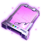 Purple Disk | Solo Adventure 6-6 Solo Adventure 8-6 Solo Adventure 9-3 |
| 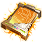 Orange Disk | Solo Adventure 10-6 Solo Adventure 11-3 Solo Adventure 13-6 Solo Adventure Stage15-6 Solo Adventure Stage17-6 |
| 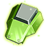 Green Armor | Solo Adventure 1-6 Solo Adventure 2-6 |
| 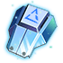 Blue Armor | Solo Adventure 4-3 Solo Adventure 5-6 |
| 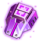 Purple Armor | Solo Adventure 6-3 Solo Adventure 7-6 |
| 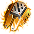 Orange Armor | Solo Adventure 12-6 Solo Adventure 13-3 Solo Adventure Stage14-6 Solo Adventure Stage15-3 Solo Adventure Stage16-6 Solo Adventure Stage17-3 |
| 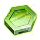 Green Mainboard | Solo Adventure 1-3 Solo Adventure 2-3 |
| 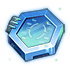 Blue Mainboard | Solo Adventure 4-3 Solo Adventure 5-6 |
| 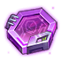 Purple Mainboard | Solo Adventure 7-3 Solo Adventure 8-3 Solo Adventure 9-6 Solo Adventure 10-6 |
| 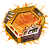 Orange Mainboard | Solo Adventure 13-3 Solo Adventure Stage15-3 Solo Adventure Stage17-3 |
|  Green Energy | Solo Adventure 2-3 Solo Adventure 2-6 |
| 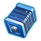 Blue Energy | Solo Adventure 4-6 Solo Adventure 5-6 |
| 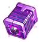 Purple Energy | Solo Adventure 7-6 Solo Adventure 8-6 Solo Adventure 9-6 |
| 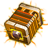 Orange Energy | Solo Adventure 11-6 Solo Adventure 12-3 Solo Adventure Stage14-3 Solo Adventure Stage16-3 |
| 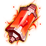 Red Crystal | Solo Adventure 18-3 Solo Adventure 19-6 |
| 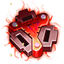 Red Alloy | Solo Adventure 20-3 |
| 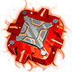 Red Chip | Solo Adventure 20-3 |
| 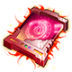 Red Disk | Solo Adventure 20-6 |
| 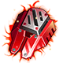 Red Armor | Solo Adventure 20-6 |
| 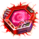 Red Mainboard | Solo Adventure 19-3 |
| 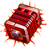 Red Energy | Solo Adventure 19-6 |
| 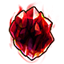 Red Magic Stone | Secret Merchant Team Expedition |
| 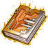 Manual | - |
| 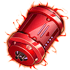 Elec Material | - |
| 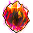 Colored Magic Stone | - |
