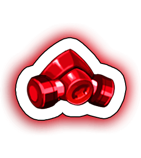

[← Equipment Advance](../equipment-advance.html)

# Gas Mask

| White - Red +5 | Pink and above |
|---|---|
|  |  |

From Pink the piece is called **Intricate.Gas Mask**. "Cost to advance" is what the next advance from that quality costs.

| Quality | ATK | DEF | HP | Bonus unlocked | Cost to advance |
|---|---|---|---|---|---|
| **White** | 9 | 7 | 34 | - |  Green Chip ×2  Green Armor ×1  Magic Stone I ×1  Upgrade Stone ×2 110,400 Coins |
| **Green** | 31 | 29 | 163 | DEF +18 |  Green Chip ×6  Green Armor ×3  Magic Stone I ×1  Upgrade Stone ×2 259,100 Coins |
| **Green +1** | 57 | 43 | 214 | - |  Green Chip ×8  Green Armor ×4  Magic Stone I ×1  Upgrade Stone ×2 295,100 Coins |
| **Green +2** | 85 | 64 | 319 | - |  Blue Chip ×15  Blue Armor ×8  Magic Stone II ×5  Upgrade Stone ×5 332,200 Coins |
| **Blue** | 123 | 92 | 461 | DEF +24 |  Blue Chip ×20  Blue Armor ×10  Magic Stone II ×10  Upgrade Stone ×10 368,200 Coins |
| **Blue +1** | 152 | 114 | 570 | - |  Blue Chip ×30  Blue Armor ×15  Magic Stone II ×15  Upgrade Stone ×20 430,200 Coins |
| **Blue +2** | 180 | 135 | 675 | - |  Blue Chip ×40  Blue Armor ×20  Magic Stone II ×20  Upgrade Stone ×25 560,000 Coins |
| **Blue +3** | 209 | 157 | 784 | - |  Purple Chip ×60  Purple Armor ×30  Magic Stone III ×25  Upgrade Stone ×30 591,000 Coins |
| **Purple** | 256 | 192 | 960 | DEF +48 |  Purple Chip ×70  Purple Armor ×35  Magic Stone III ×25  Upgrade Stone ×35 621,100 Coins |
| **Purple +1** | 280 | 210 | 1,050 | - |  Purple Chip ×80  Purple Armor ×40  Magic Stone III ×25  Upgrade Stone ×50 651,800 Coins |
| **Purple +2** | 304 | 228 | 1,140 | - |  Purple Chip ×90  Purple Armor ×45  Magic Stone III ×25  Upgrade Stone ×60 710,300 Coins |
| **Purple +3** | 328 | 246 | 1,230 | - |  Purple Chip ×100  Purple Armor ×50  Magic Stone III ×25  Upgrade Stone ×70 774,900 Coins |
| **Purple +4** | 351 | 263 | 1,316 | - |  Orange Chip ×120  Orange Armor ×60  Magic Stone IV ×40  Upgrade Stone ×80 819,800 Coins |
| **Gold** | 389 | 292 | 1,459 | DEF +96 |  Orange Chip ×130  Orange Armor ×65  Magic Stone IV ×40  Upgrade Stone ×100 873,600 Coins |
| **Gold +1** | 408 | 306 | 1,530 | - |  Orange Chip ×140  Orange Armor ×70  Magic Stone IV ×40  Upgrade Stone ×120 924,900 Coins |
| **Gold +2** | 427 | 320 | 1,601 | - |  Orange Chip ×150  Orange Armor ×75  Magic Stone IV ×40  Upgrade Stone ×130 1,049,800 Coins |
| **Gold +3** | 446 | 335 | 1,673 | - |  Orange Chip ×160  Orange Armor ×80  Magic Stone IV ×40  Upgrade Stone ×160 1,173,600 Coins |
| **Gold +4** | 475 | 356 | 1,781 | - |  Red Alloy ×180  Red Armor ×90  Red Magic Stone ×80  Upgrade Stone ×180 1,357,400 Coins |
| **Red** | 522 | 392 | 2,349 | DEF +144 |  Red Alloy ×210  Red Armor ×100  Red Magic Stone ×80  Upgrade Stone ×200 1,541,200 Coins |
| **Red +1** | 570 | 428 | 2,565 | - |  Red Alloy ×240  Red Armor ×120  Red Magic Stone ×80  Upgrade Stone ×220 1,725,000 Coins |
| **Red +2** | 617 | 463 | 2,777 | - |  Red Alloy ×260  Red Armor ×130  Red Magic Stone ×80  Upgrade Stone ×240 1,908,800 Coins |
| **Red +3** | 665 | 499 | 2,993 | - |  Red Alloy ×280  Red Armor ×140  Red Magic Stone ×80  Upgrade Stone ×260 2,092,600 Coins |
| **Red +4** | 712 | 534 | 3,204 | - |  Red Alloy ×300  Red Armor ×150  Red Magic Stone ×80  Upgrade Stone ×280 2,276,400 Coins |
| **Red +5** | 760 | 570 | 3,420 | - |  - Coins |
| **Pink** | 1,300 | 1,073 | 5,184 | - |  Manual ×160  Elec Material ×80  Red Magic Stone ×100  Upgrade Stone ×100 2,500,000 Coins |
| **Pink +1** | 1,385 | 1,143 | 6,627 | DEF +60 |  Manual ×200  Elec Material ×100  Colored Magic Stone ×100  Upgrade Stone ×150 3,000,000 Coins |
| **Pink +2** | 1,426 | 1,176 | 7,961 | - |  Manual ×240  Elec Material ×120  Colored Magic Stone ×180  Upgrade Stone ×180 3,500,000 Coins |
| **Pink +3** | 1,466 | 1,209 | 9,353 | DEF +140 |  Manual ×300  Elec Material ×150  Colored Magic Stone ×260  Upgrade Stone ×240 4,000,000 Coins |
| **Pink +4** | 1,506 | 1,242 | 10,809 | - |  Manual ×360  Elec Material ×180  Colored Magic Stone ×320  Upgrade Stone ×300 4,500,000 Coins |
| **Pink +5** | 1,547 | 1,276 | 12,337 | DEF +220 |  Manual ×440  Elec Material ×220  Colored Magic Stone ×390  Upgrade Stone ×360 5,000,000 Coins |
| **Pink +6** | 1,587 | 1,309 | 13,922 | - |  Manual ×480  Elec Material ×240  Colored Magic Stone ×480  Upgrade Stone ×400 5,500,000 Coins |
| **Pink +7** | 1,627 | 1,342 | 15,570 | DEF +300 |  Manual ×520  Elec Material ×260  Colored Magic Stone ×580  Upgrade Stone ×450 6,000,000 Coins |
| **Pink +8** | 1,668 | 1,376 | 17,293 | - |  Manual ×560  Elec Material ×280  Colored Magic Stone ×680  Upgrade Stone ×500 6,500,000 Coins |
| **Pink +9** | 1,708 | 1,409 | 19,070 | DEF +380 | max |

## Total to max

From White to Pink +9:

| Material | Amount |
|---|---|
|  Green Chip | 16 |
|  Green Armor | 8 |
|  Magic Stone I | 3 |
|  Upgrade Stone | 4,961 |
|  Blue Chip | 105 |
|  Blue Armor | 53 |
|  Magic Stone II | 50 |
|  Purple Chip | 400 |
|  Purple Armor | 200 |
|  Magic Stone III | 125 |
|  Orange Chip | 700 |
|  Orange Armor | 350 |
|  Magic Stone IV | 200 |
|  Red Alloy | 1,470 |
|  Red Armor | 730 |
|  Red Magic Stone | 580 |
|  Manual | 3,260 |
|  Elec Material | 1,630 |
|  Colored Magic Stone | 2,990 |
| Coins | 61,947,400 |
