# TNT Bomb Saga player wiki

<a class="wiki-card" href="player-lookup.html">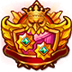Player lookupEnter a player's UID and see their profile as in the game: equipment, stats, rank, guild, title and marriage.</a>
<a class="wiki-card" href="server-leaderboard.html">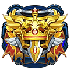Server LeaderboardEvery server's top 100 players by BP (merged servers together), updated daily; click a player for their profile.</a>
<a class="wiki-card" href="top-players.html">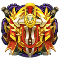Top PlayersThe strongest players of the whole game: every server's top 100 in one list by BP, with search.</a>
<a class="wiki-card" href="pets.html">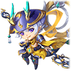PetsEvery pet with its evolutions, default skills and stats at every star.</a>
<a class="wiki-card" href="pet-skills.html">Pet skillsEvery pet skill, its effect at each level and the Skill Books to upgrade it.</a>
<a class="wiki-card" href="pet-equipment.html">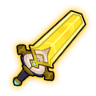Pet equipmentThe SSS and Holy Ghost pet equipment sets, their stats at every level and the upgrade costs.</a>
<a class="wiki-card" href="pet-combos.html">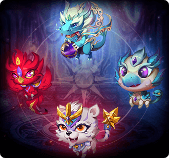Pet combosEvery pet combo, the pets it needs and the bonus it gives.</a>
<a class="wiki-card" href="military-rank.html">Military rankEvery rank, the Honor and Diamonds to promote, an Honor calculator, badges, privileges and rank perks.</a>
<a class="wiki-card" href="weapons.html">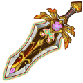WeaponsEvery weapon: S0 - S13 advance costs and stats, where to get its shards, Ultimate, Artifact slots, Horcrux and skins.</a>
<a class="wiki-card" href="team-expedition.html">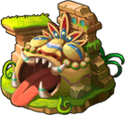Team ExpeditionEvery team dungeon and difficulty: monsters, boss HP, and every drop with its chance.</a>
<a class="wiki-card" href="sky-of-city.html">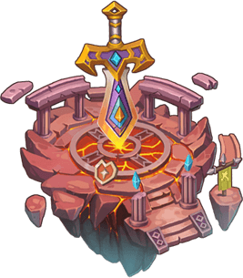Sky of CityEvery Sky of City stage: ticket, monsters, boss HP, drops with their chance and the first-clear chest.</a>
<a class="wiki-card" href="blessing.html">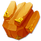BlessingEquipment blessing: Bless Points per level, the chance with 4 Blessing Gems, rank bonus, stats and set effects.</a>
<a class="wiki-card" href="jewellery.html">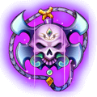JewelleryAll jewellery tiers from Valor to Hades: crafting and advance recipes, stats, enchanting, gems, sets and where to get the materials.</a>
<a class="wiki-card" href="equipment-advance.html">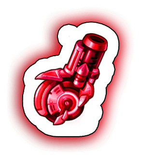Equipment AdvanceAdvance your equipment from White to Pink +9: stats, bonuses, materials, Coins, and the Solo Adventure stages that drop each material.</a>
<a class="wiki-card" href="mounts.html">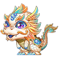MountsEvery mount and where to get it: Riding Stats and their caps, Vigor, mount skills, equipment costs and stats, and Mount Heart bonds.</a>
<a class="wiki-card" href="costumes.html">CostumesEvery costume piece: suits, clothes, hats, hair, glasses, faces and chat bubbles, with its picture and who can wear it.</a>
<a class="wiki-card" href="medals.html">MedalsEvery medal and its stats and BP, the 9 medal slots and when they open, and every crafting recipe with its Coins and full cost from scratch.</a>
<a class="wiki-card" href="wedding-ring.html">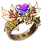Wedding ringWedding ring stats at every level, the Happiness each level needs, wedding types, gifts and items that add Happiness.</a>
<a class="wiki-card" href="orb.html">OrbEvery orb (Recovery, Rage, Homing and more): the skill each one boosts at every level, Orb Cores, stats and combining costs.</a>
<a class="wiki-card" href="parts.html">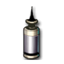PartsEvery part and its stats up to level 50, Enhance success rates and costs, Recast, set bonuses, Code Cases with their contents and consoles.</a>
<a class="wiki-card" href="wings.html">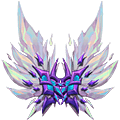WingsEvery wing and where to get it: stats, Bonus, traits and copies per step, and the Wing Heart slots from level 1 to 100 with Down, Flame and Aurora Plume costs.</a>
<a class="wiki-card" href="rune-book.html">Rune BookThe Rune Book of each rune page: how to open it, its 8 stats, the 4 Sigils and where to get them, levels 0 - 60 and Smelt Rune.</a>
<a class="wiki-card" href="mech.html">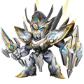MechEvery mech with its stats, transform skill, trait and recipe, combos, Modules with refine costs and sets, Raul Crystals, and the Mecha Zone floors and rewards.</a>

