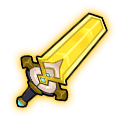
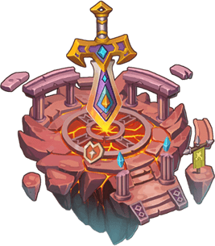

# TNT Bomb Saga player wiki

<a class="wiki-card" href="pets.html">PetsEvery pet with its evolutions, default skills and stats at every star.</a>
<a class="wiki-card" href="pet-skills.html">Pet skillsEvery pet skill, its effect at each level and the Skill Books to upgrade it.</a>
<a class="wiki-card" href="pet-equipment.html">Pet equipmentThe SSS and Holy Ghost pet equipment sets, their stats at every level and the upgrade costs.</a>
<a class="wiki-card" href="pet-combos.html">Pet combosEvery pet combo, the pets it needs and the bonus it gives.</a>
<a class="wiki-card" href="military-rank.html">Military rankEvery rank, the Honor and Diamonds to promote, an Honor calculator, badges, privileges and rank perks.</a>
<a class="wiki-card" href="weapons.html">WeaponsEvery weapon: S0 - S13 advance costs and stats, where to get its shards, Ultimate, Artifact slots, Horcrux and skins.</a>
<a class="wiki-card" href="team-expedition.html">Team ExpeditionEvery team dungeon and difficulty: monsters, boss HP, and every drop with its chance.</a>
<a class="wiki-card" href="sky-of-city.html">Sky of CityEvery Sky of City stage: ticket, monsters, boss HP, drops with their chance and the first-clear chest.</a>
<a class="wiki-card" href="blessing.html">BlessingEquipment blessing: Bless Points per level, the chance with 4 Blessing Gems, rank bonus, stats and set effects.</a>
<a class="wiki-card" href="jewellery.html">JewelleryAll jewellery tiers from Valor to Artemis: crafting and advance recipes, stats, enchanting, gems, sets and where to get the materials.</a>

