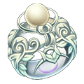
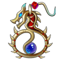
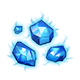
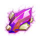
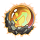
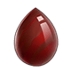
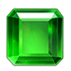
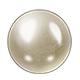
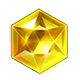
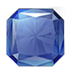

# Jewellery

## How jewellery works

- You wear 5 pieces, one per slot: Necklace, Bangle, Ring, Ornament, Backhand. Jewellery unlocks at player level 28.
- Tiers, from low to high: **Valor** → **Fearless** → **Glory** → **Legend** → **Dragon** → **Immortal** → **Hades**.
- **Craft Jewelry** makes a piece of the next tier (or the "(Superb)" version of a piece) from other pieces, Forge Hammers, blueprints or gems, and Coins. The pieces used are consumed; enchant EXP on them is partly refunded.
- **Advance** raises a piece's quality inside its set (for example Immortal → (Epic) → (Legend)). The old piece is consumed, and its enchantment and gems are lost.
- **Enchant** adds up to 6 stars. Each star needs enchant EXP; each EXP point costs 50 Coins. Using other jewellery as material gives 75% of its value.
- **Gems**: sockets open at 2, 4 and 6 stars (3 sockets). Each socket takes the gem of its shape and gives random stats; rerolling a socket's shape costs 50 Diamonds and destroys the gem in it.
- **Sets**: wearing 2 and 4 pieces of the same set gives a bonus. Upgraded versions of a set count towards it.

<a class="wiki-card" href="jewellery/valor.html">Valor12 pieces: recipes, stats and materials.</a>
<a class="wiki-card" href="jewellery/fearless.html">Fearless12 pieces: recipes, stats and materials.</a>
<a class="wiki-card" href="jewellery/glory.html">Glory12 pieces: recipes, stats and materials.</a>
<a class="wiki-card" href="jewellery/legend.html">Legend12 pieces: recipes, stats and materials.</a>
<a class="wiki-card" href="jewellery/dragon.html">Dragon49 pieces: recipes, stats and materials.</a>
<a class="wiki-card" href="jewellery/immortal.html">Immortal29 pieces: recipes, stats and materials.</a>
<a class="wiki-card" href="jewellery/hades.html">Hades15 pieces: recipes, stats and materials.</a>

## Enchant stones

| Stone | Enchant EXP | Where to get |
|---|---|---|
|  Magic Dust | 50 | Sky of City, Event Rewards |
|  OmniEssence | 200 | Sky of City, Event Rewards |
|  Elemental Gem | 600 | Sky of City, Event Rewards |
|  Earth's Core | 1,500 | Sky of City, Event Rewards |

## Gems

| Gem | Best on | Where to get |
|---|---|---|
|  Agate | Ornament | Sky of City, Event Rewards |
|  Emerald | Bangle | Sky of City, Event Rewards |
|  Pearl | Necklace | Sky of City, Event Rewards |
|  Crystal | Ring | Sky of City, Event Rewards |
|  Jewelry | Backhand | Sky of City, Event Rewards |
|  Amethyst | Any | Event Rewards |
|  Malachite | Any | Event Rewards |
|  Lazuli | Any | Event Rewards |
|  Haircrystal | Any | Event Rewards |
|  Fluorite | Any | Event Rewards |
|  Sunstone | Any | Event Rewards |

## Set bonuses

| Set | 2 pieces | 4 pieces |
|---|---|---|
| Valor Set | ATK +140, DEF +105, DMG- +80 | HP +1,000, DMG+ +240, TOU +120 |
| Fearless Set | ATK +202, DEF +168, Anti-crit +158 | HP +1,585, CRIT +188, DMG+ +316 |
| SP Valor Set | ATK +260, DEF +195, DMG- +80 | HP +1,850, CRIT +160, DMG+ +400 |
| SP Fearless Set | ATK +260, DEF +195, DMG- +80 | HP +1,850, CRIT +160, DMG+ +400 |
| Glory Set | ATK +260, DEF +195, DMG- +80 | HP +1,850, CRIT +160, DMG+ +400 |
| SP Glory Set | ATK +260, DEF +195, DMG- +80 | HP +1,850, CRIT +160, DMG+ +400 |
| SP Legend Set | ATK +260, DEF +195, DMG- +80 | HP +1,850, CRIT +160, DMG+ +400 |
| Top Legend Set | ATK +260, DEF +195, DMG- +80 | HP +1,850, CRIT +160, DMG+ +400 |
| Dragon Set | ATK +260, DEF +195, DMG- +80 | HP +1,850, CRIT +160, DMG+ +400 |
| SP Dragon Set | ATK +260, DEF +195, DMG- +80 | HP +1,850, CRIT +160, DMG+ +400 |
| Immortal Set | ATK +260, DEF +195, DMG- +80 | HP +1,850, CRIT +160, DMG+ +400 |
| Hades Set | ATK +260, DEF +195, DMG- +80 | HP +1,850, CRIT +160, DMG+ +400 |
