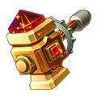
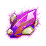
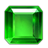
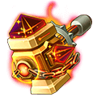
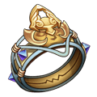
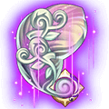
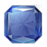

[← Jewellery](../jewellery.html)

# Dragon jewellery

**Dragon Set:** 2 pieces: ATK +260, DEF +195, DMG- +80 · 4 pieces: HP +1,850, CRIT +160, DMG+ +400

**SP Dragon Set:** 2 pieces: ATK +260, DEF +195, DMG- +80 · 4 pieces: HP +1,850, CRIT +160, DMG+ +400

## Necklace

###  Dragon Necklace

- Quality: **Purple** · Score 1,000
- Stats: STR 536 → **1,625** at 6★, END 331 → **1,004** at 6★, CON 1,087 → **3,294** at 6★ (77,052 enchant EXP to 6★)
- Where to Get: Sky of City

###  Dragon Necklace (Superb)

- Quality: **Purple** · Score 1,100
- Stats: STR 1,950 → **2,195** at 6★, END 1,204 → **1,354** at 6★, CON 3,952 → **4,451** at 6★ (80,809 enchant EXP to 6★)
- **Craft Jewelry** (player Lv 28): 1 ×  [Legend Necklace (Superb)](legend.html#jewel-legend-necklace-superb) + 1 ×  Octopus Necklace + 1 ×  Abo Scarf + 1 ×  [Dragon Necklace](dragon.html#jewel-dragon-necklace) + 2 ×  Heroic Forge Hammer + 500,000 Coins

###  Dragon Necklace (Epic)

- Quality: **Orange** · Score 1,230
- Stats: STR 2,216 → **2,494** at 6★, END 1,367 → **1,537** at 6★, CON 4,495 → **5,062** at 6★ (86,869 enchant EXP to 6★)
- **Advance** (player Lv 28) from  [Dragon Necklace (Superb)](dragon.html#jewel-dragon-necklace-superb), also using: 1 ×  [Dragon Necklace](dragon.html#jewel-dragon-necklace) + 2 ×  Elemental Gem + 10 ×  Emerald + 2 ×  Heroic Forge Hammer

###  Dragon Necklace (Epic) +1

- Quality: **Orange** · Score 1,420
- Stats: STR 2,518 → **2,834** at 6★, END 1,552 → **1,746** at 6★, CON 5,112 → **5,758** at 6★ (92,929 enchant EXP to 6★)
- **Advance** (player Lv 28) from  [Dragon Necklace (Epic)](dragon.html#jewel-dragon-necklace-epic), also using: 1 ×  [Dragon Necklace](dragon.html#jewel-dragon-necklace) + 2 ×  Elemental Gem + 20 ×  Emerald + 5 ×  Heroic Forge Hammer

###  Dragon Necklace (Epic) +2

- Quality: **Orange** · Score 1,630
- Stats: STR 2,862 → **3,222** at 6★, END 1,763 → **1,983** at 6★, CON 5,815 → **6,551** at 6★ (98,989 enchant EXP to 6★)
- **Advance** (player Lv 28) from  [Dragon Necklace (Epic) +1](dragon.html#jewel-dragon-necklace-epic-1), also using: 2 ×  [Dragon Necklace](dragon.html#jewel-dragon-necklace) + 3 ×  Elemental Gem + 30 ×  Emerald + 10 ×  Heroic Forge Hammer

###  Dragon Necklace (Epic) +3

- Quality: **Orange** · Score 1,870
- Stats: STR 3,254 → **3,664** at 6★, END 2,002 → **2,256** at 6★, CON 6,616 → **7,454** at 6★ (105,049 enchant EXP to 6★)
- **Advance** (player Lv 28) from  [Dragon Necklace (Epic) +2](dragon.html#jewel-dragon-necklace-epic-2), also using: 2 ×  [Dragon Necklace](dragon.html#jewel-dragon-necklace) + 2 ×  Earth's Core + 40 ×  Emerald + 5 ×  Epic Forge Hammer

###  Dragon Necklace (Epic) +4

- Quality: **Orange** · Score 2,130
- Stats: STR 3,700 → **4,169** at 6★, END 2,278 → **2,565** at 6★, CON 7,528 → **8,481** at 6★ (111,109 enchant EXP to 6★)
- **Advance** (player Lv 28) from  [Dragon Necklace (Epic) +3](dragon.html#jewel-dragon-necklace-epic-3), also using: 3 ×  [Dragon Necklace](dragon.html#jewel-dragon-necklace) + 4 ×  Earth's Core + 50 ×  Emerald + 10 ×  Epic Forge Hammer

## Bangle

###  Dragon Bracer

- Quality: **Purple** · Score 1,000
- Stats: STR 536 → **1,625** at 6★, DEX 550 → **1,667** at 6★, END 276 → **835** at 6★ (77,052 enchant EXP to 6★)
- Where to Get: Sky of City

###  Dragon Bracer (Superb)

- Quality: **Purple** · Score 1,100
- Stats: STR 1,950 → **2,195** at 6★, DEX 2,000 → **2,254** at 6★, END 1,002 → **1,129** at 6★ (80,809 enchant EXP to 6★)
- **Craft Jewelry** (player Lv 28): 1 ×  [Legend Bracer (Superb)](legend.html#jewel-legend-bracer-superb) + 1 ×  Coral Bracer + 1 ×  Heroic Bracer + 1 ×  [Dragon Bracer](dragon.html#jewel-dragon-bracer) + 2 ×  Heroic Forge Hammer + 500,000 Coins

###  Dragon Bracer (Epic)

- Quality: **Orange** · Score 1,230
- Stats: STR 2,216 → **2,494** at 6★, DEX 2,276 → **2,563** at 6★, END 1,140 → **1,282** at 6★ (86,869 enchant EXP to 6★)
- **Advance** (player Lv 28) from  [Dragon Bracer (Superb)](dragon.html#jewel-dragon-bracer-superb), also using: 1 ×  [Dragon Bracer](dragon.html#jewel-dragon-bracer) + 2 ×  Elemental Gem + 10 ×  Crystal + 2 ×  Heroic Forge Hammer

###  Dragon Bracer (Epic) +1

- Quality: **Orange** · Score 1,420
- Stats: STR 2,518 → **2,834** at 6★, DEX 2,588 → **2,914** at 6★, END 1,294 → **1,454** at 6★ (92,929 enchant EXP to 6★)
- **Advance** (player Lv 28) from  [Dragon Bracer (Epic)](dragon.html#jewel-dragon-bracer-epic), also using: 1 ×  [Dragon Bracer](dragon.html#jewel-dragon-bracer) + 2 ×  Elemental Gem + 20 ×  Crystal + 5 ×  Heroic Forge Hammer

###  Dragon Bracer (Epic) +2

- Quality: **Orange** · Score 1,630
- Stats: STR 2,862 → **3,222** at 6★, DEX 2,943 → **3,314** at 6★, END 1,468 → **1,652** at 6★ (98,989 enchant EXP to 6★)
- **Advance** (player Lv 28) from  [Dragon Bracer (Epic) +1](dragon.html#jewel-dragon-bracer-epic-1), also using: 2 ×  [Dragon Bracer](dragon.html#jewel-dragon-bracer) + 3 ×  Elemental Gem + 30 ×  Crystal + 10 ×  Heroic Forge Hammer

###  Dragon Bracer (Epic) +3

- Quality: **Orange** · Score 1,870
- Stats: STR 3,254 → **3,664** at 6★, DEX 3,347 → **3,769** at 6★, END 1,668 → **1,877** at 6★ (105,049 enchant EXP to 6★)
- **Advance** (player Lv 28) from  [Dragon Bracer (Epic) +2](dragon.html#jewel-dragon-bracer-epic-2), also using: 2 ×  [Dragon Bracer](dragon.html#jewel-dragon-bracer) + 2 ×  Earth's Core + 40 ×  Crystal + 5 ×  Epic Forge Hammer

###  Dragon Bracer (Epic) +4

- Quality: **Orange** · Score 2,130
- Stats: STR 3,700 → **4,169** at 6★, DEX 3,806 → **4,286** at 6★, END 1,895 → **2,133** at 6★ (111,109 enchant EXP to 6★)
- **Advance** (player Lv 28) from  [Dragon Bracer (Epic) +3](dragon.html#jewel-dragon-bracer-epic-3), also using: 4 ×  [Dragon Bracer](dragon.html#jewel-dragon-bracer) + 4 ×  Earth's Core + 50 ×  Crystal + 10 ×  Epic Forge Hammer

## Ring

###  Dragon Ring

- Quality: **Purple** · Score 1,000
- Stats: CON 1,391 → **4,216** at 6★, PEN 550 → **1,667** at 6★, END 276 → **835** at 6★ (77,052 enchant EXP to 6★)
- Where to Get: Sky of City

###  Dragon Ring (Superb)

- Quality: **Purple** · Score 1,100
- Stats: CON 5,059 → **5,698** at 6★, PEN 2,000 → **2,254** at 6★, END 1,002 → **1,129** at 6★ (80,809 enchant EXP to 6★)
- **Craft Jewelry** (player Lv 28): 1 ×  [Legend Ring (Superb)](legend.html#jewel-legend-ring-superb) + 1 ×  Jellyfish Ring + 1 ×  Wild Ring + 1 ×  [Dragon Ring](dragon.html#jewel-dragon-ring) + 2 ×  Heroic Forge Hammer + 500,000 Coins

###  Dragon Ring (Epic)

- Quality: **Orange** · Score 1,230
- Stats: CON 5,754 → **6,482** at 6★, PEN 2,276 → **2,563** at 6★, END 1,140 → **1,282** at 6★ (86,869 enchant EXP to 6★)
- **Advance** (player Lv 28) from  [Dragon Ring (Superb)](dragon.html#jewel-dragon-ring-superb), also using: 1 ×  [Dragon Ring](dragon.html#jewel-dragon-ring) + 2 ×  Elemental Gem + 10 ×  Pearl + 2 ×  Heroic Forge Hammer

###  Dragon Ring (Epic) +1

- Quality: **Orange** · Score 1,420
- Stats: CON 6,546 → **7,375** at 6★, PEN 2,588 → **2,914** at 6★, END 1,294 → **1,454** at 6★ (92,929 enchant EXP to 6★)
- **Advance** (player Lv 28) from  [Dragon Ring (Epic)](dragon.html#jewel-dragon-ring-epic), also using: 1 ×  [Dragon Ring](dragon.html#jewel-dragon-ring) + 2 ×  Elemental Gem + 20 ×  Pearl + 5 ×  Heroic Forge Hammer

###  Dragon Ring (Epic) +2

- Quality: **Orange** · Score 1,630
- Stats: CON 7,448 → **8,391** at 6★, PEN 2,943 → **3,314** at 6★, END 1,468 → **1,652** at 6★ (98,989 enchant EXP to 6★)
- **Advance** (player Lv 28) from  [Dragon Ring (Epic) +1](dragon.html#jewel-dragon-ring-epic-1), also using: 2 ×  [Dragon Ring](dragon.html#jewel-dragon-ring) + 3 ×  Elemental Gem + 30 ×  Pearl + 10 ×  Heroic Forge Hammer

###  Dragon Ring (Epic) +3

- Quality: **Orange** · Score 1,870
- Stats: CON 8,474 → **9,548** at 6★, PEN 3,347 → **3,769** at 6★, END 1,668 → **1,877** at 6★ (105,049 enchant EXP to 6★)
- **Advance** (player Lv 28) from  [Dragon Ring (Epic) +2](dragon.html#jewel-dragon-ring-epic-2), also using: 2 ×  [Dragon Ring](dragon.html#jewel-dragon-ring) + 2 ×  Earth's Core + 40 ×  Pearl + 5 ×  Epic Forge Hammer

###  Dragon Ring (Epic) +4

- Quality: **Orange** · Score 2,130
- Stats: CON 9,643 → **10,865** at 6★, PEN 3,806 → **4,286** at 6★, END 1,895 → **2,133** at 6★ (111,109 enchant EXP to 6★)
- **Advance** (player Lv 28) from  [Dragon Ring (Epic) +3](dragon.html#jewel-dragon-ring-epic-3), also using: 3 ×  [Dragon Ring](dragon.html#jewel-dragon-ring) + 4 ×  Earth's Core + 50 ×  Pearl + 10 ×  Epic Forge Hammer

###  Might: Cursed Malice

- Quality: **Orange** · Score 1,200
- Stats: CON 1,749 → **4,761** at 6★, PEN 692 → **1,884** at 6★, END 347 → **948** at 6★ (76,832 enchant EXP to 6★)
- Traits: **Prestige**: Grants the wearer 50 initial Rage in battle
- Where to Get: Sky of City

###  Might: Cursed Malice (Epic)

- Quality: **Orange** · Score 1,330
- Stats: CON 5,713 → **6,436** at 6★, PEN 2,260 → **2,543** at 6★, END 1,137 → **1,279** at 6★ (116,631 enchant EXP to 6★)
- Traits: **Prestige**: Grants the wearer 50 initial Rage in battle
- **Craft Jewelry** (player Lv 28): 1 ×  [Might: Lingering Resonance (Epic)](legend.html#jewel-might-lingering-resonance-epic) + 1 ×  Ring of Skin + 1 ×  [Might: Cursed Malice](dragon.html#jewel-might-cursed-malice) + 2 ×  Epic Forge Hammer + 800,000 Coins

###  Might: Cursed Malice (Legendary)

- Quality: **Red** · Score 1,790
- Stats: CON 6,500 → **7,324** at 6★, PEN 2,568 → **2,892** at 6★, END 1,291 → **1,451** at 6★ (137,625 enchant EXP to 6★)
- Traits: **Prestige**: Grants the wearer 50 initial Rage in battle
- **Advance** (player Lv 28) from  [Might: Cursed Malice (Epic)](dragon.html#jewel-might-cursed-malice-epic), also using: 1 ×  [Might: Cursed Malice](dragon.html#jewel-might-cursed-malice) + 2 ×  Elemental Gem + 10 ×  Amethyst + 2 ×  Heroic Forge Hammer

###  Might: Cursed Malice (Legendary) +1

- Quality: **Red** · Score 1,970
- Stats: CON 7,397 → **8,334** at 6★, PEN 2,920 → **3,287** at 6★, END 1,465 → **1,648** at 6★ (154,139 enchant EXP to 6★)
- Traits: **Prestige**: Grants the wearer 50 initial Rage in battle
- **Advance** (player Lv 28) from  [Might: Cursed Malice (Legendary)](dragon.html#jewel-might-cursed-malice-legendary), also using: 1 ×  [Might: Cursed Malice](dragon.html#jewel-might-cursed-malice) + 2 ×  Elemental Gem + 20 ×  Amethyst + 5 ×  Heroic Forge Hammer

###  Might: Cursed Malice (Legendary) +2

- Quality: **Red** · Score 2,150
- Stats: CON 8,417 → **9,482** at 6★, PEN 3,319 → **3,739** at 6★, END 1,664 → **1,872** at 6★ (172,636 enchant EXP to 6★)
- Traits: **Prestige**: Grants the wearer 50 initial Rage in battle
- **Advance** (player Lv 28) from  [Might: Cursed Malice (Legendary) +1](dragon.html#jewel-might-cursed-malice-legendary-1), also using: 2 ×  [Might: Cursed Malice](dragon.html#jewel-might-cursed-malice) + 3 ×  Elemental Gem + 30 ×  Amethyst + 10 ×  Heroic Forge Hammer

###  Might: Cursed Malice (Legendary) +3

- Quality: **Red** · Score 2,340
- Stats: CON 9,576 → **10,789** at 6★, PEN 3,776 → **4,253** at 6★, END 1,890 → **2,127** at 6★ (193,354 enchant EXP to 6★)
- Traits: **Prestige**: Grants the wearer 50 initial Rage in battle
- **Advance** (player Lv 28) from  [Might: Cursed Malice (Legendary) +2](dragon.html#jewel-might-cursed-malice-legendary-2), also using: 2 ×  [Might: Cursed Malice](dragon.html#jewel-might-cursed-malice) + 2 ×  Earth's Core + 40 ×  Amethyst + 5 ×  Epic Forge Hammer

###  Might: Cursed Malice (Legendary) +4

- Quality: **Red** · Score 2,560
- Stats: CON 10,896 → **12,277** at 6★, PEN 4,295 → **4,836** at 6★, END 2,148 → **2,417** at 6★ (216,557 enchant EXP to 6★)
- Traits: **Prestige**: Grants the wearer 50 initial Rage in battle
- **Advance** (player Lv 28) from  [Might: Cursed Malice (Legendary) +3](dragon.html#jewel-might-cursed-malice-legendary-3), also using: 4 ×  [Might: Cursed Malice](dragon.html#jewel-might-cursed-malice) + 4 ×  Earth's Core + 50 ×  Amethyst + 10 ×  Epic Forge Hammer

## Ornament

###  Dragon Earrings

- Quality: **Purple** · Score 1,000
- Stats: STR 536 → **1,625** at 6★, TOU 825 → **2,499** at 6★, END 276 → **835** at 6★ (77,052 enchant EXP to 6★)
- Where to Get: Sky of City

###  Dragon Earrings (Superb)

- Quality: **Purple** · Score 1,100
- Stats: STR 1,950 → **2,195** at 6★, TOU 2,998 → **3,373** at 6★, END 1,002 → **1,129** at 6★ (80,809 enchant EXP to 6★)
- **Craft Jewelry** (player Lv 28): 1 ×  [Legend Plume (Superb)](legend.html#jewel-legend-plume-superb) + 1 ×  Octopus Crown + 1 ×  Bamboo Hat + 1 ×  [Dragon Earrings](dragon.html#jewel-dragon-earrings) + 2 ×  Heroic Forge Hammer + 500,000 Coins

###  Dragon Earrings (Epic)

- Quality: **Orange** · Score 1,230
- Stats: STR 2,216 → **2,494** at 6★, TOU 3,406 → **3,836** at 6★, END 1,140 → **1,282** at 6★ (86,869 enchant EXP to 6★)
- **Advance** (player Lv 28) from  [Dragon Earrings (Superb)](dragon.html#jewel-dragon-earrings-superb), also using: 1 ×  [Dragon Earrings](dragon.html#jewel-dragon-earrings) + 2 ×  Elemental Gem + 10 ×  Agate + 2 ×  Heroic Forge Hammer

###  Dragon Earrings (Epic) +1

- Quality: **Orange** · Score 1,420
- Stats: STR 2,518 → **2,834** at 6★, TOU 3,874 → **4,363** at 6★, END 1,294 → **1,454** at 6★ (92,929 enchant EXP to 6★)
- **Advance** (player Lv 28) from  [Dragon Earrings (Epic)](dragon.html#jewel-dragon-earrings-epic), also using: 1 ×  [Dragon Earrings](dragon.html#jewel-dragon-earrings) + 2 ×  Elemental Gem + 20 ×  Agate + 5 ×  Heroic Forge Hammer

###  Dragon Earrings (Epic) +2

- Quality: **Orange** · Score 1,630
- Stats: STR 2,862 → **3,222** at 6★, TOU 4,406 → **4,963** at 6★, END 1,468 → **1,652** at 6★ (98,989 enchant EXP to 6★)
- **Advance** (player Lv 28) from  [Dragon Earrings (Epic) +1](dragon.html#jewel-dragon-earrings-epic-1), also using: 2 ×  [Dragon Earrings](dragon.html#jewel-dragon-earrings) + 3 ×  Elemental Gem + 30 ×  Agate + 10 ×  Heroic Forge Hammer

###  Dragon Earrings (Epic) +3

- Quality: **Orange** · Score 1,870
- Stats: STR 3,254 → **3,664** at 6★, TOU 5,012 → **5,647** at 6★, END 1,668 → **1,877** at 6★ (105,049 enchant EXP to 6★)
- **Advance** (player Lv 28) from  [Dragon Earrings (Epic) +2](dragon.html#jewel-dragon-earrings-epic-2), also using: 2 ×  [Dragon Earrings](dragon.html#jewel-dragon-earrings) + 2 ×  Earth's Core + 40 ×  Agate + 5 ×  Epic Forge Hammer

###  Dragon Earrings (Epic) +4

- Quality: **Orange** · Score 2,130
- Stats: STR 3,700 → **4,169** at 6★, TOU 5,703 → **6,426** at 6★, END 1,895 → **2,133** at 6★ (111,109 enchant EXP to 6★)
- **Advance** (player Lv 28) from  [Dragon Earrings (Epic) +3](dragon.html#jewel-dragon-earrings-epic-3), also using: 3 ×  [Dragon Earrings](dragon.html#jewel-dragon-earrings) + 4 ×  Earth's Core + 50 ×  Agate + 10 ×  Epic Forge Hammer

## Backhand

###  Dragon Crystal

- Quality: **Purple** · Score 1,000
- Stats: STR 536 → **1,625** at 6★, LUCK 825 → **2,499** at 6★, CON 1,087 → **3,294** at 6★ (77,052 enchant EXP to 6★)
- Where to Get: Sky of City

###  Wraith: Silent Manuscript

- Quality: **Orange** · Score 1,040
- Stats: STR 585 → **1,772** at 6★, LUCK 900 → **2,727** at 6★, CON 1,186 → **3,594** at 6★ (59,101 enchant EXP to 6★)
- Traits: **Rattle**: When the wearer dies, restores 10% HP for allies and removes debuffs.
- Where to Get: Team Expedition

###  Dragon Crystal (Superb)

- Quality: **Purple** · Score 1,100
- Stats: STR 1,950 → **2,195** at 6★, LUCK 2,998 → **3,373** at 6★, CON 3,952 → **4,451** at 6★ (80,809 enchant EXP to 6★)
- **Craft Jewelry** (player Lv 28): 1 ×  [Legend Moss (Superb)](legend.html#jewel-legend-moss-superb) + 1 ×  Little Trident + 1 ×  Jasper Blades + 1 ×  [Dragon Crystal](dragon.html#jewel-dragon-crystal) + 2 ×  Heroic Forge Hammer + 500,000 Coins

###  Dragon Crystal (Epic)

- Quality: **Orange** · Score 1,230
- Stats: STR 2,216 → **2,494** at 6★, LUCK 3,406 → **3,836** at 6★, CON 4,495 → **5,062** at 6★ (86,869 enchant EXP to 6★)
- **Advance** (player Lv 28) from  [Dragon Crystal (Superb)](dragon.html#jewel-dragon-crystal-superb), also using: 1 ×  [Dragon Crystal](dragon.html#jewel-dragon-crystal) + 2 ×  Elemental Gem + 10 ×  Jewelry + 2 ×  Heroic Forge Hammer

###  Dragon Crystal (Epic) +1

- Quality: **Orange** · Score 1,420
- Stats: STR 2,518 → **2,834** at 6★, LUCK 3,874 → **4,363** at 6★, CON 5,112 → **5,758** at 6★ (92,929 enchant EXP to 6★)
- **Advance** (player Lv 28) from  [Dragon Crystal (Epic)](dragon.html#jewel-dragon-crystal-epic), also using: 1 ×  [Dragon Crystal](dragon.html#jewel-dragon-crystal) + 2 ×  Elemental Gem + 20 ×  Jewelry + 5 ×  Heroic Forge Hammer

###  Dragon Crystal (Epic) +2

- Quality: **Orange** · Score 1,630
- Stats: STR 2,862 → **3,222** at 6★, LUCK 4,406 → **4,963** at 6★, CON 5,815 → **6,551** at 6★ (98,989 enchant EXP to 6★)
- **Advance** (player Lv 28) from  [Dragon Crystal (Epic) +1](dragon.html#jewel-dragon-crystal-epic-1), also using: 2 ×  [Dragon Crystal](dragon.html#jewel-dragon-crystal) + 3 ×  Elemental Gem + 30 ×  Jewelry + 10 ×  Heroic Forge Hammer

###  Dragon Crystal (Epic) +3

- Quality: **Orange** · Score 1,870
- Stats: STR 3,254 → **3,664** at 6★, LUCK 5,012 → **5,647** at 6★, CON 6,616 → **7,454** at 6★ (105,049 enchant EXP to 6★)
- **Advance** (player Lv 28) from  [Dragon Crystal (Epic) +2](dragon.html#jewel-dragon-crystal-epic-2), also using: 2 ×  [Dragon Crystal](dragon.html#jewel-dragon-crystal) + 2 ×  Earth's Core + 40 ×  Jewelry + 5 ×  Epic Forge Hammer

###  Dragon Crystal (Epic) +4

- Quality: **Orange** · Score 2,130
- Stats: STR 3,700 → **4,169** at 6★, LUCK 5,703 → **6,426** at 6★, CON 7,528 → **8,481** at 6★ (111,109 enchant EXP to 6★)
- **Advance** (player Lv 28) from  [Dragon Crystal (Epic) +3](dragon.html#jewel-dragon-crystal-epic-3), also using: 3 ×  [Dragon Crystal](dragon.html#jewel-dragon-crystal) + 4 ×  Earth's Core + 50 ×  Jewelry + 10 ×  Epic Forge Hammer

###  Wraith: Silent Manuscript (Legendary)

- Quality: **Red** · Score 1,360
- Stats: STR 2,416 → **2,719** at 6★, LUCK 3,722 → **4,191** at 6★, CON 4,905 → **5,525** at 6★ (105,865 enchant EXP to 6★)
- Traits: **Rattle**: When the wearer dies, restores 10% HP for allies and removes debuffs.
- **Advance** (player Lv 28) from  [Wraith: Silent Manuscript (Epic)](dragon.html#jewel-wraith-silent-manuscript-epic), also using: 1 ×  [Wraith: Silent Manuscript](dragon.html#jewel-wraith-silent-manuscript) + 2 ×  Elemental Gem + 10 ×  Amethyst + 2 ×  Heroic Forge Hammer

###  Wraith: Silent Manuscript (Legendary) +1

- Quality: **Red** · Score 1,570
- Stats: STR 2,746 → **3,092** at 6★, LUCK 4,232 → **4,767** at 6★, CON 5,580 → **6,287** at 6★ (118,569 enchant EXP to 6★)
- Traits: **Rattle**: When the wearer dies, restores 10% HP for allies and removes debuffs.
- **Advance** (player Lv 28) from  [Wraith: Silent Manuscript (Legendary)](dragon.html#jewel-wraith-silent-manuscript-legendary), also using: 1 ×  [Wraith: Silent Manuscript](dragon.html#jewel-wraith-silent-manuscript) + 2 ×  Elemental Gem + 20 ×  Amethyst + 5 ×  Heroic Forge Hammer

###  Wraith: Silent Manuscript (Legendary) +2

- Quality: **Red** · Score 1,800
- Stats: STR 3,122 → **3,515** at 6★, LUCK 4,814 → **5,423** at 6★, CON 6,349 → **7,153** at 6★ (132,797 enchant EXP to 6★)
- Traits: **Rattle**: When the wearer dies, restores 10% HP for allies and removes debuffs.
- **Advance** (player Lv 28) from  [Wraith: Silent Manuscript (Legendary) +1](dragon.html#jewel-wraith-silent-manuscript-legendary-1), also using: 2 ×  [Wraith: Silent Manuscript](dragon.html#jewel-wraith-silent-manuscript) + 3 ×  Elemental Gem + 30 ×  Amethyst + 10 ×  Heroic Forge Hammer

###  Wraith: Silent Manuscript (Legendary) +3

- Quality: **Red** · Score 2,060
- Stats: STR 3,550 → **3,998** at 6★, LUCK 5,477 → **6,170** at 6★, CON 7,224 → **8,138** at 6★ (148,734 enchant EXP to 6★)
- Traits: **Rattle**: When the wearer dies, restores 10% HP for allies and removes debuffs.
- **Advance** (player Lv 28) from  [Wraith: Silent Manuscript (Legendary) +2](dragon.html#jewel-wraith-silent-manuscript-legendary-2), also using: 2 ×  [Wraith: Silent Manuscript](dragon.html#jewel-wraith-silent-manuscript) + 2 ×  Earth's Core + 40 ×  Amethyst + 5 ×  Epic Forge Hammer

###  Wraith: Silent Manuscript (Legendary) +4

- Quality: **Red** · Score 2,360
- Stats: STR 4,037 → **4,546** at 6★, LUCK 6,231 → **7,020** at 6★, CON 8,219 → **9,260** at 6★ (166,582 enchant EXP to 6★)
- Traits: **Rattle**: When the wearer dies, restores 10% HP for allies and removes debuffs.
- **Advance** (player Lv 28) from  [Wraith: Silent Manuscript (Legendary) +3](dragon.html#jewel-wraith-silent-manuscript-legendary-3), also using: 4 ×  [Wraith: Silent Manuscript](dragon.html#jewel-wraith-silent-manuscript) + 4 ×  Earth's Core + 50 ×  Amethyst + 10 ×  Epic Forge Hammer

###  Wraith: Silent Manuscript (Epic)

- Quality: **Orange** · Score 1,180
- Stats: STR 2,126 → **2,393** at 6★, LUCK 3,272 → **3,686** at 6★, CON 4,312 → **4,857** at 6★ (89,716 enchant EXP to 6★)
- Traits: **Rattle**: When the wearer dies, restores 10% HP for allies and removes debuffs.
- **Craft Jewelry** (player Lv 28): 1 ×  [Wraith: Shadowgourd (Epic)](glory.html#jewel-wraith-shadowgourd-epic) + 1 ×  Wild Ring + 1 ×  [Wraith: Silent Manuscript](dragon.html#jewel-wraith-silent-manuscript) + 2 ×  Epic Forge Hammer + 500,000 Coins

## Materials

Everything the recipes above use, and where to get it.

| Material | Where to get |
|---|---|
|  [Legend Necklace (Superb)](legend.html#jewel-legend-necklace-superb) | Craft Jewelry |
|  Octopus Necklace | Team Expedition, Sky of City |
|  Abo Scarf | Team Expedition, Sky of City |
|  Heroic Forge Hammer | Sky of City, Event |
|  Elemental Gem | Sky of City, Event Rewards |
|  Emerald | Sky of City, Event Rewards |
|  Earth's Core | Sky of City, Event Rewards |
|  Epic Forge Hammer | Sky of City, Event |
|  [Legend Bracer (Superb)](legend.html#jewel-legend-bracer-superb) | Craft Jewelry |
|  Coral Bracer | Team Expedition, Sky of City |
|  Heroic Bracer | Team Expedition, Sky of City |
|  Crystal | Sky of City, Event Rewards |
|  [Legend Ring (Superb)](legend.html#jewel-legend-ring-superb) | Craft Jewelry |
|  Jellyfish Ring | Team Expedition, Sky of City |
|  Wild Ring | Team Expedition, Sky of City |
|  Pearl | Sky of City, Event Rewards |
|  [Might: Lingering Resonance (Epic)](legend.html#jewel-might-lingering-resonance-epic) | Craft Jewelry |
|  Ring of Skin | Sky of City |
|  Amethyst | Event Rewards |
|  [Legend Plume (Superb)](legend.html#jewel-legend-plume-superb) | Craft Jewelry |
|  Octopus Crown | Team Expedition, Sky of City |
|  Bamboo Hat | Team Expedition, Sky of City |
|  Agate | Sky of City, Event Rewards |
|  [Legend Moss (Superb)](legend.html#jewel-legend-moss-superb) | Craft Jewelry |
|  Little Trident | Team Expedition, Sky of City |
|  Jasper Blades | Team Expedition, Sky of City |
|  Jewelry | Sky of City, Event Rewards |
|  [Wraith: Shadowgourd (Epic)](glory.html#jewel-wraith-shadowgourd-epic) | Craft Jewelry |
