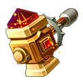
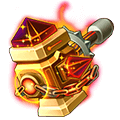
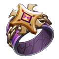
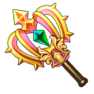
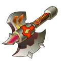

[← Jewellery](../jewellery.html)

# Hades jewellery

**Hades Set:** 2 pieces: ATK +260, DEF +195, DMG- +80 · 4 pieces: HP +1,850, CRIT +160, DMG+ +400

## Necklace

###  Hades Necklace

- Quality: **Orange** · Score 4,000
- Stats: STR 8,175 → **9,211** at 6★, END 5,023 → **5,658** at 6★, CON 16,644 → **18,755** at 6★ (248,144 enchant EXP to 6★)
- **Craft Jewelry** (player Lv 60): 1 ×  Hades Necklace Blueprint + 1 ×  [Immortal Pendant (Legend)](immortal.html#jewel-immortal-pendant-legend) + 3 ×  Covert Codex + 1 ×  Monitor + 2 ×  Heroic Forge Hammer + 1,000,000 Coins

###  Hades Necklace (Epic)

- Quality: **Orange** · Score 4,600
- Stats: STR 9,671 → **10,896** at 6★, END 5,940 → **6,692** at 6★, CON 19,692 → **22,189** at 6★ (270,144 enchant EXP to 6★)
- **Advance** (player Lv 60) from  [Hades Necklace](hades.html#jewel-hades-necklace), also using: 1 ×  [Hades Necklace](hades.html#jewel-hades-necklace) + 3 ×  Covert Codex + 2 ×  Monitor + 5 ×  Epic Forge Hammer

###  Hades Necklace (Legend)

- Quality: **Red** · Score 5,600
- Stats: STR 11,440 → **12,891** at 6★, END 7,026 → **7,915** at 6★, CON 23,298 → **26,252** at 6★ (300,778 enchant EXP to 6★)
- Traits: **Echo of the Dead**: Increase Dark stats DMG (Hades Set pieces x 2%)
- **Advance** (player Lv 60) from  [Hades Necklace (Epic)](hades.html#jewel-hades-necklace-epic), also using: 1 ×  [Hades Necklace (Epic)](hades.html#jewel-hades-necklace-epic) + 5 ×  Covert Codex + 3 ×  Monitor + 10 ×  Epic Forge Hammer

## Bangle

###  Hades Bracer

- Quality: **Orange** · Score 4,000
- Stats: STR 8,175 → **9,211** at 6★, DEX 8,402 → **9,467** at 6★, END 4,175 → **4,703** at 6★ (248,144 enchant EXP to 6★)
- **Craft Jewelry** (player Lv 60): 1 ×  Hades Bracer Blueprint + 1 ×  [Immortality (Legend)](immortal.html#jewel-immortality-legend) + 3 ×  Gold Collar + 1 ×  Tusk Collar + 2 ×  Heroic Forge Hammer + 1,000,000 Coins

###  Hades Bracer (Epic)

- Quality: **Orange** · Score 4,600
- Stats: STR 9,671 → **10,896** at 6★, DEX 9,940 → **11,200** at 6★, END 4,938 → **5,563** at 6★ (270,144 enchant EXP to 6★)
- **Advance** (player Lv 60) from  [Hades Bracer](hades.html#jewel-hades-bracer), also using: 1 ×  [Hades Bracer](hades.html#jewel-hades-bracer) + 3 ×  Gold Collar + 2 ×  Tusk Collar + 5 ×  Epic Forge Hammer

###  Hades Bracer (Legend)

- Quality: **Red** · Score 5,600
- Stats: STR 11,440 → **12,891** at 6★, DEX 11,760 → **13,250** at 6★, END 5,841 → **6,579** at 6★ (300,778 enchant EXP to 6★)
- Traits: **Echo of the Dead**: Increase Dark stats DMG (Hades Set pieces x 2%)
- **Advance** (player Lv 60) from  [Hades Bracer (Epic)](hades.html#jewel-hades-bracer-epic), also using: 1 ×  [Hades Bracer (Epic)](hades.html#jewel-hades-bracer-epic) + 5 ×  Gold Collar + 3 ×  Tusk Collar + 10 ×  Epic Forge Hammer

## Ring

###  Hades Ring

- Quality: **Orange** · Score 4,000
- Stats: CON 21,327 → **24,033** at 6★, PEN 8,402 → **9,467** at 6★, END 4,175 → **4,703** at 6★ (248,144 enchant EXP to 6★)
- **Craft Jewelry** (player Lv 60): 1 ×  Hades Ring Blueprint + 1 ×  [Immortal Ring (Legend)](immortal.html#jewel-immortal-ring-legend) + 3 ×  Ring of Skin + 1 ×  Primal Force + 2 ×  Heroic Forge Hammer + 1,000,000 Coins

###  Hades Ring (Epic)

- Quality: **Orange** · Score 4,600
- Stats: CON 25,234 → **28,437** at 6★, PEN 9,940 → **11,200** at 6★, END 4,938 → **5,563** at 6★ (270,144 enchant EXP to 6★)
- **Advance** (player Lv 60) from  [Hades Ring](hades.html#jewel-hades-ring), also using: 1 ×  [Hades Ring](hades.html#jewel-hades-ring) + 3 ×  Ring of Skin + 2 ×  Primal Force + 5 ×  Epic Forge Hammer

###  Hades Ring (Legend)

- Quality: **Red** · Score 5,600
- Stats: CON 29,858 → **33,647** at 6★, PEN 11,760 → **13,250** at 6★, END 5,841 → **6,579** at 6★ (300,778 enchant EXP to 6★)
- Traits: **Echo of the Dead**: Increase Dark stats DMG (Hades Set pieces x 2%)
- **Advance** (player Lv 60) from  [Hades Ring (Epic)](hades.html#jewel-hades-ring-epic), also using: 1 ×  [Hades Ring (Epic)](hades.html#jewel-hades-ring-epic) + 5 ×  Ring of Skin + 3 ×  Primal Force + 10 ×  Epic Forge Hammer

## Ornament

###  Hades Earrings

- Quality: **Orange** · Score 4,000
- Stats: STR 8,175 → **9,211** at 6★, TOU 12,608 → **14,205** at 6★, END 4,175 → **4,703** at 6★ (248,144 enchant EXP to 6★)
- **Craft Jewelry** (player Lv 60): 1 ×  Hades Earrings Blueprint + 1 ×  [Immortal Wings (Legend)](immortal.html#jewel-immortal-wings-legend) + 3 ×  Gold Bracer + 1 ×  Fang Bracer + 2 ×  Heroic Forge Hammer + 1,000,000 Coins

###  Hades Earrings (Epic)

- Quality: **Orange** · Score 4,600
- Stats: STR 9,671 → **10,896** at 6★, TOU 14,915 → **16,806** at 6★, END 4,938 → **5,563** at 6★ (270,144 enchant EXP to 6★)
- **Advance** (player Lv 60) from  [Hades Earrings](hades.html#jewel-hades-earrings), also using: 1 ×  [Hades Earrings](hades.html#jewel-hades-earrings) + 3 ×  Gold Bracer + 2 ×  Fang Bracer + 5 ×  Epic Forge Hammer

###  Hades Earrings (Legend)

- Quality: **Red** · Score 5,600
- Stats: STR 11,440 → **12,891** at 6★, TOU 17,646 → **19,884** at 6★, END 5,841 → **6,579** at 6★ (300,778 enchant EXP to 6★)
- Traits: **Echo of the Dead**: Increase Dark stats DMG (Hades Set pieces x 2%)
- **Advance** (player Lv 60) from  [Hades Earrings (Epic)](hades.html#jewel-hades-earrings-epic), also using: 1 ×  [Hades Earrings (Epic)](hades.html#jewel-hades-earrings-epic) + 5 ×  Gold Bracer + 3 ×  Fang Bracer + 10 ×  Epic Forge Hammer

## Backhand

###  Hades Power

- Quality: **Orange** · Score 4,000
- Stats: STR 8,175 → **9,211** at 6★, LUCK 12,608 → **14,205** at 6★, CON 16,644 → **18,755** at 6★ (248,144 enchant EXP to 6★)
- **Craft Jewelry** (player Lv 60): 1 ×  Hades Power Blueprint + 1 ×  [Immortal Tale (Legend)](immortal.html#jewel-immortal-tale-legend) + 3 ×  Pharaoh Staff + 1 ×  Warcry + 2 ×  Heroic Forge Hammer + 1,000,000 Coins

###  Hades Power (Epic)

- Quality: **Orange** · Score 4,600
- Stats: STR 9,671 → **10,896** at 6★, LUCK 14,915 → **16,806** at 6★, CON 19,692 → **22,189** at 6★ (270,144 enchant EXP to 6★)
- **Advance** (player Lv 60) from  [Hades Power](hades.html#jewel-hades-power), also using: 1 ×  [Hades Power](hades.html#jewel-hades-power) + 3 ×  Pharaoh Staff + 2 ×  Warcry + 5 ×  Epic Forge Hammer

###  Hades Power (Legend)

- Quality: **Red** · Score 5,600
- Stats: STR 11,440 → **12,891** at 6★, LUCK 17,646 → **19,884** at 6★, CON 23,298 → **26,252** at 6★ (300,778 enchant EXP to 6★)
- Traits: **Echo of the Dead**: Increase Dark stats DMG (Hades Set pieces x 2%)
- **Advance** (player Lv 60) from  [Hades Power (Epic)](hades.html#jewel-hades-power-epic), also using: 1 ×  [Hades Power (Epic)](hades.html#jewel-hades-power-epic) + 5 ×  Pharaoh Staff + 3 ×  Warcry + 10 ×  Epic Forge Hammer

## Materials

Everything the recipes above use, and where to get it.

| Material | Where to get |
|---|---|
|  Hades Necklace Blueprint | Sky of City |
|  [Immortal Pendant (Legend)](immortal.html#jewel-immortal-pendant-legend) | Advance Jewelry |
|  Covert Codex | Sky of City |
|  Monitor | Team Expedition |
|  Heroic Forge Hammer | Sky of City, Event |
|  Epic Forge Hammer | Sky of City, Event |
|  Hades Bracer Blueprint | Sky of City |
|  [Immortality (Legend)](immortal.html#jewel-immortality-legend) | Advance Jewelry |
|  Gold Collar | Sky of City |
|  Tusk Collar | Team Expedition |
|  Hades Ring Blueprint | Sky of City |
|  [Immortal Ring (Legend)](immortal.html#jewel-immortal-ring-legend) | Advance Jewelry |
|  Ring of Skin | Sky of City |
|  Primal Force | Team Expedition |
|  Hades Earrings Blueprint | Sky of City |
|  [Immortal Wings (Legend)](immortal.html#jewel-immortal-wings-legend) | Advance Jewelry |
|  Gold Bracer | Sky of City |
|  Fang Bracer | Team Expedition |
|  Hades Power Blueprint | Sky of City |
|  [Immortal Tale (Legend)](immortal.html#jewel-immortal-tale-legend) | Advance Jewelry |
|  Pharaoh Staff | Sky of City |
|  Warcry | Team Expedition |
