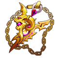
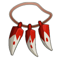
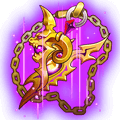
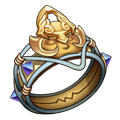
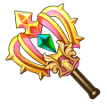
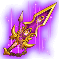
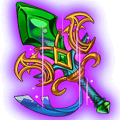
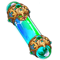

[← Jewellery](../jewellery.html)

# Immortal jewellery

**Immortal Set:** 2 pieces: ATK +260, DEF +195, DMG- +80 · 4 pieces: HP +1,850, CRIT +160, DMG+ +400

## Necklace

###  Immortal Pendant

- Quality: **Orange** · Score 2,600
- Stats: STR 4,585 → **5,165** at 6★, END 2,821 → **3,176** at 6★, CON 9,329 → **10,511** at 6★ (126,605 enchant EXP to 6★)
- **Craft Jewelry** (player Lv 28): 1 ×  Immortal Pendant Blueprint + 1 ×  [Dragon Necklace (Epic) +4](dragon.html#j-403098) + 1 ×  Gold Collar + 1 ×  Tusk Collar + 2 ×  Heroic Forge Hammer + 1,000,000 Coins
- Where to Get: Sky of City

###  Immortal Pendant (Epic)

- Quality: **Orange** · Score 3,000
- Stats: STR 5,578 → **6,284** at 6★, END 3,430 → **3,862** at 6★, CON 11,351 → **12,790** at 6★ (177,246 enchant EXP to 6★)
- **Advance** (player Lv 28) from  [Immortal Pendant](immortal.html#j-403136), also using: 1 ×  [Immortal Pendant](immortal.html#j-403136) + 2 ×  Gold Collar + 1 ×  Tusk Collar + 5 ×  Epic Forge Hammer

###  Immortal Pendant (Legend)

- Quality: **Red** · Score 3,500
- Stats: STR 6,598 → **7,432** at 6★, END 4,055 → **4,567** at 6★, CON 13,429 → **15,131** at 6★ (248,144 enchant EXP to 6★)
- **Advance** (player Lv 28) from  [Immortal Pendant (Epic)](immortal.html#j-403137), also using: 2 ×  [Immortal Pendant](immortal.html#j-403136) + 2 ×  Gold Collar + 2 ×  Tusk Collar + 10 ×  Epic Forge Hammer

## Bangle

###  Immortality

- Quality: **Orange** · Score 2,600
- Stats: STR 4,585 → **5,165** at 6★, DEX 4,714 → **5,310** at 6★, END 2,346 → **2,640** at 6★ (126,605 enchant EXP to 6★)
- **Craft Jewelry** (player Lv 28): 1 ×  Immortality Blueprint + 1 ×  [Dragon Bracer (Epic) +4](dragon.html#j-403108) + 1 ×  Gold Bracer + 1 ×  Fang Bracer + 2 ×  Heroic Forge Hammer + 1,000,000 Coins
- Where to Get: Sky of City

###  Immortality (Epic)

- Quality: **Orange** · Score 3,000
- Stats: STR 5,578 → **6,284** at 6★, DEX 5,734 → **6,459** at 6★, END 2,851 → **3,211** at 6★ (177,246 enchant EXP to 6★)
- **Advance** (player Lv 28) from  [Immortality](immortal.html#j-403142), also using: 1 ×  [Immortality](immortal.html#j-403142) + 2 ×  Gold Bracer + 1 ×  Fang Bracer + 5 ×  Epic Forge Hammer

###  Immortality (Legend)

- Quality: **Red** · Score 3,500
- Stats: STR 6,598 → **7,432** at 6★, DEX 6,781 → **7,639** at 6★, END 3,371 → **3,796** at 6★ (248,144 enchant EXP to 6★)
- **Advance** (player Lv 28) from  [Immortality (Epic)](immortal.html#j-403143), also using: 2 ×  [Immortality](immortal.html#j-403142) + 2 ×  Gold Bracer + 2 ×  Fang Bracer + 10 ×  Epic Forge Hammer

## Ring

###  Immortal Ring

- Quality: **Orange** · Score 2,600
- Stats: CON 11,951 → **13,466** at 6★, PEN 4,714 → **5,310** at 6★, END 2,346 → **2,640** at 6★ (126,605 enchant EXP to 6★)
- **Craft Jewelry** (player Lv 28): 1 ×  Immortal Ring Blueprint + 1 ×  [Dragon Ring (Epic) +4](dragon.html#j-403103) + 1 ×  Ring of Skin + 1 ×  Primal Force + 2 ×  Heroic Forge Hammer + 1,000,000 Coins
- Where to Get: Sky of City

###  Immortal Ring (Epic)

- Quality: **Orange** · Score 3,000
- Stats: CON 14,543 → **16,388** at 6★, PEN 5,734 → **6,459** at 6★, END 2,851 → **3,211** at 6★ (177,246 enchant EXP to 6★)
- **Advance** (player Lv 28) from  [Immortal Ring](immortal.html#j-403139), also using: 1 ×  [Immortal Ring](immortal.html#j-403139) + 2 ×  Ring of Skin + 1 ×  Primal Force + 5 ×  Epic Forge Hammer

###  Immortal Ring (Legend)

- Quality: **Red** · Score 3,500
- Stats: CON 17,207 → **19,389** at 6★, PEN 6,781 → **7,639** at 6★, END 3,371 → **3,796** at 6★ (248,144 enchant EXP to 6★)
- **Advance** (player Lv 28) from  [Immortal Ring (Epic)](immortal.html#j-403140), also using: 2 ×  [Immortal Ring](immortal.html#j-403139) + 2 ×  Ring of Skin + 2 ×  Primal Force + 10 ×  Epic Forge Hammer

###  Might: Ares's Wrath

- Quality: **Orange** · Score 3,320
- Stats: CON 12,890 → **14,524** at 6★, PEN 5,077 → **5,720** at 6★, END 2,537 → **2,856** at 6★ (230,495 enchant EXP to 6★)
- Traits: **Prestige**: Grants the wearer 50 initial Rage in battle
- Where to Get: Team Expedition

###  Might: Ares's Wrath (Epic)

- Quality: **Orange** · Score 3,440
- Stats: CON 15,976 → **18,002** at 6★, PEN 6,292 → **7,087** at 6★, END 3,141 → **3,537** at 6★ (345,742 enchant EXP to 6★)
- Traits: **Prestige**: Grants the wearer 50 initial Rage in battle
- **Craft Jewelry** (player Lv 28): 1 ×  [Might: Ares's Wrath](immortal.html#j-403184) + 1 ×  [Might: Cursed Malice (Legendary) +4](dragon.html#j-403132) + 2 ×  Epic Forge Hammer + 1,000,000 Coins

###  Might: Ares's Wrath (Legendary)

- Quality: **Red** · Score 3,840
- Stats: CON 18,182 → **20,488** at 6★, PEN 7,157 → **8,063** at 6★, END 3,572 → **4,023** at 6★ (449,465 enchant EXP to 6★)
- Traits: **Prestige**: Grants the wearer 50 initial Rage in battle
- **Advance** (player Lv 28) from  [Might: Ares's Wrath (Epic)](immortal.html#j-403185), also using: 1 ×  [Might: Ares's Wrath](immortal.html#j-403184) + 2 ×  Elemental Gem + 10 ×  Amethyst + 2 ×  Heroic Forge Hammer

###  Might: Ares's Wrath (Legendary) +1

- Quality: **Red** · Score 4,440
- Stats: CON 20,692 → **23,316** at 6★, PEN 8,143 → **9,174** at 6★, END 4,063 → **4,576** at 6★ (584,306 enchant EXP to 6★)
- Traits: **Prestige**: Grants the wearer 50 initial Rage in battle
- **Advance** (player Lv 28) from  [Might: Ares's Wrath (Legendary)](immortal.html#j-403186), also using: 1 ×  [Might: Ares's Wrath](immortal.html#j-403184) + 2 ×  Elemental Gem + 20 ×  Amethyst + 5 ×  Heroic Forge Hammer

###  Might: Ares's Wrath (Legendary) +2

- Quality: **Red** · Score 4,890
- Stats: CON 23,549 → **26,537** at 6★, PEN 9,265 → **10,439** at 6★, END 4,621 → **5,205** at 6★ (759,598 enchant EXP to 6★)
- Traits: **Prestige**: Grants the wearer 50 initial Rage in battle
- **Advance** (player Lv 28) from  [Might: Ares's Wrath (Legendary) +1](immortal.html#j-403187), also using: 2 ×  [Might: Ares's Wrath](immortal.html#j-403184) + 3 ×  Elemental Gem + 30 ×  Amethyst + 10 ×  Heroic Forge Hammer

###  Might: Ares's Wrath (Legendary) +3

- Quality: **Red** · Score 5,380
- Stats: CON 26,802 → **30,203** at 6★, PEN 10,543 → **11,880** at 6★, END 5,257 → **5,921** at 6★ (987,479 enchant EXP to 6★)
- Traits: **Prestige**: Grants the wearer 50 initial Rage in battle
- **Advance** (player Lv 28) from  [Might: Ares's Wrath (Legendary) +2](immortal.html#j-403188), also using: 2 ×  [Might: Ares's Wrath](immortal.html#j-403184) + 2 ×  Earth's Core + 40 ×  Amethyst + 5 ×  Epic Forge Hammer

###  Might: Ares's Wrath (Legendary) +4

- Quality: **Red** · Score 6,030
- Stats: CON 30,505 → **34,377** at 6★, PEN 11,998 → **13,516** at 6★, END 5,980 → **6,736** at 6★ (1,115,849 enchant EXP to 6★)
- Traits: **Prestige**: Grants the wearer 50 initial Rage in battle
- **Advance** (player Lv 28) from  [Might: Ares's Wrath (Legendary) +3](immortal.html#j-403189), also using: 4 ×  [Might: Ares's Wrath](immortal.html#j-403184) + 4 ×  Earth's Core + 50 ×  Amethyst + 10 ×  Epic Forge Hammer

## Ornament

###  Immortal Wings

- Quality: **Orange** · Score 2,600
- Stats: STR 4,585 → **5,165** at 6★, TOU 7,068 → **7,963** at 6★, END 2,346 → **2,640** at 6★ (126,605 enchant EXP to 6★)
- **Craft Jewelry** (player Lv 28): 1 ×  Immortal Wings Blueprint + 1 ×  [Dragon Earrings (Epic) +4](dragon.html#j-403093) + 1 ×  Covert Codex + 1 ×  Monitor + 2 ×  Heroic Forge Hammer + 1,000,000 Coins
- Where to Get: Sky of City

###  Immortal Wings (Epic)

- Quality: **Orange** · Score 3,000
- Stats: STR 5,578 → **6,284** at 6★, TOU 8,600 → **9,689** at 6★, END 2,851 → **3,211** at 6★ (177,246 enchant EXP to 6★)
- **Advance** (player Lv 28) from  [Immortal Wings](immortal.html#j-403133), also using: 1 ×  [Immortal Wings](immortal.html#j-403133) + 2 ×  Covert Codex + 1 ×  Monitor + 5 ×  Epic Forge Hammer

###  Immortal Wings (Legend)

- Quality: **Red** · Score 3,500
- Stats: STR 6,598 → **7,432** at 6★, TOU 10,173 → **11,462** at 6★, END 3,371 → **3,796** at 6★ (248,144 enchant EXP to 6★)
- **Advance** (player Lv 28) from  [Immortal Wings (Epic)](immortal.html#j-403134), also using: 2 ×  [Immortal Wings](immortal.html#j-403133) + 2 ×  Covert Codex + 2 ×  Monitor + 10 ×  Epic Forge Hammer

## Backhand

###  Immortal Tale

- Quality: **Orange** · Score 2,600
- Stats: STR 4,585 → **5,165** at 6★, LUCK 7,068 → **7,963** at 6★, CON 9,329 → **10,511** at 6★ (126,605 enchant EXP to 6★)
- **Craft Jewelry** (player Lv 28): 1 ×  Immortal Tale Blueprint + 1 ×  [Dragon Crystal (Epic) +4](dragon.html#j-403113) + 1 ×  Pharaoh Staff + 1 ×  Warcry + 2 ×  Heroic Forge Hammer + 1,000,000 Coins
- Where to Get: Sky of City

###  Immortal Tale (Epic)

- Quality: **Orange** · Score 3,000
- Stats: STR 5,578 → **6,284** at 6★, LUCK 8,600 → **9,689** at 6★, CON 11,351 → **12,790** at 6★ (177,246 enchant EXP to 6★)
- **Advance** (player Lv 28) from  [Immortal Tale](immortal.html#j-403145), also using: 1 ×  [Immortal Tale](immortal.html#j-403145) + 2 ×  Pharaoh Staff + 1 ×  Warcry + 5 ×  Epic Forge Hammer

###  Immortal Tale (Legend)

- Quality: **Red** · Score 3,500
- Stats: STR 6,598 → **7,432** at 6★, LUCK 10,173 → **11,462** at 6★, CON 13,429 → **15,131** at 6★ (248,144 enchant EXP to 6★)
- **Advance** (player Lv 28) from  [Immortal Tale (Epic)](immortal.html#j-403146), also using: 2 ×  [Immortal Tale](immortal.html#j-403145) + 2 ×  Pharaoh Staff + 2 ×  Warcry + 10 ×  Epic Forge Hammer

###  Wraith: Skeleton Scale

- Quality: **Orange** · Score 3,090
- Stats: STR 4,773 → **5,377** at 6★, LUCK 7,371 → **8,304** at 6★, CON 9,723 → **10,954** at 6★ (177,303 enchant EXP to 6★)
- Traits: **Rattle**: When the wearer dies, restores 10% HP for allies and removes debuffs.
- Where to Get: Team Expedition

###  Wraith: Skeleton Scale (Epic)

- Quality: **Orange** · Score 3,460
- Stats: STR 5,914 → **6,662** at 6★, LUCK 9,134 → **10,292** at 6★, CON 12,049 → **13,576** at 6★ (265,956 enchant EXP to 6★)
- Traits: **Rattle**: When the wearer dies, restores 10% HP for allies and removes debuffs.
- **Craft Jewelry** (player Lv 28): 1 ×  [Wraith: Skeleton Scale](immortal.html#j-403191) + 1 ×  [Wraith: Silent Manuscript (Legendary) +4](dragon.html#j-403118) + 2 ×  Epic Forge Hammer + 1,000,000 Coins

###  Wraith: Skeleton Scale (Legendary)

- Quality: **Red** · Score 3,860
- Stats: STR 6,728 → **7,578** at 6★, LUCK 10,394 → **11,712** at 6★, CON 13,711 → **15,450** at 6★ (345,742 enchant EXP to 6★)
- Traits: **Rattle**: When the wearer dies, restores 10% HP for allies and removes debuffs.
- **Advance** (player Lv 28) from  [Wraith: Skeleton Scale (Epic)](immortal.html#j-403192), also using: 1 ×  [Wraith: Skeleton Scale](immortal.html#j-403191) + 2 ×  Elemental Gem + 10 ×  Amethyst + 2 ×  Heroic Forge Hammer

###  Wraith: Skeleton Scale (Legendary) +1

- Quality: **Red** · Score 4,470
- Stats: STR 7,653 → **8,622** at 6★, LUCK 11,829 → **13,328** at 6★, CON 15,604 → **17,582** at 6★ (449,465 enchant EXP to 6★)
- Traits: **Rattle**: When the wearer dies, restores 10% HP for allies and removes debuffs.
- **Advance** (player Lv 28) from  [Wraith: Skeleton Scale (Legendary)](immortal.html#j-403193), also using: 1 ×  [Wraith: Skeleton Scale](immortal.html#j-403191) + 2 ×  Elemental Gem + 20 ×  Amethyst + 5 ×  Heroic Forge Hammer

###  Wraith: Skeleton Scale (Legendary) +2

- Quality: **Red** · Score 4,910
- Stats: STR 8,708 → **9,812** at 6★, LUCK 13,461 → **15,166** at 6★, CON 17,757 → **20,009** at 6★ (584,306 enchant EXP to 6★)
- Traits: **Rattle**: When the wearer dies, restores 10% HP for allies and removes debuffs.
- **Advance** (player Lv 28) from  [Wraith: Skeleton Scale (Legendary) +1](immortal.html#j-403194), also using: 2 ×  [Wraith: Skeleton Scale](immortal.html#j-403191) + 3 ×  Elemental Gem + 30 ×  Amethyst + 10 ×  Heroic Forge Hammer

###  Wraith: Skeleton Scale (Legendary) +3

- Quality: **Red** · Score 5,400
- Stats: STR 9,910 → **11,165** at 6★, LUCK 15,317 → **17,261** at 6★, CON 20,209 → **22,772** at 6★ (759,598 enchant EXP to 6★)
- Traits: **Rattle**: When the wearer dies, restores 10% HP for allies and removes debuffs.
- **Advance** (player Lv 28) from  [Wraith: Skeleton Scale (Legendary) +2](immortal.html#j-403195), also using: 2 ×  [Wraith: Skeleton Scale](immortal.html#j-403191) + 2 ×  Earth's Core + 40 ×  Amethyst + 5 ×  Epic Forge Hammer

###  Wraith: Skeleton Scale (Legendary) +4

- Quality: **Red** · Score 5,870
- Stats: STR 11,276 → **12,706** at 6★, LUCK 17,433 → **19,643** at 6★, CON 22,999 → **25,914** at 6★ (858,345 enchant EXP to 6★)
- Traits: **Rattle**: When the wearer dies, restores 10% HP for allies and removes debuffs.
- **Advance** (player Lv 28) from  [Wraith: Skeleton Scale (Legendary) +3](immortal.html#j-403196), also using: 4 ×  [Wraith: Skeleton Scale](immortal.html#j-403191) + 4 ×  Earth's Core + 50 ×  Amethyst + 10 ×  Epic Forge Hammer

## Materials

Everything the recipes above use, and where to get it.

| Material | Where to get |
|---|---|
|  Immortal Pendant Blueprint | Sky of City |
|  [Dragon Necklace (Epic) +4](dragon.html#j-403098) | Advance Jewelry |
|  Gold Collar | Sky of City |
|  Tusk Collar | Team Expedition |
|  Heroic Forge Hammer | Sky of City, Event |
|  Epic Forge Hammer | Sky of City, Event |
|  Immortality Blueprint | Sky of City |
|  [Dragon Bracer (Epic) +4](dragon.html#j-403108) | Advance Jewelry |
|  Gold Bracer | Sky of City |
|  Fang Bracer | Team Expedition |
|  Immortal Ring Blueprint | Sky of City |
|  [Dragon Ring (Epic) +4](dragon.html#j-403103) | Advance Jewelry |
|  Ring of Skin | Sky of City |
|  Primal Force | Team Expedition |
|  [Might: Cursed Malice (Legendary) +4](dragon.html#j-403132) | Advance Jewelry |
|  Elemental Gem | Sky of City, Event Rewards |
|  Amethyst | Event Rewards |
|  Earth's Core | Sky of City, Event Rewards |
|  Immortal Wings Blueprint | Sky of City |
|  [Dragon Earrings (Epic) +4](dragon.html#j-403093) | Advance Jewelry |
|  Covert Codex | Sky of City |
|  Monitor | Team Expedition |
|  Immortal Tale Blueprint | Sky of City |
|  [Dragon Crystal (Epic) +4](dragon.html#j-403113) | Advance Jewelry |
|  Pharaoh Staff | Sky of City |
|  Warcry | Team Expedition |
|  [Wraith: Silent Manuscript (Legendary) +4](dragon.html#j-403118) | Advance Jewelry |
