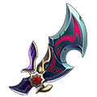
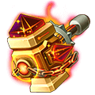
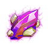

[← Jewellery](../jewellery.html)

# Wraith jewellery

Wraith pieces are Backhand jewellery without a set bonus. They form one chain through the tiers: each step is crafted from the Wraith piece before it plus other jewellery, and the top pieces then evolve to Legendary +4.

| Tier | Piece |
|---|---|
| Valor |  [Wraith: Devil Codex](#jewel-wraith-devil-codex) |
| Valor |  [Wraith: Devil Codex (Epic)](#jewel-wraith-devil-codex-epic) |
| Glory |  [Wraith: Shadowgourd](#jewel-wraith-shadowgourd) |
| Glory |  [Wraith: Shadowgourd (Epic)](#jewel-wraith-shadowgourd-epic) |
| Dragon |  [Wraith: Silent Manuscript](#jewel-wraith-silent-manuscript) |
| Dragon |  [Wraith: Silent Manuscript (Epic)](#jewel-wraith-silent-manuscript-epic) |
| Dragon |  [Wraith: Silent Manuscript (Legendary)](#jewel-wraith-silent-manuscript-legendary) |
| Immortal |  [Wraith: Skeleton Scale](#jewel-wraith-skeleton-scale) |
| Immortal |  [Wraith: Skeleton Scale (Epic)](#jewel-wraith-skeleton-scale-epic) |
| Immortal |  [Wraith: Skeleton Scale (Legendary)](#jewel-wraith-skeleton-scale-legendary) |

## Valor

###  Wraith: Devil Codex

- Quality: **Orange** · Score 280
- Stats: STR 157 → **477** at 6★, LUCK 242 → **732** at 6★, CON 319 → **967** at 6★ (11,856 enchant EXP to 6★)
- Traits: **Rattle**: When the wearer dies, restores 10% HP for allies and removes debuffs.
- Where to Get: Team Expedition

###  Wraith: Devil Codex (Epic)

- Quality: **Orange** · Score 360
- Stats: STR 201 → **615** at 6★, LUCK 309 → **946** at 6★, CON 407 → **1,247** at 6★ (38,182 enchant EXP to 6★)
- Traits: **Rattle**: When the wearer dies, restores 10% HP for allies and removes debuffs.
- **Craft Jewelry** (player Lv 28): 1 ×  Demon Blade + 1 ×  [Wraith: Devil Codex](valor.html#jewel-wraith-devil-codex) + 1 ×  Epic Forge Hammer + 200,000 Coins

## Glory

###  Wraith: Shadowgourd

- Quality: **Orange** · Score 570
- Stats: STR 317 → **960** at 6★, LUCK 488 → **1,479** at 6★, CON 642 → **1,946** at 6★ (27,378 enchant EXP to 6★)
- Traits: **Rattle**: When the wearer dies, restores 10% HP for allies and removes debuffs.
- Where to Get: Team Expedition

###  Wraith: Shadowgourd (Epic)

- Quality: **Orange** · Score 670
- Stats: STR 378 → **1,145** at 6★, LUCK 581 → **1,760** at 6★, CON 766 → **2,321** at 6★ (47,250 enchant EXP to 6★)
- Traits: **Rattle**: When the wearer dies, restores 10% HP for allies and removes debuffs.
- **Craft Jewelry** (player Lv 28): 2 ×  [Wraith: Devil Codex (Epic)](valor.html#jewel-wraith-devil-codex-epic) + 1 ×  Wisdom Wrench + 1 ×  [Wraith: Shadowgourd](glory.html#jewel-wraith-shadowgourd) + 2 ×  Epic Forge Hammer + 200,000 Coins

## Dragon

###  Wraith: Silent Manuscript

- Quality: **Orange** · Score 1,040
- Stats: STR 585 → **1,772** at 6★, LUCK 900 → **2,727** at 6★, CON 1,186 → **3,594** at 6★ (59,101 enchant EXP to 6★)
- Traits: **Rattle**: When the wearer dies, restores 10% HP for allies and removes debuffs.
- Where to Get: Team Expedition

###  Wraith: Silent Manuscript (Epic)

- Quality: **Orange** · Score 1,180
- Stats: STR 2,126 → **2,393** at 6★, LUCK 3,272 → **3,686** at 6★, CON 4,312 → **4,857** at 6★ (89,716 enchant EXP to 6★)
- Traits: **Rattle**: When the wearer dies, restores 10% HP for allies and removes debuffs.
- **Craft Jewelry** (player Lv 28): 1 ×  [Wraith: Shadowgourd (Epic)](glory.html#jewel-wraith-shadowgourd-epic) + 1 ×  Wild Ring + 1 ×  [Wraith: Silent Manuscript](dragon.html#jewel-wraith-silent-manuscript) + 2 ×  Epic Forge Hammer + 500,000 Coins

###  Wraith: Silent Manuscript (Legendary)

- Quality: **Red** · Score 1,360
- Stats: STR 2,416 → **2,719** at 6★, LUCK 3,722 → **4,191** at 6★, CON 4,905 → **5,525** at 6★ (105,865 enchant EXP to 6★)
- Traits: **Rattle**: When the wearer dies, restores 10% HP for allies and removes debuffs.
- **Advance** (player Lv 28) from  [Wraith: Silent Manuscript (Epic)](dragon.html#jewel-wraith-silent-manuscript-epic), also using: 1 ×  [Wraith: Silent Manuscript](dragon.html#jewel-wraith-silent-manuscript) + 2 ×  Elemental Gem + 10 ×  Amethyst + 2 ×  Heroic Forge Hammer

###  Wraith: Silent Manuscript (Legendary) +1

- Quality: **Red** · Score 1,570
- Stats: STR 2,746 → **3,092** at 6★, LUCK 4,232 → **4,767** at 6★, CON 5,580 → **6,287** at 6★ (118,569 enchant EXP to 6★)
- Traits: **Rattle**: When the wearer dies, restores 10% HP for allies and removes debuffs.
- **Advance** (player Lv 28) from  [Wraith: Silent Manuscript (Legendary)](dragon.html#jewel-wraith-silent-manuscript-legendary), also using: 1 ×  [Wraith: Silent Manuscript](dragon.html#jewel-wraith-silent-manuscript) + 2 ×  Elemental Gem + 20 ×  Amethyst + 5 ×  Heroic Forge Hammer

###  Wraith: Silent Manuscript (Legendary) +2

- Quality: **Red** · Score 1,800
- Stats: STR 3,122 → **3,515** at 6★, LUCK 4,814 → **5,423** at 6★, CON 6,349 → **7,153** at 6★ (132,797 enchant EXP to 6★)
- Traits: **Rattle**: When the wearer dies, restores 10% HP for allies and removes debuffs.
- **Advance** (player Lv 28) from  [Wraith: Silent Manuscript (Legendary) +1](dragon.html#jewel-wraith-silent-manuscript-legendary-1), also using: 2 ×  [Wraith: Silent Manuscript](dragon.html#jewel-wraith-silent-manuscript) + 3 ×  Elemental Gem + 30 ×  Amethyst + 10 ×  Heroic Forge Hammer

###  Wraith: Silent Manuscript (Legendary) +3

- Quality: **Red** · Score 2,060
- Stats: STR 3,550 → **3,998** at 6★, LUCK 5,477 → **6,170** at 6★, CON 7,224 → **8,138** at 6★ (148,734 enchant EXP to 6★)
- Traits: **Rattle**: When the wearer dies, restores 10% HP for allies and removes debuffs.
- **Advance** (player Lv 28) from  [Wraith: Silent Manuscript (Legendary) +2](dragon.html#jewel-wraith-silent-manuscript-legendary-2), also using: 2 ×  [Wraith: Silent Manuscript](dragon.html#jewel-wraith-silent-manuscript) + 2 ×  Earth's Core + 40 ×  Amethyst + 5 ×  Epic Forge Hammer

###  Wraith: Silent Manuscript (Legendary) +4

- Quality: **Red** · Score 2,360
- Stats: STR 4,037 → **4,546** at 6★, LUCK 6,231 → **7,020** at 6★, CON 8,219 → **9,260** at 6★ (166,582 enchant EXP to 6★)
- Traits: **Rattle**: When the wearer dies, restores 10% HP for allies and removes debuffs.
- **Advance** (player Lv 28) from  [Wraith: Silent Manuscript (Legendary) +3](dragon.html#jewel-wraith-silent-manuscript-legendary-3), also using: 4 ×  [Wraith: Silent Manuscript](dragon.html#jewel-wraith-silent-manuscript) + 4 ×  Earth's Core + 50 ×  Amethyst + 10 ×  Epic Forge Hammer

## Immortal

###  Wraith: Skeleton Scale

- Quality: **Orange** · Score 3,090
- Stats: STR 4,773 → **5,377** at 6★, LUCK 7,371 → **8,304** at 6★, CON 9,723 → **10,954** at 6★ (177,303 enchant EXP to 6★)
- Traits: **Rattle**: When the wearer dies, restores 10% HP for allies and removes debuffs.
- Where to Get: Team Expedition

###  Wraith: Skeleton Scale (Epic)

- Quality: **Orange** · Score 3,460
- Stats: STR 5,914 → **6,662** at 6★, LUCK 9,134 → **10,292** at 6★, CON 12,049 → **13,576** at 6★ (265,956 enchant EXP to 6★)
- Traits: **Rattle**: When the wearer dies, restores 10% HP for allies and removes debuffs.
- **Craft Jewelry** (player Lv 28): 1 ×  [Wraith: Skeleton Scale](immortal.html#jewel-wraith-skeleton-scale) + 1 ×  [Wraith: Silent Manuscript (Legendary) +4](dragon.html#jewel-wraith-silent-manuscript-legendary-4) + 2 ×  Epic Forge Hammer + 1,000,000 Coins

###  Wraith: Skeleton Scale (Legendary)

- Quality: **Red** · Score 3,860
- Stats: STR 6,728 → **7,578** at 6★, LUCK 10,394 → **11,712** at 6★, CON 13,711 → **15,450** at 6★ (345,742 enchant EXP to 6★)
- Traits: **Rattle**: When the wearer dies, restores 10% HP for allies and removes debuffs.
- **Advance** (player Lv 28) from  [Wraith: Skeleton Scale (Epic)](immortal.html#jewel-wraith-skeleton-scale-epic), also using: 1 ×  [Wraith: Skeleton Scale](immortal.html#jewel-wraith-skeleton-scale) + 2 ×  Elemental Gem + 10 ×  Amethyst + 2 ×  Heroic Forge Hammer

###  Wraith: Skeleton Scale (Legendary) +1

- Quality: **Red** · Score 4,470
- Stats: STR 7,653 → **8,622** at 6★, LUCK 11,829 → **13,328** at 6★, CON 15,604 → **17,582** at 6★ (449,465 enchant EXP to 6★)
- Traits: **Rattle**: When the wearer dies, restores 10% HP for allies and removes debuffs.
- **Advance** (player Lv 28) from  [Wraith: Skeleton Scale (Legendary)](immortal.html#jewel-wraith-skeleton-scale-legendary), also using: 1 ×  [Wraith: Skeleton Scale](immortal.html#jewel-wraith-skeleton-scale) + 2 ×  Elemental Gem + 20 ×  Amethyst + 5 ×  Heroic Forge Hammer

###  Wraith: Skeleton Scale (Legendary) +2

- Quality: **Red** · Score 4,910
- Stats: STR 8,708 → **9,812** at 6★, LUCK 13,461 → **15,166** at 6★, CON 17,757 → **20,009** at 6★ (584,306 enchant EXP to 6★)
- Traits: **Rattle**: When the wearer dies, restores 10% HP for allies and removes debuffs.
- **Advance** (player Lv 28) from  [Wraith: Skeleton Scale (Legendary) +1](immortal.html#jewel-wraith-skeleton-scale-legendary-1), also using: 2 ×  [Wraith: Skeleton Scale](immortal.html#jewel-wraith-skeleton-scale) + 3 ×  Elemental Gem + 30 ×  Amethyst + 10 ×  Heroic Forge Hammer

###  Wraith: Skeleton Scale (Legendary) +3

- Quality: **Red** · Score 5,400
- Stats: STR 9,910 → **11,165** at 6★, LUCK 15,317 → **17,261** at 6★, CON 20,209 → **22,772** at 6★ (759,598 enchant EXP to 6★)
- Traits: **Rattle**: When the wearer dies, restores 10% HP for allies and removes debuffs.
- **Advance** (player Lv 28) from  [Wraith: Skeleton Scale (Legendary) +2](immortal.html#jewel-wraith-skeleton-scale-legendary-2), also using: 2 ×  [Wraith: Skeleton Scale](immortal.html#jewel-wraith-skeleton-scale) + 2 ×  Earth's Core + 40 ×  Amethyst + 5 ×  Epic Forge Hammer

###  Wraith: Skeleton Scale (Legendary) +4

- Quality: **Red** · Score 5,870
- Stats: STR 11,276 → **12,706** at 6★, LUCK 17,433 → **19,643** at 6★, CON 22,999 → **25,914** at 6★ (858,345 enchant EXP to 6★)
- Traits: **Rattle**: When the wearer dies, restores 10% HP for allies and removes debuffs.
- **Advance** (player Lv 28) from  [Wraith: Skeleton Scale (Legendary) +3](immortal.html#jewel-wraith-skeleton-scale-legendary-3), also using: 4 ×  [Wraith: Skeleton Scale](immortal.html#jewel-wraith-skeleton-scale) + 4 ×  Earth's Core + 50 ×  Amethyst + 10 ×  Epic Forge Hammer

## Materials

Everything the recipes above use, and where to get it.

| Material | Where to get |
|---|---|
|  Demon Blade | Team Expedition, Sky of City |
|  Epic Forge Hammer | Sky of City, Event |
|  Wisdom Wrench | Team Expedition, Sky of City |
|  Wild Ring | Team Expedition, Sky of City |
|  Elemental Gem | Sky of City, Event Rewards |
|  Amethyst | Event Rewards |
|  Heroic Forge Hammer | Sky of City, Event |
|  Earth's Core | Sky of City, Event Rewards |
