# Mech

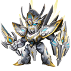

Mechs are battle companions you deploy in up to 5 slots. Every deployed mech adds its stats to yours, can **transform** you in battle with its transform skill, and may carry a passive trait. Mechs of the right kinds deployed together switch on **combos**. Each deployed mech also has 8 **Module** slots, and modules are powered up with **Raul Crystals**. Mech Wrecks, crystals and more come from the **Mecha Zone** dungeon.

- [Rules](#rules) · [Mechs in battle](#battle) · [All mechs](#all-mechs) · [Crafting](#crafting) · [Combos](#combos) · [Modules](#modules) · [Raul Crystals](#crystals) · [Mecha Zone](#mecha-zone) · [Materials](#materials) · [Unknown](#unknown)

## Rules

- The **Mech** button (main menu) appears at **level 55**.
- **Deploy slots:** 5 slots, opening at player level **55**, **60**, **65**, **70**, **75**. A locked slot shows its level.
- **Deploying:** press **Mech Garage** to list your mechs, then tap a mech: it goes into the first free open slot (a tick marks deployed mechs). Tap a deployed mech to take it out. Game text when you do: "The module on the mecha will be automatically removed when the mecha is not equipped. Remember to wear it after changing to a new mecha."
- **Stats:** each deployed mech adds its own stats; the stats of all deployed mechs add up (the info button on the Mech screen shows the total). A mech has **no level, star-up or advance**: its stats and skills are fixed. To get stronger you deploy more and better mechs, craft higher-star mechs, switch on combos and fit modules.
- **Stars:** mechs come in 3★ (Blue), 4★ (Purple), 5★ (Orange) and 6★ (Red). The 6★ mechs are the upgraded forms of 5★ mechs and share their name.
- **Display Mech:** a deployed mech can be set as your display mech (it is marked **Displayed**).
- Game help text: "Deploy Mechs for extra stats or unique passive skills via transformation." "More deployed Mechs increase the stats bonus." "Obtain Mechs through shards or crafting." "Mechs have unique traits; only one of the same trait can trigger, but different traits stack." "Deploy different types of Mechs to trigger combo effects." "Set a Mech as your avatar." "Equipped modules grant additional stats for each deployed Mech."

## Mechs in battle

- With at least one mech deployed, a **mech gauge** sits next to the fire button. It goes from 0 to 100 and fills by 20 at the start of each turn, so it is full after 5 turns.
- When the gauge is full and it is your turn, tap it to open a wheel with your deployed mechs (up to 5). A mech can be picked only when your SP is at least its transform's **SP cost**; the others stay locked. Picking a mech uses its transform skill (see each mech below). Tapping the gauge too early shows "You can only transform when Source Power is full" or "It's not your turn".
- **Traits** (passive skills of 4★ and better mechs) work in battle on their own while the mech is deployed. Help text: "Mechs have unique traits; only one of the same trait can trigger, but different traits stack."
- The mech gauge is not shown in **Ballistic Masters** and **3v3 Masters** matches.

## All mechs

18 mechs. **SP** = SP cost of the transform skill. Stats are what the mech adds while deployed.

| Mech | Stars | Stats | SP | Trait | How to get |
|---|---|---|---|---|---|
| 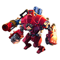 [Rocket](#mech-rocket-3-star) | 3★ Blue | ATK +152 DEF +114 HP +3,750 DMG+ +42 DMG- +42 | 40 | - | random craft from 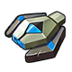 Mech Wreck I |
| 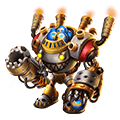 [Hell](#mech-hell-3-star) | 3★ Blue | ATK +148 DEF +130 HP +3,673 DMG+ +41 DMG- +41 | 40 | - | random craft from  Mech Wreck I |
| 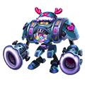 [Candy](#mech-candy-3-star) | 3★ Blue | ATK +114 DEF +38 HP +4,500 DMG+ +42 DMG- +42 | 40 | - | random craft from  Mech Wreck I |
| 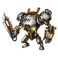 [Chainsaw](#mech-chainsaw-4-star) | 4★ Purple | ATK +227 DEF +170 HP +5,625 DMG+ +62 DMG- +62 | 50 | yes | craft, random craft from 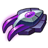 Mech Wreck II |
| 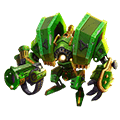 [Blaze](#mech-blaze-4-star) | 4★ Purple | ATK +284 DEF +170 HP +5,250 DMG+ +62 DMG- +62 | 50 | yes | craft, random craft from  Mech Wreck II |
| 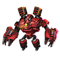 [Redspot](#mech-redspot-4-star) | 4★ Purple | ATK +223 DEF +195 HP +5,510 DMG+ +61 DMG- +61 | 50 | yes | random craft from  Mech Wreck II |
| 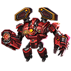 [Flame Redspot](#mech-flame-redspot-5-star) | 5★ Orange | ATK +430 DEF +377 HP +10,653 DMG+ +118 DMG- +118 | 60 | yes | craft, random craft from 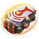 Mech Wreck III |
| 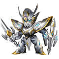 [Justice Knight (5★)](#mech-justice-knight-5-star) | 5★ Orange | ATK +519 DEF +455 HP +12,857 DMG+ +143 DMG- +143 | 60 | yes | random craft from  Mech Wreck III, chests |
| 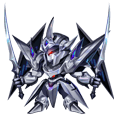 [Moon Demon (5★)](#mech-moon-demon-5-star) | 5★ Orange | ATK +610 DEF +544 HP +15,068 DMG+ +176 DMG- +176 | 60 | yes | random craft from  Mech Wreck III, chests |
| 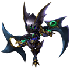 [Darkest Horror (5★)](#mech-darkest-horror-5-star) | 5★ Orange | ATK +610 DEF +544 HP +15,068 DMG+ +176 DMG- +176 | 60 | yes | random craft from  Mech Wreck III, chests |
| 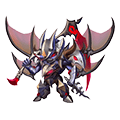 [Pure Death (5★)](#mech-pure-death-5-star) | 5★ Orange | ATK +610 DEF +544 HP +15,068 DMG+ +176 DMG- +176 | 60 | yes | random craft from  Mech Wreck III, chests |
| 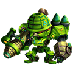 [Green Assault](#mech-green-assault-5-star) | 5★ Orange | ATK +430 DEF +377 HP +10,653 DMG+ +118 DMG- +118 | 60 | yes | random craft from  Mech Wreck III |
| 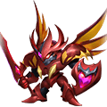 [Crimson Demon (5★)](#mech-crimson-demon-5-star) | 5★ Orange | ATK +610 DEF +544 HP +15,068 DMG+ +176 DMG- +176 | 60 | yes | random craft from  Mech Wreck III, chests |
|  [Justice Knight (6★)](#mech-justice-knight-6-star) | 6★ Red | ATK +891 DEF +779 HP +22,041 DMG+ +245 DMG- +245 | 70 | yes | craft, chests, event exchange |
| 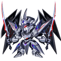 [Moon Demon (6★)](#mech-moon-demon-6-star) | 6★ Red | ATK +989 DEF +860 HP +26,478 DMG+ +298 DMG- +298 | 70 | yes | craft, chests, event exchange |
| 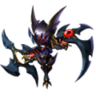 [Darkest Horror (6★)](#mech-darkest-horror-6-star) | 6★ Red | ATK +989 DEF +860 HP +26,478 DMG+ +298 DMG- +298 | 70 | yes | craft, chests, event exchange |
| 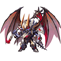 [Pure Death (6★)](#mech-pure-death-6-star) | 6★ Red | ATK +989 DEF +860 HP +26,478 DMG+ +298 DMG- +298 | 70 | yes | craft, chests |
| 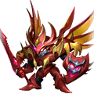 [Crimson Demon (6★)](#mech-crimson-demon-6-star) | 6★ Red | ATK +989 DEF +860 HP +26,478 DMG+ +298 DMG- +298 | 70 | yes | craft |

### Rocket

Rocket Mech is among the first combat mechs built with Energy Core technology. Violence is its biggest feature. Warriors need to be very careful due to its tremendous power

- Stars: **3★** (Blue)
- Stats: ATK +152, DEF +114, HP +3,750, DMG+ +42, DMG- +42
- Skill (transform, SP cost 40): Transform for 1 turn, increasing damage dealt by 25% and inflicting Bleed effect to the target which deals damage equal to 10% of HP in the next turn. SP Cost: 40.
- Traits: -
- [Combos](#combos): (Rocket + Hell + Chainsaw: PEN +15, DEX +15); (Rocket + Candy + Blaze: STR +27, END +18, CON +36)
- Random craft:  Mech Wreck I ×20 gives a random 3★ mech

### Hell

One of the first gen combat armor. Top mech pilot Von Rex once drove it to in the Demon Forest and caused havoc there. Even demons were afraid of it. So it was named 'Hell'

- Stars: **3★** (Blue)
- Stats: ATK +148, DEF +130, HP +3,673, DMG+ +41, DMG- +41
- Skill (transform, SP cost 40): Transform for 2 turns, reducing DMG by another 15% and reflecting 15% of damage taken to the enemy. SP Cost: 40.
- Traits: -
- [Combos](#combos): (Rocket + Hell + Chainsaw: PEN +15, DEX +15)
- Random craft:  Mech Wreck I ×20 gives a random 3★ mech

### Candy

One of the first gen combat armor. Specially built for female warriors. Tutor Lena was its first pilot  'It's a sweet devil, just like me' - Tutor Lena

- Stars: **3★** (Blue)
- Stats: ATK +114, DEF +38, HP +4,500, DMG+ +42, DMG- +42
- Skill (transform, SP cost 40): Transform for 2 turns, increasing DEF by 30% and All Elemental Res by 10. SP Cost: 40.
- Traits: -
- [Combos](#combos): (Rocket + Candy + Blaze: STR +27, END +18, CON +36)
- Random craft:  Mech Wreck I ×20 gives a random 3★ mech

### Chainsaw

Based on the horror movie 'Saw' and the belief that cruelty is kindness, this mech is more suitable for shredding enemies at close range than blasting them 'That old man Jigsaw is nothing compared to this mech.'

- Stars: **4★** (Purple)
- Stats: ATK +227, DEF +170, HP +5,625, DMG+ +62, DMG- +62
- Skill (transform, SP cost 50): Transform for 2 turns, getting 10 Rage immediately. Get 20 extra Rage at the beginning of the next turn. SP Cost: 50.
- Traits: When taking critical damage in the battle, reduce critical damage taken of the current turn by 15%. CD: 3 turns.
- [Combos](#combos): (Rocket + Hell + Chainsaw: PEN +15, DEX +15); (Chainsaw + Blaze + Redspot: PEN +62, DEX +62)
- Craft: any 3★ mechs ×3
- Random craft:  Mech Wreck II ×30 gives a random 4★ mech

### Blaze

Blaze was built by an expert who liked eastern culture, based on the idea of 'attack as fiercely as fire'. It's an efficient and reliable mech with unlimited firepower

- Stars: **4★** (Purple)
- Stats: ATK +284, DEF +170, HP +5,250, DMG+ +62, DMG- +62
- Skill (transform, SP cost 50): Transform for 1 turn, increasing damage dealt by 30% and converting 10% of damage dealing into energy shield (2 turns). SP Cost: 50.
- Traits: When taking critical damage in the battle, increase ACRIT Rate for the current turn by 5%. CD: 3 turns.
- [Combos](#combos): (Rocket + Candy + Blaze: STR +27, END +18, CON +36); (Chainsaw + Blaze + Redspot: PEN +62, DEX +62)
- Craft: any 3★ mechs ×3
- Random craft:  Mech Wreck II ×30 gives a random 4★ mech

### Redspot

High performance mech known as Scarlet Demon. Only ace pilot can handle this more agile and accurate new model.

- Stars: **4★** (Purple)
- Stats: ATK +223, DEF +195, HP +5,510, DMG+ +61, DMG- +61
- Skill (transform, SP cost 50): Transform for 1 turn, increasing damage dealt by 30%and reducing the target's rage by 25 upon hit. SP Cost: 50.
- Traits: When hit by a weapon Ultimate, gain 8% DEF for the current turn. Cooldown: 3 turns.
- [Combos](#combos): (Chainsaw + Blaze + Redspot: PEN +62, DEX +62); (Redspot + Flame Redspot: STR +44, END +20, CON +78)
- Random craft:  Mech Wreck II ×30 gives a random 4★ mech

### Flame Redspot

High performance mech known as Scarlet Demon. Only ace pilot can handle this more agile and accurate new model.

- Stars: **5★** (Orange)
- Stats: ATK +430, DEF +377, HP +10,653, DMG+ +118, DMG- +118
- Skill (transform, SP cost 60): Transform for 1 turn, increasing damage dealt by 40% and reducing the target's rage by 35 upon hit. SP Cost: 60.
- Traits: When getting damaged by the ultimate of weapon in the battle, increase DEF by 12% for the current turn. CD: 3 turns.
- [Combos](#combos): (Redspot + Flame Redspot: STR +44, END +20, CON +78); (Flame Redspot + Justice Knight (5★): STR +50, END +80, CON +100)
- Craft:  [Redspot](#mech-redspot-4-star) ×4 +  [Rocket](#mech-rocket-3-star) ×4 + any 4★ mechs ×4
- Random craft:  Mech Wreck III ×50 gives a random 5★ mech

### Justice Knight (5★)

The legacy of an ancient civilization, a mysterious machinery built by a new wave of scientists out of decrypted ancient tech and magical devices

- Stars: **5★** (Orange)
- Stats: ATK +519, DEF +455, HP +12,857, DMG+ +143, DMG- +143
- Skill (transform, SP cost 60): Transform for 2 turns, giving an Energy Shield with strength of 15% Max HP to the caster (2 turns). SP Cost: 60.
- Traits: When getting damaged by the ultimate of weapon in the battle, convert 15% damage taken into Energy Shield (2 turns). CD: 3 turns.
- [Combos](#combos): (Flame Redspot + Justice Knight (5★): STR +50, END +80, CON +100); (Justice Knight (5★) + Moon Demon (5★): STR +60, END +100, CON +120)
- Random craft:  Mech Wreck III ×50 gives a random 5★ mech
- Where from:
  - Chest 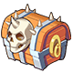 **5-star Mecha Selection Chest**: pick 1 of 5 (chest from: Event)
  - Chest  **5-star Mecha Chest**: 23.00% chance per chest (chest from: Event)

### Moon Demon (5★)

One of the four legendary mecha knights, the core of this mecha is made using the techniques of ancient times, so it is more powerful and intelligent than other mechas. In this dark night sky, the mech is shining like a silver moon, it is simply a demon on the battlefield!

- Stars: **5★** (Orange)
- Stats: ATK +610, DEF +544, HP +15,068, DMG+ +176, DMG- +176
- Skill (transform, SP cost 60): Transform for 1 turn, increasing damage dealt by 40%. If the target has Energy Shield, ATK increases 10% more. SP Cost: 60.
- Traits: When killing an enemy in the battle, heal for 5% of Max HP of the caster.
- [Combos](#combos): (Justice Knight (5★) + Moon Demon (5★): STR +60, END +100, CON +120); (Moon Demon (5★) + Darkest Horror (5★): STR +60, END +100, CON +120)
- Random craft:  Mech Wreck III ×50 gives a random 5★ mech
- Where from:
  - Chest  **5-star Mecha Selection Chest**: pick 1 of 5 (chest from: Event)
  - Chest  **5-star Mecha Chest**: 23.00% chance per chest (chest from: Event)

### Darkest Horror (5★)

One of the legendary four knights of the mecha, the pitch-black body can hide the mecha in the dark instantly.

- Stars: **5★** (Orange)
- Stats: ATK +610, DEF +544, HP +15,068, DMG+ +176, DMG- +176
- Skill (transform, SP cost 60): Transform for 2 turns, getting 3 Mech-clad layers (each layer can block 1 bullet, which is invalid when attacked by monsters). SP Cost: 60.
- Traits: At the start of the battle, get an Energy Shield with strength of 5% Max HP (2 turns). Energy Shield can be obtained again every 5 turns.
- [Combos](#combos): (Moon Demon (5★) + Darkest Horror (5★): STR +60, END +100, CON +120); (Darkest Horror (5★) + Pure Death (5★): STR +60, END +100, CON +120)
- Random craft:  Mech Wreck III ×50 gives a random 5★ mech
- Where from:
  - Chest  **5-star Mecha Selection Chest**: pick 1 of 5 (chest from: Event)
  - Chest  **5-star Mecha Chest**: 23.00% chance per chest (chest from: Event)

### Pure Death (5★)

One of the four knights mech in the legend. With silver-white lacquer armor, the appearance has bursts of murderous aura, carrying a sickle for harvesting everything, can flash behind the enemy in an instant, harvest instantly, and crush the enemy into powder

- Stars: **5★** (Orange)
- Stats: ATK +610, DEF +544, HP +15,068, DMG+ +176, DMG- +176
- Skill (transform, SP cost 60): Transform for 1 turn, increasing damage dealt by 40%. This attack can penetrate the Energy Shield, dealing fatal damage to the enemies with HP below 3%. SP Cost: 60.
- Traits: When killing the enemy in the battle, give an Energy Shield with strength of 8% Max HP to the caster (2 turns).
- [Combos](#combos): (Darkest Horror (5★) + Pure Death (5★): STR +60, END +100, CON +120); (Pure Death (5★) + Crimson Demon (5★): STR +60, END +100, CON +120)
- Random craft:  Mech Wreck III ×50 gives a random 5★ mech
- Where from:
  - Chest  **5-star Mecha Selection Chest**: pick 1 of 5 (chest from: Event)
  - Chest  **5-star Mecha Chest**: 23.00% chance per chest (chest from: Event)

### Green Assault

The first-generation attack mecha produced by the Artillery Federation, also known as the Green Assault, is equipped with three extremely powerful XS technologies-BS-01 (rapid reaction armor) and BS-03 (steel cannon). ) And BS-05 (Imitated Gundam)

- Stars: **5★** (Orange)
- Stats: ATK +430, DEF +377, HP +10,653, DMG+ +118, DMG- +118
- Skill (transform, SP cost 60): Transform for 1 turn, increasing damage dealt by 40% and reducing the target's rage by 35 upon hit. SP Cost: 60.
- Traits: When getting damaged by the ultimate of weapon in the battle, increase DEF by 12% for the current turn. CD: 3 turns.
- Random craft:  Mech Wreck III ×50 gives a random 5★ mech

### Crimson Demon (5★)

Forged in Phoenix flames, this undying mech wields the power of rebirth, growing stronger with every battle!

- Stars: **5★** (Orange)
- Stats: ATK +610, DEF +544, HP +15,068, DMG+ +176, DMG- +176
- Skill (transform, SP cost 60): Transforms for 1 round, increasing attack power by 40% and restoring 60% of the total damage dealt as HP.SP Cost: 60.
- Traits: When deployed, gains a shield equal to 20% of damage dealt upon casting an ultimate (shield lasts 2 rounds; cooldown: 3 rounds).
- [Combos](#combos): (Pure Death (5★) + Crimson Demon (5★): STR +60, END +100, CON +120)
- Random craft:  Mech Wreck III ×50 gives a random 5★ mech
- Where from:
  - Chest  **5-star Mecha Selection Chest**: pick 1 of 5 (chest from: Event)
  - Chest  **5-star Mecha Chest**: 8.00% chance per chest (chest from: Event)

### Justice Knight (6★)

The legacy of an ancient civilization, a mysterious machinery built by a new wave of scientists out of decrypted ancient tech and magical devices

- Stars: **6★** (Red)
- Stats: ATK +891, DEF +779, HP +22,041, DMG+ +245, DMG- +245
- Skill (transform, SP cost 70): Transform for 2 turns, giving an Energy Shield with strength of 20% Max HP to the caster (2 turns). SP Cost: 70.
- Traits: When getting damaged by the ultimate of weapon in the battle, convert 40% damage taken into Energy Shield (2 turns). CD: 3 turns.
- [Combos](#combos): (Justice Knight (6★): STR +70, END +200, CON +300)
- Craft:  [Justice Knight (5★)](#mech-justice-knight-5-star) ×4 +  [Hell](#mech-hell-3-star) ×4 + any 4★ mechs ×4
- Where from:
  - Chest  **$5000 Extra Draft Pack**: pick 1 of 12 (chest from: Event)
  - Chest  **6-Star Mech Selection Chest 1**: pick 1 of 4 (chest from: Event)
  - Crystal Memorial event exchange: 20 Xeno Crystals

### Moon Demon (6★)

One of the four legendary mecha knights, the core of this mecha is made using the techniques of ancient times, so it is more powerful and intelligent than other mechas. In this dark night sky, the mech is shining like a silver moon, it is simply a demon on the battlefield!

- Stars: **6★** (Red)
- Stats: ATK +989, DEF +860, HP +26,478, DMG+ +298, DMG- +298
- Skill (transform, SP cost 70): Transform for 1 turn, increasing damage dealt by 50%. If the target has an Energy Shield, damage increases by 15% more. SP Cost: 70.
- Traits: When killing the enemy in the battle, heal for 8% of Max HP of the caster.
- [Combos](#combos): **Black and white** (Moon Demon (6★): STR +90, END +220, CON +380)
- Craft:  [Moon Demon (5★)](#mech-moon-demon-5-star) ×4 +  [Candy](#mech-candy-3-star) ×4 + any 4★ mechs ×4
- Where from:
  - Chest  **$5000 Extra Draft Pack**: pick 1 of 12 (chest from: Event)
  - Chest  **6-Star Mech Selection Chest 1**: pick 1 of 4 (chest from: Event)
  - Crystal Memorial event exchange: 20 Xeno Crystals

### Darkest Horror (6★)

One of the legendary four knights of the mecha, the pitch-black body can hide the mecha in the dark instantly.

- Stars: **6★** (Red)
- Stats: ATK +989, DEF +860, HP +26,478, DMG+ +298, DMG- +298
- Skill (transform, SP cost 70): Transform for 2 turns, getting 3 Mech-clad layers (each layer can block 5 bullet, which is invalid when attacked by monsters). SP Cost: 70.
- Traits: At the start of the battle, get an Energy Shield with strength of 8% Max HP (2 turns). Energy Shield can be obtained again every 5 turns.
- [Combos](#combos): **Shadow Lore** (Darkest Horror (6★): STR +90, END +220, CON +380)
- Craft:  [Darkest Horror (5★)](#mech-darkest-horror-5-star) ×4 +  [Rocket](#mech-rocket-3-star) ×4 + any 4★ mechs ×4
- Where from:
  - Chest  **$5000 Extra Draft Pack**: pick 1 of 12 (chest from: Event)
  - Chest  **6-Star Mech Selection Chest 1**: pick 1 of 4 (chest from: Event)
  - Crystal Memorial event exchange: 20 Xeno Crystals

### Pure Death (6★)

One of the four knights mech in the legend. With silver-white lacquer armor, the appearance has bursts of murderous aura, carrying a sickle for harvesting everything, can flash behind the enemy in an instant, harvest instantly, and crush the enemy into powder

- Stars: **6★** (Red)
- Stats: ATK +989, DEF +860, HP +26,478, DMG+ +298, DMG- +298
- Skill (transform, SP cost 70): Transform for 1 turn, increasing damage dealt by 50%. This attack can penetrate the Energy Shield, dealing fatal damage to the enemies with HP below 8%. SP Cost: 70.
- Traits: When killing the enemy in the battle, give an Energy Shield with strength of 12% Max HP to the caster (2 turns).
- [Combos](#combos): **God's Harvest** (Pure Death (6★): STR +90, END +220, CON +380)
- Craft:  [Pure Death (5★)](#mech-pure-death-5-star) ×4 +  [Candy](#mech-candy-3-star) ×4 + any 4★ mechs ×4
- Where from:
  - Chest  **$5000 Extra Draft Pack**: pick 1 of 12 (chest from: Event)
  - Chest  **6-Star Mech Selection Chest 1**: pick 1 of 4 (chest from: Event)

### Crimson Demon (6★)

Forged in Phoenix flames, this undying mech wields the power of rebirth, growing stronger with every battle!

- Stars: **6★** (Red)
- Stats: ATK +989, DEF +860, HP +26,478, DMG+ +298, DMG- +298
- Skill (transform, SP cost 70): Transforms for 1 round, increasing attack power by 50% and restoring 100% of the total damage dealt as HP.SP Cost: 70.
- Traits: When deployed, gains a shield equal to 40% of damage dealt upon casting an ultimate (shield lasts 2 rounds; cooldown: 3 rounds).
- [Combos](#combos): **Crimson Demon** (Crimson Demon (6★): STR +90, END +220, CON +380)
- Craft:  [Crimson Demon (5★)](#mech-crimson-demon-5-star) ×4 +  [Rocket](#mech-rocket-3-star) ×4 + any 4★ mechs ×4

## Crafting

In **Mech Garage** press **Craft**, pick the mech to make and fill its materials. Mechs used as materials are used up; deployed mechs can't be used. For "any N★ mechs" you pick which of your mechs to give (not the ones already used for the other materials). Help text: "Collect Mech Wreck to craft random Mechs of selected star level." "Collect and consume Mechs to craft better ones." "Mechs in use cannot be used in as materials."

| Makes | Materials |
|---|---|
| a random 3★ mech |  Mech Wreck I ×20 |
| a random 4★ mech |  Mech Wreck II ×30 |
| a random 5★ mech |  Mech Wreck III ×50 |
|  [Chainsaw](#mech-chainsaw-4-star) | any 3★ mechs ×3 |
|  [Blaze](#mech-blaze-4-star) | any 3★ mechs ×3 |
|  [Flame Redspot](#mech-flame-redspot-5-star) |  [Redspot](#mech-redspot-4-star) ×4 +  [Rocket](#mech-rocket-3-star) ×4 + any 4★ mechs ×4 |
|  [Justice Knight (6★)](#mech-justice-knight-6-star) |  [Justice Knight (5★)](#mech-justice-knight-5-star) ×4 +  [Hell](#mech-hell-3-star) ×4 + any 4★ mechs ×4 |
|  [Moon Demon (6★)](#mech-moon-demon-6-star) |  [Moon Demon (5★)](#mech-moon-demon-5-star) ×4 +  [Candy](#mech-candy-3-star) ×4 + any 4★ mechs ×4 |
|  [Darkest Horror (6★)](#mech-darkest-horror-6-star) |  [Darkest Horror (5★)](#mech-darkest-horror-5-star) ×4 +  [Rocket](#mech-rocket-3-star) ×4 + any 4★ mechs ×4 |
|  [Pure Death (6★)](#mech-pure-death-6-star) |  [Pure Death (5★)](#mech-pure-death-5-star) ×4 +  [Candy](#mech-candy-3-star) ×4 + any 4★ mechs ×4 |
|  [Crimson Demon (6★)](#mech-crimson-demon-6-star) |  [Crimson Demon (5★)](#mech-crimson-demon-5-star) ×4 +  [Rocket](#mech-rocket-3-star) ×4 + any 4★ mechs ×4 |

 Mech Wreck IV has no recipe on the Craft screen (its item text: "Collect 50x Shard to get any Elite 5 stars Mech"). The 6★ recipes each need 4 copies of the 5★ form, 4 copies of a 3★ mech and 4 more 4★ mechs of your choice.

## Combos

A combo is on while **every** mech it lists is deployed at the same time; its stats are added on top of the mechs' own. Several combos can be on together. Combos with a single mech are a bonus that mech always brings.

| Combo | Mechs to deploy | Bonus |
|---|---|---|
| - |  [Rocket](#mech-rocket-3-star) +  [Hell](#mech-hell-3-star) +  [Chainsaw](#mech-chainsaw-4-star) | PEN +15 DEX +15 |
| - |  [Rocket](#mech-rocket-3-star) +  [Candy](#mech-candy-3-star) +  [Blaze](#mech-blaze-4-star) | STR +27 END +18 CON +36 |
| - |  [Chainsaw](#mech-chainsaw-4-star) +  [Blaze](#mech-blaze-4-star) +  [Redspot](#mech-redspot-4-star) | PEN +62 DEX +62 |
| - |  [Redspot](#mech-redspot-4-star) +  [Flame Redspot](#mech-flame-redspot-5-star) | STR +44 END +20 CON +78 |
| - |  [Flame Redspot](#mech-flame-redspot-5-star) +  [Justice Knight (5★)](#mech-justice-knight-5-star) | STR +50 END +80 CON +100 |
| - |  [Justice Knight (6★)](#mech-justice-knight-6-star) | STR +70 END +200 CON +300 |
| - |  [Justice Knight (5★)](#mech-justice-knight-5-star) +  [Moon Demon (5★)](#mech-moon-demon-5-star) | STR +60 END +100 CON +120 |
| Black and white |  [Moon Demon (6★)](#mech-moon-demon-6-star) | STR +90 END +220 CON +380 |
| - |  [Moon Demon (5★)](#mech-moon-demon-5-star) +  [Darkest Horror (5★)](#mech-darkest-horror-5-star) | STR +60 END +100 CON +120 |
| Shadow Lore |  [Darkest Horror (6★)](#mech-darkest-horror-6-star) | STR +90 END +220 CON +380 |
| - |  [Darkest Horror (5★)](#mech-darkest-horror-5-star) +  [Pure Death (5★)](#mech-pure-death-5-star) | STR +60 END +100 CON +120 |
| God's Harvest |  [Pure Death (6★)](#mech-pure-death-6-star) | STR +90 END +220 CON +380 |
| - |  [Pure Death (5★)](#mech-pure-death-5-star) +  [Crimson Demon (5★)](#mech-crimson-demon-5-star) | STR +60 END +100 CON +120 |
| Crimson Demon |  [Crimson Demon (6★)](#mech-crimson-demon-6-star) | STR +90 END +220 CON +380 |

## Modules

- Press **Module** on the Mech screen while a deployed mech is selected. Each deployed mech has its own 8 slots, one per module type; a module only fits its own slot. Modules sit on that mech; when the mech is taken out of its deploy slot its modules come off.
- Module stats count for the mech they sit on ("Equipped modules grant additional stats for each deployed Mech.").
- Each module has **stars** (0 up to 6), raised by [refining](#refine) with Raul Crystals, and 2 **install slots** that hold one [Raul Crystal](#install) each.
- Module bag: game text "Module Bag is full (Limit of each type is 10.) Extra modules will be mailed. Please disenchant before claiming."
- The **Quality** number on a module card: 80, 90, 110 (see the list).
- The **Alchemy Room** has a **Mech Module** tab (open from level 55) with three pages: **Raul Crystal** ([upgrade crystals](#crystals)), **Refine Strip** and **Disenchant Module** ([see below](#disenchant)).

| Slot | Type |
|---|---|
|   | Booster |
|   | Energy Reactor |
|   | Helmet |
|   | Pauldron |
|   | Breastplate |
|   | Legplates |
|   | Back Armor |
|   | Alloy Frame |

### All modules

| Module | Slot | Colour | Quality | Max stars | Set | Stats at 0★ | Stats at max |
|---|---|---|---|---|---|---|---|
|  Booster | Booster | Blue | 80 | 4★ | - | ATK +111 DEF +88 HP +3,527 | ATK +294 DEF +234 HP +9,346 |
| 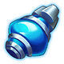 Energy Reactor | Energy Reactor | Blue | 80 | 4★ | - | ATK +111 DEF +88 HP +3,527 | ATK +294 DEF +234 HP +9,346 |
|  Alloy Helmet | Helmet | Blue | 80 | 4★ | - | ATK +83 DEF +66 HP +2,645 | ATK +221 DEF +175 HP +7,010 |
|  Alloy Pauldron | Pauldron | Blue | 80 | 4★ | - | ATK +56 DEF +44 HP +1,763 | ATK +147 DEF +117 HP +4,673 |
|  Alloy Breastplate | Breastplate | Blue | 80 | 4★ | - | ATK +83 DEF +66 HP +2,645 | ATK +221 DEF +175 HP +7,010 |
|  Alloy Legplates | Legplates | Blue | 80 | 4★ | - | ATK +56 DEF +44 HP +1,763 | ATK +147 DEF +117 HP +4,673 |
|  Alloy Back Armor | Back Armor | Blue | 80 | 4★ | - | ATK +56 DEF +44 HP +1,763 | ATK +147 DEF +117 HP +4,673 |
|  Alloy Frame | Alloy Frame | Blue | 80 | 4★ | - | ATK +83 DEF +66 HP +2,645 | ATK +221 DEF +175 HP +7,010 |
|  Teck.1 Booster | Booster | Blue | 90 | 4★ | - | ATK +122 DEF +97 HP +3,880 | ATK +324 DEF +257 HP +10,281 |
|  Teck.1 Energy Reactor | Energy Reactor | Blue | 90 | 4★ | - | ATK +122 DEF +97 HP +3,880 | ATK +324 DEF +257 HP +10,281 |
|  Lost Mech Helmet | Helmet | Blue | 90 | 4★ | [Lost Mech](#module-set-lost-mech) | ATK +92 DEF +73 HP +2,910 | ATK +243 DEF +193 HP +7,711 |
|  Lost Mech Pauldron | Pauldron | Blue | 90 | 4★ | [Lost Mech](#module-set-lost-mech) | ATK +61 DEF +49 HP +1,940 | ATK +162 DEF +129 HP +5,141 |
|  Lost Mech Breastplate | Breastplate | Blue | 90 | 4★ | [Lost Mech](#module-set-lost-mech) | ATK +92 DEF +73 HP +2,910 | ATK +243 DEF +193 HP +7,711 |
| 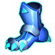 Lost Mech Legplates | Legplates | Blue | 90 | 4★ | [Lost Mech](#module-set-lost-mech) | ATK +61 DEF +49 HP +1,940 | ATK +162 DEF +129 HP +5,141 |
| 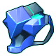 Lost Mech Back Armor | Back Armor | Blue | 90 | 4★ | [Lost Mech](#module-set-lost-mech) | ATK +61 DEF +49 HP +1,940 | ATK +162 DEF +129 HP +5,141 |
|  Lost Mech Body | Alloy Frame | Blue | 90 | 4★ | [Lost Mech](#module-set-lost-mech) | ATK +92 DEF +73 HP +2,910 | ATK +243 DEF +193 HP +7,711 |
|  Dragon's Booster | Booster | Purple | 110 | 6★ | - | ATK +178 DEF +141 HP +5,643 | ATK +793 DEF +630 HP +25,197 |
| 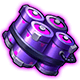 Dragon's Energy Reactor | Energy Reactor | Purple | 110 | 6★ | - | ATK +178 DEF +141 HP +5,643 | ATK +793 DEF +630 HP +25,197 |
|  Dragon's Helmet | Helmet | Purple | 110 | 6★ | [Blazing Dragon King](#module-set-blazing-dragon-king) | ATK +133 DEF +106 HP +4,232 | ATK +595 DEF +473 HP +18,897 |
| 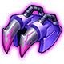 Dragon's Pauldron | Pauldron | Purple | 110 | 6★ | [Blazing Dragon King](#module-set-blazing-dragon-king) | ATK +89 DEF +71 HP +2,822 | ATK +397 DEF +315 HP +12,598 |
| 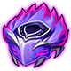 Dragon's Breastplate | Breastplate | Purple | 110 | 6★ | [Blazing Dragon King](#module-set-blazing-dragon-king) | ATK +133 DEF +106 HP +4,232 | ATK +595 DEF +473 HP +18,897 |
| 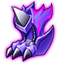 Dragon's Legplates | Legplates | Purple | 110 | 6★ | [Blazing Dragon King](#module-set-blazing-dragon-king) | ATK +89 DEF +71 HP +2,822 | ATK +397 DEF +315 HP +12,598 |
| 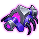 Dragon's Back Armor | Back Armor | Purple | 110 | 6★ | [Blazing Dragon King](#module-set-blazing-dragon-king) | ATK +89 DEF +71 HP +2,822 | ATK +397 DEF +315 HP +12,598 |
|  Dragon's Mecha Body | Alloy Frame | Purple | 110 | 6★ | [Blazing Dragon King](#module-set-blazing-dragon-king) | ATK +133 DEF +106 HP +4,232 | ATK +595 DEF +473 HP +18,897 |

### Module stats per star

Modules on the same line have the same stats.

| Modules | 0★ | 1★ | 2★ | 3★ | 4★ | 5★ | 6★ |
|---|---|---|---|---|---|---|---|
|  Booster  Energy Reactor | ATK +111 DEF +88 HP +3,527 | ATK +129 DEF +103 HP +4,109 | ATK +166 DEF +132 HP +5,273 | ATK +221 DEF +176 HP +7,019 | ATK +294 DEF +234 HP +9,346 | - | - |
|  Alloy Helmet  Alloy Breastplate  Alloy Frame | ATK +83 DEF +66 HP +2,645 | ATK +97 DEF +77 HP +3,082 | ATK +124 DEF +99 HP +3,955 | ATK +166 DEF +132 HP +5,264 | ATK +221 DEF +175 HP +7,010 | - | - |
|  Alloy Pauldron  Alloy Legplates  Alloy Back Armor | ATK +56 DEF +44 HP +1,763 | ATK +65 DEF +51 HP +2,054 | ATK +83 DEF +66 HP +2,636 | ATK +110 DEF +88 HP +3,509 | ATK +147 DEF +117 HP +4,673 | - | - |
|  Teck.1 Booster  Teck.1 Energy Reactor | ATK +122 DEF +97 HP +3,880 | ATK +142 DEF +113 HP +4,520 | ATK +183 DEF +145 HP +5,800 | ATK +243 DEF +193 HP +7,721 | ATK +324 DEF +257 HP +10,281 | - | - |
|  Lost Mech Helmet  Lost Mech Breastplate  Lost Mech Body | ATK +92 DEF +73 HP +2,910 | ATK +107 DEF +85 HP +3,390 | ATK +137 DEF +109 HP +4,350 | ATK +182 DEF +145 HP +5,790 | ATK +243 DEF +193 HP +7,711 | - | - |
|  Lost Mech Pauldron  Lost Mech Legplates  Lost Mech Back Armor | ATK +61 DEF +49 HP +1,940 | ATK +71 DEF +57 HP +2,260 | ATK +91 DEF +73 HP +2,900 | ATK +122 DEF +97 HP +3,860 | ATK +162 DEF +129 HP +5,141 | - | - |
|  Dragon's Booster  Dragon's Energy Reactor | ATK +178 DEF +141 HP +5,643 | ATK +207 DEF +165 HP +6,574 | ATK +266 DEF +211 HP +8,436 | ATK +354 DEF +281 HP +11,230 | ATK +471 DEF +374 HP +14,954 | ATK +617 DEF +491 HP +19,610 | ATK +793 DEF +630 HP +25,197 |
|  Dragon's Helmet  Dragon's Breastplate  Dragon's Mecha Body | ATK +133 DEF +106 HP +4,232 | ATK +155 DEF +123 HP +4,931 | ATK +199 DEF +158 HP +6,327 | ATK +265 DEF +211 HP +8,422 | ATK +353 DEF +281 HP +11,216 | ATK +463 DEF +368 HP +14,707 | ATK +595 DEF +473 HP +18,897 |
|  Dragon's Pauldron  Dragon's Legplates  Dragon's Back Armor | ATK +89 DEF +71 HP +2,822 | ATK +103 DEF +82 HP +3,287 | ATK +133 DEF +106 HP +4,218 | ATK +177 DEF +140 HP +5,615 | ATK +235 DEF +187 HP +7,477 | ATK +309 DEF +245 HP +9,805 | ATK +397 DEF +315 HP +12,598 |

### Refining (module stars)

- Tap a module and press **Empowerment**. Put up to 16 Raul Crystals in as materials and press the button: one try costs the Diamonds shown below and uses the crystals. The **Success Rate** is the materials' refine exp added up, divided by the exp the star needs (at most 100%: "Success Rate reached 100%"). On success the module gains 1 star.
- Help text: "Raul Crystals will be used as materials for refining Modules. There is a chance to upgrade the Module to a higher star level based on the selection of materials." "Refining has a success rate. Refining Raul Crystals of different levels has different success rates when they are used as materials." "Refining Modules of different star levels with the same Raul Crystal has different success rates."
- Blue modules stop at 4★, Purple modules at 6★; the cost of each star is the same for every module.

**Crystals for 100%** = how many crystals of one level give a 100% rate on their own ("-" = more than 16). **Spent** = Diamonds and exp used from 0★ when every try succeeds.

| Star | Exp needed | Diamonds per try |  Raul Crystal Lv.1 |  Raul Crystal Lv.2 | 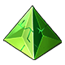 Raul Crystal Lv.3 |  Raul Crystal Lv.4 |  Raul Crystal Lv.5 |  Raul Crystal Lv.6 |  Raul Crystal Lv.7 | 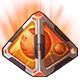 Raul Crystal Lv.8 | Spent: Diamonds | Spent: exp |
|---|---|---|---|---|---|---|---|---|---|---|---|---|
| 0★ → 1★ | 230 | 3 | - | 7 | 2 | 1 | 1 | 1 | 1 | 1 | 0 | 0 |
| 1★ → 2★ | 705 | 170 | - | - | 6 | 2 | 1 | 1 | 1 | 1 | 3 | 230 |
| 2★ → 3★ | 2,174 | 184 | - | - | 16 | 5 | 2 | 1 | 1 | 1 | 173 | 935 |
| 3★ → 4★ | 6,667 | 380 | - | - | - | 14 | 4 | 1 | 1 | 1 | 357 | 3,109 |
| 4★ → 5★ | 20,000 | 640 | - | - | - | - | 11 | 3 | 1 | 1 | 737 | 9,776 |
| 5★ → 6★ | 50,000 | 1,060 | - | - | - | - | - | 7 | 3 | 1 | 1,377 | 29,776 |
| 6★ (max) | - | - | - | - | - | - | - | - | - | - | 2,437 | 79,776 |

To max: Blue modules 737 Diamonds, Purple modules 2,437 Diamonds (plus the crystals), if every try succeeds.

### Install slots

- Tap a module and press **Install**. Every module has 2 install slots, each with its own stat; a Raul Crystal put in a slot gives that stat, more for a higher crystal level.
- Help text: "Modules have different numbers of Install Slots based on quality." "Install Raul Crystals into slots to activate their stats." "Higher-level Raul Crystals grant greater stat bonuses." "Installed Raul Crystals become part of the Module immediately. Installing a new Raul Crystal overwrites the previous effect, and the old Crystal is not returned."

| Slot | Stat | Modules |  Raul Crystal Lv.1 |  Raul Crystal Lv.2 |  Raul Crystal Lv.3 |  Raul Crystal Lv.4 |  Raul Crystal Lv.5 |  Raul Crystal Lv.6 |  Raul Crystal Lv.7 |  Raul Crystal Lv.8 |
|---|---|---|---|---|---|---|---|---|---|---|
| 1 | CON | Booster, Alloy Helmet, Alloy Pauldron, Alloy Breastplate, Alloy Legplates, Alloy Back Armor, Alloy Frame, Teck.1 Booster, Lost Mech Helmet, Lost Mech Pauldron, Lost Mech Breastplate, Lost Mech Legplates, Lost Mech Back Armor, Lost Mech Body | +48 | +50 | +55 | +62 | +71 | +83 | +98 | +114 |
| 1 | CON | Dragon's Booster, Dragon's Helmet, Dragon's Pauldron, Dragon's Breastplate, Dragon's Legplates, Dragon's Back Armor, Dragon's Mecha Body | +56 | +58 | +64 | +72 | +83 | +97 | +114 | +133 |
| 1 | AGI | Energy Reactor, Teck.1 Energy Reactor | +8 | +9 | +10 | +11 | +13 | +15 | +17 | +20 |
| 1 | AGI | Dragon's Energy Reactor | +9 | +10 | +11 | +13 | +15 | +17 | +20 | +23 |
| 2 | STR | Booster, Energy Reactor, Alloy Back Armor, Alloy Frame, Teck.1 Booster, Teck.1 Energy Reactor, Lost Mech Back Armor, Lost Mech Body | +21 | +22 | +24 | +27 | +31 | +36 | +43 | +50 |
| 2 | STR | Dragon's Booster, Dragon's Energy Reactor, Dragon's Back Armor, Dragon's Mecha Body | +24 | +26 | +28 | +32 | +36 | +43 | +50 | +58 |
| 2 | END | Alloy Helmet, Alloy Pauldron, Alloy Breastplate, Alloy Legplates, Lost Mech Helmet, Lost Mech Pauldron, Lost Mech Breastplate, Lost Mech Legplates | +42 | +44 | +48 | +54 | +63 | +73 | +85 | +100 |
| 2 | END | Dragon's Helmet, Dragon's Pauldron, Dragon's Breastplate, Dragon's Legplates | +49 | +51 | +56 | +63 | +73 | +85 | +100 | +117 |

### Module sets

Set pieces count on the same mech: the bonus of a line is on when that many pieces of the set sit on one mech.

#### Lost Mech

Pieces:  Lost Mech Helmet,  Lost Mech Pauldron,  Lost Mech Breastplate,  Lost Mech Legplates,  Lost Mech Back Armor,  Lost Mech Body

| Pieces | Bonus |
|---|---|
| 2 | DEF: +200 |
| 4 | DEX: +100 |
| 5 | ACRIT: +200 |
| 6 | DMG Up: +1% |

#### Blazing Dragon King

Pieces:  Dragon's Helmet,  Dragon's Pauldron,  Dragon's Breastplate,  Dragon's Legplates,  Dragon's Back Armor,  Dragon's Mecha Body

| Pieces | Bonus |
|---|---|
| 2 | DEF: +200 |
| 4 | PEN: +100 |
| 5 | CRIT: +200 |
| 6 | DMG Up: +1% |

### Disenchant Module and Refine Strip

- **Disenchant Module** turns spare modules into Raul Crystals (up to 5 at a time: "Can disenchant up to 5"). Help text: "Spare Modules can be disenchanted into Raul Crystals." "Raul Crystal types depend on Module quality. Refined Modules must be stripped first; otherwise, no Crystals are returned."
- **Refine Strip** takes a module with 1★ or more back to 0★ and gives Raul Crystals. Help text: "Only Refined 1-star+ Modules can be stripped." "Strip Refined 6-star Modules for 7-star Crystals." "Strip Refined 8-star Modules for 8-star Crystals."

| Disenchant Module: module quality | Diamonds | Crystals |
|---|---|---|
| Blue | 10 |  Raul Crystal Lv.1 ×2  Raul Crystal Lv.2 ×3 |
| Purple | 10 |  Raul Crystal Lv.1 ×1  Raul Crystal Lv.2 ×2  Raul Crystal Lv.3 ×3 |
| Orange (no module of this quality yet) | 10 |  Raul Crystal Lv.2 ×1  Raul Crystal Lv.3 ×2  Raul Crystal Lv.4 ×3 |

| Refine Strip: module stars | Diamonds | Crystals |
|---|---|---|
| 1★ | 100 |  Raul Crystal Lv.1 ×1  Raul Crystal Lv.2 ×3 |
| 2★ | 100 |  Raul Crystal Lv.1 ×1  Raul Crystal Lv.2 ×1  Raul Crystal Lv.3 ×2 |
| 3★ | 100 |  Raul Crystal Lv.2 ×2  Raul Crystal Lv.3 ×2  Raul Crystal Lv.4 ×1 |
| 4★ | 100 |  Raul Crystal Lv.3 ×1  Raul Crystal Lv.4 ×2  Raul Crystal Lv.5 ×1 |
| 5★ | 100 |  Raul Crystal Lv.4 ×3  Raul Crystal Lv.5 ×2  Raul Crystal Lv.6 ×1 |
| 6★ | 100 |  Raul Crystal Lv.5 ×3  Raul Crystal Lv.6 ×2  Raul Crystal Lv.7 ×1 |
| 7★ (no module goes this high yet) | 100 |  Raul Crystal Lv.4 ×3  Raul Crystal Lv.6 ×1  Raul Crystal Lv.7 ×3 |
| 8★ (no module goes this high yet) | 100 |  Raul Crystal Lv.6 ×2  Raul Crystal Lv.7 ×2  Raul Crystal Lv.8 ×2 |

## Raul Crystals

8 levels. They are the material for [refining](#refine), go into [install slots](#install), and are upgraded on the **Raul Crystal** page of the Alchemy Room.

- **Upgrade:** pick the crystal to upgrade, add up to 16 other crystals as materials and press the button. One try costs the Diamonds below; the **Success Rate** is the materials' upgrade exp added up, divided by the exp needed. Help text: "Select a Raul Crystal to upgrade and use others as materials." "Success rates vary based on the levels of Raul Crystals used." "Upgrading with the same type of Raul Crystal also affects success rates." "Lv.2-6 Raul Crystals can be obtained via upgrades; Lv.7-8 can only be obtained via stripping."
- **Quick Upgrade:** turns  Raul Crystal Lv.1 straight into a higher level; the cost per crystal is in the last column (already the full cost from Lv 1).

| Crystal | Upgrades into | Exp needed | Same-level materials for 100% | Diamonds per try | Upgrade exp as material | Refine exp as material | Quick Upgrade cost |
|---|---|---|---|---|---|---|---|
|  Raul Crystal Lv.1 |  Raul Crystal Lv.2 | 30 | 3 | 1 | 10 | 10 | - |
|  Raul Crystal Lv.2 |  Raul Crystal Lv.3 | 100 | 3 | 2 | 34 | 38 |  Raul Crystal Lv.1 ×4 + 1 Diamonds |
|  Raul Crystal Lv.3 |  Raul Crystal Lv.4 | 330 | 3 | 48 | 110 | 137 |  Raul Crystal Lv.1 ×14 + 3 Diamonds |
|  Raul Crystal Lv.4 |  Raul Crystal Lv.5 | 1,100 | 3 | 214 | 367 | 507 |  Raul Crystal Lv.1 ×50 + 130 Diamonds |
|  Raul Crystal Lv.5 |  Raul Crystal Lv.6 | 3,660 | 3 | 730 | 1,220 | 1,944 |  Raul Crystal Lv.1 ×190 + 900 Diamonds |
|  Raul Crystal Lv.6 | - | - | - | - | 3,660 | 7,876 |  Raul Crystal Lv.1 ×699 + 5,080 Diamonds |
|  Raul Crystal Lv.7 | - | - | - | - | 100% on its own | 21,140 | - |
|  Raul Crystal Lv.8 | - | - | - | - | 100% on its own | 69,520 | - |

Raul Crystal Lv.6, Raul Crystal Lv.7, Raul Crystal Lv.8 can't be upgraded. Crystals above Raul Crystal Lv.6 come only from [Refine Strip](#disenchant).

## Mecha Zone

A daily solo dungeon of 20 floors. It opens at **level 55**. Clearing floors gives points and Mech Coins; the daily and weekly point rankings give the rewards below. The Mech Coins are spent in the **Mech Store**.

- Game help text: "Mecha Zone unlocks at player Lv.55" "Dungeon floors reset daily. Clear a floor to challenge the next; failure means no further attempts on the same day." "Earn points and Mech Coins based on battle performance after clearing each Mecha Zone floor. More cleared floors mean more points and Mech Coins." "Receive corresponding ranking rewards based on daily and weekly total points rankings." "Spend Mech Coins to exchange for rare items in the Mech Store." "The Mecha Zone has three tiers: Outer Front, Flaming Battlefield, and Decisive Battlefield. Players who meet the weekly point requirements for advancement after weekly reset will automatically advance. Higher tiers mean harder levels and richer rewards." "Daily rankings reset at 00:00, and weekly rankings reset at 00:00 on Mondays. Settlement starts 30 minutes before reset, and the dungeon cannot be challenged during settlement." "Rankings are sorted by points from highest to lowest; players with the same points share the same rank, and subsequent ranks progress sequentially based on the number of players." "Win Conditions: Floors 1–10: ≤20 turns, Floors 11–15: ≤15 turns, Floors 16–20: ≤12 turns."
- The dungeon has 3 tiers: **Outside Front** (start), **Flaming War** (needs 70,000,000 weekly points), **Final Land** (needs 70,000,000 weekly points).
- **Quick Challenge** (clear a floor without fighting) is open on floors 1 - 15 when you can still challenge today and either your BP is at least 3× the floor's recommended BP or the floor is at least 5 floors below your highest floor.
-  Dungeon Ticket (Mecha Zone) ×1: game text "Use it to reset MP Dungeon [Mecha Zone] challenge chance".
- Each floor shows a monster, floor effects, traps and a Mech Trait; the game shows them only for the floor you are on.

### Floors and recommended BP

| Floor | Outside Front | Flaming War | Final Land |
|---|---|---|---|
| 1 | 500,000 | 800,000 | 3,000,000 |
| 2 | 540,000 | 940,000 | 3,250,000 |
| 3 | 580,000 | 1,080,000 | 3,300,000 |
| 4 | 620,000 | 1,220,000 | 3,400,000 |
| 5 | 660,000 | 1,360,000 | 3,500,000 |
| 6 | 700,000 | 1,500,000 | 3,750,000 |
| 7 | 740,000 | 1,640,000 | 4,000,000 |
| 8 | 780,000 | 1,780,000 | 4,250,000 |
| 9 | 820,000 | 1,920,000 | 4,500,000 |
| 10 | 860,000 | 2,060,000 | 5,000,000 |
| 11 | 900,000 | 2,200,000 | 5,250,000 |
| 12 | 940,000 | 2,340,000 | 5,500,000 |
| 13 | 980,000 | 2,480,000 | 5,750,000 |
| 14 | 1,020,000 | 2,620,000 | 6,000,000 |
| 15 | 1,060,000 | 2,760,000 | 6,250,000 |
| 16 | 1,100,000 | 2,900,000 | 6,500,000 |
| 17 | 1,140,000 | 3,040,000 | 6,750,000 |
| 18 | 1,180,000 | 3,180,000 | 7,000,000 |
| 19 | 1,300,000 | 3,320,000 | 7,250,000 |
| 20 | 1,500,000 | 3,600,000 | 7,500,000 |

### Floor effects

Names the game can show on a floor:

| Kind | Names |
|---|---|
| Floor effects | Burning, Self Harm, Lazy, Fury, Exhausted, Dice Points, Prime, Throw 1, Throw 2 |
| Traps | Area Bombing, Withered Life, Railgun, Invasion |
| Mech Trait | Burst Ignore, ATK Ignore, Boost Ignore, Magic Damage Ignorance |

### Ranking rewards

Daily rankings reset at 00:00, weekly rankings on Monday 00:00. "101+" = rank 101 and below.

#### Outside Front

| Rank | Daily | Weekly |
|---|---|---|
| 1 - 3 |  Mech Wreck I ×1  Mech Wreck II ×1  Mech Wreck III ×1  Diamond ×50 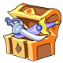 Ultimate Weapon Chest ×5  Sigil 2 ×3  Raul Crystal Lv.1 ×59 |  Mech Wreck I ×2  Mech Wreck II ×2  Mech Wreck III ×2  Diamond ×500  Ultimate Weapon Chest ×20 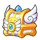 Wings Chest ×5  Raul Crystal Lv.1 ×676 |
| 4 - 5 |  Mech Wreck I ×1  Mech Wreck II ×1  Mech Wreck III ×1  Diamond ×40  Ultimate Weapon Chest ×4  Sigil 2 ×2  Raul Crystal Lv.1 ×53 |  Mech Wreck I ×2  Mech Wreck II ×2  Mech Wreck III ×1  Diamond ×450  Ultimate Weapon Chest ×15  Wings Chest ×4  Raul Crystal Lv.1 ×608 |
| 6 - 10 |  Mech Wreck I ×1  Mech Wreck II ×1  Diamond ×30  Ultimate Weapon Chest ×3  Sigil 2 ×1  Raul Crystal Lv.1 ×48 |  Mech Wreck I ×2  Mech Wreck II ×2  Diamond ×400  Ultimate Weapon Chest ×15  Wings Chest ×3  Raul Crystal Lv.1 ×540 |
| 11 - 20 |  Mech Wreck I ×1  Mech Wreck II ×1  Diamond ×20  Ultimate Weapon Chest ×3  Raul Crystal Lv.1 ×42 |  Mech Wreck I ×2  Mech Wreck II ×1  Diamond ×350  Ultimate Weapon Chest ×10  Wings Chest ×2  Raul Crystal Lv.1 ×472 |
| 21 - 30 |  Mech Wreck I ×1  Mech Wreck II ×1  Diamond ×20  Ultimate Weapon Chest ×3  Raul Crystal Lv.1 ×37 |  Mech Wreck I ×1  Mech Wreck II ×1  Diamond ×300  Ultimate Weapon Chest ×10  Wings Chest ×1  Raul Crystal Lv.1 ×404 |
| 31 - 50 |  Mech Wreck I ×1  Mech Wreck II ×1  Diamond ×10  Ultimate Weapon Chest ×3  Raul Crystal Lv.1 ×31 |  Mech Wreck I ×1  Mech Wreck II ×1  Diamond ×250  Ultimate Weapon Chest ×5  Raul Crystal Lv.1 ×336 |
| 51 - 100 |  Mech Wreck I ×1  Mech Wreck II ×1  Diamond ×10  Ultimate Weapon Chest ×2  Raul Crystal Lv.1 ×26 |  Mech Wreck I ×1  Mech Wreck II ×1  Diamond ×200  Ultimate Weapon Chest ×4  Raul Crystal Lv.1 ×268 |
| 101+ |  Mech Wreck I ×1  Mech Wreck II ×1  Diamond ×10  Ultimate Weapon Chest ×1  Raul Crystal Lv.1 ×20 |  Mech Wreck I ×1  Mech Wreck II ×1  Diamond ×100  Ultimate Weapon Chest ×3  Raul Crystal Lv.1 ×200 |

#### Flaming War

| Rank | Daily | Weekly |
|---|---|---|
| 1 - 3 |  Mech Wreck I ×1  Mech Wreck II ×1  Mech Wreck III ×1  Diamond ×50  Ultimate Weapon Chest ×5  Sigil 2 ×3  Raul Crystal Lv.2 ×15 |  Mech Wreck I ×2  Mech Wreck II ×2  Mech Wreck III ×2  Diamond ×500  Ultimate Weapon Chest ×20  Wings Chest ×5  Raul Crystal Lv.2 ×169 |
| 4 - 5 |  Mech Wreck I ×1  Mech Wreck II ×1  Mech Wreck III ×1  Diamond ×40  Ultimate Weapon Chest ×4  Sigil 2 ×2  Raul Crystal Lv.2 ×13 |  Mech Wreck I ×2  Mech Wreck II ×2  Mech Wreck III ×1  Diamond ×450  Ultimate Weapon Chest ×15  Wings Chest ×4  Raul Crystal Lv.2 ×152 |
| 6 - 10 |  Mech Wreck I ×1  Mech Wreck II ×1  Diamond ×30  Ultimate Weapon Chest ×3  Sigil 2 ×1  Raul Crystal Lv.2 ×12 |  Mech Wreck I ×2  Mech Wreck II ×2  Diamond ×400  Ultimate Weapon Chest ×15  Wings Chest ×3  Raul Crystal Lv.2 ×135 |
| 11 - 20 |  Mech Wreck I ×1  Mech Wreck II ×1  Diamond ×20  Ultimate Weapon Chest ×3  Raul Crystal Lv.2 ×11 |  Mech Wreck I ×2  Mech Wreck II ×1  Diamond ×350  Ultimate Weapon Chest ×10  Wings Chest ×2  Raul Crystal Lv.2 ×118 |
| 21 - 30 |  Mech Wreck I ×1  Mech Wreck II ×1  Diamond ×20  Ultimate Weapon Chest ×3  Raul Crystal Lv.2 ×9 |  Mech Wreck I ×1  Mech Wreck II ×1  Diamond ×300  Ultimate Weapon Chest ×10  Wings Chest ×1  Raul Crystal Lv.2 ×101 |
| 31 - 50 |  Mech Wreck I ×1  Mech Wreck II ×1  Diamond ×10  Ultimate Weapon Chest ×3  Raul Crystal Lv.2 ×8 |  Mech Wreck I ×1  Mech Wreck II ×1  Diamond ×250  Ultimate Weapon Chest ×5  Raul Crystal Lv.2 ×84 |
| 51 - 100 |  Mech Wreck I ×1  Mech Wreck II ×1  Diamond ×10  Ultimate Weapon Chest ×2  Raul Crystal Lv.2 ×7 |  Mech Wreck I ×1  Mech Wreck II ×1  Diamond ×200  Ultimate Weapon Chest ×4  Raul Crystal Lv.2 ×67 |
| 101+ |  Mech Wreck I ×1  Mech Wreck II ×1  Diamond ×10  Ultimate Weapon Chest ×1  Raul Crystal Lv.2 ×5 |  Mech Wreck I ×1  Mech Wreck II ×1  Diamond ×100  Ultimate Weapon Chest ×3  Raul Crystal Lv.2 ×50 |

#### Final Land

| Rank | Daily | Weekly |
|---|---|---|
| 1 - 3 |  Mech Wreck I ×1  Mech Wreck II ×1  Mech Wreck III ×1  Diamond ×50  Ultimate Weapon Chest ×5  Sigil 2 ×3  Raul Crystal Lv.3 ×4 |  Mech Wreck I ×2  Mech Wreck II ×2  Mech Wreck III ×2  Diamond ×500  Ultimate Weapon Chest ×20  Wings Chest ×5  Raul Crystal Lv.3 ×48 |
| 4 - 5 |  Mech Wreck I ×1  Mech Wreck II ×1  Mech Wreck III ×1  Diamond ×40  Ultimate Weapon Chest ×4  Sigil 2 ×2  Raul Crystal Lv.3 ×4 |  Mech Wreck I ×2  Mech Wreck II ×2  Mech Wreck III ×1  Diamond ×450  Ultimate Weapon Chest ×15  Wings Chest ×4  Raul Crystal Lv.3 ×43 |
| 6 - 10 |  Mech Wreck I ×1  Mech Wreck II ×1  Diamond ×30  Ultimate Weapon Chest ×3  Sigil 2 ×1  Raul Crystal Lv.3 ×3 |  Mech Wreck I ×2  Mech Wreck II ×2  Diamond ×400  Ultimate Weapon Chest ×15  Wings Chest ×3  Raul Crystal Lv.3 ×39 |
| 11 - 20 |  Mech Wreck I ×1  Mech Wreck II ×1  Diamond ×20  Ultimate Weapon Chest ×3  Raul Crystal Lv.3 ×3 |  Mech Wreck I ×2  Mech Wreck II ×1  Diamond ×350  Ultimate Weapon Chest ×10  Wings Chest ×2  Raul Crystal Lv.3 ×34 |
| 21 - 30 |  Mech Wreck I ×1  Mech Wreck II ×1  Diamond ×20  Ultimate Weapon Chest ×3  Raul Crystal Lv.3 ×3 |  Mech Wreck I ×1  Mech Wreck II ×1  Diamond ×300  Ultimate Weapon Chest ×10  Wings Chest ×1  Raul Crystal Lv.3 ×29 |
| 31 - 50 |  Mech Wreck I ×1  Mech Wreck II ×1  Diamond ×10  Ultimate Weapon Chest ×3  Raul Crystal Lv.3 ×2 |  Mech Wreck I ×1  Mech Wreck II ×1  Diamond ×250  Ultimate Weapon Chest ×5  Raul Crystal Lv.3 ×24 |
| 51 - 100 |  Mech Wreck I ×1  Mech Wreck II ×1  Diamond ×10  Ultimate Weapon Chest ×2  Raul Crystal Lv.3 ×2 |  Mech Wreck I ×1  Mech Wreck II ×1  Diamond ×200  Ultimate Weapon Chest ×4  Raul Crystal Lv.3 ×19 |
| 101+ |  Mech Wreck I ×1  Mech Wreck II ×1  Diamond ×10  Ultimate Weapon Chest ×1  Raul Crystal Lv.3 ×1 |  Mech Wreck I ×1  Mech Wreck II ×1  Diamond ×100  Ultimate Weapon Chest ×3  Raul Crystal Lv.3 ×14 |

## Materials

| Material | Quality | Used for | Where from |
|---|---|---|---|
|  Mech Wreck I | Blue | 20 → a random 3★ mech | Team Expedition: [Sea Vortex](team-expedition/sea-vortex.html), Easy, stage **Sea Vortex -2**: 3.43% drop chance Team Expedition: [Sea Vortex](team-expedition/sea-vortex.html), Normal, stage **Sea Vortex -2**: 2.85% drop chance Team Expedition: [Phantom of the Opera](team-expedition/phantom-of-the-opera.html), Easy, stage **Phantom of the Opera -2**: 1.78% drop chance Team Expedition: [Phantom of the Opera](team-expedition/phantom-of-the-opera.html), Normal, stage **Phantom of the Opera -2**: 2.29% drop chance Team Expedition: [Phantom of the Opera](team-expedition/phantom-of-the-opera.html), Hard, stage **Phantom of the Opera -2**: 2.86% drop chance Team Expedition: [Lost Forest](team-expedition/lost-forest.html), Easy, stage **Lost Forest - 2**: 1.84% drop chance Team Expedition: [Lost Forest](team-expedition/lost-forest.html), Normal, stage **Lost Forest - 2**: 2.20% drop chance Team Expedition: [Desert Ruins](team-expedition/desert-ruins.html), Easy, stage **Desert Ruins - 2**: 1.77% drop chance Team Expedition: [Desert Ruins](team-expedition/desert-ruins.html), Normal, stage **Desert Ruins - 2**: 2.23% drop chance Team Expedition: [Burning Canyon](team-expedition/burning-canyon.html), Easy, stage **Burning Canyon - 2**: 1.73% drop chance Team Expedition: [Burning Canyon](team-expedition/burning-canyon.html), Normal, stage **Burning Canyon - 2**: 2.68% drop chance Team Expedition: [Snow Castle](team-expedition/snow-castle.html), Easy, stage **Snow Castle 2**: 2.65% drop chance Team Expedition: [Snow Castle](team-expedition/snow-castle.html), Normal, stage **Snow Castle 2**: 2.13% drop chance Team Expedition: [Shadowy Domain](team-expedition/shadowy-domain.html), Easy, stage **Shadowy Domain 1**: 2.62% drop chance Team Expedition: [Shadowy Domain](team-expedition/shadowy-domain.html), Easy, stage **Shadowy Domain 2**: 2.61% drop chance Team Expedition: [Shadowy Domain](team-expedition/shadowy-domain.html), Normal, stage **Shadowy Domain 2**: 2.67% drop chance Team Expedition: [Sea train](team-expedition/sea-train.html), Easy, stage **Sea Train 2**: 1.74% drop chance Team Expedition: [Sea train](team-expedition/sea-train.html), Normal, stage **Sea Train 2**: 2.60% drop chance Team Expedition: [Lost Battlefield](team-expedition/lost-battlefield.html), Easy, stage **Lost Battlefield - 2**: 2.58% drop chance Team Expedition: [Lost Battlefield](team-expedition/lost-battlefield.html), Normal, stage **Lost Battlefield - 2**: 2.22% drop chance [Mecha Zone](#mecha-zone) Outside Front daily ranking (every rank): ×1 [Mecha Zone](#mecha-zone) Outside Front weekly ranking (every rank): ×1 - 2 [Mecha Zone](#mecha-zone) Flaming War daily ranking (every rank): ×1 [Mecha Zone](#mecha-zone) Flaming War weekly ranking (every rank): ×1 - 2 [Mecha Zone](#mecha-zone) Final Land daily ranking (every rank): ×1 [Mecha Zone](#mecha-zone) Final Land weekly ranking (every rank): ×1 - 2 Pet Hunt **Phantom of the Opera** Lv 5: Lucky Bonus ×3 (base chance 20%, lucky pets raise it) Weekly Trove, "reach Mecha Zone Outside Front floor 1": normal reward ×2 (10.00% chance), advanced reward ×5 (10.00% chance) Weekly Trove, "reach Mecha Zone Outside Front floor 20": normal reward ×5 (10.00% chance) Top-up gift **Level packs**: ×20 |
|  Mech Wreck II | Purple | 30 → a random 4★ mech | Team Expedition: [Sea Vortex](team-expedition/sea-vortex.html), Normal, stage **Sea Vortex -2**: 2.38% drop chance Team Expedition: [Sea Vortex](team-expedition/sea-vortex.html), Hard, stage **Sea Vortex -2**: 1.72% drop chance Team Expedition: [Phantom of the Opera](team-expedition/phantom-of-the-opera.html), Normal, stage **Phantom of the Opera -2**: 1.37% drop chance Team Expedition: [Phantom of the Opera](team-expedition/phantom-of-the-opera.html), Hard, stage **Phantom of the Opera -2**: 1.43% drop chance Team Expedition: [Lost Forest](team-expedition/lost-forest.html), Easy, stage **Lost Forest - 2**: 1.38% drop chance Team Expedition: [Lost Forest](team-expedition/lost-forest.html), Normal, stage **Lost Forest - 2**: 1.32% drop chance Team Expedition: [Lost Forest](team-expedition/lost-forest.html), Hard, stage **Lost Forest - 2**: 1.85% drop chance Team Expedition: [Desert Ruins](team-expedition/desert-ruins.html), Normal, stage **Desert Ruins - 2**: 1.79% drop chance Team Expedition: [Desert Ruins](team-expedition/desert-ruins.html), Hard, stage **Desert Ruins - 2**: 2.74% drop chance Team Expedition: [Burning Canyon](team-expedition/burning-canyon.html), Normal, stage **Burning Canyon - 2**: 1.78% drop chance Team Expedition: [Burning Canyon](team-expedition/burning-canyon.html), Hard, stage **Burning Canyon - 2**: 2.59% drop chance Team Expedition: [Snow Castle](team-expedition/snow-castle.html), Normal, stage **Snow Castle 2**: 1.28% drop chance Team Expedition: [Snow Castle](team-expedition/snow-castle.html), Hard, stage **Snow Castle 2**: 2.03% drop chance Team Expedition: [Shadowy Domain](team-expedition/shadowy-domain.html), Normal, stage **Shadowy Domain 2**: 1.34% drop chance Team Expedition: [Shadowy Domain](team-expedition/shadowy-domain.html), Hard, stage **Shadowy Domain 2**: 1.92% drop chance Team Expedition: [Sea train](team-expedition/sea-train.html), Normal, stage **Sea Train 2**: 1.74% drop chance Team Expedition: [Sea train](team-expedition/sea-train.html), Hard, stage **Sea Train 2**: 2.39% drop chance Team Expedition: [Lost Battlefield](team-expedition/lost-battlefield.html), Normal, stage **Lost Battlefield - 2**: 1.33% drop chance Team Expedition: [Lost Battlefield](team-expedition/lost-battlefield.html), Hard, stage **Lost Battlefield - 2**: 2.98% drop chance [Mecha Zone](#mecha-zone) Outside Front daily ranking (every rank): ×1 [Mecha Zone](#mecha-zone) Outside Front weekly ranking (every rank): ×1 - 2 [Mecha Zone](#mecha-zone) Flaming War daily ranking (every rank): ×1 [Mecha Zone](#mecha-zone) Flaming War weekly ranking (every rank): ×1 - 2 [Mecha Zone](#mecha-zone) Final Land daily ranking (every rank): ×1 [Mecha Zone](#mecha-zone) Final Land weekly ranking (every rank): ×1 - 2 Pet Hunt **Phantom of the Opera** Lv 6: Lucky Bonus ×2 (base chance 20%, lucky pets raise it) Weekly Trove, "reach Mecha Zone Outside Front floor 20": advanced reward ×5 (10.00% chance) Weekly Trove, "reach Mecha Zone Flaming War floor 10": normal reward ×5 (10.00% chance) Top-up gift **Level packs**: ×10 |
|  Mech Wreck III | Orange | 50 → a random 5★ mech | Team Expedition: [Sea Vortex](team-expedition/sea-vortex.html), Hard, stage **Sea Vortex -2**: 1.72% drop chance Team Expedition: [Phantom of the Opera](team-expedition/phantom-of-the-opera.html), Normal, stage **Phantom of the Opera -2**: 0.91% drop chance Team Expedition: [Phantom of the Opera](team-expedition/phantom-of-the-opera.html), Hard, stage **Phantom of the Opera -2**: 1.43% drop chance Team Expedition: [Lost Forest](team-expedition/lost-forest.html), Hard, stage **Lost Forest - 2**: 3.71% drop chance Team Expedition: [Desert Ruins](team-expedition/desert-ruins.html), Hard, stage **Desert Ruins - 2**: 1.82% drop chance Team Expedition: [Burning Canyon](team-expedition/burning-canyon.html), Hard, stage **Burning Canyon - 2**: 1.56% drop chance Team Expedition: [Snow Castle](team-expedition/snow-castle.html), Hard, stage **Snow Castle 2**: 1.52% drop chance Team Expedition: [Shadowy Domain](team-expedition/shadowy-domain.html), Hard, stage **Shadowy Domain 2**: 1.44% drop chance Team Expedition: [Sea train](team-expedition/sea-train.html), Hard, stage **Sea Train 2**: 1.43% drop chance Team Expedition: [Lost Battlefield](team-expedition/lost-battlefield.html), Hard, stage **Lost Battlefield - 2**: 1.98% drop chance [Mecha Zone](#mecha-zone) Outside Front daily ranking (top 5): ×1 [Mecha Zone](#mecha-zone) Outside Front weekly ranking (top 5): ×1 - 2 [Mecha Zone](#mecha-zone) Flaming War daily ranking (top 5): ×1 [Mecha Zone](#mecha-zone) Flaming War weekly ranking (top 5): ×1 - 2 [Mecha Zone](#mecha-zone) Final Land daily ranking (top 5): ×1 [Mecha Zone](#mecha-zone) Final Land weekly ranking (top 5): ×1 - 2 |
|  Mech Wreck IV | Orange | no recipe | Weekly Trove, "reach Mecha Zone Flaming War floor 10": advanced reward ×5 (10.00% chance) |
|  Raul Crystal Lv.1 | - | refining, install slots, upgrading | Mecha Zone Team Expedition: [Sea Vortex](team-expedition/sea-vortex.html), Normal, stage **Sea Vortex -2**: 7.61% drop chance [Mecha Zone](#mecha-zone) Outside Front daily ranking (every rank): ×20 - 59 [Mecha Zone](#mecha-zone) Outside Front weekly ranking (every rank): ×200 - 676 Pet Hunt **Phantom of the Opera** Lv 1: Lucky Bonus ×3 (base chance 25%, lucky pets raise it) Pet Hunt **Phantom of the Opera** Lv 2: Lucky Bonus ×4 (base chance 25%, lucky pets raise it) Pet Hunt **Phantom of the Opera** Lv 3: Lucky Bonus ×4 (base chance 25%, lucky pets raise it) [Disenchant Module](#disenchant) [Refine Strip](#disenchant) |
|  Raul Crystal Lv.2 | - | refining, install slots, upgrading | Mecha Zone Team Expedition: [Sea Vortex](team-expedition/sea-vortex.html), Easy, stage **Sea Vortex -2**: 6.86% drop chance Team Expedition: [Sea Vortex](team-expedition/sea-vortex.html), Normal, stage **Sea Vortex -2**: 5.71% drop chance Team Expedition: [Phantom of the Opera](team-expedition/phantom-of-the-opera.html), Easy, stage **Phantom of the Opera -2**: 4.46% drop chance Team Expedition: [Phantom of the Opera](team-expedition/phantom-of-the-opera.html), Normal, stage **Phantom of the Opera -2**: 4.57% drop chance Team Expedition: [Lost Forest](team-expedition/lost-forest.html), Easy, stage **Lost Forest - 2**: 4.60% drop chance Team Expedition: [Lost Forest](team-expedition/lost-forest.html), Normal, stage **Lost Forest - 2**: 5.29% drop chance Team Expedition: [Desert Ruins](team-expedition/desert-ruins.html), Easy, stage **Desert Ruins - 2**: 7.10% drop chance Team Expedition: [Desert Ruins](team-expedition/desert-ruins.html), Normal, stage **Desert Ruins - 2**: 5.36% drop chance Team Expedition: [Burning Canyon](team-expedition/burning-canyon.html), Easy, stage **Burning Canyon - 2**: 6.90% drop chance Team Expedition: [Snow Castle](team-expedition/snow-castle.html), Easy, stage **Snow Castle 2**: 3.54% drop chance Team Expedition: [Snow Castle](team-expedition/snow-castle.html), Normal, stage **Snow Castle 2**: 4.26% drop chance Team Expedition: [Shadowy Domain](team-expedition/shadowy-domain.html), Normal, stage **Shadowy Domain 2**: 3.57% drop chance Team Expedition: [Sea train](team-expedition/sea-train.html), Easy, stage **Sea Train 2**: 4.36% drop chance Team Expedition: [Sea train](team-expedition/sea-train.html), Normal, stage **Sea Train 2**: 2.60% drop chance Team Expedition: [Lost Battlefield](team-expedition/lost-battlefield.html), Easy, stage **Lost Battlefield - 2**: 3.45% drop chance Team Expedition: [Lost Battlefield](team-expedition/lost-battlefield.html), Normal, stage **Lost Battlefield - 2**: 3.56% drop chance [Mecha Zone](#mecha-zone) Flaming War daily ranking (every rank): ×5 - 15 [Mecha Zone](#mecha-zone) Flaming War weekly ranking (every rank): ×50 - 169 Pet Hunt **Phantom of the Opera** Lv 1: Lucky Bonus ×2 (base chance 25%, lucky pets raise it) Pet Hunt **Phantom of the Opera** Lv 2: Lucky Bonus ×2 (base chance 25%, lucky pets raise it) Pet Hunt **Phantom of the Opera** Lv 3: Lucky Bonus ×2 (base chance 25%, lucky pets raise it) Pet Hunt **Phantom of the Opera** Lv 4: Lucky Bonus ×2 (base chance 25%, lucky pets raise it) Weekly Trove, "reach Mecha Zone Outside Front floor 1": normal reward ×3 (60.00% chance), advanced reward ×5 (60.00% chance) Top-up gift **Level packs**: ×30 [Disenchant Module](#disenchant) [Refine Strip](#disenchant) [Upgrade](#crystals) from Raul Crystal Lv.1 |
|  Raul Crystal Lv.3 | - | refining, install slots, upgrading | Mecha Zone Team Expedition: [Sea Vortex](team-expedition/sea-vortex.html), Hard, stage **Sea Vortex -2**: 5.74% drop chance Team Expedition: [Phantom of the Opera](team-expedition/phantom-of-the-opera.html), Hard, stage **Phantom of the Opera -2**: 4.76% drop chance Team Expedition: [Lost Forest](team-expedition/lost-forest.html), Hard, stage **Lost Forest - 2**: 3.71% drop chance Team Expedition: [Desert Ruins](team-expedition/desert-ruins.html), Hard, stage **Desert Ruins - 2**: 4.56% drop chance Team Expedition: [Burning Canyon](team-expedition/burning-canyon.html), Normal, stage **Burning Canyon - 2**: 4.46% drop chance Team Expedition: [Shadowy Domain](team-expedition/shadowy-domain.html), Easy, stage **Shadowy Domain 1**: 4.36% drop chance Team Expedition: [Shadowy Domain](team-expedition/shadowy-domain.html), Easy, stage **Shadowy Domain 2**: 4.34% drop chance Team Expedition: [Shadowy Domain](team-expedition/shadowy-domain.html), Hard, stage **Shadowy Domain 2**: 3.84% drop chance Team Expedition: [Sea train](team-expedition/sea-train.html), Normal, stage **Sea Train 2**: 2.60% drop chance Team Expedition: [Sea train](team-expedition/sea-train.html), Hard, stage **Sea Train 2**: 3.82% drop chance Team Expedition: [Lost Battlefield](team-expedition/lost-battlefield.html), Hard, stage **Lost Battlefield - 2**: 5.38% drop chance [Mecha Zone](#mecha-zone) Final Land daily ranking (every rank): ×1 - 4 [Mecha Zone](#mecha-zone) Final Land weekly ranking (every rank): ×14 - 48 Pet Hunt **Phantom of the Opera** Lv 1: Lucky Bonus ×1 (base chance 25%, lucky pets raise it) Pet Hunt **Phantom of the Opera** Lv 2: Lucky Bonus ×1 (base chance 25%, lucky pets raise it) Pet Hunt **Phantom of the Opera** Lv 3: Lucky Bonus ×2 (base chance 25%, lucky pets raise it) Pet Hunt **Phantom of the Opera** Lv 4: Lucky Bonus ×1 (base chance 25%, lucky pets raise it) Pet Hunt **Phantom of the Opera** Lv 5: Lucky Bonus ×2 (base chance 20%, lucky pets raise it) Pet Hunt **Phantom of the Opera** Lv 6: Lucky Bonus ×2 (base chance 20%, lucky pets raise it) Weekly Trove, "reach Mecha Zone Outside Front floor 1": normal reward ×2 (30.00% chance), advanced reward ×3 (30.00% chance) Weekly Trove, "reach Mecha Zone Outside Front floor 20": normal reward ×3 (60.00% chance), advanced reward ×5 (60.00% chance) [Disenchant Module](#disenchant) [Refine Strip](#disenchant) [Upgrade](#crystals) from Raul Crystal Lv.2 |
|  Raul Crystal Lv.4 | - | refining, install slots, upgrading | Mecha Zone Pet Hunt **Phantom of the Opera** Lv 2: Lucky Bonus ×1 (base chance 25%, lucky pets raise it) Pet Hunt **Phantom of the Opera** Lv 3: Lucky Bonus ×2 (base chance 25%, lucky pets raise it) Pet Hunt **Phantom of the Opera** Lv 4: Lucky Bonus ×1 (base chance 25%, lucky pets raise it) Pet Hunt **Phantom of the Opera** Lv 5: Lucky Bonus ×2 (base chance 20%, lucky pets raise it) Pet Hunt **Phantom of the Opera** Lv 6: Lucky Bonus ×2 (base chance 20%, lucky pets raise it) Weekly Trove, "reach Mecha Zone Outside Front floor 20": normal reward ×2 (30.00% chance), advanced reward ×3 (30.00% chance) Weekly Trove, "reach Mecha Zone Flaming War floor 10": normal reward ×3 (60.00% chance), advanced reward ×5 (60.00% chance) [Disenchant Module](#disenchant) [Refine Strip](#disenchant) [Upgrade](#crystals) from Raul Crystal Lv.3 |
|  Raul Crystal Lv.5 | - | refining, install slots, upgrading | Mecha Zone Pet Hunt **Phantom of the Opera** Lv 4: Lucky Bonus ×1 (base chance 25%, lucky pets raise it) Pet Hunt **Phantom of the Opera** Lv 5: Lucky Bonus ×1 (base chance 20%, lucky pets raise it) Pet Hunt **Phantom of the Opera** Lv 6: Lucky Bonus ×1 (base chance 20%, lucky pets raise it) Weekly Trove, "reach Mecha Zone Flaming War floor 10": normal reward ×2 (30.00% chance), advanced reward ×3 (30.00% chance) [Refine Strip](#disenchant) [Upgrade](#crystals) from Raul Crystal Lv.4 |
|  Raul Crystal Lv.6 | - | refining, install slots, upgrading | Mecha Zone [Refine Strip](#disenchant) [Upgrade](#crystals) from Raul Crystal Lv.5 |
|  Raul Crystal Lv.7 | - | refining, install slots, upgrading | Mecha Zone [Refine Strip](#disenchant) |
|  Raul Crystal Lv.8 | - | refining, install slots, upgrading | Mecha Zone [Refine Strip](#disenchant) |
|  Dungeon Ticket (Mecha Zone) | - | an extra Mecha Zone try | - |
|  Booster | Blue | Booster slot | Team Expedition: [Shadowy Domain](team-expedition/shadowy-domain.html), Normal, stage **Shadowy Domain 2**: 0.62% drop chance Chest  **Alloy Module Selection Chest**: pick 1 of 8 (chest from: Event) Chest  **Alloy Module Chest**: 9.50% chance per chest (chest from: Event) |
|  Energy Reactor | Blue | Energy Reactor slot | Team Expedition: [Snow Castle](team-expedition/snow-castle.html), Hard, stage **Snow Castle 2**: 0.51% drop chance Chest  **Alloy Module Selection Chest**: pick 1 of 8 (chest from: Event) Chest  **Alloy Module Chest**: 9.50% chance per chest (chest from: Event) |
|  Alloy Helmet | Blue | Helmet slot | Team Expedition: [Sea Vortex](team-expedition/sea-vortex.html), Normal, stage **Sea Vortex -2**: 0.38% drop chance Chest  **Alloy Module Selection Chest**: pick 1 of 8 (chest from: Event) Chest  **Alloy Module Chest**: 12.00% chance per chest (chest from: Event) Chest  **Alloy Module Set Selection Chest**: pick 1 of 6 (chest from: Event) |
|  Alloy Pauldron | Blue | Pauldron slot | Team Expedition: [Phantom of the Opera](team-expedition/phantom-of-the-opera.html), Normal, stage **Phantom of the Opera -2**: 0.55% drop chance Team Expedition: [Lost Forest](team-expedition/lost-forest.html), Normal, stage **Lost Forest - 2**: 0.53% drop chance Chest  **Alloy Module Selection Chest**: pick 1 of 8 (chest from: Event) Chest  **Alloy Module Chest**: 15.00% chance per chest (chest from: Event) Chest  **Alloy Module Set Selection Chest**: pick 1 of 6 (chest from: Event) |
|  Alloy Breastplate | Blue | Breastplate slot | Chest  **Alloy Module Selection Chest**: pick 1 of 8 (chest from: Event) Chest  **Alloy Module Chest**: 12.00% chance per chest (chest from: Event) Chest  **Alloy Module Set Selection Chest**: pick 1 of 6 (chest from: Event) |
|  Alloy Legplates | Blue | Legplates slot | Team Expedition: [Desert Ruins](team-expedition/desert-ruins.html), Normal, stage **Desert Ruins - 2**: 0.45% drop chance Chest  **Alloy Module Selection Chest**: pick 1 of 8 (chest from: Event) Chest  **Alloy Module Chest**: 15.00% chance per chest (chest from: Event) Chest  **Alloy Module Set Selection Chest**: pick 1 of 6 (chest from: Event) |
|  Alloy Back Armor | Blue | Back Armor slot | Team Expedition: [Burning Canyon](team-expedition/burning-canyon.html), Normal, stage **Burning Canyon - 2**: 0.36% drop chance Team Expedition: [Sea train](team-expedition/sea-train.html), Normal, stage **Sea Train 2**: 0.87% drop chance Chest  **Alloy Module Selection Chest**: pick 1 of 8 (chest from: Event) Chest  **Alloy Module Chest**: 15.00% chance per chest (chest from: Event) Chest  **Alloy Module Set Selection Chest**: pick 1 of 6 (chest from: Event) |
|  Alloy Frame | Blue | Alloy Frame slot | Team Expedition: [Snow Castle](team-expedition/snow-castle.html), Normal, stage **Snow Castle 2**: 0.68% drop chance Chest  **Alloy Module Selection Chest**: pick 1 of 8 (chest from: Event) Chest  **Alloy Module Chest**: 12.00% chance per chest (chest from: Event) Chest  **Alloy Module Set Selection Chest**: pick 1 of 6 (chest from: Event) |
|  Teck.1 Booster | Blue | Booster slot | Team Expedition: [Lost Forest](team-expedition/lost-forest.html), Hard, stage **Lost Forest - 2**: 0.28% drop chance Team Expedition: [Desert Ruins](team-expedition/desert-ruins.html), Hard, stage **Desert Ruins - 2**: 0.36% drop chance Team Expedition: [Sea train](team-expedition/sea-train.html), Normal, stage **Sea Train 2**: 0.35% drop chance Chest  **Lost Mech Selection Chest**: pick 1 of 8 (chest from: Event) Chest  **Lost Mech Chest**: 9.50% chance per chest (chest from: Event) |
|  Teck.1 Energy Reactor | Blue | Energy Reactor slot | Team Expedition: [Burning Canyon](team-expedition/burning-canyon.html), Hard, stage **Burning Canyon - 2**: 0.31% drop chance Team Expedition: [Snow Castle](team-expedition/snow-castle.html), Hard, stage **Snow Castle 2**: 0.30% drop chance Team Expedition: [Lost Battlefield](team-expedition/lost-battlefield.html), Normal, stage **Lost Battlefield - 2**: 0.36% drop chance Chest  **Lost Mech Selection Chest**: pick 1 of 8 (chest from: Event) Chest  **Lost Mech Chest**: 9.50% chance per chest (chest from: Event) |
|  Lost Mech Helmet | Blue | Helmet slot | Team Expedition: [Shadowy Domain](team-expedition/shadowy-domain.html), Hard, stage **Shadowy Domain 2**: 0.48% drop chance Team Expedition: [Sea train](team-expedition/sea-train.html), Hard, stage **Sea Train 2**: 0.48% drop chance Team Expedition: [Lost Battlefield](team-expedition/lost-battlefield.html), Hard, stage **Lost Battlefield - 2**: 0.50% drop chance Chest  **Lost Mech Selection Chest**: pick 1 of 8 (chest from: Event) Chest  **Lost Mech Chest**: 12.00% chance per chest (chest from: Event) Chest  **Lost Mech Set Selection Chest**: pick 1 of 6 (chest from: Event) |
|  Lost Mech Pauldron | Blue | Pauldron slot | Chest  **Lost Mech Selection Chest**: pick 1 of 8 (chest from: Event) Chest  **Lost Mech Chest**: 15.00% chance per chest (chest from: Event) Chest  **Lost Mech Set Selection Chest**: pick 1 of 6 (chest from: Event) |
|  Lost Mech Breastplate | Blue | Breastplate slot | Chest  **Lost Mech Selection Chest**: pick 1 of 8 (chest from: Event) Chest  **Lost Mech Chest**: 12.00% chance per chest (chest from: Event) Chest  **Lost Mech Set Selection Chest**: pick 1 of 6 (chest from: Event) |
|  Lost Mech Legplates | Blue | Legplates slot | Chest  **Lost Mech Selection Chest**: pick 1 of 8 (chest from: Event) Chest  **Lost Mech Chest**: 15.00% chance per chest (chest from: Event) Chest  **Lost Mech Set Selection Chest**: pick 1 of 6 (chest from: Event) |
|  Lost Mech Back Armor | Blue | Back Armor slot | Chest  **Lost Mech Selection Chest**: pick 1 of 8 (chest from: Event) Chest  **Lost Mech Chest**: 15.00% chance per chest (chest from: Event) Chest  **Lost Mech Set Selection Chest**: pick 1 of 6 (chest from: Event) |
|  Lost Mech Body | Blue | Alloy Frame slot | Chest  **Lost Mech Selection Chest**: pick 1 of 8 (chest from: Event) Chest  **Lost Mech Chest**: 12.00% chance per chest (chest from: Event) Chest  **Lost Mech Set Selection Chest**: pick 1 of 6 (chest from: Event) |
|  Dragon's Booster | Purple | Booster slot | Chest  **Dragon's Module Selection Chest**: pick 1 of 8 (chest from: Event) Chest  **Dragon's Module Chest**: 9.50% chance per chest (chest from: Event) |
|  Dragon's Energy Reactor | Purple | Energy Reactor slot | Chest  **Dragon's Module Selection Chest**: pick 1 of 8 (chest from: Event) Chest  **Dragon's Module Chest**: 9.50% chance per chest (chest from: Event) |
|  Dragon's Helmet | Purple | Helmet slot | Chest  **Dragon's Module Selection Chest**: pick 1 of 8 (chest from: Event) Chest  **Dragon's Module Chest**: 12.00% chance per chest (chest from: Event) Chest  **Fiery Dragon King Set Selection Chest**: pick 1 of 6 (chest from: Event) |
|  Dragon's Pauldron | Purple | Pauldron slot | Chest  **Dragon's Module Selection Chest**: pick 1 of 8 (chest from: Event) Chest  **Dragon's Module Chest**: 15.00% chance per chest (chest from: Event) Chest  **Fiery Dragon King Set Selection Chest**: pick 1 of 6 (chest from: Event) |
|  Dragon's Breastplate | Purple | Breastplate slot | Chest  **Dragon's Module Selection Chest**: pick 1 of 8 (chest from: Event) Chest  **Dragon's Module Chest**: 12.00% chance per chest (chest from: Event) Chest  **Fiery Dragon King Set Selection Chest**: pick 1 of 6 (chest from: Event) |
|  Dragon's Legplates | Purple | Legplates slot | Chest  **Dragon's Module Selection Chest**: pick 1 of 8 (chest from: Event) Chest  **Dragon's Module Chest**: 15.00% chance per chest (chest from: Event) Chest  **Fiery Dragon King Set Selection Chest**: pick 1 of 6 (chest from: Event) |
|  Dragon's Back Armor | Purple | Back Armor slot | Chest  **Dragon's Module Selection Chest**: pick 1 of 8 (chest from: Event) Chest  **Dragon's Module Chest**: 15.00% chance per chest (chest from: Event) Chest  **Fiery Dragon King Set Selection Chest**: pick 1 of 6 (chest from: Event) |
|  Dragon's Mecha Body | Purple | Alloy Frame slot | Chest  **Dragon's Module Selection Chest**: pick 1 of 8 (chest from: Event) Chest  **Dragon's Module Chest**: 12.00% chance per chest (chest from: Event) Chest  **Fiery Dragon King Set Selection Chest**: pick 1 of 6 (chest from: Event) |

## Unknown

- Which mechs a random craft from a Mech Wreck can give, and the chance of each.
- What happens to the crystals and Diamonds when a refine or crystal upgrade fails.
- The Mech Store stock and prices, and how many points and Mech Coins a floor gives.
- Which monster, floor effects and traps each floor has, and what each floor effect does.
