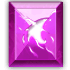
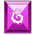
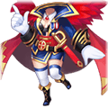
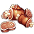
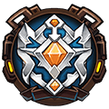
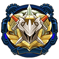
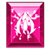

# Military rank

## How ranking works

- You earn  **Honor** in **Free Arena** matches (1v1, 2v2 and 3v3). Free Arena only gives Honor up to a daily amount; after that, matches give 0 Honor until the next day. **Ladder matches give no Honor**, only ladder points.
- When the rank bar is full, press **Promote**. Promoting **spends** the Honor the next rank needs; any Honor above that stays on the bar for the following rank.
- From Second Lt. up, each promotion also **costs Diamonds**  (the game asks you to confirm first). A few early ranks also need a number of Free Arena wins.
- Each rank gives a badge with stats, more daily privileges, and its own perks and packs (see below).

## Honor calculator

Pick your current rank, type the Honor shown on your rank bar, and pick the rank you want to reach.

Current rank

<label class="rc-field">Honor on your rank bar<input id="rc-honor" type="number" min="0" step="1" value="0"></label>

Target rank

## Ranks

| | Rank | Honor to promote | Total Honor from Veteran | Diamonds on promotion | Other |
|---|---|---|---|---|---|
|  | **Veteran** | starting rank | - | - | - |
|  | **Corporal** | 520 | 520 | - | - |
|  | **Sergeant** | 1,058 | 1,578 | - | - |
|  | **Staff Sgt** | 1,500 | 3,078 | - | Win 1 Free Arena matches |
|  | **Master Sgt** | 3,000 | 6,078 | - | Win 5 Free Arena matches |
|  | **Second Lt.** | 5,500 | 11,578 | 50  | - |
|  | **Lieutenant** | 15,000 | 26,578 | 100  | - |
|  | **Captain** | 40,000 | 66,578 | 200  | - |
|  | **Major** | 70,000 | 136,578 | 400  | - |
|  | **Lt Colonel** | 110,000 | 246,578 | 800  | - |
|  | **Colonel** | 160,000 | 406,578 | 1,000  | - |
|  | **Major General** | 230,000 | 636,578 | 1,500  | - |
|  | **Lt. General** | 310,000 | 946,578 | 2,000  | - |
|  | **General** | 400,000 | 1,346,578 | 3,000  | - |
|  | **Marshal** | 550,000 | 1,896,578 | 4,000  | - |
|  | **Grand Marshal** | 800,000 | 2,696,578 | 5,000  | - |
|  | **The Supreme Marshal** | 1,500,000 | 4,196,578 | 6,000  | - |

## Rank badges

Every rank from Corporal up gives its badge. The badge's stats:

| | Badge | ATK | DEF | HP | Luck | Toughness | DMG+ | DMG- | AGI | Motto |
|---|---|---|---|---|---|---|---|---|---|---|
|  | **Corporal** | 40 | 15 | 75 | 0 | 0 | 0 | 0 | 0 | I swear I will protect the continent with my life! |
|  | **Sergeant** | 40 | 30 | 150 | 0 | 0 | 0 | 0 | 0 | Charge forward! Charge forward! Charge forward! There is nothing to be afraid of! Go forward! |
|  | **Staff Sgt** | 70 | 53 | 265 | 0 | 0 | 0 | 0 | 0 | I'll chase invaders out of my country even if it means death! |
|  | **Master Sgt** | 100 | 75 | 375 | 75 | 0 | 0 | 0 | 20 | I will follow the order and go wherever I am needed! |
|  | **Second Lt.** | 130 | 98 | 490 | 97 | 0 | 0 | 0 | 50 | I won't give up my will even it means death! |
|  | **Lieutenant** | 160 | 120 | 600 | 120 | 0 | 40 | 0 | 70 | No matter how dangerous it is, following the order is my priority! |
|  | **Captain** | 190 | 142 | 710 | 142 | 111 | 47 | 0 | 90 | We must conquer our enemies! We must protect our country! |
|  | **Major** | 220 | 165 | 825 | 165 | 128 | 55 | 0 | 120 | Soldiers must obey orders. Even when asked to jump off the cliff, they would do so without hesitation. |
|  | **Lt Colonel** | 260 | 195 | 975 | 195 | 152 | 65 | 104 | 145 | Failure won't stop me from trying. I will keep trying till the last moment! |
|  | **Colonel** | 300 | 225 | 1,125 | 225 | 175 | 75 | 120 | 198 | I will always preserve my dignity as a soldier no matter the situation. Go forward, never look back! |
|  | **Major General** | 340 | 255 | 1,275 | 255 | 199 | 85 | 136 | 265 | I am willing to sacrifice everything to win this war, for honor, and my country! |
|  | **Lt. General** | 380 | 285 | 1,425 | 285 | 222 | 95 | 152 | 342 | I swore to not back down upon powerful enemies and keep bravery and loyalty in heart! |
|  | **General** | 420 | 315 | 1,575 | 315 | 245 | 105 | 168 | 498 | I swore to protect the weak and fight for justice with my life! |
|  | **Marshal** | 460 | 345 | 1,725 | 345 | 269 | 115 | 184 | 560 | War is holy. Don't start it recklessly War is cruel. Don't start it in a whim! |
|  | **Grand Marshal** | 520 | 390 | 1,950 | 390 | 304 | 130 | 208 | 640 | The true victory is to win without a fight. |
|  | **The Supreme Marshal** | 560 | 420 | 2,100 | 425 | 330 | 140 | 227 | 708 | The highest order is issued to annihilate all reactionaries |

## Privileges by rank

What each rank unlocks, as the game lists it.

 <b>Veteran</b>
<ul><li>Have <b>2</b> chances to buy VIT per day</li><li>Have <b>10</b> chances to use Alchemy per day</li><li>Join Team Expedition up to <b>10</b> times per day.</li><li>Can claim <b>20</b> VIT gifted by friends per day</li><li>Can buy Rune Explore <b>1</b> times per day</li><li>Can use Hardcore Training <b>5</b> times per day</li><li>Can quick complete <b>4</b> loop quests per day</li><li>Open<b>the 1 meridian cultivation queue</b></li></ul>

 <b>Corporal</b>
<ul><li>Upgrade Badge to: <b>Corporal</b></li><li>Have <b>3</b> chances to buy VIT per day</li><li>Have <b>11</b> chances to use Alchemy per day</li><li>Join Team Expedition up to <b>12</b> times per day.</li><li>Can claim <b>22</b> VIT gifted by friends per day</li><li>Have <b>1</b> chances to reset chances to challenge boss stages per day</li><li>Have <b>1</b> chances to reset chances to challenge elite stages per day</li><li>Can buy Rune Explore <b>1</b> times per day</li><li>Can use Hardcore Training <b>5</b> times per day</li><li>Can quick complete <b>4</b> loop quests per day</li><li>Enjoy all the privileges of <b>Veteran</b></li></ul>

 <b>Sergeant</b>
<ul><li>Upgrade Badge to: <b>Sergeant</b></li><li>Have <b>4</b> chances to buy VIT per day</li><li>Have <b>12</b> chances to use Alchemy per day</li><li>Join Team Expedition up to <b>12</b> times per day.</li><li>Can claim <b>24</b> VIT gifted by friends per day</li><li>Unlock the <b>Blitz</b> function in Solo Adventure</li><li>Have <b>2</b> chances to reset chances to challenge boss stages per day</li><li>Have <b>2</b> chances to reset chances to challenge elite stages per day</li><li>Can buy Rune Explore <b>1</b> times per day</li><li>Can use Hardcore Training <b>5</b> times per day</li><li>Can quick complete <b>4</b> loop quests per day</li><li>Enjoy all the privileges of <b>Corporal</b></li></ul>

 <b>Staff Sgt</b>
<ul><li>Upgrade Badge to: <b>Staff Sgt</b></li><li>Have <b>5</b> chances to buy VIT per day</li><li>Have <b>13</b> chances to use Alchemy per day</li><li>Join Team Expedition up to <b>12</b> times per day.</li><li>Can claim <b>26</b> VIT gifted by friends per day</li><li>Unlock the <b>x10 Blitz</b> function in Solo Adventure</li><li>Have <b>3</b> chances to reset chances to challenge boss stages per day</li><li>Have <b>3</b> chances to reset chances to challenge elite stages per day</li><li>Can buy Rune Explore <b>1</b> times per day</li><li>Can use Hardcore Training <b>10</b> times per day</li><li>Can quick complete <b>4</b> loop quests per day</li><li>Enjoy all the privileges of <b>Sergeant</b></li></ul>

 <b>Master Sgt</b>
<ul><li>Upgrade Badge to: <b>Master Sgt</b></li><li>Have <b>6</b> chances to buy VIT per day</li><li>Have <b>14</b> chances to use Alchemy per day</li><li>Join Team Expedition up to <b>12</b> times per day.</li><li>Can claim <b>28</b> VIT gifted by friends per day</li><li>Open <b>Master Sgt exclusive rune slot</b></li><li>Have <b>4</b> chances to reset chances to challenge boss stages per day</li><li>Have <b>4</b> chances to reset chances to challenge elite stages per day</li><li>Can buy Rune Explore <b>1</b> times per day</li><li>Can use Hardcore Training <b>10</b> times per day</li><li>Can quick complete <b>5</b> loop quests per day</li><li>Enjoy all the privileges of <b>Staff Sgt</b></li></ul>

 <b>Second Lt.</b>
<ul><li>Upgrade Badge to: <b>Second Lt.</b></li><li>Have <b>7</b> chances to buy VIT per day</li><li>Have <b>15</b> chances to use Alchemy per day</li><li>Join Team Expedition up to <b>14</b> times per day.</li><li>Can claim <b>30</b> VIT gifted by friends per day</li><li>Activate the skill - <b>Group Healing</b></li><li>Open <b>Second Lt. exclusive rune slot</b></li><li>Equipment blessing unlocks the <b>One Click Blessing</b> function.</li><li>Have <b>5</b> chances to reset chances to challenge boss stages per day</li><li>Have <b>5</b> chances to reset chances to challenge elite stages per day</li><li>Can buy Rune Explore <b>2</b> times per day</li><li>Can use Hardcore Training <b>15</b> times per day</li><li>Can quick complete <b>6</b> loop quests per day</li><li>Enjoy all the privileges of <b>Master Sgt</b></li></ul>

 <b>Lieutenant</b>
<ul><li>Upgrade Badge to: <b>Lieutenant</b></li><li>Have <b>8</b> chances to buy VIT per day</li><li>Have <b>16</b> chances to use Alchemy per day</li><li>Join Team Expedition up to <b>14</b> times per day.</li><li>Can claim <b>32</b> VIT gifted by friends per day</li><li>Activate the skill - <b>Group Stealth</b></li><li>Open <b>Lieutenant exclusive rune slot</b></li><li>Unlock the <b>Quick Craft</b> function</li><li>Have <b>6</b> chances to reset chances to challenge boss stages per day</li><li>Have <b>6</b> chances to reset chances to challenge elite stages per day</li><li>Can buy Rune Explore <b>2</b> times per day</li><li>Can use Hardcore Training <b>15</b> times per day</li><li>Can quick complete <b>6</b> loop quests per day</li><li>Enjoy all the privileges of <b>Second Lt.</b></li></ul>

 <b>Captain</b>
<ul><li>Upgrade Badge to: <b>Captain</b></li><li>Have <b>9</b> chances to buy VIT per day</li><li>Have <b>17</b> chances to use Alchemy per day</li><li>Join Team Expedition up to <b>14</b> times per day.</li><li>Can claim <b>34</b> VIT gifted by friends per day</li><li>Open <b>Captain exclusive rune slot</b></li><li>Unlock <b>Gold Miner</b> in Rune Explore</li><li>Have <b>7</b> chances to reset chances to challenge boss stages per day</li><li>Have <b>7</b> chances to reset chances to challenge elite stages per day</li><li>Can buy Rune Explore <b>2</b> times per day</li><li>Can use Hardcore Training <b>15</b> times per day</li><li>Can quick complete <b>7</b> loop quests per day</li><li>Enjoy all the privileges of <b>Lieutenant</b></li></ul>

 <b>Major</b>
<ul><li>Upgrade Badge to: <b>Major</b></li><li>Have <b>10</b> chances to buy VIT per day</li><li>Have <b>18</b> chances to use Alchemy per day</li><li>Join Team Expedition up to <b>15</b> times per day.</li><li>Can claim <b>36</b> VIT gifted by friends per day</li><li>Unlock the function to <b>permanently summon Secret Merchant</b></li><li>Open <b>Major exclusive rune slot</b></li><li>Have <b>8</b> chances to reset chances to challenge boss stages per day</li><li>Have <b>8</b> chances to reset chances to challenge elite stages per day</li><li>Can buy Rune Explore <b>3</b> times per day</li><li>Can use Hardcore Training <b>20</b> times per day</li><li>Can quick complete <b>8</b> loop quests per day</li><li>Base success rate of blessing increased by <b>15.0%</b></li><li>Lord's Battle Bidding Funds: Can purchase <b>1</b> times</li><li>Enjoy all the privileges of <b>Captain</b></li></ul>

 <b>Lt Colonel</b>
<ul><li>Upgrade Badge to: <b>Lt Colonel</b></li><li>Have <b>11</b> chances to buy VIT per day</li><li>Have <b>19</b> chances to use Alchemy per day</li><li>Join Team Expedition up to <b>15</b> times per day.</li><li>Can claim <b>38</b> VIT gifted by friends per day</li><li>Activate <b>Lt Colonel Exclusive Costume</b></li><li>Open <b>Lt Colonel exclusive rune slot</b></li><li>Have <b>9</b> chances to reset chances to challenge boss stages per day</li><li>Have <b>9</b> chances to reset chances to challenge elite stages per day</li><li>Can buy Rune Explore <b>3</b> times per day</li><li>Can use Hardcore Training <b>20</b> times per day</li><li>Can quick complete <b>8</b> loop quests per day</li><li>Base success rate of blessing increased by <b>20.0%</b></li><li>Lord's Battle Bidding Funds: Can purchase <b>1</b> times</li><li>Enjoy all the privileges of <b>Major</b></li></ul>

 <b>Colonel</b>
<ul><li>Upgrade Badge to: <b>Colonel</b></li><li>Have <b>12</b> chances to buy VIT per day</li><li>Have <b>20</b> chances to use Alchemy per day</li><li>Join Team Expedition up to <b>15</b> times per day.</li><li>Can claim <b>40</b> VIT gifted by friends per day</li><li>Open <b>Colonel exclusive rune slot</b></li><li>Have <b>10</b> chances to reset chances to challenge boss stages per day</li><li>Have <b>10</b> chances to reset chances to challenge elite stages per day</li><li>Can buy Rune Explore <b>3</b> times per day</li><li>Can use Hardcore Training <b>20</b> times per day</li><li>Can quick complete <b>9</b> loop quests per day</li><li>Base success rate of blessing increased by <b>25.0%</b></li><li>Lord's Battle Bidding Funds: Can purchase <b>1</b> times</li><li>Enjoy all the privileges of <b>Lt Colonel</b></li></ul>

 <b>Major General</b>
<ul><li>Upgrade Badge to: <b>Major General</b></li><li>Have <b>13</b> chances to buy VIT per day</li><li>Have <b>21</b> chances to use Alchemy per day</li><li>Join Team Expedition up to <b>16</b> times per day.</li><li>Can claim <b>42</b> VIT gifted by friends per day</li><li>Open <b>Major General exclusive rune slot</b></li><li>Have <b>11</b> chances to reset chances to challenge boss stages per day</li><li>Have <b>11</b> chances to reset chances to challenge elite stages per day</li><li>Can buy Rune Explore <b>4</b> times per day</li><li>Can use Hardcore Training <b>25</b> times per day</li><li>Can quick complete <b>10</b> loop quests per day</li><li>Base success rate of blessing increased by <b>30.0%</b></li><li>Open<b>the 2 meridian cultivation queue</b></li><li>Lord's Battle Bidding Funds: Can purchase <b>2</b> times</li><li>Enjoy all the privileges of <b>Colonel</b></li></ul>

 <b>Lt. General</b>
<ul><li>Upgrade Badge to: <b>Lt. General</b></li><li>Have <b>14</b> chances to buy VIT per day</li><li>Have <b>22</b> chances to use Alchemy per day</li><li>Join Team Expedition up to <b>16</b> times per day.</li><li>Can claim <b>44</b> VIT gifted by friends per day</li><li>Open <b>Lt. General exclusive rune slot</b></li><li>Have <b>12</b> chances to reset chances to challenge boss stages per day</li><li>Have <b>12</b> chances to reset chances to challenge elite stages per day</li><li>Can buy Rune Explore <b>4</b> times per day</li><li>Can use Hardcore Training <b>25</b> times per day</li><li>Can quick complete <b>10</b> loop quests per day</li><li>Base success rate of blessing increased by <b>35.0%</b></li><li>Lord's Battle Bidding Funds: Can purchase <b>2</b> times</li><li>Enjoy all the privileges of <b>Major General</b></li></ul>

 <b>General</b>
<ul><li>Upgrade Badge to: <b>General</b></li><li>Have <b>15</b> chances to buy VIT per day</li><li>Have <b>23</b> chances to use Alchemy per day</li><li>Join Team Expedition up to <b>16</b> times per day.</li><li>Can claim <b>46</b> VIT gifted by friends per day</li><li>Open <b>General exclusive rune slot</b></li><li>Have <b>13</b> chances to reset chances to challenge boss stages per day</li><li>Have <b>13</b> chances to reset chances to challenge elite stages per day</li><li>Can buy Rune Explore <b>4</b> times per day</li><li>Can use Hardcore Training <b>25</b> times per day</li><li>Can quick complete <b>11</b> loop quests per day</li><li>Base success rate of blessing increased by <b>40.0%</b></li><li>Lord's Battle Bidding Funds: Can purchase <b>2</b> times</li><li>Enjoy all the privileges of <b>Lt. General</b></li></ul>

 <b>Marshal</b>
<ul><li>Upgrade Badge to: <b>Marshal</b></li><li>Have <b>16</b> chances to buy VIT per day</li><li>Have <b>24</b> chances to use Alchemy per day</li><li>Join Team Expedition up to <b>17</b> times per day.</li><li>Can claim <b>48</b> VIT gifted by friends per day</li><li>Open <b>Marshal exclusive rune slot</b></li><li>Have <b>14</b> chances to reset chances to challenge boss stages per day</li><li>Have <b>14</b> chances to reset chances to challenge elite stages per day</li><li>Can buy Rune Explore <b>5</b> times per day</li><li>Can use Hardcore Training <b>30</b> times per day</li><li>Can quick complete <b>12</b> loop quests per day</li><li>Base success rate of blessing increased by <b>45.0%</b></li><li>Lord's Battle Bidding Funds: Can purchase <b>3</b> times</li><li>Enjoy all the privileges of <b>General</b></li></ul>

 <b>Grand Marshal</b>
<ul><li>Upgrade Badge to: <b>Grand Marshal</b></li><li>Have <b>17</b> chances to buy VIT per day</li><li>Have <b>25</b> chances to use Alchemy per day</li><li>Join Team Expedition up to <b>17</b> times per day.</li><li>Can claim <b>50</b> VIT gifted by friends per day</li><li>Open <b>Grand Marshal exclusive rune slot</b></li><li>Have <b>15</b> chances to reset chances to challenge boss stages per day</li><li>Have <b>15</b> chances to reset chances to challenge elite stages per day</li><li>Can buy Rune Explore <b>6</b> times per day</li><li>Can use Hardcore Training <b>35</b> times per day</li><li>Can quick complete <b>12</b> loop quests per day</li><li>Base success rate of blessing increased by <b>50.0%</b></li><li>Open<b>the 3 meridian cultivation queue</b></li><li>Lord's Battle Bidding Funds: Can purchase <b>3</b> times</li><li>Enjoy all the privileges of <b>Marshal</b></li></ul>

 <b>The Supreme Marshal</b>
<ul><li>Upgrade Badge to: <b>The Supreme Marshal</b></li><li>Have <b>18</b> chances to buy VIT per day</li><li>Have <b>26</b> chances to use Alchemy per day</li><li>Join Team Expedition up to <b>18</b> times per day.</li><li>Can claim <b>60</b> VIT gifted by friends per day</li><li>Have <b>16</b> chances to reset chances to challenge boss stages per day</li><li>Have <b>16</b> chances to reset chances to challenge elite stages per day</li><li>Can buy Rune Explore <b>7</b> times per day</li><li>Can use Hardcore Training <b>40</b> times per day</li><li>Can quick complete <b>13</b> loop quests per day</li><li>Base success rate of blessing increased by <b>55.0%</b></li><li>Lord's Battle Bidding Funds: Can purchase <b>4</b> times</li><li>Enjoy all the privileges of <b>Grand Marshal</b></li></ul>

## Rank perks

### Daily Perks

You can claim perks daily. High Rank equals better perks! Free; you can only claim the perk of your current rank.

| | Rank | Rewards |
|---|---|---|
|  | Sergeant |  Coin ×10,000  Blitz Ticket ×10  Pet Essence ×200  Diamond ×20 |
|  | Staff Sgt |  Coin ×15,000  Blitz Ticket ×15  Pet Essence ×300  Diamond ×30 |
|  | Master Sgt |  Coin ×20,000  Blitz Ticket ×20  Pet Essence ×400  Diamond ×40 |
|  | Second Lt. |  Coin ×20,000  Blitz Ticket ×20  Pet Essence ×500  Diamond ×50 |
|  | Lieutenant |  Coin ×25,000  Blitz Ticket ×25  Pet Essence ×600  Diamond ×60 |
|  | Captain |  Coin ×30,000  Blitz Ticket ×30  Pet Essence ×700  Diamond ×70 |
|  | Major |  Coin ×30,000  Blitz Ticket ×30  Pet Essence ×800  Diamond ×80 |
|  | Lt Colonel |  Coin ×35,000  Blitz Ticket ×35  Pet Essence ×900  Diamond ×90 |
|  | Colonel |  Coin ×40,000  Blitz Ticket ×40  Pet Essence ×1,000  Diamond ×100 |
|  | Major General |  Coin ×40,000  Blitz Ticket ×50  Pet Essence ×1,100  Diamond ×110 |
|  | Lt. General |  Coin ×45,000  Blitz Ticket ×50  Pet Essence ×1,200  Diamond ×120 |
|  | General |  Coin ×50,000  Blitz Ticket ×50  Pet Essence ×1,300  Diamond ×130 |
|  | Marshal |  Coin ×50,000  Blitz Ticket ×60  Pet Essence ×1,400  Diamond ×140 |
|  | Grand Marshal |  Coin ×55,000  Blitz Ticket ×60  Pet Essence ×1,500  Diamond ×150 |
|  | The Supreme Marshal |  Coin ×60,000  Blitz Ticket ×60  Pet Essence ×1,600  Diamond ×160 |

### Weekly Perks

Items are on sale every week. Reach higher rank to get access to more and better deals! Bought with Diamonds.

| Needs rank | Player level | Items | Price | Normal price |
|---|---|---|---|---|
| Veteran | 1-139 |  SP Gacha ×5  APT Pill II ×5  APT Pill ×10 | 580  | 2,050 |
| Master Sgt | 22-139 |  Purple Rune Chest ×1  Chest Key ×20  Premium Chest Key ×20 | 380  | 950 |
| Captain | 1-139 |  Lv.3 Blessing Gem ×20  Lv.4 Blessing Gem ×10  Lv.5 Blessing Gem ×5 | 480  | 1,129 |
| Colonel | 1-139 |  Refine Stone I ×10  Refine Stone II ×10  Refine Stone III ×10  Refine Stone IV ×10 | 580  | 1,499 |
| General | 28-139 |  Earth's Core ×5  Elemental Gem ×10  Heroic Forge Hammer ×1 | 680  | 1,640 |
| The Supreme Marshal | 35-139 |  Lv.2 Orb Bag ×20  Lv.3 Orb Bag ×10  Lv.4 Orb Bag ×5 | 1,580  | 4,119 |

### Rank Pack

Don't miss out on rank exclusive pack! Each pack can be bought once, after reaching its rank.

| | Rank | Items | Price | Normal price |
|---|---|---|---|---|
|  | Sergeant |  Coin ×400,000  Upgrade Stone ×5  ATK Rune ×1  Enhance Stone V ×30 | 380  | 1,000 |
|  | Staff Sgt |  Coin ×400,000  Upgrade Stone ×5  ATK Rune ×1  Enhance Stone VI ×30 | 380  | 1,357 |
|  | Master Sgt |  Coin ×400,000  weapon shard chest C ×10  Lv.4 Blessing Gem ×10  Enhance Stone VIII ×30 | 380  | 1,727 |
|  | Second Lt. |  SP Gacha ×10  weapon shard chest C ×10  Lv.4 Blessing Gem ×20  Refine Chest ×1 | 980  | 3,629 |
|  | Lieutenant |  SP Gacha ×10  weapon shard chest C ×10  Lv.4 Blessing Gem ×30  Refine Chest ×2 | 980  | 4,454 |
|  | Captain |  SP Gacha ×10  weapon shard chest C ×20  Lv.5 Blessing Gem ×10  Blade Rune ×1 | 980  | 5,444 |
|  | Major |  Hell Shard ×20  Lv.5 Blessing Gem ×10  Col.'s Uniform ×1  Col.'s Uniform ×1  Food Stock ×30 | 1,280  | 6,400 |
|  | Lt Colonel |  Hell Shard ×20  Lv.5 Blessing Gem ×10  Col.'s Hat ×1  Col.'s Hat ×1  Food Stock ×40 | 1,280  | 6,400 |
|  | Colonel |  Hell Shard ×20  Lv.5 Blessing Gem ×15  Col.'s Hairstyle ×1  Col.'s Hairstyle ×1  Food Stock ×50 | 1,280  | 7,529 |
|  | Major General |  Excalibur Shard ×30  Epic Forge Hammer ×2  Refine Chest ×10  Armored Runes ×1 | 2,800  | 14,000 |
|  | Lt. General |  Excalibur Shard ×30  Platinum Medal ×1  Endurance ×1  Survival ×1  Starlight Rune ×1 | 3,800  | 13,571 |
|  | General |  Excalibur Shard ×30  Lv.5 Orb Bag ×1  Refine Chest ×20  God of War Rune ×1 | 4,800  | 21,818 |
|  | Marshal |  Troll Boomerang Shard ×50  Lv.5 Orb Bag ×2  SP Gacha ×40  Knight Runes ×1 | 5,800  | 26,363 |
|  | Grand Marshal |  Troll Boomerang Shard ×50  Superb Medal ×1  Spiderman ×1  Spiderman ×1  Blood Rune ×1 | 5,800  | 20,000 |
|  | The Supreme Marshal |  Troll Boomerang Shard ×50  Brawler King Medal ×1  Starry Moon ×1  God of War Rune ×1 | 6,800  | 27,200 |
