# Mounts

Mounts unlock at player level **40**. Collecting and upgrading mounts makes your character stronger in three ways: Riding Stats, the skills of the mount you ride, and the stats of mount equipment and Mount Hearts.

**Jump to:** [Riding Stats](#riding) · [Vigor](#vigor) · [Skills](#skills) · [Equipment](#equipment) · [Mount Heart](#heart) · [All mounts](#all)

## How mounts work

- **Riding Stats** (STR, END, CON, LUCK, TOU, PEN, DEX) belong to your character, not to one mount. You raise them with **Foster**.
- **Riding Points** set the cap of every Riding Stat: more Riding Points, higher caps. They come from your base value, your Mount Heart bonds, and the equipment of **every mount you own**.
- You ride one mount at a time (**Mount** / **Rest** button). Its 4 skills work in battle while it has Vigor.
- Each mount has 4 equipment pieces that give stats and Riding Points. How far they go depends on the mount's stars.
- The first copy of a mount gives a **Mount Heart** to claim. Every further copy turns into  **Mount Coins** and refills that mount's Vigor. A mount's stars never change.
- Mount Coins pay for mount equipment and for the **Mount** tab of the Store, which opens at level 40.

## Riding Stats and Foster

- Each **Foster** costs  Rider Tome ×3 and randomly changes your Riding Stats. **Use x10** does 10 at once (30 Rider Tomes).
- Fostering never takes a stat below its base value.
- If a Foster lowers your BP, you can keep your previous stats for **20 Diamonds**  (free while the Super Value Weekly Card is active). The **Save (Default)** box does this automatically after each Foster that lowers BP.
- You can't Foster while a stat is above its cap; raise your Riding Points first (the game sends you to the Mount Heart bonds).
- The info button next to your Riding Points on the Foster screen shows how much comes from your base, your Mount Heart bonds and your mount equipment.

### Riding Stat caps

Cap = Riding Points × the stat's rate ÷ 10,000, rounded up.

| Stat | Rate | Cap at 5,000 Riding Points | at 10,000 | at 20,000 | at 40,000 |
|---|---|---|---|---|---|
| **STR** | 16,281 | 8,141 | 16,282 | 32,563 | 65,125 |
| **END** | 5,510 | 2,755 | 5,510 | 11,020 | 22,040 |
| **CON** | 64,696 | 32,349 | 64,697 | 129,393 | 258,785 |
| **LUCK** | 6,821 | 3,411 | 6,821 | 13,642 | 27,284 |
| **TOU** | 6,821 | 3,411 | 6,821 | 13,642 | 27,284 |
| **PEN** | 11,188 | 5,594 | 11,188 | 22,376 | 44,752 |
| **DEX** | 8,997 | 4,499 | 8,997 | 17,994 | 35,988 |

## Vigor

- Mount deployed loses 5 Vigor per battle
- Some mount skills will reduce or increase Vigor Cost
- Mount with 0 Vigor cannot enter battle, mount skills are invalid, but Riding Stats are still in effect. Restore its Vigor so it can fight again
- Obtaining duplicate Mount, will replenish Vigor of that Mount
- Every mount has **600** Vigor (+20% with the skill **Endure**).
- A mount you are not riding regains **10** Vigor every 60 minutes, up to 8 times a day.
-  **Vigor Pill (S)**: Can restore 50 Vigor to a Mount (Where to Get: Quest Reward, Event, Team Expedition - Sky Battle, Team Expedition - Dragon Nest, Store Purchase)
- 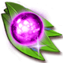 **Vigor Pill (L)**: Can restore 150 Vigor to a Mount (Where to Get: Event, Store Purchase)

## Mount skills

- Every mount has 4 skill slots. Tap a slot to learn a skill, or to change the skill in that slot; only that slot changes. Each try costs  Skill Page ×1 (Where to Get: Event, Store Purchase).
- The skill you get is random; the game doesn't show the chances. A mount can't have the same skill twice.
- "Adds to BP" is the BP the skill counts for.

| Icon | Skill | Effect | Adds to BP |
|---|---|---|---|
| 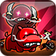 | **Strive** | Has a 30% chance to ignore Vigor Cost after the end of aa battle that lasts more than 6 turns ends | 4,500 |
|  | **Hoof** | Player gains ATK equals to Mount Stars x 1%. Valid in battle. Vigor Cost per battle +3 at most | 6,000 |
|  | **Riot** | Player gains CRIT equals to Mount Stars x 1%. Valid in battle. Vigor Cost per battle +3 at most | 6,000 |
|  | **Maim** | Player gains DMG+ equals to Mount Stars x 1%. Valid in battle. Vigor Cost per battle +5 at most | 6,000 |
|  | **Endure** | Mount Vigor and Max Vigor +20%, Vigor Cost per battle -1 | 4,860 |
| 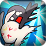 | **Alert** | Has a 30% chance to ignore splash DMG, Vigor -2 per trigger | 4,860 |
| 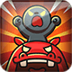 | **Warcry** | All allies +30 Rage when battle starts, Mount Vigor -3 | 4,050 |
| 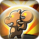 | **Aid** | On taking CRIT DMG, has a 30% chance to trigger Aid effect, total DMG taken -30%, Mount Vigor -3 | 4,860 |
| 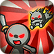 | **Assist** | Owner's current attack has a 25% chance to +5MG, Mount Vigor -2 | 5,400 |
|  | **Survive** | Mount restores 10% HP to owner when HP is below 20%, Mount Vigor -2 (triggers 1 time per battle) | 4,320 |
| 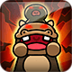 | **Bawl** | When HP is below 50%, all enemies DEF -5% for 2 turns, Mount Vigor -2 (triggers 1 time per battle) | 4,800 |
| 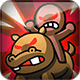 | **Bloody** | After dealing CRIT DMG, has a 30% chance to trigger Bloody effect, CRIT DMG +10%, Mount Vigor -1 | 4,800 |
| 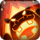 | **Revenge** | After ally's death, owner DMG +15% for 2 turns, Mount Vigor -3 | 4,800 |
| 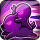 | **Speedup** | Movement SP Cost -33% in battle, Vigor Cost per battle +2 | 3,150 |
| 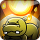 | **As One** | DMG taken -5% in battle, Vigor Cost +2 per battle | 3,780 |
| 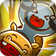 | **Exultation** | Has a 30% chance to ignore Vigor Cost upon victory | 3,150 |

## Mount equipment

- Each mount has its own 4 pieces. Press **Activate** (paid in Mount Coins) to start them at White +1.
- **Upgrade** costs materials and raises **one random piece**. When all 4 pieces reach +10, **Advance** (paid in Mount Coins) moves them to the next tier, back at +1.
- Tiers: White → Green → Blue → Purple → Orange → Red. The last tier depends on the mount's stars: 3★ up to **Blue**, 4★ up to **Purple**, 5★ up to **Orange**, 6★ up to **Red**.
- Activating and every Advance give Riding Points; Riding Points from every mount you own add up.

### 6★ mounts

| Tier | To unlock the tier | Each Upgrade | Riding Points (total) |
|---|---|---|---|
| **White** | Activate:  Mount Coin ×10 |  Amethyst ×1  Phoebe ×4  Hardness ×10 | +24 |
| **Green** | Advance:  Mount Coin ×15 |  Amethyst ×1  Phoebe ×4  Hardness ×12 | +53 |
| **Blue** | Advance:  Mount Coin ×20 |  Amethyst ×2  Phoebe ×6  Hardness ×15 | +87 |
| **Purple** | Advance:  Mount Coin ×30 |  Amethyst ×3  Phoebe ×8  Hardness ×20 | +124 |
| **Orange** | Advance:  Mount Coin ×30 |  Amethyst ×3  Phoebe ×8  Hardness ×20 | +161 |
| **Red** | Advance:  Mount Coin ×30 |  Amethyst ×3  Phoebe ×8  Hardness ×20 | +198 |

Total to max one mount (36 level-ups per tier, one per Upgrade):  Mount Coin ×135,  Amethyst ×468,  Phoebe ×1,368,  Hardness ×3,492.

### 5★ mounts

| Tier | To unlock the tier | Each Upgrade | Riding Points (total) |
|---|---|---|---|
| **White** | Activate:  Mount Coin ×10 |  Amethyst ×1  Phoebe ×2  Hardness ×4 | +13 |
| **Green** | Advance:  Mount Coin ×5 |  Amethyst ×1  Phoebe ×3  Hardness ×6 | +32 |
| **Blue** | Advance:  Mount Coin ×10 |  Amethyst ×1  Phoebe ×4  Hardness ×10 | +56 |
| **Purple** | Advance:  Mount Coin ×15 |  Amethyst ×1  Phoebe ×4  Hardness ×12 | +85 |
| **Orange** | Advance:  Mount Coin ×20 |  Amethyst ×2  Phoebe ×6  Hardness ×15 | +119 |

Total to max one mount (36 level-ups per tier, one per Upgrade):  Mount Coin ×60,  Amethyst ×216,  Phoebe ×684,  Hardness ×1,692.

### 4★ mounts

| Tier | To unlock the tier | Each Upgrade | Riding Points (total) |
|---|---|---|---|
| **White** | Activate:  Mount Coin ×10 |  Amethyst ×1  Phoebe ×2  Hardness ×4 | +13 |
| **Green** | Advance:  Mount Coin ×5 |  Amethyst ×1  Phoebe ×3  Hardness ×6 | +32 |
| **Blue** | Advance:  Mount Coin ×10 |  Amethyst ×1  Phoebe ×4  Hardness ×10 | +56 |
| **Purple** | Advance:  Mount Coin ×15 |  Amethyst ×1  Phoebe ×4  Hardness ×12 | +85 |

Total to max one mount (36 level-ups per tier, one per Upgrade):  Mount Coin ×40,  Amethyst ×144,  Phoebe ×468,  Hardness ×1,152.

### 3★ mounts

| Tier | To unlock the tier | Each Upgrade | Riding Points (total) |
|---|---|---|---|
| **White** | Activate:  Mount Coin ×10 |  Amethyst ×1  Phoebe ×2  Hardness ×4 | +13 |
| **Green** | Advance:  Mount Coin ×5 |  Amethyst ×1  Phoebe ×3  Hardness ×6 | +32 |
| **Blue** | Advance:  Mount Coin ×10 |  Amethyst ×1  Phoebe ×4  Hardness ×10 | +56 |

Total to max one mount (36 level-ups per tier, one per Upgrade):  Mount Coin ×25,  Amethyst ×108,  Phoebe ×324,  Hardness ×720.

### Equipment materials

| Material | Where to Get |
|---|---|
|  Mount Coin | Team Expedition - Sky Battle, Team Expedition - Dragon Nest, Quest Reward, Event |
|  Amethyst | Event, Store Purchase |
|  Phoebe | Event, Store Purchase |
|  Hardness | Event, Store Purchase |

## Mount Heart

- The first copy of each mount gives a Mount Heart that matches its stars (claim it from the box on the mount in your mount list).
- Hearts strengthen **bonds**, one bond per heart type. Every bond level gives stats and Riding Points, and raises the **level cap** of your Mount Heart.
- Your **Mount Heart** levels up with bells and gives stats at every level. When it reaches its cap, strengthen bonds (collect more mounts) to go further. The Mount Heart screen shows your current cap.

### Bonds

Stats in the last column are the totals at the bond's highest level.

| Heart | From | Bond levels | Each bond level | At the highest level |
|---|---|---|---|---|
|  **Exquisite Heart** | 3★ mounts | 10 (10 hearts in total) | 1 heart: +61 Riding Points, level cap +1 | AGI +50, ATK +1,000, DEF +3,000, HP +40,000, DMG Up +0.50% Riding Points +610, level cap +10 |
|  **Shining Heart** | 4★ mounts | 20 (20 hearts in total) | 1 heart: +87 Riding Points, level cap +2 | AGI +200, ATK +4,000, DEF +12,000, HP +160,000, DMG Up +2.00% Riding Points +1,740, level cap +40 |
| 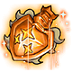 **Radiant Heart** | 5★ mounts | 50 (50 hearts in total) | 1 heart: +118 Riding Points, level cap +3 | AGI +750, ATK +15,000, DEF +45,000, HP +600,000, DMG Up +7.50% Riding Points +5,900, level cap +150 |
|  **Perfect Heart** | 6★ mounts | 120 (120 hearts in total) | 1 heart: +148 Riding Points, level cap +5 | AGI +4,000, ATK +80,000, DEF +240,000, HP +3,200,000, DMG Up +40.00% Riding Points +17,760, level cap +600 |

### Bells

| Bell | EXP | Where to Get |
|---|---|---|
| 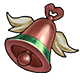 copper bell | 100 | Daily Quest Reward |
| 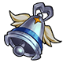 silver bell | 500 | Store Purchase |
| 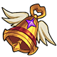 Golden Bell | 1,000 | Event |

### Mount Heart levels

Up to level **840**. Stats are the totals at that level; "Total EXP" is the bell EXP needed to reach it from level 1.

| Level | Total EXP | EXP to next level | ATK | DEF | HP | CRIT | Anti-crit |
|---|---|---|---|---|---|---|---|
| 1 | 0 | 100 | 24 | 67 | 333 | 10 | 10 |
| 10 | 4,500 | 1,000 | 238 | 667 | 3,333 | 95 | 95 |
| 25 | 30,000 | 2,500 | 595 | 1,667 | 8,333 | 238 | 238 |
| 50 | 122,500 | 5,000 | 1,190 | 3,333 | 16,667 | 476 | 476 |
| 100 | 495,000 | 10,000 | 2,381 | 6,667 | 33,333 | 952 | 952 |
| 200 | 1,990,000 | 20,000 | 4,762 | 13,333 | 66,667 | 1,905 | 1,905 |
| 300 | 3,990,000 | 20,000 | 7,143 | 20,000 | 100,000 | 2,857 | 2,857 |
| 400 | 5,990,000 | 20,000 | 9,524 | 26,667 | 133,333 | 3,810 | 3,810 |
| 500 | 7,990,000 | 20,000 | 11,905 | 33,333 | 166,667 | 4,762 | 4,762 |
| 600 | 9,990,000 | 20,000 | 14,286 | 40,000 | 200,000 | 5,714 | 5,714 |
| 700 | 11,990,000 | 20,000 | 16,667 | 46,667 | 233,333 | 6,667 | 6,667 |
| 800 | 13,990,000 | 20,000 | 19,048 | 53,333 | 266,667 | 7,619 | 7,619 |
| 840 | 14,790,000 | max | 20,000 | 56,000 | 280,000 | 8,000 | 8,000 |

## All mounts

### 6★

<a class="wiki-card" href="mounts/midnight.html">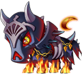Midnight6★ · equipment up to Red.</a>
<a class="wiki-card" href="mounts/christmas-elk.html">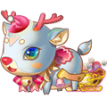Christmas Elk6★ · equipment up to Red.</a>
<a class="wiki-card" href="mounts/du-du.html">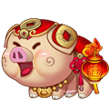Du Du6★ · equipment up to Red.</a>
<a class="wiki-card" href="mounts/tx200t.html">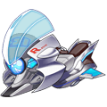TX200T6★ · equipment up to Red.</a>
<a class="wiki-card" href="mounts/dragon-boat.html">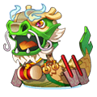Dragon Boat6★ · equipment up to Red.</a>
<a class="wiki-card" href="mounts/jade-kirin.html">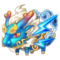Jade Kirin6★ · equipment up to Red.</a>
<a class="wiki-card" href="mounts/mech-dragon.html">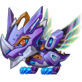Mech Dragon6★ · equipment up to Red.</a>
<a class="wiki-card" href="mounts/shadow-knight.html">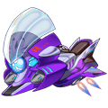Shadow Knight6★ · equipment up to Red.</a>
<a class="wiki-card" href="mounts/noble-cat.html">Noble Cat6★ · equipment up to Red.</a>
<a class="wiki-card" href="mounts/little-orange-maid.html">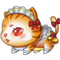Little Orange Maid6★ · equipment up to Red.</a>
<a class="wiki-card" href="mounts/moon-rabbit.html">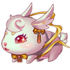Moon Rabbit6★ · equipment up to Red.</a>
<a class="wiki-card" href="mounts/alpaca.html">Alpaca6★ · equipment up to Red.</a>
<a class="wiki-card" href="mounts/gentleman-turkey.html">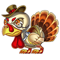Gentleman Turkey6★ · equipment up to Red.</a>
<a class="wiki-card" href="mounts/polar-ursa.html">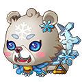Polar Ursa6★ · equipment up to Red.</a>
<a class="wiki-card" href="mounts/mammuthus.html">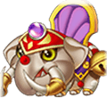Mammuthus6★ · equipment up to Red.</a>
<a class="wiki-card" href="mounts/moo-moo-cow.html">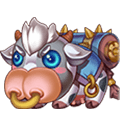Moo-moo Cow6★ · equipment up to Red.</a>
<a class="wiki-card" href="mounts/bouncing.html">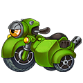bouncing6★ · equipment up to Red.</a>
<a class="wiki-card" href="mounts/ninja-turtle.html">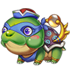Ninja Turtle6★ · equipment up to Red.</a>
<a class="wiki-card" href="mounts/edonkey.html">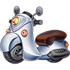eDonkey6★ · equipment up to Red.</a>
<a class="wiki-card" href="mounts/steam-tank.html">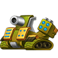Steam Tank6★ · equipment up to Red.</a>
<a class="wiki-card" href="mounts/nine-tailed-snow-fox.html">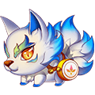Nine-tailed Snow Fox6★ · equipment up to Red.</a>
<a class="wiki-card" href="mounts/nine-tailed-fire-fox.html">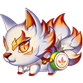Nine-tailed Fire Fox6★ · equipment up to Red.</a>
<a class="wiki-card" href="mounts/auspicious-beast.html">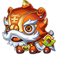Auspicious Beast6★ · equipment up to Red.</a>
<a class="wiki-card" href="mounts/firefly-bunny.html">Firefly Bunny6★ · equipment up to Red.</a>
<a class="wiki-card" href="mounts/soaring-loong.html">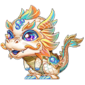Soaring Loong6★ · equipment up to Red.</a>
<a class="wiki-card" href="mounts/serpira.html">Serpira6★ · equipment up to Red.</a>
<a class="wiki-card" href="mounts/love-parade-float.html">Love Parade Float6★ · equipment up to Red.</a>
<a class="wiki-card" href="mounts/treading-flame.html">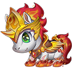Treading Flame6★ · equipment up to Red.</a>

### 5★

<a class="wiki-card" href="mounts/shouty.html">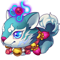Shouty5★ · equipment up to Orange.</a>
<a class="wiki-card" href="mounts/fire-nian-beast.html">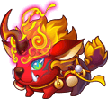Fire.Nian Beast5★ · equipment up to Orange.</a>
<a class="wiki-card" href="mounts/dark-shouty.html">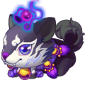Dark.Shouty5★ · equipment up to Orange.</a>
<a class="wiki-card" href="mounts/nian-beast.html">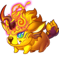Nian Beast5★ · equipment up to Orange.</a>
<a class="wiki-card" href="mounts/mantis-shrimp.html">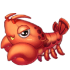Mantis Shrimp5★ · equipment up to Orange.</a>
<a class="wiki-card" href="mounts/nadoh.html">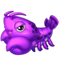Nadoh5★ · equipment up to Orange.</a>
<a class="wiki-card" href="mounts/ice-claws.html">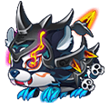Ice Claws5★ · equipment up to Orange.</a>
<a class="wiki-card" href="mounts/cold-teeth.html">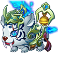Cold Teeth5★ · equipment up to Orange.</a>
<a class="wiki-card" href="mounts/mio.html">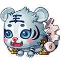Mio5★ · equipment up to Orange.</a>
<a class="wiki-card" href="mounts/yoki.html">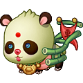Yoki5★ · equipment up to Orange.</a>
<a class="wiki-card" href="mounts/ponda.html">Ponda5★ · equipment up to Orange.</a>
<a class="wiki-card" href="mounts/dai-dai.html">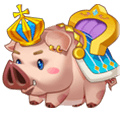Dai Dai5★ · equipment up to Orange.</a>
<a class="wiki-card" href="mounts/red-nose-elk.html">Red Nose Elk5★ · equipment up to Orange.</a>
<a class="wiki-card" href="mounts/tidal-lord.html">Tidal Lord5★ · equipment up to Orange.</a>
<a class="wiki-card" href="mounts/crystal-pioneer.html">Crystal Pioneer5★ · equipment up to Orange.</a>
<a class="wiki-card" href="mounts/mutant-hippo.html">Mutant Hippo5★ · equipment up to Orange.</a>
<a class="wiki-card" href="mounts/tapir.html">Tapir5★ · equipment up to Orange.</a>

### 4★

<a class="wiki-card" href="mounts/elf-elk.html">Elf Elk4★ · equipment up to Purple.</a>
<a class="wiki-card" href="mounts/han-han.html">Han Han4★ · equipment up to Purple.</a>
<a class="wiki-card" href="mounts/sphinx.html">Sphinx4★ · equipment up to Purple.</a>
<a class="wiki-card" href="mounts/tiger.html">Tiger4★ · equipment up to Purple.</a>
<a class="wiki-card" href="mounts/doug.html">Doug4★ · equipment up to Purple.</a>

### 3★

<a class="wiki-card" href="mounts/rabbit.html">Rabbit3★ · equipment up to Blue.</a>
<a class="wiki-card" href="mounts/pinky-hippo.html">Pinky Hippo3★ · equipment up to Blue.</a>
<a class="wiki-card" href="mounts/shaq.html">Shaq3★ · equipment up to Blue.</a>

