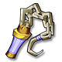
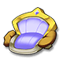

[← All mounts](../mounts.html)

# Dai Dai

I'm piggy Han Han's little brother Dai Dai. Naturally Dumb ~

## Info

| Detail | Value |
|---|---|
| Stars | ★★★★★ (5) |
| Vigor | 600 (720 with the skill Endure) |
| Equipment |  Noble Whip,  Noble Reins,  Noble Saddle,  Noble Hoof |
| Equipment up to | **Orange** tier |
| First copy |  **Radiant Heart** to claim ([Mount Heart](../mounts.html#heart)) |
| Duplicates | Turn into Mount Coins and refill this mount's Vigor (the game shows the amount when it happens) |

## Where to Get

- Chest  **5-Star Mount Random Chest**: 6.25% chance per chest (chest from: Event)
- Chest  **5-Star Mount Selection Chest 2**: pick 1 of 7 (chest from: Event)
- Also check the **Mount** tab of the Store (paid in Mount Coins) and current events in game: their stock is not listed outside the game.

## Skills

Like every mount, Dai Dai has 4 skill slots and can learn any of the 16 [mount skills](../mounts.html#skills). Learning or changing the skill of one slot costs  Skill Page ×1; the skill you get is random.

## Equipment

| Piece | Description |
|---|---|
|  **Noble Whip** | Noble Set, pigs' favorite |
|  **Noble Reins** | Noble Set, pigs' favorite |
|  **Noble Saddle** | Noble Set, pigs' favorite |
|  **Noble Hoof** | Noble Set, pigs' favorite |

Tiers go from White to **Orange** for this mount. "To unlock the tier" is paid once (Activate for the first tier, Advance when all 4 pieces are at +10). "Each Upgrade" is the price of one press, which raises one random piece; a tier has 36 piece level-ups (4 pieces from +1 to +10). Stats are the 4 pieces together at +10 of the tier. Riding Points count for your character as long as you own the mount. More: [Mount equipment](../mounts.html#equipment).

| Tier | To unlock the tier | Each Upgrade | Riding Points (total) | ATK | DEF | HP | CRIT | Anti-crit | DMG+ | DMG- |
|---|---|---|---|---|---|---|---|---|---|---|
| **White** | Activate:  Mount Coin ×10 |  Amethyst ×1  Phoebe ×2  Hardness ×4 | +13 | 144 | 108 | 3,600 | 60 | 60 | 60 | 48 |
| **Green** | Advance:  Mount Coin ×5 |  Amethyst ×1  Phoebe ×3  Hardness ×6 | +32 | 280 | 212 | 6,976 | 116 | 116 | 116 | 92 |
| **Blue** | Advance:  Mount Coin ×10 |  Amethyst ×1  Phoebe ×4  Hardness ×10 | +56 | 420 | 312 | 10,348 | 172 | 172 | 172 | 136 |
| **Purple** | Advance:  Mount Coin ×15 |  Amethyst ×1  Phoebe ×4  Hardness ×12 | +85 | 556 | 416 | 13,724 | 228 | 228 | 228 | 180 |
| **Orange** | Advance:  Mount Coin ×20 |  Amethyst ×2  Phoebe ×6  Hardness ×15 | +119 | 692 | 520 | 17,096 | 284 | 284 | 284 | 224 |

**Total to max** (one level-up per Upgrade):  Mount Coin ×60,  Amethyst ×216,  Phoebe ×684,  Hardness ×1,692. Riding Points at max: **+119**.
