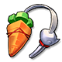
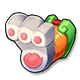
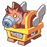
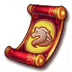
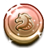
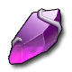
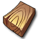
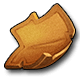

[← All mounts](../mounts.html)

# Firefly Bunny

The bunny was born during the Lunar New Year. It eats carrots that people store to celebrate the festival.

## Info

| Detail | Value |
|---|---|
| Stars | ★★★★★★ (6) |
| Vigor | 600 (720 with the skill Endure) |
| Equipment |  Carrot Whip,  Carrot Reins,  Carrot Saddle,  Carrot Paw |
| Equipment up to | **Red** tier |
| First copy |  **Perfect Heart** to claim ([Mount Heart](../mounts.html#heart)) |
| Duplicates | Turn into Mount Coins and refill this mount's Vigor (the game shows the amount when it happens) |

## Where to Get

- Chest  **6-Star Mount Selection Chest 3**: pick 1 of 8 (chest from: Event)
- Also check the **Mount** tab of the Store (paid in Mount Coins) and current events in game: their stock is not listed outside the game.

## Skills

Like every mount, Firefly Bunny has 4 skill slots and can learn any of the 16 [mount skills](../mounts.html#skills). Learning or changing the skill of one slot costs  Skill Page ×1; the skill you get is random.

## Equipment

| Piece | Description |
|---|---|
|  **Carrot Whip** | Carrot Whip |
|  **Carrot Reins** | Carrot Reins |
|  **Carrot Saddle** | Carrot Saddle |
|  **Carrot Paw** | Carrot Paw |

Tiers go from White to **Red** for this mount. "To unlock the tier" is paid once (Activate for the first tier, Advance when all 4 pieces are at +10). "Each Upgrade" is the price of one press, which raises one random piece; a tier has 36 piece level-ups (4 pieces from +1 to +10). Stats are the 4 pieces together at +10 of the tier. Riding Points count for your character as long as you own the mount. More: [Mount equipment](../mounts.html#equipment).

| Tier | To unlock the tier | Each Upgrade | Riding Points (total) | ATK | DEF | HP | CRIT | Anti-crit | DMG+ | DMG- |
|---|---|---|---|---|---|---|---|---|---|---|
| **White** | Activate:  Mount Coin ×10 |  Amethyst ×1  Phoebe ×4  Hardness ×10 | +24 | 144 | 108 | 3,600 | 60 | 60 | 60 | 48 |
| **Green** | Advance:  Mount Coin ×15 |  Amethyst ×1  Phoebe ×4  Hardness ×12 | +53 | 280 | 212 | 6,976 | 116 | 116 | 116 | 92 |
| **Blue** | Advance:  Mount Coin ×20 |  Amethyst ×2  Phoebe ×6  Hardness ×15 | +87 | 420 | 312 | 10,348 | 172 | 172 | 172 | 136 |
| **Purple** | Advance:  Mount Coin ×30 |  Amethyst ×3  Phoebe ×8  Hardness ×20 | +124 | 556 | 416 | 13,724 | 228 | 228 | 228 | 180 |
| **Orange** | Advance:  Mount Coin ×30 |  Amethyst ×3  Phoebe ×8  Hardness ×20 | +161 | 692 | 520 | 17,096 | 284 | 284 | 284 | 224 |
| **Red** | Advance:  Mount Coin ×30 |  Amethyst ×3  Phoebe ×8  Hardness ×20 | +198 | 852 | 640 | 20,456 | 324 | 324 | 324 | 304 |

**Total to max** (one level-up per Upgrade):  Mount Coin ×135,  Amethyst ×468,  Phoebe ×1,368,  Hardness ×3,492. Riding Points at max: **+198**.
