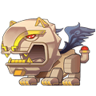
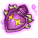

[← All mounts](../mounts.html)

# Sphinx

Guardian of the desert, avatar of the Pharaoh, surprisingly cute for someone guarding the vast desert for thousands of years

## Info

| Detail | Value |
|---|---|
| Stars | ★★★★ (4) |
| Vigor | 600 (720 with the skill Endure) |
| Equipment |  Whip,  Reins,  Saddle,  Hoof |
| Equipment up to | **Purple** tier |
| First copy |  **Shining Heart** to claim ([Mount Heart](../mounts.html#heart)) |
| Duplicates | Turn into Mount Coins and refill this mount's Vigor (the game shows the amount when it happens) |

## Where to Get

- Team Expedition: [Desert Ruins](../team-expedition/desert-ruins.html), Hard, stage **Desert Ruins - 2**: 0.18% drop chance
- Also check the **Mount** tab of the Store (paid in Mount Coins) and current events in game: their stock is not listed outside the game.

## Skills

Like every mount, Sphinx has 4 skill slots and can learn any of the 16 [mount skills](../mounts.html#skills). Learning or changing the skill of one slot costs  Skill Page ×1; the skill you get is random.

## Equipment

| Piece | Description |
|---|---|
|  **Whip** | Base Set, good for most mounts. |
|  **Reins** | Base Set, good for most mounts. |
|  **Saddle** | Base Set, good for most mounts. |
|  **Hoof** | Base Set, good for most mounts. |

Tiers go from White to **Purple** for this mount. "To unlock the tier" is paid once (Activate for the first tier, Advance when all 4 pieces are at +10). "Each Upgrade" is the price of one press, which raises one random piece; a tier has 36 piece level-ups (4 pieces from +1 to +10). Stats are the 4 pieces together at +10 of the tier. Riding Points count for your character as long as you own the mount. More: [Mount equipment](../mounts.html#equipment).

| Tier | To unlock the tier | Each Upgrade | Riding Points (total) | ATK | DEF | HP | CRIT | Anti-crit | DMG+ | DMG- |
|---|---|---|---|---|---|---|---|---|---|---|
| **White** | Activate:  Mount Coin ×10 |  Amethyst ×1  Phoebe ×2  Hardness ×4 | +13 | 124 | 80 | 992 | 80 | 80 | 80 | 44 |
| **Green** | Advance:  Mount Coin ×5 |  Amethyst ×1  Phoebe ×3  Hardness ×6 | +32 | 244 | 160 | 1,952 | 160 | 160 | 160 | 84 |
| **Blue** | Advance:  Mount Coin ×10 |  Amethyst ×1  Phoebe ×4  Hardness ×10 | +56 | 364 | 240 | 2,912 | 240 | 240 | 240 | 124 |
| **Purple** | Advance:  Mount Coin ×15 |  Amethyst ×1  Phoebe ×4  Hardness ×12 | +85 | 484 | 320 | 3,872 | 320 | 320 | 320 | 164 |

**Total to max** (one level-up per Upgrade):  Mount Coin ×40,  Amethyst ×144,  Phoebe ×468,  Hardness ×1,152. Riding Points at max: **+85**.
