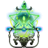
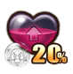
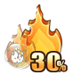
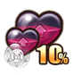

# Orb

       

Orbs open at **level 35** (Role → Cosmetic → Orb). There are 8 kinds of orb with 10 levels each. Every orb gives stats and makes one of your battle skills stronger.

- **Only your highest orb of each kind counts.** The game wears it for you; lower orbs of the same kind do nothing until you combine them.
- **Combining:** 4 orbs of the same kind and level + Coins make 1 orb of the next level (table at the bottom).
- **Orb Cores:** each core belongs to a group of orb kinds and levels up with them (below).

## Orb Cores

A core's level is the **lowest level among its orbs, divided by 2 and rounded up**: orbs at Lv 1-2 give core Lv 1, Lv 3-4 core Lv 2 … Lv 9-10 core Lv 5. The core shows the combined stats of its orbs.

| Core | Orbs | Lv 1 | Lv 2 | Lv 3 | Lv 4 | Lv 5 |
|---|---|---|---|---|---|---|
| **Assist Orb Core** The core of Assist Orb can make stats of Assist Orbs all take effect. | Recovery Orb Rage Orb Homing Orb |  |  |  |  |  |
| **Tactic Orb Core** The core of Tactic Orbs can make stats of Tactic Orbs all take effect. | Flying Orb Stealth Orb Frozen Orb |  |  |  |  |  |
| **Group Orb Core** The core of Group Orbs can make stats of Group Orbs all take effect. | Group Stealth Orb Group Recovery Orb |  |  |  |  |  |

## Orbs

Each orb kind boosts one battle skill. The boost grows with the orb's level:

###  Flying Orb

- **Skill boosted:**  **Sky High** - Teleports the user to where the plane lands
- **Core:** Tactic Orb Core
- This orb provides a shield of compressed air

| Level | Orb | Boost |
|---|---|---|
| 1 |  | **Enhance:** Grants 20 DMG- upon using Flight skills |
| 2 |  | **Enhance:** Grants 45 DMG- upon using Flight skills |
| 3 |  | **Enhance:** Grants 100 DMG- upon using Flight skills |
| 4 |  | **Enhance:** Grants 150 DMG- upon using Flight skills |
| 5 |  | **Enhance:** Grants 210 DMG- upon using Flight skills |
| 6 |  | **Enhance:** Grants 480 DMG- upon using Flight skills |
| 7 |  | **Enhance:** Grants 820 DMG- upon using Flight skills |
| 8 |  | **Enhance:** Grants 1280 DMG- upon using Flight skills |
| 9 |  | **Enhance:** Grants 2100 DMG- upon using Flight skills |
| 10 |  | **Enhance:** Grants 3000 DMG- upon using Flight skills |

###  Recovery Orb

- **Skill boosted:**  **Heal** - Restores 20% HP for the user
- **Core:** Assist Orb Core
- This orb with nature strength boosts healing effects.

| Level | Orb | Boost |
|---|---|---|
| 1 |  | **Intense:** It has no traits |
| 2 |  | **Intense:** It has no traits |
| 3 |  | **Intense:** Boosts healing by 1% upon using Heal |
| 4 |  | **Intense:** Boosts healing by 1% upon using Heal |
| 5 |  | **Intense:** Boosts healing by 2% upon using Heal |
| 6 |  | **Intense:** Boosts healing by 2% upon using Heal |
| 7 |  | **Intense:** Boosts healing by 2% upon using Heal |
| 8 |  | **Intense:** Boosts healing by 3% upon using Heal |
| 9 |  | **Intense:** Boosts healing by 3% upon using Heal |
| 10 |  | **Intense:** Boosts healing by 3% upon using Heal |

###  Rage Orb

- **Skill boosted:**  **Rage On** - Gains 30 Rage after use
- **Core:** Assist Orb Core
- It gives the owner endless will to fight.

| Level | Orb | Boost |
|---|---|---|
| 1 |  | **Intense:** Grants 2 additional Rage upon using Rage skills |
| 2 |  | **Intense:** Grants 5 additional Rage upon using Rage skills |
| 3 |  | **Intense:** Grants 5 additional Rage upon using Rage skills |
| 4 |  | **Intense:** Grants 7 additional Rage upon using Rage skills |
| 5 |  | **Intense:** Grants 7 additional Rage upon using Rage skills |
| 6 |  | **Intense:** Grants 10 additional Rage upon using Rage skills |
| 7 |  | **Intense:** Grants 10 additional Rage upon using Rage skills |
| 8 |  | **Intense:** Grants 12 additional Rage upon using Rage skills |
| 9 |  | **Intense:** Grants 12 additional Rage upon using Rage skills |
| 10 |  | **Intense:** Grants 15 additional Rage upon using Rage skills |

###  Homing Orb

- **Skill boosted:**  **Guide Bomb** - The shell 100% hits when the target is near, dealing 50% less DMG
- **Core:** Assist Orb Core
- With it, Homing Bomb is as precise as a scalpel.

| Level | Orb | Boost |
|---|---|---|
| 1 |  | **DMG+:** DMG +3% upon using Guide Bomb |
| 2 |  | **DMG+:** DMG +5% upon using Guide Bomb |
| 3 |  | **DMG+:** DMG +8% upon using Guide Bomb |
| 4 |  | **DMG+:** DMG +10% upon using Guide Bomb |
| 5 |  | **DMG+:** DMG +15% upon using Guide Bomb |
| 6 |  | **DMG+:** DMG +20% upon using Guide Bomb |
| 7 |  | **DMG+:** DMG +25% upon using Guide Bomb |
| 8 |  | **DMG+:** DMG +30% upon using Guide Bomb |
| 9 |  | **DMG+:** DMG +40% upon using Guide Bomb |
| 10 |  | **DMG+:** DMG +50% upon using Guide Bomb |

###  Stealth Orb

- **Skill boosted:**  **Stealth** - The user become invisible for 2 turns
- **Core:** Tactic Orb Core
- It gives the owner great endurance.

| Level | Orb | Boost |
|---|---|---|
| 1 |  | **SP Effect:** Has a 5% chance to not be interrupted when using single Stealth |
| 2 |  | **SP Effect:** Has a 8% chance to not be interrupted when using single Stealth |
| 3 |  | **SP Effect:** Has a 10% chance to not be interrupted when using single Stealth |
| 4 |  | **SP Effect:** Has a 12% chance to not be interrupted when using single Stealth |
| 5 |  | **SP Effect:** Has a 15% chance to not be interrupted when using single Stealth |
| 6 |  | **SP Effect:** Has a 18% chance to not be interrupted when using single Stealth |
| 7 |  | **SP Effect:** Has a 20% chance to not be interrupted when using single Stealth |
| 8 |  | **SP Effect:** Has a 25% chance to not be interrupted when using single Stealth |
| 9 |  | **SP Effect:** Has a 28% chance to not be interrupted when using single Stealth |
| 10 |  | **SP Effect:** Has a 35% chance to not be interrupted when using single Stealth |

###  Frozen Orb

- **Skill boosted:**  **Frost Bomb** - Players who are hit cannot move or use skills for 2 turns
- **Core:** Tactic Orb Core
- It contains strength of blizzard

| Level | Orb | Boost |
|---|---|---|
| 1 |  | **Splash:** Range of Frost Bomb increases by 2% upon release |
| 2 |  | **Splash:** Range of Frost Bomb increases by 4% upon release |
| 3 |  | **Splash:** Range of Frost Bomb increases by 6% upon release |
| 4 |  | **Splash:** Range of Frost Bomb increases by 8% upon release |
| 5 |  | **Splash:** Range of Frost Bomb increases by 11% upon release |
| 6 |  | **Splash:** Range of Frost Bomb increases by 14% upon release |
| 7 |  | **Splash:** Range of Frost Bomb increases by 18% upon release |
| 8 |  | **Splash:** Range of Frost Bomb increases by 22% upon release |
| 9 |  | **Splash:** Range of Frost Bomb increases by 29% upon release |
| 10 |  | **Splash:** Range of Frost Bomb increases by 38% upon release |

###  Group Stealth Orb

- **Skill boosted:**  **Group Stealth** - Makes all allies invisible for 2 turns
- **Core:** Group Orb Core
- As illusory as moon in the water, as stable as mountain

| Level | Orb | Boost |
|---|---|---|
| 1 |  | **All Enhance:** Using Group Stealth provides 20 DEF for all players for 1 turn |
| 2 |  | **All Enhance:** Using Group Stealth provides 45 DEF for all players for 1 turn |
| 3 |  | **All Enhance:** Using Group Stealth provides 100 DEF for all players for 1 turn |
| 4 |  | **All Enhance:** Using Group Stealth provides 150 DEF for all players for 1 turn |
| 5 |  | **All Enhance:** Using Group Stealth provides 210 DEF for all players for 1 turn |
| 6 |  | **All Enhance:** Using Group Stealth provides 480 DEF for all players for 1 turn |
| 7 |  | **All Enhance:** Using Group Stealth provides 820 DEF for all players for 1 turn |
| 8 |  | **All Enhance:** Using Group Stealth provides 1280 DEF for all players for 1 turn |
| 9 |  | **All Enhance:** Using Group Stealth provides 2100 DEF for all players for 1 turn |
| 10 |  | **All Enhance:** Using Group Stealth provides 3000 DEF for all players for 1 turn |

###  Group Recovery Orb

- **Skill boosted:**  **Group Healing** - Restores 10% HP for all allies
- **Core:** Group Orb Core
- Orb blessed by holy light.

| Level | Orb | Boost |
|---|---|---|
| 1 |  | **All Intense:** It has no traits |
| 2 |  | **All Intense:** It has no traits |
| 3 |  | **All Intense:** Boosts healing by 3% upon using Heal |
| 4 |  | **All Intense:** Boosts healing by 1% upon using Group Healing |
| 5 |  | **All Intense:** Boosts healing by 2% upon using Group Healing |
| 6 |  | **All Intense:** Boosts healing by 2% upon using Group Healing |
| 7 |  | **All Intense:** Boosts healing by 2% upon using Group Healing |
| 8 |  | **All Intense:** Boosts healing by 3% upon using Group Healing |
| 9 |  | **All Intense:** Boosts healing by 3% upon using Group Healing |
| 10 |  | **All Intense:** Boosts healing by 5% upon using Group Healing |

## Stats and combining

Every orb kind has the same stats at the same level. **To combine** = what it takes to turn orbs of that level into 1 orb of the next level. **From Lv 1** = everything one orb of that level costs, starting from Lv 1 orbs.

| Level | ATK | HP | DMG Up | DMG Down | CRIT Rate | ACRIT Rate | To combine | From Lv 1 |
|---|---|---|---|---|---|---|---|---|
| 1 | 10 | 150 | - | - | - | - | 4 × Lv 1 +  2,000 | - |
| 2 | 41 | 615 | - | - | - | - | 4 × Lv 2 +  5,000 | 4 × Lv 1 +  2,000 |
| 3 | 112 | 1,680 | - | - | - | - | 4 × Lv 3 +  10,000 | 16 × Lv 1 +  13,000 |
| 4 | 212 | 3,180 | - | - | - | - | 4 × Lv 4 +  20,000 | 64 × Lv 1 +  62,000 |
| 5 | 362 | 5,430 | - | - | - | - | 4 × Lv 5 +  30,000 | 256 × Lv 1 +  268,000 |
| 6 | 485 | 7,275 | 0.10% | 0.10% | - | - | 4 × Lv 6 +  40,000 | 1,024 × Lv 1 +  1,102,000 |
| 7 | 604 | 9,060 | 0.20% | 0.20% | - | - | 4 × Lv 7 +  60,000 | 4,096 × Lv 1 +  4,448,000 |
| 8 | 685 | 10,275 | 0.30% | 0.30% | 0.15% | 0.15% | 4 × Lv 8 +  80,000 | 16,384 × Lv 1 +  17,852,000 |
| 9 | 765 | 11,475 | 0.40% | 0.40% | 0.25% | 0.25% | 4 × Lv 9 +  100,000 | 65,536 × Lv 1 +  71,488,000 |
| 10 | 834 | 12,510 | 0.50% | 0.50% | 0.40% | 0.40% | top level | 262,144 × Lv 1 +  286,052,000 |

The game lists no place to get orbs.
