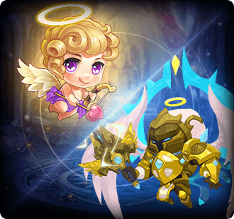
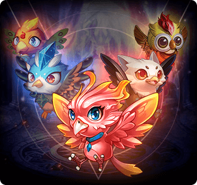
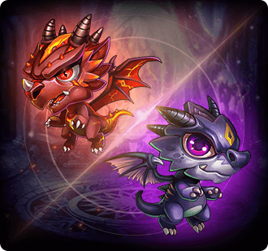
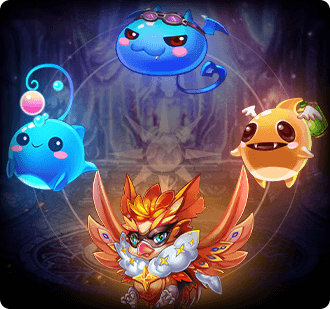

# Pet combos

[← All pets](pets.html)

Each combo has slots: fill every slot with a pet you own (a different pet per slot; any form listed in a slot counts), then press **Deploy** on the combo in the game's combo book. Combos that come in tiers can't be deployed at a lower tier while you qualify for a higher one.

| Portrait | Combo | Slots | Bonus | Effect |
|---|---|---|---|---|
|  | **Early-Power of the Four Saints** | Slot 1:  [Azure](pets/azure.html) /  [Thunderfury Drake](pets/thunderfury-drake.html) /  [Holy - Thunderfury Drake](pets/holy-thunderfury-drake.html) Slot 2:  [Ivory](pets/ivory.html) /  [Ice White Tiger](pets/ice-white-tiger.html) /  [Holy - Frozen Tiger](pets/holy-frozen-tiger.html) Slot 3:  [Rosefinch](pets/rosefinch.html) /  [Rosefinch(LD)](pets/rosefinch-ld.html) /  [Holy - Rosefinch](pets/holy-rosefinch.html) Slot 4:  [Shellie](pets/shellie.html) /  [Mount Xuanwu](pets/mount-xuanwu.html) /  [Holy - Mount Xuanwu](pets/holy-mount-xuanwu.html) | ATK +1,640 DEF +1,230 HP +14,758 BP +16,849 | Early-Four Saints:Elemental damage caused by the player increased by 3% |
|  | **Pole-Power of the Four Saints** | Slot 1:  [Thunderfury Drake](pets/thunderfury-drake.html) /  [Holy - Thunderfury Drake](pets/holy-thunderfury-drake.html) Slot 2:  [Ice White Tiger](pets/ice-white-tiger.html) /  [Holy - Frozen Tiger](pets/holy-frozen-tiger.html) Slot 3:  [Rosefinch(LD)](pets/rosefinch-ld.html) /  [Holy - Rosefinch](pets/holy-rosefinch.html) Slot 4:  [Mount Xuanwu](pets/mount-xuanwu.html) /  [Holy - Mount Xuanwu](pets/holy-mount-xuanwu.html) | ATK +2,733 DEF +2,049 HP +24,597 BP +28,082 | Pole-Four Saints:Elemental damage caused by players increased by 5% |
|  | **Ancient Spirit** | Slot 1:  [Bull Knight](pets/bull-knight.html) /  [Titan Bull](pets/titan-bull.html) Slot 2:  [Demon Fox](pets/demon-fox.html) /  [Fox Elf](pets/fox-elf.html) Slot 3:  [Jade Rabbit](pets/jade-rabbit.html) | ATK +1,000 DEF +1,000 HP +10,000 BP +11,600 | - |
|  | **Sky fighting spirit** | Slot 1:  [Titan Bull](pets/titan-bull.html) Slot 2:  [Fox Elf](pets/fox-elf.html) Slot 3:  [Celestial Marshal](pets/celestial-marshal.html) | ATK +2,000 DEF +2,000 HP +20,000 BP +23,200 | War Soul: restores 5% Max HP after using Ultimate. |
|  | **Coming from the sky** | Slot 1:  [Michael](pets/michael.html) Slot 2:  [Cupid](pets/cupid.html) /  [Michael](pets/michael.html) | DEF +2,000 Anti-crit +2,000 DMG- +2,000 BP +16,600 | - |
|  | **Fierce beast** | Slot 1:  [Squirrel](pets/squirrel.html) Slot 2:  [Zabiwaka](pets/zabiwaka.html) Slot 3:  [Gifted Cat](pets/gifted-cat.html) Slot 4:  [Dumbo](pets/dumbo.html) Slot 5:  [Fire Bunny](pets/fire-bunny.html) Slot 6:  [Sky Pony](pets/sky-pony.html) | ATK +500 HP +5,000 Crit +500 DMG+ +500 AGI +200 BP +7,850 | Rage Beast: Rage +10 at the end of your round. |
|  | **Bird fight** | Slot 1:  [Phoenix](pets/phoenix.html) Slot 2:  [Ice Falcon](pets/ice-falcon.html) Slot 3:  [Firehawk](pets/firehawk.html) Slot 4:  [Mecha Owl](pets/mecha-owl.html) Slot 5:  [Hawk Baby](pets/hawk-baby.html) | AGI +750 BP +4,500 | - |
|  | **Dragon language** | Slot 1:  [Burning Dragon](pets/burning-dragon.html) Slot 2:  [Black Drake](pets/black-drake.html) | ATK +250 HP +2,500 BP +2,075 | - |
|  | **Legion of Darkness** | Slot 1:  [Hades](pets/hades.html) Slot 2:  [Evil Angel](pets/evil-angel.html) Slot 3:  [Demon King](pets/demon-king.html) Slot 4:  [Ghost King](pets/ghost-king.html) | Crit +1,000 DMG+ +500 BP +3,500 | - |
|  | **Holy Ghost** | Slot 1:  [Forest Elf](pets/forest-elf.html) Slot 2:  [Creamery Fairy](pets/creamery-fairy.html) Slot 3:  [Xmas Elf](pets/xmas-elf.html) | HP +5,000 DMG- +200 AGI +100 BP +3,700 | - |
|  | **Cute monster** | Slot 1:  [Ku Ku](pets/ku-ku.html) Slot 2:  [Water Polly](pets/water-polly.html) Slot 3:  [Nether Lamp](pets/nether-lamp.html) Slot 4:  [Blue Bat](pets/blue-bat.html) | DEF +500 Anti-crit +500 BP +2,650 | - |
|  | **True - Mythic Power** | Slot 1:  [Holy - Thunderfury Drake](pets/holy-thunderfury-drake.html) Slot 2:  [Holy - Rosefinch](pets/holy-rosefinch.html) Slot 3:  [Holy - Mount Xuanwu](pets/holy-mount-xuanwu.html) Slot 4:  [Holy - Frozen Tiger](pets/holy-frozen-tiger.html) | ATK +5,466 DEF +4,098 HP +49,194 BP +56,158 | True - Mythic Beasts: Elemental DMG dealt by player increases by 5%, elemental DMG taken by player reduces by 5%. |
