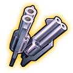

# Pet equipment

[← All pets](pets.html)

SSS and Holy Ghost pets come with their own set of 4 pieces (Weapon, Wing, Accessory, Armor). The set belongs to the pet and can't be swapped.

## How upgrading works

- Each piece has **3 stages of +1 to +10** (30 levels in total). Holy Ghost pets' pieces stop at the end of stage 2.
- Pressing **Upgrade** costs  **Pet Essence** and upgrades **one piece, chosen by the game**. The piece can go **up**, **stay the same** or **go down**.
- The price depends on the **combined level of all 4 pieces**, not on the piece that gets upgraded (table below).
- When all 4 pieces are at +10, the button becomes **Advance**, which moves the set to the next stage.
- Higher stages need the pet itself to be advanced further: stage 2 needs the pet at **Advance III** (advancing there needs pet Lv300), stage 3 at **Advance IV** (pet Lv400). These are the same stage names as in the pets' star tables. The game says "Unlocks at next rank" when the pet's rank is too low. Holy Ghost pets meet every requirement.

**Jump to a set:** [Holy - Thunderfury Drake](#set-holy-thunderfury-drake) · [Holy - Rosefinch](#set-holy-rosefinch) · [Holy - Mount Xuanwu](#set-holy-mount-xuanwu) · [Holy - Frozen Tiger](#set-holy-frozen-tiger) · [Holy - Feather Envoy](#set-holy-feather-envoy) · [Holy - Elixir Maker](#set-holy-elixir-maker) · [Holy-Fantasy Loong](#set-holy-fantasy-loong) · [Holy - Celestial Serpira](#set-holy-celestial-serpira) · [Saintly Noon Horse Soaring to the Sky](#set-saintly-noon-horse-soaring-to-the-sky) · [Michael](#set-michael) · [Celestial Marshal](#set-celestial-marshal) · [Fox Elf](#set-fox-elf) · [Squirrel](#set-squirrel) · [Thunderfury Drake](#set-thunderfury-drake) · [Ice White Tiger](#set-ice-white-tiger) · [Rosefinch(LD)](#set-rosefinch-ld) · [Titan Bull](#set-titan-bull) · [Lu Ye Bai Ze](#set-lu-ye-bai-ze) · [Mount Xuanwu](#set-mount-xuanwu) · [Feather Envoy](#set-feather-envoy) · [Dreamy Elf](#set-dreamy-elf) · [Elixir Maker](#set-elixir-maker) · [Fantasy Loong](#set-fantasy-loong) · [Celestial Serpira](#set-celestial-serpira) · [Noon Horse Soaring to the Sky](#set-noon-horse-soaring-to-the-sky) · [Chippy · Source](#set-chippy-source)

## Upgrade cost

Combined level = the levels of all 4 pieces added together (stage 2 +3 counts as level 13). Cost of one Upgrade or Advance press:

| Combined level | Essence | Combined level | Essence | Combined level | Essence | Combined level | Essence |
|---|---|---|---|---|---|---|---|
| 4 | 354 | 33 | 6,270 | 62 | 21,774 | 91 | 46,865 |
| 5 | 399 | 34 | 6,645 | 63 | 22,479 | 92 | 47,901 |
| 6 | 455 | 35 | 7,032 | 64 | 23,196 | 93 | 48,948 |
| 7 | 522 | 36 | 7,430 | 65 | 23,925 | 94 | 50,007 |
| 8 | 600 | 37 | 7,839 | 66 | 24,665 | 95 | 51,078 |
| 9 | 690 | 38 | 8,259 | 67 | 25,416 | 96 | 52,160 |
| 10 | 792 | 39 | 8,691 | 68 | 26,178 | 97 | 53,253 |
| 11 | 905 | 40 | 9,135 | 69 | 26,952 | 98 | 54,357 |
| 12 | 1,029 | 41 | 9,590 | 70 | 27,738 | 99 | 55,473 |
| 13 | 1,164 | 42 | 10,056 | 71 | 28,535 | 100 | 56,601 |
| 14 | 1,311 | 43 | 10,533 | 72 | 29,343 | 101 | 57,740 |
| 15 | 1,470 | 44 | 11,022 | 73 | 30,162 | 102 | 58,890 |
| 16 | 1,640 | 45 | 11,523 | 74 | 30,993 | 103 | 60,051 |
| 17 | 1,821 | 46 | 12,035 | 75 | 31,836 | 104 | 61,224 |
| 18 | 2,013 | 47 | 12,558 | 76 | 32,690 | 105 | 62,409 |
| 19 | 2,217 | 48 | 13,092 | 77 | 33,555 | 106 | 63,605 |
| 20 | 2,433 | 49 | 13,638 | 78 | 34,431 | 107 | 64,812 |
| 21 | 2,660 | 50 | 14,196 | 79 | 35,319 | 108 | 66,030 |
| 22 | 2,898 | 51 | 14,765 | 80 | 36,219 | 109 | 67,260 |
| 23 | 3,147 | 52 | 15,345 | 81 | 37,130 | 110 | 68,502 |
| 24 | 3,408 | 53 | 15,936 | 82 | 38,052 | 111 | 69,755 |
| 25 | 3,681 | 54 | 16,539 | 83 | 38,985 | 112 | 71,019 |
| 26 | 3,965 | 55 | 17,154 | 84 | 39,930 | 113 | 72,294 |
| 27 | 4,260 | 56 | 17,780 | 85 | 40,887 | 114 | 73,581 |
| 28 | 4,566 | 57 | 18,417 | 86 | 41,855 | 115 | 74,880 |
| 29 | 4,884 | 58 | 19,065 | 87 | 42,834 | 116 | 76,190 |
| 30 | 5,214 | 59 | 19,725 | 88 | 43,824 | 117 | 77,511 |
| 31 | 5,555 | 60 | 20,397 | 89 | 44,826 | 118 | 78,843 |
| 32 | 5,907 | 61 | 21,080 | 90 | 45,840 | 119 | 80,187 |

From all pieces at stage 1 +1, if every press goes up: **954,894** essence to max a Holy Ghost set (stage 2 +10), **3,226,702** to max an SSS set (stage 3 +10). Presses that stay or go down cost extra.

## Sets

###  [Holy - Thunderfury Drake](pets/holy-thunderfury-drake.html)

| | Weapon | Wing | Accessory | Armor |
|---|---|---|---|---|
| Piece |  **Holy - Sea Tyrant Staff** |  **Holy - Sea Tyrant Bead** |  **Holy - Sea Tyrant Hat** |  **Holy - Sea Tyrant Aura** |
| Description | As the Lord of Tides descends upon the world, the four seas submit. | Every prayer bead seals the memory of a shipwreck. | While it can shelter from the storm at sea, it cannot conceal its soaring edge. | Blessed by the Sea God, you can now walk upon the waves. |
| Stat | ATK | DEF | HP | DMG- |

| Level | Pet rank needed to upgrade | Weapon (ATK) | Wing (DEF) | Accessory (HP) | Armor (DMG-) |
|---|---|---|---|---|---|
| Stage&nbsp;1&nbsp;+1 | Advance III | 871 | 419 | 21,323 | 774 |
| Stage&nbsp;1&nbsp;+2 | Advance III | 899 | 432 | 21,980 | 798 |
| Stage&nbsp;1&nbsp;+3 | Advance III | 927 | 445 | 22,645 | 822 |
| Stage&nbsp;1&nbsp;+4 | Advance III | 955 | 458 | 23,311 | 846 |
| Stage&nbsp;1&nbsp;+5 | Advance III | 983 | 471 | 23,976 | 870 |
| Stage&nbsp;1&nbsp;+6 | Advance III | 1,011 | 484 | 24,642 | 894 |
| Stage&nbsp;1&nbsp;+7 | Advance III | 1,039 | 497 | 25,307 | 918 |
| Stage&nbsp;1&nbsp;+8 | Advance III | 1,067 | 510 | 25,972 | 942 |
| Stage&nbsp;1&nbsp;+9 | Advance III | 1,095 | 523 | 26,638 | 966 |
| Stage&nbsp;1&nbsp;+10 | Advance III | 1,123 | 536 | 27,303 | 990 |
| Stage&nbsp;2&nbsp;+1 | Advance IV | 1,151 | 549 | 27,969 | 1,015 |
| Stage&nbsp;2&nbsp;+2 | Advance IV | 1,179 | 562 | 28,634 | 1,039 |
| Stage&nbsp;2&nbsp;+3 | Advance IV | 1,207 | 575 | 29,299 | 1,063 |
| Stage&nbsp;2&nbsp;+4 | Advance IV | 1,235 | 588 | 29,965 | 1,087 |
| Stage&nbsp;2&nbsp;+5 | Advance IV | 1,263 | 601 | 30,630 | 1,111 |
| Stage&nbsp;2&nbsp;+6 | Advance IV | 1,291 | 614 | 31,296 | 1,135 |
| Stage&nbsp;2&nbsp;+7 | Advance IV | 1,319 | 627 | 31,961 | 1,159 |
| Stage&nbsp;2&nbsp;+8 | Advance IV | 1,347 | 640 | 32,626 | 1,183 |
| Stage&nbsp;2&nbsp;+9 | Advance IV | 1,375 | 653 | 33,292 | 1,207 |
| Stage&nbsp;2&nbsp;+10 | max | 1,403 | 666 | 33,957 | 1,231 |

###  [Holy - Rosefinch](pets/holy-rosefinch.html)

| | Weapon | Wing | Accessory | Armor |
|---|---|---|---|---|
| Piece |  **Holy - Flame Umbrella** |  **Holy - Flame Phoenix** |  **Holy - Flame Headwear** |  **Holy - Flame Circlet** |
| Description | The umbrella opens like a phoenix dancing in the nine heavens, flames scorch the plains. | Bathing in fire yet neither dying nor perishing, burning all to ashes to be reborn. | Eternal true fire ignites in the hair, flames blaze in the eyes. | The mask burns like raging fire, concealing a resolve to incinerate everything. |
| Stat | ATK | DEF | HP | DMG- |

| Level | Pet rank needed to upgrade | Weapon (ATK) | Wing (DEF) | Accessory (HP) | Armor (DMG-) |
|---|---|---|---|---|---|
| Stage&nbsp;1&nbsp;+1 | Advance III | 871 | 419 | 21,323 | 774 |
| Stage&nbsp;1&nbsp;+2 | Advance III | 899 | 432 | 21,980 | 798 |
| Stage&nbsp;1&nbsp;+3 | Advance III | 927 | 445 | 22,645 | 822 |
| Stage&nbsp;1&nbsp;+4 | Advance III | 955 | 458 | 23,311 | 846 |
| Stage&nbsp;1&nbsp;+5 | Advance III | 983 | 471 | 23,976 | 870 |
| Stage&nbsp;1&nbsp;+6 | Advance III | 1,011 | 484 | 24,642 | 894 |
| Stage&nbsp;1&nbsp;+7 | Advance III | 1,039 | 497 | 25,307 | 918 |
| Stage&nbsp;1&nbsp;+8 | Advance III | 1,067 | 510 | 25,972 | 942 |
| Stage&nbsp;1&nbsp;+9 | Advance III | 1,095 | 523 | 26,638 | 966 |
| Stage&nbsp;1&nbsp;+10 | Advance III | 1,123 | 536 | 27,303 | 990 |
| Stage&nbsp;2&nbsp;+1 | Advance IV | 1,151 | 549 | 27,969 | 1,015 |
| Stage&nbsp;2&nbsp;+2 | Advance IV | 1,179 | 562 | 28,634 | 1,039 |
| Stage&nbsp;2&nbsp;+3 | Advance IV | 1,207 | 575 | 29,299 | 1,063 |
| Stage&nbsp;2&nbsp;+4 | Advance IV | 1,235 | 588 | 29,965 | 1,087 |
| Stage&nbsp;2&nbsp;+5 | Advance IV | 1,263 | 601 | 30,630 | 1,111 |
| Stage&nbsp;2&nbsp;+6 | Advance IV | 1,291 | 614 | 31,296 | 1,135 |
| Stage&nbsp;2&nbsp;+7 | Advance IV | 1,319 | 627 | 31,961 | 1,159 |
| Stage&nbsp;2&nbsp;+8 | Advance IV | 1,347 | 640 | 32,626 | 1,183 |
| Stage&nbsp;2&nbsp;+9 | Advance IV | 1,375 | 653 | 33,292 | 1,207 |
| Stage&nbsp;2&nbsp;+10 | max | 1,403 | 666 | 33,957 | 1,231 |

###  [Holy - Mount Xuanwu](pets/holy-mount-xuanwu.html)

| | Weapon | Wing | Accessory | Armor |
|---|---|---|---|---|
| Piece |  **Holy - Titan Blade** |  **Holy - Titan Boots** |  **Holy - Titan Hairpin** |  **Holy - Titan Robe** |
| Description | A heavy sword, unsharpened yet shakes heaven and earth, moves mountains. | Every step shakes the earth, an unstoppable force. | A single hairpin ties up mountains and rivers, an aura that swallows ten thousand miles. | Donning it transforms you into a mountain, unshakable. |
| Stat | ATK | DEF | HP | DMG- |

| Level | Pet rank needed to upgrade | Weapon (ATK) | Wing (DEF) | Accessory (HP) | Armor (DMG-) |
|---|---|---|---|---|---|
| Stage&nbsp;1&nbsp;+1 | Advance III | 871 | 419 | 21,323 | 774 |
| Stage&nbsp;1&nbsp;+2 | Advance III | 899 | 432 | 21,980 | 798 |
| Stage&nbsp;1&nbsp;+3 | Advance III | 927 | 445 | 22,645 | 822 |
| Stage&nbsp;1&nbsp;+4 | Advance III | 955 | 458 | 23,311 | 846 |
| Stage&nbsp;1&nbsp;+5 | Advance III | 983 | 471 | 23,976 | 870 |
| Stage&nbsp;1&nbsp;+6 | Advance III | 1,011 | 484 | 24,642 | 894 |
| Stage&nbsp;1&nbsp;+7 | Advance III | 1,039 | 497 | 25,307 | 918 |
| Stage&nbsp;1&nbsp;+8 | Advance III | 1,067 | 510 | 25,972 | 942 |
| Stage&nbsp;1&nbsp;+9 | Advance III | 1,095 | 523 | 26,638 | 966 |
| Stage&nbsp;1&nbsp;+10 | Advance III | 1,123 | 536 | 27,303 | 990 |
| Stage&nbsp;2&nbsp;+1 | Advance IV | 1,151 | 549 | 27,969 | 1,015 |
| Stage&nbsp;2&nbsp;+2 | Advance IV | 1,179 | 562 | 28,634 | 1,039 |
| Stage&nbsp;2&nbsp;+3 | Advance IV | 1,207 | 575 | 29,299 | 1,063 |
| Stage&nbsp;2&nbsp;+4 | Advance IV | 1,235 | 588 | 29,965 | 1,087 |
| Stage&nbsp;2&nbsp;+5 | Advance IV | 1,263 | 601 | 30,630 | 1,111 |
| Stage&nbsp;2&nbsp;+6 | Advance IV | 1,291 | 614 | 31,296 | 1,135 |
| Stage&nbsp;2&nbsp;+7 | Advance IV | 1,319 | 627 | 31,961 | 1,159 |
| Stage&nbsp;2&nbsp;+8 | Advance IV | 1,347 | 640 | 32,626 | 1,183 |
| Stage&nbsp;2&nbsp;+9 | Advance IV | 1,375 | 653 | 33,292 | 1,207 |
| Stage&nbsp;2&nbsp;+10 | max | 1,403 | 666 | 33,957 | 1,231 |

###  [Holy - Frozen Tiger](pets/holy-frozen-tiger.html)

| | Weapon | Wing | Accessory | Armor |
|---|---|---|---|---|
| Piece |  **Holy - Ice Soul Blade** |  **Holy - Ice Soul Bracer** |  **Holy - Ice Soul Circlet** |  **Holy - Ice Soul Belt** |
| Description | The instant the long blade is unsheathed, all creation freezes. | Extreme Cold true energy enters through the wrist, freezing the blood in an instant. | The expression behind the mask is unclear, only a bone-chilling cold is felt. | Wrapped by ten-thousand-mile frozen rivers, energy soars like a rainbow across the heavens. |
| Stat | ATK | DEF | HP | DMG- |

| Level | Pet rank needed to upgrade | Weapon (ATK) | Wing (DEF) | Accessory (HP) | Armor (DMG-) |
|---|---|---|---|---|---|
| Stage&nbsp;1&nbsp;+1 | Advance III | 871 | 419 | 21,323 | 774 |
| Stage&nbsp;1&nbsp;+2 | Advance III | 899 | 432 | 21,980 | 798 |
| Stage&nbsp;1&nbsp;+3 | Advance III | 927 | 445 | 22,645 | 822 |
| Stage&nbsp;1&nbsp;+4 | Advance III | 955 | 458 | 23,311 | 846 |
| Stage&nbsp;1&nbsp;+5 | Advance III | 983 | 471 | 23,976 | 870 |
| Stage&nbsp;1&nbsp;+6 | Advance III | 1,011 | 484 | 24,642 | 894 |
| Stage&nbsp;1&nbsp;+7 | Advance III | 1,039 | 497 | 25,307 | 918 |
| Stage&nbsp;1&nbsp;+8 | Advance III | 1,067 | 510 | 25,972 | 942 |
| Stage&nbsp;1&nbsp;+9 | Advance III | 1,095 | 523 | 26,638 | 966 |
| Stage&nbsp;1&nbsp;+10 | Advance III | 1,123 | 536 | 27,303 | 990 |
| Stage&nbsp;2&nbsp;+1 | Advance IV | 1,151 | 549 | 27,969 | 1,015 |
| Stage&nbsp;2&nbsp;+2 | Advance IV | 1,179 | 562 | 28,634 | 1,039 |
| Stage&nbsp;2&nbsp;+3 | Advance IV | 1,207 | 575 | 29,299 | 1,063 |
| Stage&nbsp;2&nbsp;+4 | Advance IV | 1,235 | 588 | 29,965 | 1,087 |
| Stage&nbsp;2&nbsp;+5 | Advance IV | 1,263 | 601 | 30,630 | 1,111 |
| Stage&nbsp;2&nbsp;+6 | Advance IV | 1,291 | 614 | 31,296 | 1,135 |
| Stage&nbsp;2&nbsp;+7 | Advance IV | 1,319 | 627 | 31,961 | 1,159 |
| Stage&nbsp;2&nbsp;+8 | Advance IV | 1,347 | 640 | 32,626 | 1,183 |
| Stage&nbsp;2&nbsp;+9 | Advance IV | 1,375 | 653 | 33,292 | 1,207 |
| Stage&nbsp;2&nbsp;+10 | max | 1,403 | 666 | 33,957 | 1,231 |

###  [Holy - Feather Envoy](pets/holy-feather-envoy.html)

| | Weapon | Wing | Accessory | Armor |
|---|---|---|---|---|
| Piece |  **Holy - Love and Peace** |  **Holy - Spirit Ribbon** |  **Holy - Spirit Hat** |  **Holy - Spirit Wings** |
| Description | The relic of the Peace God, which can spread love and peace to the world. | One of the relics of an old sage. Legend has it that it possesses the power of immortality. | One of the relics of an old sage. Legend has it that it possesses the power of resurrection. | One of the relics of an old sage. Legend has it that it possesses the power to fly to the godly realm. |
| Stat | ATK | DEF | HP | DMG- |

| Level | Pet rank needed to upgrade | Weapon (ATK) | Wing (DEF) | Accessory (HP) | Armor (DMG-) |
|---|---|---|---|---|---|
| Stage&nbsp;1&nbsp;+1 | Advance III | 871 | 419 | 21,323 | 774 |
| Stage&nbsp;1&nbsp;+2 | Advance III | 899 | 432 | 21,980 | 798 |
| Stage&nbsp;1&nbsp;+3 | Advance III | 927 | 445 | 22,645 | 822 |
| Stage&nbsp;1&nbsp;+4 | Advance III | 955 | 458 | 23,311 | 846 |
| Stage&nbsp;1&nbsp;+5 | Advance III | 983 | 471 | 23,976 | 870 |
| Stage&nbsp;1&nbsp;+6 | Advance III | 1,011 | 484 | 24,642 | 894 |
| Stage&nbsp;1&nbsp;+7 | Advance III | 1,039 | 497 | 25,307 | 918 |
| Stage&nbsp;1&nbsp;+8 | Advance III | 1,067 | 510 | 25,972 | 942 |
| Stage&nbsp;1&nbsp;+9 | Advance III | 1,095 | 523 | 26,638 | 966 |
| Stage&nbsp;1&nbsp;+10 | Advance III | 1,123 | 536 | 27,303 | 990 |
| Stage&nbsp;2&nbsp;+1 | Advance IV | 1,151 | 549 | 27,969 | 1,015 |
| Stage&nbsp;2&nbsp;+2 | Advance IV | 1,179 | 562 | 28,634 | 1,039 |
| Stage&nbsp;2&nbsp;+3 | Advance IV | 1,207 | 575 | 29,299 | 1,063 |
| Stage&nbsp;2&nbsp;+4 | Advance IV | 1,235 | 588 | 29,965 | 1,087 |
| Stage&nbsp;2&nbsp;+5 | Advance IV | 1,263 | 601 | 30,630 | 1,111 |
| Stage&nbsp;2&nbsp;+6 | Advance IV | 1,291 | 614 | 31,296 | 1,135 |
| Stage&nbsp;2&nbsp;+7 | Advance IV | 1,319 | 627 | 31,961 | 1,159 |
| Stage&nbsp;2&nbsp;+8 | Advance IV | 1,347 | 640 | 32,626 | 1,183 |
| Stage&nbsp;2&nbsp;+9 | Advance IV | 1,375 | 653 | 33,292 | 1,207 |
| Stage&nbsp;2&nbsp;+10 | max | 1,403 | 666 | 33,957 | 1,231 |

###  [Holy - Elixir Maker](pets/holy-elixir-maker.html)

| | Weapon | Wing | Accessory | Armor |
|---|---|---|---|---|
| Piece |  **Holy - Bunny Hammer** |  **Holy - Bunny Hood** |  **Holy - Bunny Belt** |  **Holy - Moonlight Red Silk** |
| Description | During Mao's medicine making process, the bunny hammer absorbed more divine power from the elixirs and achieved further enhancement. | The hood is specially designed for the elixir maker, with holes reserved for ears. | Some said the treasure has the power to bring the dead back alive. | Red silk hung in front of the Lunar Palace. It has become a holy artifact with strong defensive capabilities after years of absorbing the essence of moonlight. |
| Stat | ATK | DEF | HP | DMG- |

| Level | Pet rank needed to upgrade | Weapon (ATK) | Wing (DEF) | Accessory (HP) | Armor (DMG-) |
|---|---|---|---|---|---|
| Stage&nbsp;1&nbsp;+1 | Advance III | 871 | 419 | 21,323 | 774 |
| Stage&nbsp;1&nbsp;+2 | Advance III | 899 | 432 | 21,980 | 798 |
| Stage&nbsp;1&nbsp;+3 | Advance III | 927 | 445 | 22,645 | 822 |
| Stage&nbsp;1&nbsp;+4 | Advance III | 955 | 458 | 23,311 | 846 |
| Stage&nbsp;1&nbsp;+5 | Advance III | 983 | 471 | 23,976 | 870 |
| Stage&nbsp;1&nbsp;+6 | Advance III | 1,011 | 484 | 24,642 | 894 |
| Stage&nbsp;1&nbsp;+7 | Advance III | 1,039 | 497 | 25,307 | 918 |
| Stage&nbsp;1&nbsp;+8 | Advance III | 1,067 | 510 | 25,972 | 942 |
| Stage&nbsp;1&nbsp;+9 | Advance III | 1,095 | 523 | 26,638 | 966 |
| Stage&nbsp;1&nbsp;+10 | Advance III | 1,123 | 536 | 27,303 | 990 |
| Stage&nbsp;2&nbsp;+1 | Advance IV | 1,151 | 549 | 27,969 | 1,015 |
| Stage&nbsp;2&nbsp;+2 | Advance IV | 1,179 | 562 | 28,634 | 1,039 |
| Stage&nbsp;2&nbsp;+3 | Advance IV | 1,207 | 575 | 29,299 | 1,063 |
| Stage&nbsp;2&nbsp;+4 | Advance IV | 1,235 | 588 | 29,965 | 1,087 |
| Stage&nbsp;2&nbsp;+5 | Advance IV | 1,263 | 601 | 30,630 | 1,111 |
| Stage&nbsp;2&nbsp;+6 | Advance IV | 1,291 | 614 | 31,296 | 1,135 |
| Stage&nbsp;2&nbsp;+7 | Advance IV | 1,319 | 627 | 31,961 | 1,159 |
| Stage&nbsp;2&nbsp;+8 | Advance IV | 1,347 | 640 | 32,626 | 1,183 |
| Stage&nbsp;2&nbsp;+9 | Advance IV | 1,375 | 653 | 33,292 | 1,207 |
| Stage&nbsp;2&nbsp;+10 | max | 1,403 | 666 | 33,957 | 1,231 |

###  [Holy-Fantasy Loong](pets/holy-fantasy-loong.html)

| | Weapon | Wing | Accessory | Armor |
|---|---|---|---|---|
| Piece |  **Holy-Loong Horn Crown** |  **Holy-Scalelike Cloud Damask** |  **Holy-Golden Auspicious Cloud** |  **Holy-Spirit Wood Staff** |
| Description | The crown of loong horns contains the power of the loong. As Chen grows, the power contained becomes stronger. | A silk ribbon gathered by the spiritual energy of heaven and earth. The loong scales are fused with the ribbon. It is elegant and indestructible. It is a highly defensive treasure. | It seems that under the influence of the loong's power, it developed spiritual intelligence and became Chen's mount. | Legend has it that it is a scepter made from the branches of the Fusang sacred tree. Only such spiritual wood can withstand the power of the loong. |
| Stat | ATK | DEF | HP | DMG- |

| Level | Pet rank needed to upgrade | Weapon (ATK) | Wing (DEF) | Accessory (HP) | Armor (DMG-) |
|---|---|---|---|---|---|
| Stage&nbsp;1&nbsp;+1 | Advance III | 871 | 419 | 21,323 | 774 |
| Stage&nbsp;1&nbsp;+2 | Advance III | 899 | 432 | 21,980 | 798 |
| Stage&nbsp;1&nbsp;+3 | Advance III | 927 | 445 | 22,645 | 822 |
| Stage&nbsp;1&nbsp;+4 | Advance III | 955 | 458 | 23,311 | 846 |
| Stage&nbsp;1&nbsp;+5 | Advance III | 983 | 471 | 23,976 | 870 |
| Stage&nbsp;1&nbsp;+6 | Advance III | 1,011 | 484 | 24,642 | 894 |
| Stage&nbsp;1&nbsp;+7 | Advance III | 1,039 | 497 | 25,307 | 918 |
| Stage&nbsp;1&nbsp;+8 | Advance III | 1,067 | 510 | 25,972 | 942 |
| Stage&nbsp;1&nbsp;+9 | Advance III | 1,095 | 523 | 26,638 | 966 |
| Stage&nbsp;1&nbsp;+10 | Advance III | 1,123 | 536 | 27,303 | 990 |
| Stage&nbsp;2&nbsp;+1 | Advance IV | 1,151 | 549 | 27,969 | 1,015 |
| Stage&nbsp;2&nbsp;+2 | Advance IV | 1,179 | 562 | 28,634 | 1,039 |
| Stage&nbsp;2&nbsp;+3 | Advance IV | 1,207 | 575 | 29,299 | 1,063 |
| Stage&nbsp;2&nbsp;+4 | Advance IV | 1,235 | 588 | 29,965 | 1,087 |
| Stage&nbsp;2&nbsp;+5 | Advance IV | 1,263 | 601 | 30,630 | 1,111 |
| Stage&nbsp;2&nbsp;+6 | Advance IV | 1,291 | 614 | 31,296 | 1,135 |
| Stage&nbsp;2&nbsp;+7 | Advance IV | 1,319 | 627 | 31,961 | 1,159 |
| Stage&nbsp;2&nbsp;+8 | Advance IV | 1,347 | 640 | 32,626 | 1,183 |
| Stage&nbsp;2&nbsp;+9 | Advance IV | 1,375 | 653 | 33,292 | 1,207 |
| Stage&nbsp;2&nbsp;+10 | max | 1,403 | 666 | 33,957 | 1,231 |

###  [Holy - Celestial Serpira](pets/holy-celestial-serpira.html)

| | Weapon | Wing | Accessory | Armor |
|---|---|---|---|---|
| Piece |  **Holy - Serpent Blade** |  **Holy - Azure Veil** |  **Holy - Sunset Crown** |  **Holy - Lotus Robe** |
| Description | Transformed from the illusionary serpent whip, controlled by the serpent's will, it once defeated seven evil immortals, thus earning its name. | With this item in hand, you can journey a thousand miles effortlessly. | The sunshine lingers here. | With a graceful sweep of its sleeve, the golden serpent casts red lotuses against white clouds. |
| Stat | ATK | DEF | HP | DMG- |

| Level | Pet rank needed to upgrade | Weapon (ATK) | Wing (DEF) | Accessory (HP) | Armor (DMG-) |
|---|---|---|---|---|---|
| Stage&nbsp;1&nbsp;+1 | Advance III | 871 | 419 | 21,323 | 774 |
| Stage&nbsp;1&nbsp;+2 | Advance III | 899 | 432 | 21,980 | 798 |
| Stage&nbsp;1&nbsp;+3 | Advance III | 927 | 445 | 22,645 | 822 |
| Stage&nbsp;1&nbsp;+4 | Advance III | 955 | 458 | 23,311 | 846 |
| Stage&nbsp;1&nbsp;+5 | Advance III | 983 | 471 | 23,976 | 870 |
| Stage&nbsp;1&nbsp;+6 | Advance III | 1,011 | 484 | 24,642 | 894 |
| Stage&nbsp;1&nbsp;+7 | Advance III | 1,039 | 497 | 25,307 | 918 |
| Stage&nbsp;1&nbsp;+8 | Advance III | 1,067 | 510 | 25,972 | 942 |
| Stage&nbsp;1&nbsp;+9 | Advance III | 1,095 | 523 | 26,638 | 966 |
| Stage&nbsp;1&nbsp;+10 | Advance III | 1,123 | 536 | 27,303 | 990 |
| Stage&nbsp;2&nbsp;+1 | Advance IV | 1,151 | 549 | 27,969 | 1,015 |
| Stage&nbsp;2&nbsp;+2 | Advance IV | 1,179 | 562 | 28,634 | 1,039 |
| Stage&nbsp;2&nbsp;+3 | Advance IV | 1,207 | 575 | 29,299 | 1,063 |
| Stage&nbsp;2&nbsp;+4 | Advance IV | 1,235 | 588 | 29,965 | 1,087 |
| Stage&nbsp;2&nbsp;+5 | Advance IV | 1,263 | 601 | 30,630 | 1,111 |
| Stage&nbsp;2&nbsp;+6 | Advance IV | 1,291 | 614 | 31,296 | 1,135 |
| Stage&nbsp;2&nbsp;+7 | Advance IV | 1,319 | 627 | 31,961 | 1,159 |
| Stage&nbsp;2&nbsp;+8 | Advance IV | 1,347 | 640 | 32,626 | 1,183 |
| Stage&nbsp;2&nbsp;+9 | Advance IV | 1,375 | 653 | 33,292 | 1,207 |
| Stage&nbsp;2&nbsp;+10 | max | 1,403 | 666 | 33,957 | 1,231 |

###  [Saintly Noon Horse Soaring to the Sky](pets/saintly-noon-horse-soaring-to-the-sky.html)

| | Weapon | Wing | Accessory | Armor |
|---|---|---|---|---|
| Piece |  **Saintly Immortal Steed Bracers** |  **Saintly Immortal Steed Jade Pauldron** |  **Saintly Immortal Steed Red Ribbon** |  **Saintly Immortal Steed Sacred Lance** |
| Description | A saintly bracer condensed from the Immortal Steed's bloodline, silver patterns flow with immortal power, a life-bound protective gear gifted by the steed's incarnation to its loyal and brave rider. | A gilded saintly shoulder armor inlaid with warm jade from the Immortal Steed, the jade's glow reflecting immortal mist, a saintly rider's pauldron inherited from the Immortal Steed clan. | A crimson saintly ribbon entwined with the Immortal Steed's spirit flame, its surface woven with patterns of the steed treading clouds, a protective ribbon blessed by the steed, accompanying the rider in battle undispersed. | An Immortal Steed Sacred Lance with its tip condensed from pure yang immortal fire, the shaft carved full of master-protection runes, a life-bound divine weapon forged by the Immortal Steed clan for its rider. |
| Stat | ATK | DEF | HP | DMG- |

| Level | Pet rank needed to upgrade | Weapon (ATK) | Wing (DEF) | Accessory (HP) | Armor (DMG-) |
|---|---|---|---|---|---|
| Stage&nbsp;1&nbsp;+1 | Advance III | 871 | 419 | 21,323 | 774 |
| Stage&nbsp;1&nbsp;+2 | Advance III | 899 | 432 | 21,980 | 798 |
| Stage&nbsp;1&nbsp;+3 | Advance III | 927 | 445 | 22,645 | 822 |
| Stage&nbsp;1&nbsp;+4 | Advance III | 955 | 458 | 23,311 | 846 |
| Stage&nbsp;1&nbsp;+5 | Advance III | 983 | 471 | 23,976 | 870 |
| Stage&nbsp;1&nbsp;+6 | Advance III | 1,011 | 484 | 24,642 | 894 |
| Stage&nbsp;1&nbsp;+7 | Advance III | 1,039 | 497 | 25,307 | 918 |
| Stage&nbsp;1&nbsp;+8 | Advance III | 1,067 | 510 | 25,972 | 942 |
| Stage&nbsp;1&nbsp;+9 | Advance III | 1,095 | 523 | 26,638 | 966 |
| Stage&nbsp;1&nbsp;+10 | Advance III | 1,123 | 536 | 27,303 | 990 |
| Stage&nbsp;2&nbsp;+1 | Advance IV | 1,151 | 549 | 27,969 | 1,015 |
| Stage&nbsp;2&nbsp;+2 | Advance IV | 1,179 | 562 | 28,634 | 1,039 |
| Stage&nbsp;2&nbsp;+3 | Advance IV | 1,207 | 575 | 29,299 | 1,063 |
| Stage&nbsp;2&nbsp;+4 | Advance IV | 1,235 | 588 | 29,965 | 1,087 |
| Stage&nbsp;2&nbsp;+5 | Advance IV | 1,263 | 601 | 30,630 | 1,111 |
| Stage&nbsp;2&nbsp;+6 | Advance IV | 1,291 | 614 | 31,296 | 1,135 |
| Stage&nbsp;2&nbsp;+7 | Advance IV | 1,319 | 627 | 31,961 | 1,159 |
| Stage&nbsp;2&nbsp;+8 | Advance IV | 1,347 | 640 | 32,626 | 1,183 |
| Stage&nbsp;2&nbsp;+9 | Advance IV | 1,375 | 653 | 33,292 | 1,207 |
| Stage&nbsp;2&nbsp;+10 | max | 1,403 | 666 | 33,957 | 1,231 |

###  [Michael](pets/michael.html)

| | Weapon | Wing | Accessory | Armor |
|---|---|---|---|---|
| Piece |  **Angel Sword** |  **Angel Wings** |  **Angel Aura** |  **Angel Armor** |
| Description | Michael's Sword | Holy wings that only an archangel can possess | Symbol of a higher status angel | An armor blessed by God |
| Stat | ATK | DEF | HP | DMG- |

| Level | Pet rank needed to upgrade | Weapon (ATK) | Wing (DEF) | Accessory (HP) | Armor (DMG-) |
|---|---|---|---|---|---|
| Stage&nbsp;1&nbsp;+1 | - | 23 | 11 | 608 | 20 |
| Stage&nbsp;1&nbsp;+2 | - | 45 | 23 | 1,216 | 41 |
| Stage&nbsp;1&nbsp;+3 | - | 68 | 34 | 1,824 | 61 |
| Stage&nbsp;1&nbsp;+4 | - | 90 | 45 | 2,431 | 81 |
| Stage&nbsp;1&nbsp;+5 | - | 113 | 56 | 3,039 | 101 |
| Stage&nbsp;1&nbsp;+6 | - | 135 | 68 | 3,647 | 122 |
| Stage&nbsp;1&nbsp;+7 | - | 158 | 79 | 4,255 | 142 |
| Stage&nbsp;1&nbsp;+8 | - | 180 | 90 | 4,863 | 162 |
| Stage&nbsp;1&nbsp;+9 | - | 203 | 101 | 5,471 | 182 |
| Stage&nbsp;1&nbsp;+10 | Advance III | 225 | 113 | 6,078 | 203 |
| Stage&nbsp;2&nbsp;+1 | Advance III | 272 | 136 | 7,353 | 245 |
| Stage&nbsp;2&nbsp;+2 | Advance III | 295 | 147 | 7,961 | 265 |
| Stage&nbsp;2&nbsp;+3 | Advance III | 317 | 159 | 8,569 | 286 |
| Stage&nbsp;2&nbsp;+4 | Advance III | 340 | 170 | 9,177 | 306 |
| Stage&nbsp;2&nbsp;+5 | Advance III | 362 | 181 | 9,784 | 326 |
| Stage&nbsp;2&nbsp;+6 | Advance III | 385 | 192 | 10,392 | 346 |
| Stage&nbsp;2&nbsp;+7 | Advance III | 407 | 204 | 11,000 | 367 |
| Stage&nbsp;2&nbsp;+8 | Advance III | 430 | 215 | 11,608 | 387 |
| Stage&nbsp;2&nbsp;+9 | Advance III | 452 | 226 | 12,216 | 407 |
| Stage&nbsp;2&nbsp;+10 | Advance IV | 475 | 237 | 12,824 | 427 |
| Stage&nbsp;3&nbsp;+1 | Advance IV | 523 | 261 | 14,118 | 471 |
| Stage&nbsp;3&nbsp;+2 | Advance IV | 545 | 273 | 14,726 | 491 |
| Stage&nbsp;3&nbsp;+3 | Advance IV | 568 | 284 | 15,333 | 511 |
| Stage&nbsp;3&nbsp;+4 | Advance IV | 590 | 295 | 15,941 | 531 |
| Stage&nbsp;3&nbsp;+5 | Advance IV | 613 | 306 | 16,549 | 552 |
| Stage&nbsp;3&nbsp;+6 | Advance IV | 635 | 318 | 17,157 | 572 |
| Stage&nbsp;3&nbsp;+7 | Advance IV | 658 | 329 | 17,765 | 592 |
| Stage&nbsp;3&nbsp;+8 | Advance IV | 680 | 340 | 18,373 | 612 |
| Stage&nbsp;3&nbsp;+9 | Advance IV | 703 | 351 | 18,981 | 633 |
| Stage&nbsp;3&nbsp;+10 | max | 726 | 363 | 19,608 | 654 |

###  [Celestial Marshal](pets/celestial-marshal.html)

| | Weapon | Wing | Accessory | Armor |
|---|---|---|---|---|
| Piece |  **Rake** |  **Ribbon** |  **Beastking Armor** |  **Breastplate** |
| Description | Nine-toothed Rake, tempered with divine icy iron by Lord Lao | Super light, as tough as steel | Only the king of all beasts can wear this armor | Cold Iron Armor worn to protect chest |
| Stat | ATK | DEF | HP | DMG- |

| Level | Pet rank needed to upgrade | Weapon (ATK) | Wing (DEF) | Accessory (HP) | Armor (DMG-) |
|---|---|---|---|---|---|
| Stage&nbsp;1&nbsp;+1 | - | 25 | 12 | 669 | 22 |
| Stage&nbsp;1&nbsp;+2 | - | 50 | 25 | 1,338 | 45 |
| Stage&nbsp;1&nbsp;+3 | - | 75 | 37 | 2,006 | 67 |
| Stage&nbsp;1&nbsp;+4 | - | 99 | 50 | 2,674 | 89 |
| Stage&nbsp;1&nbsp;+5 | - | 124 | 62 | 3,343 | 111 |
| Stage&nbsp;1&nbsp;+6 | - | 149 | 75 | 4,012 | 134 |
| Stage&nbsp;1&nbsp;+7 | - | 174 | 87 | 4,681 | 156 |
| Stage&nbsp;1&nbsp;+8 | - | 198 | 99 | 5,349 | 178 |
| Stage&nbsp;1&nbsp;+9 | - | 223 | 111 | 6,018 | 200 |
| Stage&nbsp;1&nbsp;+10 | Advance III | 248 | 124 | 6,686 | 223 |
| Stage&nbsp;2&nbsp;+1 | Advance III | 299 | 150 | 8,088 | 270 |
| Stage&nbsp;2&nbsp;+2 | Advance III | 325 | 162 | 8,757 | 292 |
| Stage&nbsp;2&nbsp;+3 | Advance III | 349 | 175 | 9,426 | 315 |
| Stage&nbsp;2&nbsp;+4 | Advance III | 374 | 187 | 10,095 | 337 |
| Stage&nbsp;2&nbsp;+5 | Advance III | 398 | 199 | 10,762 | 359 |
| Stage&nbsp;2&nbsp;+6 | Advance III | 424 | 211 | 11,431 | 381 |
| Stage&nbsp;2&nbsp;+7 | Advance III | 448 | 224 | 12,100 | 404 |
| Stage&nbsp;2&nbsp;+8 | Advance III | 473 | 237 | 12,769 | 426 |
| Stage&nbsp;2&nbsp;+9 | Advance III | 497 | 249 | 13,438 | 448 |
| Stage&nbsp;2&nbsp;+10 | Advance IV | 523 | 261 | 14,106 | 470 |
| Stage&nbsp;3&nbsp;+1 | Advance IV | 575 | 287 | 15,530 | 518 |
| Stage&nbsp;3&nbsp;+2 | Advance IV | 600 | 300 | 16,199 | 540 |
| Stage&nbsp;3&nbsp;+3 | Advance IV | 625 | 312 | 16,866 | 562 |
| Stage&nbsp;3&nbsp;+4 | Advance IV | 649 | 325 | 17,535 | 584 |
| Stage&nbsp;3&nbsp;+5 | Advance IV | 674 | 337 | 18,204 | 607 |
| Stage&nbsp;3&nbsp;+6 | Advance IV | 699 | 350 | 18,873 | 629 |
| Stage&nbsp;3&nbsp;+7 | Advance IV | 724 | 362 | 19,542 | 651 |
| Stage&nbsp;3&nbsp;+8 | Advance IV | 748 | 374 | 20,210 | 673 |
| Stage&nbsp;3&nbsp;+9 | Advance IV | 773 | 386 | 20,879 | 696 |
| Stage&nbsp;3&nbsp;+10 | max | 799 | 399 | 21,569 | 719 |

###  [Fox Elf](pets/fox-elf.html)

| | Weapon | Wing | Accessory | Armor |
|---|---|---|---|---|
| Piece |  **Foxelf Staff** |  **Nine-tails** |  **Gilt Accessory** |  **Fairy Crown** |
| Description | A staff infused with Fox Elf's power, it can easily charm mortals with a direct glance | A thick and soft tail, the symbol of Fox Elf | A golden accessory infused with Fox Elf's power | A relic only for the immortals and a favorite of Fox Elf. It can draw energy from the natural world |
| Stat | ATK | DEF | HP | DMG- |

| Level | Pet rank needed to upgrade | Weapon (ATK) | Wing (DEF) | Accessory (HP) | Armor (DMG-) |
|---|---|---|---|---|---|
| Stage&nbsp;1&nbsp;+1 | - | 25 | 12 | 669 | 22 |
| Stage&nbsp;1&nbsp;+2 | - | 50 | 25 | 1,338 | 45 |
| Stage&nbsp;1&nbsp;+3 | - | 75 | 37 | 2,006 | 67 |
| Stage&nbsp;1&nbsp;+4 | - | 99 | 50 | 2,674 | 89 |
| Stage&nbsp;1&nbsp;+5 | - | 124 | 62 | 3,343 | 111 |
| Stage&nbsp;1&nbsp;+6 | - | 149 | 75 | 4,012 | 134 |
| Stage&nbsp;1&nbsp;+7 | - | 174 | 87 | 4,681 | 156 |
| Stage&nbsp;1&nbsp;+8 | - | 198 | 99 | 5,349 | 178 |
| Stage&nbsp;1&nbsp;+9 | - | 223 | 111 | 6,018 | 200 |
| Stage&nbsp;1&nbsp;+10 | Advance III | 248 | 124 | 6,686 | 223 |
| Stage&nbsp;2&nbsp;+1 | Advance III | 299 | 150 | 8,088 | 270 |
| Stage&nbsp;2&nbsp;+2 | Advance III | 325 | 162 | 8,757 | 292 |
| Stage&nbsp;2&nbsp;+3 | Advance III | 349 | 175 | 9,426 | 315 |
| Stage&nbsp;2&nbsp;+4 | Advance III | 374 | 187 | 10,095 | 337 |
| Stage&nbsp;2&nbsp;+5 | Advance III | 398 | 199 | 10,762 | 359 |
| Stage&nbsp;2&nbsp;+6 | Advance III | 424 | 211 | 11,431 | 381 |
| Stage&nbsp;2&nbsp;+7 | Advance III | 448 | 224 | 12,100 | 404 |
| Stage&nbsp;2&nbsp;+8 | Advance III | 473 | 237 | 12,769 | 426 |
| Stage&nbsp;2&nbsp;+9 | Advance III | 497 | 249 | 13,438 | 448 |
| Stage&nbsp;2&nbsp;+10 | Advance IV | 523 | 261 | 14,106 | 470 |
| Stage&nbsp;3&nbsp;+1 | Advance IV | 575 | 287 | 15,530 | 518 |
| Stage&nbsp;3&nbsp;+2 | Advance IV | 600 | 300 | 16,199 | 540 |
| Stage&nbsp;3&nbsp;+3 | Advance IV | 625 | 312 | 16,866 | 562 |
| Stage&nbsp;3&nbsp;+4 | Advance IV | 649 | 325 | 17,535 | 584 |
| Stage&nbsp;3&nbsp;+5 | Advance IV | 674 | 337 | 18,204 | 607 |
| Stage&nbsp;3&nbsp;+6 | Advance IV | 699 | 350 | 18,873 | 629 |
| Stage&nbsp;3&nbsp;+7 | Advance IV | 724 | 362 | 19,542 | 651 |
| Stage&nbsp;3&nbsp;+8 | Advance IV | 748 | 374 | 20,210 | 673 |
| Stage&nbsp;3&nbsp;+9 | Advance IV | 773 | 386 | 20,879 | 696 |
| Stage&nbsp;3&nbsp;+10 | max | 799 | 399 | 21,569 | 719 |

###  [Squirrel](pets/squirrel.html)

| | Weapon | Wing | Accessory | Armor |
|---|---|---|---|---|
| Piece |  **Fire Gun** |  **Ejector** |  **Clip** |  **Laser Mirror** |
| Description | Squirrel's exclusive machine gun has more bullets, stronger firepower | Squirrel can fly nimbler and faster with this ejector | The clip wrapped around the belt can provide Squirrel with more firepower | Support tool made with light spot imager, can be used to scan suspicious spots in battlefield |
| Stat | ATK | DEF | HP | DMG- |

| Level | Pet rank needed to upgrade | Weapon (ATK) | Wing (DEF) | Accessory (HP) | Armor (DMG-) |
|---|---|---|---|---|---|
| Stage&nbsp;1&nbsp;+1 | - | 27 | 13 | 661 | 24 |
| Stage&nbsp;1&nbsp;+2 | - | 54 | 26 | 1,322 | 48 |
| Stage&nbsp;1&nbsp;+3 | - | 81 | 39 | 1,983 | 72 |
| Stage&nbsp;1&nbsp;+4 | - | 108 | 52 | 2,644 | 96 |
| Stage&nbsp;1&nbsp;+5 | - | 135 | 65 | 3,305 | 120 |
| Stage&nbsp;1&nbsp;+6 | - | 162 | 78 | 3,966 | 144 |
| Stage&nbsp;1&nbsp;+7 | - | 189 | 91 | 4,627 | 168 |
| Stage&nbsp;1&nbsp;+8 | - | 216 | 104 | 5,288 | 192 |
| Stage&nbsp;1&nbsp;+9 | - | 243 | 117 | 5,949 | 216 |
| Stage&nbsp;1&nbsp;+10 | Advance III | 270 | 130 | 6,610 | 240 |
| Stage&nbsp;2&nbsp;+1 | Advance III | 327 | 157 | 7,996 | 290 |
| Stage&nbsp;2&nbsp;+2 | Advance III | 354 | 170 | 8,657 | 314 |
| Stage&nbsp;2&nbsp;+3 | Advance III | 381 | 183 | 9,318 | 338 |
| Stage&nbsp;2&nbsp;+4 | Advance III | 408 | 196 | 9,979 | 362 |
| Stage&nbsp;2&nbsp;+5 | Advance III | 435 | 209 | 10,640 | 386 |
| Stage&nbsp;2&nbsp;+6 | Advance III | 462 | 222 | 11,301 | 410 |
| Stage&nbsp;2&nbsp;+7 | Advance III | 489 | 235 | 11,962 | 434 |
| Stage&nbsp;2&nbsp;+8 | Advance III | 516 | 248 | 12,623 | 458 |
| Stage&nbsp;2&nbsp;+9 | Advance III | 543 | 261 | 13,284 | 482 |
| Stage&nbsp;2&nbsp;+10 | Advance IV | 570 | 274 | 13,945 | 506 |
| Stage&nbsp;3&nbsp;+1 | Advance IV | 627 | 302 | 15,352 | 557 |
| Stage&nbsp;3&nbsp;+2 | Advance IV | 654 | 315 | 16,013 | 581 |
| Stage&nbsp;3&nbsp;+3 | Advance IV | 681 | 328 | 16,674 | 605 |
| Stage&nbsp;3&nbsp;+4 | Advance IV | 708 | 341 | 17,335 | 629 |
| Stage&nbsp;3&nbsp;+5 | Advance IV | 735 | 354 | 17,996 | 653 |
| Stage&nbsp;3&nbsp;+6 | Advance IV | 762 | 367 | 18,657 | 677 |
| Stage&nbsp;3&nbsp;+7 | Advance IV | 789 | 380 | 19,318 | 701 |
| Stage&nbsp;3&nbsp;+8 | Advance IV | 816 | 393 | 19,979 | 725 |
| Stage&nbsp;3&nbsp;+9 | Advance IV | 843 | 406 | 20,640 | 749 |
| Stage&nbsp;3&nbsp;+10 | max | 871 | 419 | 21,323 | 774 |

###  [Thunderfury Drake](pets/thunderfury-drake.html)

| | Weapon | Wing | Accessory | Armor |
|---|---|---|---|---|
| Piece |  **Sea Tyrant Spear** |  **Ripple Ribbon** |  **Sea Tyrant Helmet** |  **Stasis Aura** |
| Description | A divine weapon once used by the prince of Sea Rebels, it cuts through chaos with the blade of dawn. | Crafted by Godly Energy and residing in the 9 Heavens, it draws essence from the cosmos to provide it with endless power. | Made from mystic silver inlaid with Marine Orbs, this helmet draws on the spirit of the sea to enhance its soul force. | A relic left behind by the Stasis Sea Monarch of the ancient Sea Rebel Clan. Rumor says it is powerful enough to slay Spirits. |
| Stat | ATK | DEF | HP | DMG- |

| Level | Pet rank needed to upgrade | Weapon (ATK) | Wing (DEF) | Accessory (HP) | Armor (DMG-) |
|---|---|---|---|---|---|
| Stage&nbsp;1&nbsp;+1 | - | 27 | 13 | 661 | 24 |
| Stage&nbsp;1&nbsp;+2 | - | 54 | 26 | 1,322 | 48 |
| Stage&nbsp;1&nbsp;+3 | - | 81 | 39 | 1,983 | 72 |
| Stage&nbsp;1&nbsp;+4 | - | 108 | 52 | 2,644 | 96 |
| Stage&nbsp;1&nbsp;+5 | - | 135 | 65 | 3,305 | 120 |
| Stage&nbsp;1&nbsp;+6 | - | 162 | 78 | 3,966 | 144 |
| Stage&nbsp;1&nbsp;+7 | - | 189 | 91 | 4,627 | 168 |
| Stage&nbsp;1&nbsp;+8 | - | 216 | 104 | 5,288 | 192 |
| Stage&nbsp;1&nbsp;+9 | - | 243 | 117 | 5,949 | 216 |
| Stage&nbsp;1&nbsp;+10 | Advance III | 270 | 130 | 6,610 | 240 |
| Stage&nbsp;2&nbsp;+1 | Advance III | 327 | 157 | 7,996 | 290 |
| Stage&nbsp;2&nbsp;+2 | Advance III | 354 | 170 | 8,657 | 314 |
| Stage&nbsp;2&nbsp;+3 | Advance III | 381 | 183 | 9,318 | 338 |
| Stage&nbsp;2&nbsp;+4 | Advance III | 408 | 196 | 9,979 | 362 |
| Stage&nbsp;2&nbsp;+5 | Advance III | 435 | 209 | 10,640 | 386 |
| Stage&nbsp;2&nbsp;+6 | Advance III | 462 | 222 | 11,301 | 410 |
| Stage&nbsp;2&nbsp;+7 | Advance III | 489 | 235 | 11,962 | 434 |
| Stage&nbsp;2&nbsp;+8 | Advance III | 516 | 248 | 12,623 | 458 |
| Stage&nbsp;2&nbsp;+9 | Advance III | 543 | 261 | 13,284 | 482 |
| Stage&nbsp;2&nbsp;+10 | Advance IV | 570 | 274 | 13,945 | 506 |
| Stage&nbsp;3&nbsp;+1 | Advance IV | 627 | 302 | 15,352 | 557 |
| Stage&nbsp;3&nbsp;+2 | Advance IV | 654 | 315 | 16,013 | 581 |
| Stage&nbsp;3&nbsp;+3 | Advance IV | 681 | 328 | 16,674 | 605 |
| Stage&nbsp;3&nbsp;+4 | Advance IV | 708 | 341 | 17,335 | 629 |
| Stage&nbsp;3&nbsp;+5 | Advance IV | 735 | 354 | 17,996 | 653 |
| Stage&nbsp;3&nbsp;+6 | Advance IV | 762 | 367 | 18,657 | 677 |
| Stage&nbsp;3&nbsp;+7 | Advance IV | 789 | 380 | 19,318 | 701 |
| Stage&nbsp;3&nbsp;+8 | Advance IV | 816 | 393 | 19,979 | 725 |
| Stage&nbsp;3&nbsp;+9 | Advance IV | 843 | 406 | 20,640 | 749 |
| Stage&nbsp;3&nbsp;+10 | max | 871 | 419 | 21,323 | 774 |

###  [Ice White Tiger](pets/ice-white-tiger.html)

| | Weapon | Wing | Accessory | Armor |
|---|---|---|---|---|
| Piece |  **Ice Tiger Claw** |  **Ice Soul Hairband** |  **Ice mask** |  **Ice Poached Tiger Tail** |
| Description | It has extremely sharp characteristics and can often shred the shield of everything in the world | The hairband does not seem to have much power, but in fact it can withstand all the fatal blows at the moment of danger. | An ancient god of Dou Dan used a mask to seal most of its extreme cold power. As time passed, the mask's sealing effect became less and less. Once the mask fails, the ice white tiger will become uncontrollable | The extremely hard tail weapon can break through all the dark chaos |
| Stat | ATK | DEF | HP | DMG- |

| Level | Pet rank needed to upgrade | Weapon (ATK) | Wing (DEF) | Accessory (HP) | Armor (DMG-) |
|---|---|---|---|---|---|
| Stage&nbsp;1&nbsp;+1 | - | 27 | 13 | 661 | 24 |
| Stage&nbsp;1&nbsp;+2 | - | 54 | 26 | 1,322 | 48 |
| Stage&nbsp;1&nbsp;+3 | - | 81 | 39 | 1,983 | 72 |
| Stage&nbsp;1&nbsp;+4 | - | 108 | 52 | 2,644 | 96 |
| Stage&nbsp;1&nbsp;+5 | - | 135 | 65 | 3,305 | 120 |
| Stage&nbsp;1&nbsp;+6 | - | 162 | 78 | 3,966 | 144 |
| Stage&nbsp;1&nbsp;+7 | - | 189 | 91 | 4,627 | 168 |
| Stage&nbsp;1&nbsp;+8 | - | 216 | 104 | 5,288 | 192 |
| Stage&nbsp;1&nbsp;+9 | - | 243 | 117 | 5,949 | 216 |
| Stage&nbsp;1&nbsp;+10 | Advance III | 270 | 130 | 6,610 | 240 |
| Stage&nbsp;2&nbsp;+1 | Advance III | 327 | 157 | 7,996 | 290 |
| Stage&nbsp;2&nbsp;+2 | Advance III | 354 | 170 | 8,657 | 314 |
| Stage&nbsp;2&nbsp;+3 | Advance III | 381 | 183 | 9,318 | 338 |
| Stage&nbsp;2&nbsp;+4 | Advance III | 408 | 196 | 9,979 | 362 |
| Stage&nbsp;2&nbsp;+5 | Advance III | 435 | 209 | 10,640 | 386 |
| Stage&nbsp;2&nbsp;+6 | Advance III | 462 | 222 | 11,301 | 410 |
| Stage&nbsp;2&nbsp;+7 | Advance III | 489 | 235 | 11,962 | 434 |
| Stage&nbsp;2&nbsp;+8 | Advance III | 516 | 248 | 12,623 | 458 |
| Stage&nbsp;2&nbsp;+9 | Advance III | 543 | 261 | 13,284 | 482 |
| Stage&nbsp;2&nbsp;+10 | Advance IV | 570 | 274 | 13,945 | 506 |
| Stage&nbsp;3&nbsp;+1 | Advance IV | 627 | 302 | 15,352 | 557 |
| Stage&nbsp;3&nbsp;+2 | Advance IV | 654 | 315 | 16,013 | 581 |
| Stage&nbsp;3&nbsp;+3 | Advance IV | 681 | 328 | 16,674 | 605 |
| Stage&nbsp;3&nbsp;+4 | Advance IV | 708 | 341 | 17,335 | 629 |
| Stage&nbsp;3&nbsp;+5 | Advance IV | 735 | 354 | 17,996 | 653 |
| Stage&nbsp;3&nbsp;+6 | Advance IV | 762 | 367 | 18,657 | 677 |
| Stage&nbsp;3&nbsp;+7 | Advance IV | 789 | 380 | 19,318 | 701 |
| Stage&nbsp;3&nbsp;+8 | Advance IV | 816 | 393 | 19,979 | 725 |
| Stage&nbsp;3&nbsp;+9 | Advance IV | 843 | 406 | 20,640 | 749 |
| Stage&nbsp;3&nbsp;+10 | max | 871 | 419 | 21,323 | 774 |

###  [Rosefinch(LD)](pets/rosefinch-ld.html)

| | Weapon | Wing | Accessory | Armor |
|---|---|---|---|---|
| Piece |  **Flame Spear** |  **Flame Wings** |  **Flame Headwear** |  **Flame Pauldron** |
| Description | Spear of the Mythic Beast. No prey can escape from this sharp and firm spear. | Wings of the Mythic Beast. It can send forth a powerful firestorm anytime, devouring anything in its way into the deadly high-pressure vacuum. | Headwear made of fire phoenix feathers. As it flutters in the breeze, it can render the wearer calm and serene. | An ancient god of the Battle Kingdom sealed most of its nirvana fire with armor. However, the seal has lessened over time. When the armor turns invalid, Rosefinch will be out of control. |
| Stat | ATK | DEF | HP | DMG- |

| Level | Pet rank needed to upgrade | Weapon (ATK) | Wing (DEF) | Accessory (HP) | Armor (DMG-) |
|---|---|---|---|---|---|
| Stage&nbsp;1&nbsp;+1 | - | 27 | 13 | 661 | 24 |
| Stage&nbsp;1&nbsp;+2 | - | 54 | 26 | 1,322 | 48 |
| Stage&nbsp;1&nbsp;+3 | - | 81 | 39 | 1,983 | 72 |
| Stage&nbsp;1&nbsp;+4 | - | 108 | 52 | 2,644 | 96 |
| Stage&nbsp;1&nbsp;+5 | - | 135 | 65 | 3,305 | 120 |
| Stage&nbsp;1&nbsp;+6 | - | 162 | 78 | 3,966 | 144 |
| Stage&nbsp;1&nbsp;+7 | - | 189 | 91 | 4,627 | 168 |
| Stage&nbsp;1&nbsp;+8 | - | 216 | 104 | 5,288 | 192 |
| Stage&nbsp;1&nbsp;+9 | - | 243 | 117 | 5,949 | 216 |
| Stage&nbsp;1&nbsp;+10 | Advance III | 270 | 130 | 6,610 | 240 |
| Stage&nbsp;2&nbsp;+1 | Advance III | 327 | 157 | 7,996 | 290 |
| Stage&nbsp;2&nbsp;+2 | Advance III | 354 | 170 | 8,657 | 314 |
| Stage&nbsp;2&nbsp;+3 | Advance III | 381 | 183 | 9,318 | 338 |
| Stage&nbsp;2&nbsp;+4 | Advance III | 408 | 196 | 9,979 | 362 |
| Stage&nbsp;2&nbsp;+5 | Advance III | 435 | 209 | 10,640 | 386 |
| Stage&nbsp;2&nbsp;+6 | Advance III | 462 | 222 | 11,301 | 410 |
| Stage&nbsp;2&nbsp;+7 | Advance III | 489 | 235 | 11,962 | 434 |
| Stage&nbsp;2&nbsp;+8 | Advance III | 516 | 248 | 12,623 | 458 |
| Stage&nbsp;2&nbsp;+9 | Advance III | 543 | 261 | 13,284 | 482 |
| Stage&nbsp;2&nbsp;+10 | Advance IV | 570 | 274 | 13,945 | 506 |
| Stage&nbsp;3&nbsp;+1 | Advance IV | 627 | 302 | 15,352 | 557 |
| Stage&nbsp;3&nbsp;+2 | Advance IV | 654 | 315 | 16,013 | 581 |
| Stage&nbsp;3&nbsp;+3 | Advance IV | 681 | 328 | 16,674 | 605 |
| Stage&nbsp;3&nbsp;+4 | Advance IV | 708 | 341 | 17,335 | 629 |
| Stage&nbsp;3&nbsp;+5 | Advance IV | 735 | 354 | 17,996 | 653 |
| Stage&nbsp;3&nbsp;+6 | Advance IV | 762 | 367 | 18,657 | 677 |
| Stage&nbsp;3&nbsp;+7 | Advance IV | 789 | 380 | 19,318 | 701 |
| Stage&nbsp;3&nbsp;+8 | Advance IV | 816 | 393 | 19,979 | 725 |
| Stage&nbsp;3&nbsp;+9 | Advance IV | 843 | 406 | 20,640 | 749 |
| Stage&nbsp;3&nbsp;+10 | max | 871 | 419 | 21,323 | 774 |

###  [Titan Bull](pets/titan-bull.html)

| | Weapon | Wing | Accessory | Armor |
|---|---|---|---|---|
| Piece |  **Bull Lancer** |  **Bull Wings** |  **Bull Helmet** |  **Bull Armor** |
| Description | Lancer carried by the holy bull. Some said it is the work of a master crafter. The brilliant light on the point of the lancer brings horror to all dark souls! | Iron wings carried by the holy bull. Some said it is the work of a master crafter. The iron wings carried by the holy bull was blessed with a wisp of breath of life. | Divine helmet worn by the holy bull. Some said it is the work of a master crafter. Under the holy helmet are two blood-red eyes. | Divine armor carried by the holy bull. Some said it is the work of a master crafter. There are tiny points of lights on it. |
| Stat | ATK | DEF | HP | DMG- |

| Level | Pet rank needed to upgrade | Weapon (ATK) | Wing (DEF) | Accessory (HP) | Armor (DMG-) |
|---|---|---|---|---|---|
| Stage&nbsp;1&nbsp;+1 | - | 27 | 13 | 661 | 24 |
| Stage&nbsp;1&nbsp;+2 | - | 54 | 26 | 1,322 | 48 |
| Stage&nbsp;1&nbsp;+3 | - | 81 | 39 | 1,983 | 72 |
| Stage&nbsp;1&nbsp;+4 | - | 108 | 52 | 2,644 | 96 |
| Stage&nbsp;1&nbsp;+5 | - | 135 | 65 | 3,305 | 120 |
| Stage&nbsp;1&nbsp;+6 | - | 162 | 78 | 3,966 | 144 |
| Stage&nbsp;1&nbsp;+7 | - | 189 | 91 | 4,627 | 168 |
| Stage&nbsp;1&nbsp;+8 | - | 216 | 104 | 5,288 | 192 |
| Stage&nbsp;1&nbsp;+9 | - | 243 | 117 | 5,949 | 216 |
| Stage&nbsp;1&nbsp;+10 | Advance III | 270 | 130 | 6,610 | 240 |
| Stage&nbsp;2&nbsp;+1 | Advance III | 327 | 157 | 7,996 | 290 |
| Stage&nbsp;2&nbsp;+2 | Advance III | 354 | 170 | 8,657 | 314 |
| Stage&nbsp;2&nbsp;+3 | Advance III | 381 | 183 | 9,318 | 338 |
| Stage&nbsp;2&nbsp;+4 | Advance III | 408 | 196 | 9,979 | 362 |
| Stage&nbsp;2&nbsp;+5 | Advance III | 435 | 209 | 10,640 | 386 |
| Stage&nbsp;2&nbsp;+6 | Advance III | 462 | 222 | 11,301 | 410 |
| Stage&nbsp;2&nbsp;+7 | Advance III | 489 | 235 | 11,962 | 434 |
| Stage&nbsp;2&nbsp;+8 | Advance III | 516 | 248 | 12,623 | 458 |
| Stage&nbsp;2&nbsp;+9 | Advance III | 543 | 261 | 13,284 | 482 |
| Stage&nbsp;2&nbsp;+10 | Advance IV | 570 | 274 | 13,945 | 506 |
| Stage&nbsp;3&nbsp;+1 | Advance IV | 627 | 302 | 15,352 | 557 |
| Stage&nbsp;3&nbsp;+2 | Advance IV | 654 | 315 | 16,013 | 581 |
| Stage&nbsp;3&nbsp;+3 | Advance IV | 681 | 328 | 16,674 | 605 |
| Stage&nbsp;3&nbsp;+4 | Advance IV | 708 | 341 | 17,335 | 629 |
| Stage&nbsp;3&nbsp;+5 | Advance IV | 735 | 354 | 17,996 | 653 |
| Stage&nbsp;3&nbsp;+6 | Advance IV | 762 | 367 | 18,657 | 677 |
| Stage&nbsp;3&nbsp;+7 | Advance IV | 789 | 380 | 19,318 | 701 |
| Stage&nbsp;3&nbsp;+8 | Advance IV | 816 | 393 | 19,979 | 725 |
| Stage&nbsp;3&nbsp;+9 | Advance IV | 843 | 406 | 20,640 | 749 |
| Stage&nbsp;3&nbsp;+10 | max | 871 | 419 | 21,323 | 774 |

###  [Lu Ye Bai Ze](pets/lu-ye-bai-ze.html)

| | Weapon | Wing | Accessory | Armor |
|---|---|---|---|---|
| Piece |  **Yuqing Cloud Fan** |  **Yuqing Shenhuan** |  **Yuqing Lingguan** |  **Yu Qing Ye Yu** |
| Description | This is the result of the Kunlun travels. When waving, the wind screams, the lightning flashes, and the rain is majestic. Yuqing Kunlun fan furiously angered Kyushu. | This circle and even the golden treasure is indestructible, extremely hard and infinite, thrown out can critically hit everything, can change the size; the power is unstoppable, with the huge divine power of turning the river into the sea and shaking the universe. | The crown created by the god of creation gives the spiritual power of all things and hides the spirit of heaven and earth. | The first leaf that the Sky Tree grows in early spring has endless vitality and endless hope. |
| Stat | ATK | DEF | HP | DMG- |

| Level | Pet rank needed to upgrade | Weapon (ATK) | Wing (DEF) | Accessory (HP) | Armor (DMG-) |
|---|---|---|---|---|---|
| Stage&nbsp;1&nbsp;+1 | - | 27 | 13 | 661 | 24 |
| Stage&nbsp;1&nbsp;+2 | - | 54 | 26 | 1,322 | 48 |
| Stage&nbsp;1&nbsp;+3 | - | 81 | 39 | 1,983 | 72 |
| Stage&nbsp;1&nbsp;+4 | - | 108 | 52 | 2,644 | 96 |
| Stage&nbsp;1&nbsp;+5 | - | 135 | 65 | 3,305 | 120 |
| Stage&nbsp;1&nbsp;+6 | - | 162 | 78 | 3,966 | 144 |
| Stage&nbsp;1&nbsp;+7 | - | 189 | 91 | 4,627 | 168 |
| Stage&nbsp;1&nbsp;+8 | - | 216 | 104 | 5,288 | 192 |
| Stage&nbsp;1&nbsp;+9 | - | 243 | 117 | 5,949 | 216 |
| Stage&nbsp;1&nbsp;+10 | Advance III | 270 | 130 | 6,610 | 240 |
| Stage&nbsp;2&nbsp;+1 | Advance III | 327 | 157 | 7,996 | 290 |
| Stage&nbsp;2&nbsp;+2 | Advance III | 354 | 170 | 8,657 | 314 |
| Stage&nbsp;2&nbsp;+3 | Advance III | 381 | 183 | 9,318 | 338 |
| Stage&nbsp;2&nbsp;+4 | Advance III | 408 | 196 | 9,979 | 362 |
| Stage&nbsp;2&nbsp;+5 | Advance III | 435 | 209 | 10,640 | 386 |
| Stage&nbsp;2&nbsp;+6 | Advance III | 462 | 222 | 11,301 | 410 |
| Stage&nbsp;2&nbsp;+7 | Advance III | 489 | 235 | 11,962 | 434 |
| Stage&nbsp;2&nbsp;+8 | Advance III | 516 | 248 | 12,623 | 458 |
| Stage&nbsp;2&nbsp;+9 | Advance III | 543 | 261 | 13,284 | 482 |
| Stage&nbsp;2&nbsp;+10 | Advance IV | 570 | 274 | 13,945 | 506 |
| Stage&nbsp;3&nbsp;+1 | Advance IV | 627 | 302 | 15,352 | 557 |
| Stage&nbsp;3&nbsp;+2 | Advance IV | 654 | 315 | 16,013 | 581 |
| Stage&nbsp;3&nbsp;+3 | Advance IV | 681 | 328 | 16,674 | 605 |
| Stage&nbsp;3&nbsp;+4 | Advance IV | 708 | 341 | 17,335 | 629 |
| Stage&nbsp;3&nbsp;+5 | Advance IV | 735 | 354 | 17,996 | 653 |
| Stage&nbsp;3&nbsp;+6 | Advance IV | 762 | 367 | 18,657 | 677 |
| Stage&nbsp;3&nbsp;+7 | Advance IV | 789 | 380 | 19,318 | 701 |
| Stage&nbsp;3&nbsp;+8 | Advance IV | 816 | 393 | 19,979 | 725 |
| Stage&nbsp;3&nbsp;+9 | Advance IV | 843 | 406 | 20,640 | 749 |
| Stage&nbsp;3&nbsp;+10 | max | 871 | 419 | 21,323 | 774 |

###  [Mount Xuanwu](pets/mount-xuanwu.html)

| | Weapon | Wing | Accessory | Armor |
|---|---|---|---|---|
| Piece |  **Megalith Hammer** |  **Megalith Legplates** |  **Megalith Horn** |  **Megalith Breastplate** |
| Description | Hammer of an ancient holy beast. Its mighty forces allow it to block all damage. | Legplates of an ancient holy beast. Possessing the forces of earth and sea, they can create a shield that blocks and rebounds all damage. | Horn of Xuanwu. With the ability to sense danger, it can predict attacks from every corner. | An ancient god of the Battle Kingdom sealed most of its earth forces with this armor. However, the seal has lessened over time. When the seal turns invalid, Mount Xuanwu will be out of control. |
| Stat | ATK | DEF | HP | DMG- |

| Level | Pet rank needed to upgrade | Weapon (ATK) | Wing (DEF) | Accessory (HP) | Armor (DMG-) |
|---|---|---|---|---|---|
| Stage&nbsp;1&nbsp;+1 | - | 27 | 13 | 661 | 24 |
| Stage&nbsp;1&nbsp;+2 | - | 54 | 26 | 1,322 | 48 |
| Stage&nbsp;1&nbsp;+3 | - | 81 | 39 | 1,983 | 72 |
| Stage&nbsp;1&nbsp;+4 | - | 108 | 52 | 2,644 | 96 |
| Stage&nbsp;1&nbsp;+5 | - | 135 | 65 | 3,305 | 120 |
| Stage&nbsp;1&nbsp;+6 | - | 162 | 78 | 3,966 | 144 |
| Stage&nbsp;1&nbsp;+7 | - | 189 | 91 | 4,627 | 168 |
| Stage&nbsp;1&nbsp;+8 | - | 216 | 104 | 5,288 | 192 |
| Stage&nbsp;1&nbsp;+9 | - | 243 | 117 | 5,949 | 216 |
| Stage&nbsp;1&nbsp;+10 | Advance III | 270 | 130 | 6,610 | 240 |
| Stage&nbsp;2&nbsp;+1 | Advance III | 327 | 157 | 7,996 | 290 |
| Stage&nbsp;2&nbsp;+2 | Advance III | 354 | 170 | 8,657 | 314 |
| Stage&nbsp;2&nbsp;+3 | Advance III | 381 | 183 | 9,318 | 338 |
| Stage&nbsp;2&nbsp;+4 | Advance III | 408 | 196 | 9,979 | 362 |
| Stage&nbsp;2&nbsp;+5 | Advance III | 435 | 209 | 10,640 | 386 |
| Stage&nbsp;2&nbsp;+6 | Advance III | 462 | 222 | 11,301 | 410 |
| Stage&nbsp;2&nbsp;+7 | Advance III | 489 | 235 | 11,962 | 434 |
| Stage&nbsp;2&nbsp;+8 | Advance III | 516 | 248 | 12,623 | 458 |
| Stage&nbsp;2&nbsp;+9 | Advance III | 543 | 261 | 13,284 | 482 |
| Stage&nbsp;2&nbsp;+10 | Advance IV | 570 | 274 | 13,945 | 506 |
| Stage&nbsp;3&nbsp;+1 | Advance IV | 627 | 302 | 15,352 | 557 |
| Stage&nbsp;3&nbsp;+2 | Advance IV | 654 | 315 | 16,013 | 581 |
| Stage&nbsp;3&nbsp;+3 | Advance IV | 681 | 328 | 16,674 | 605 |
| Stage&nbsp;3&nbsp;+4 | Advance IV | 708 | 341 | 17,335 | 629 |
| Stage&nbsp;3&nbsp;+5 | Advance IV | 735 | 354 | 17,996 | 653 |
| Stage&nbsp;3&nbsp;+6 | Advance IV | 762 | 367 | 18,657 | 677 |
| Stage&nbsp;3&nbsp;+7 | Advance IV | 789 | 380 | 19,318 | 701 |
| Stage&nbsp;3&nbsp;+8 | Advance IV | 816 | 393 | 19,979 | 725 |
| Stage&nbsp;3&nbsp;+9 | Advance IV | 843 | 406 | 20,640 | 749 |
| Stage&nbsp;3&nbsp;+10 | max | 871 | 419 | 21,323 | 774 |

###  [Feather Envoy](pets/feather-envoy.html)

| | Weapon | Wing | Accessory | Armor |
|---|---|---|---|---|
| Piece |  **Feather Scepter** |  **Feather Cape** |  **Feather Crown** |  **Feather Wings** |
| Description | The relic given to the blessed one by the Peace God. It seals the power of healing. | A cape transformed from feathers, with powerful guardian power. | The golden crown formed by the power of the Spirit, provides the wearer with powerful magic power. | Wings blessed by the Spirit, with the power of flying freely. |
| Stat | ATK | DEF | HP | DMG- |

| Level | Pet rank needed to upgrade | Weapon (ATK) | Wing (DEF) | Accessory (HP) | Armor (DMG-) |
|---|---|---|---|---|---|
| Stage&nbsp;1&nbsp;+1 | - | 27 | 13 | 661 | 24 |
| Stage&nbsp;1&nbsp;+2 | - | 54 | 26 | 1,322 | 48 |
| Stage&nbsp;1&nbsp;+3 | - | 81 | 39 | 1,983 | 72 |
| Stage&nbsp;1&nbsp;+4 | - | 108 | 52 | 2,644 | 96 |
| Stage&nbsp;1&nbsp;+5 | - | 135 | 65 | 3,305 | 120 |
| Stage&nbsp;1&nbsp;+6 | - | 162 | 78 | 3,966 | 144 |
| Stage&nbsp;1&nbsp;+7 | - | 189 | 91 | 4,627 | 168 |
| Stage&nbsp;1&nbsp;+8 | - | 216 | 104 | 5,288 | 192 |
| Stage&nbsp;1&nbsp;+9 | - | 243 | 117 | 5,949 | 216 |
| Stage&nbsp;1&nbsp;+10 | Advance III | 270 | 130 | 6,610 | 240 |
| Stage&nbsp;2&nbsp;+1 | Advance III | 327 | 157 | 7,996 | 290 |
| Stage&nbsp;2&nbsp;+2 | Advance III | 354 | 170 | 8,657 | 314 |
| Stage&nbsp;2&nbsp;+3 | Advance III | 381 | 183 | 9,318 | 338 |
| Stage&nbsp;2&nbsp;+4 | Advance III | 408 | 196 | 9,979 | 362 |
| Stage&nbsp;2&nbsp;+5 | Advance III | 435 | 209 | 10,640 | 386 |
| Stage&nbsp;2&nbsp;+6 | Advance III | 462 | 222 | 11,301 | 410 |
| Stage&nbsp;2&nbsp;+7 | Advance III | 489 | 235 | 11,962 | 434 |
| Stage&nbsp;2&nbsp;+8 | Advance III | 516 | 248 | 12,623 | 458 |
| Stage&nbsp;2&nbsp;+9 | Advance III | 543 | 261 | 13,284 | 482 |
| Stage&nbsp;2&nbsp;+10 | Advance IV | 570 | 274 | 13,945 | 506 |
| Stage&nbsp;3&nbsp;+1 | Advance IV | 627 | 302 | 15,352 | 557 |
| Stage&nbsp;3&nbsp;+2 | Advance IV | 654 | 315 | 16,013 | 581 |
| Stage&nbsp;3&nbsp;+3 | Advance IV | 681 | 328 | 16,674 | 605 |
| Stage&nbsp;3&nbsp;+4 | Advance IV | 708 | 341 | 17,335 | 629 |
| Stage&nbsp;3&nbsp;+5 | Advance IV | 735 | 354 | 17,996 | 653 |
| Stage&nbsp;3&nbsp;+6 | Advance IV | 762 | 367 | 18,657 | 677 |
| Stage&nbsp;3&nbsp;+7 | Advance IV | 789 | 380 | 19,318 | 701 |
| Stage&nbsp;3&nbsp;+8 | Advance IV | 816 | 393 | 19,979 | 725 |
| Stage&nbsp;3&nbsp;+9 | Advance IV | 843 | 406 | 20,640 | 749 |
| Stage&nbsp;3&nbsp;+10 | max | 871 | 419 | 21,323 | 774 |

###  [Dreamy Elf](pets/dreamy-elf.html)

| | Weapon | Wing | Accessory | Armor |
|---|---|---|---|---|
| Piece |  **Magician Hat** |  **Toy Train** |  **Starry Pillow** |  **Dreamscape Key** |
| Description | A magician's hat, wear it to feel the existence of a dreamscape. | The toy train hidden in the hat represents childlike innocence. | The pillow painted with the starry logo is the source of the power of Twinkl. | The gleaming golden key is said to open the fabled door of the dreamscape. |
| Stat | ATK | DEF | HP | DMG- |

| Level | Pet rank needed to upgrade | Weapon (ATK) | Wing (DEF) | Accessory (HP) | Armor (DMG-) |
|---|---|---|---|---|---|
| Stage&nbsp;1&nbsp;+1 | - | 27 | 13 | 661 | 24 |
| Stage&nbsp;1&nbsp;+2 | - | 54 | 26 | 1,322 | 48 |
| Stage&nbsp;1&nbsp;+3 | - | 81 | 39 | 1,983 | 72 |
| Stage&nbsp;1&nbsp;+4 | - | 108 | 52 | 2,644 | 96 |
| Stage&nbsp;1&nbsp;+5 | - | 135 | 65 | 3,305 | 120 |
| Stage&nbsp;1&nbsp;+6 | - | 162 | 78 | 3,966 | 144 |
| Stage&nbsp;1&nbsp;+7 | - | 189 | 91 | 4,627 | 168 |
| Stage&nbsp;1&nbsp;+8 | - | 216 | 104 | 5,288 | 192 |
| Stage&nbsp;1&nbsp;+9 | - | 243 | 117 | 5,949 | 216 |
| Stage&nbsp;1&nbsp;+10 | Advance III | 270 | 130 | 6,610 | 240 |
| Stage&nbsp;2&nbsp;+1 | Advance III | 327 | 157 | 7,996 | 290 |
| Stage&nbsp;2&nbsp;+2 | Advance III | 354 | 170 | 8,657 | 314 |
| Stage&nbsp;2&nbsp;+3 | Advance III | 381 | 183 | 9,318 | 338 |
| Stage&nbsp;2&nbsp;+4 | Advance III | 408 | 196 | 9,979 | 362 |
| Stage&nbsp;2&nbsp;+5 | Advance III | 435 | 209 | 10,640 | 386 |
| Stage&nbsp;2&nbsp;+6 | Advance III | 462 | 222 | 11,301 | 410 |
| Stage&nbsp;2&nbsp;+7 | Advance III | 489 | 235 | 11,962 | 434 |
| Stage&nbsp;2&nbsp;+8 | Advance III | 516 | 248 | 12,623 | 458 |
| Stage&nbsp;2&nbsp;+9 | Advance III | 543 | 261 | 13,284 | 482 |
| Stage&nbsp;2&nbsp;+10 | Advance IV | 570 | 274 | 13,945 | 506 |
| Stage&nbsp;3&nbsp;+1 | Advance IV | 627 | 302 | 15,352 | 557 |
| Stage&nbsp;3&nbsp;+2 | Advance IV | 654 | 315 | 16,013 | 581 |
| Stage&nbsp;3&nbsp;+3 | Advance IV | 681 | 328 | 16,674 | 605 |
| Stage&nbsp;3&nbsp;+4 | Advance IV | 708 | 341 | 17,335 | 629 |
| Stage&nbsp;3&nbsp;+5 | Advance IV | 735 | 354 | 17,996 | 653 |
| Stage&nbsp;3&nbsp;+6 | Advance IV | 762 | 367 | 18,657 | 677 |
| Stage&nbsp;3&nbsp;+7 | Advance IV | 789 | 380 | 19,318 | 701 |
| Stage&nbsp;3&nbsp;+8 | Advance IV | 816 | 393 | 19,979 | 725 |
| Stage&nbsp;3&nbsp;+9 | Advance IV | 843 | 406 | 20,640 | 749 |
| Stage&nbsp;3&nbsp;+10 | max | 871 | 419 | 21,323 | 774 |

###  [Elixir Maker](pets/elixir-maker.html)

| | Weapon | Wing | Accessory | Armor |
|---|---|---|---|---|
| Piece |  **Bunny Pestle** |  **Bunny Crown** |  **Bunny Belt** |  **Lunar Crystal** |
| Description | Mao uses this pestle to make elixirs. It contains some power of elixirs. | The crown of the lunar palace shines the light of the moon. | Some said the treasure has the power to bring the dead back alive. | The essence of the moon. The material to make elixirs. |
| Stat | ATK | DEF | HP | DMG- |

| Level | Pet rank needed to upgrade | Weapon (ATK) | Wing (DEF) | Accessory (HP) | Armor (DMG-) |
|---|---|---|---|---|---|
| Stage&nbsp;1&nbsp;+1 | - | 27 | 13 | 661 | 24 |
| Stage&nbsp;1&nbsp;+2 | - | 54 | 26 | 1,322 | 48 |
| Stage&nbsp;1&nbsp;+3 | - | 81 | 39 | 1,983 | 72 |
| Stage&nbsp;1&nbsp;+4 | - | 108 | 52 | 2,644 | 96 |
| Stage&nbsp;1&nbsp;+5 | - | 135 | 65 | 3,305 | 120 |
| Stage&nbsp;1&nbsp;+6 | - | 162 | 78 | 3,966 | 144 |
| Stage&nbsp;1&nbsp;+7 | - | 189 | 91 | 4,627 | 168 |
| Stage&nbsp;1&nbsp;+8 | - | 216 | 104 | 5,288 | 192 |
| Stage&nbsp;1&nbsp;+9 | - | 243 | 117 | 5,949 | 216 |
| Stage&nbsp;1&nbsp;+10 | Advance III | 270 | 130 | 6,610 | 240 |
| Stage&nbsp;2&nbsp;+1 | Advance III | 327 | 157 | 7,996 | 290 |
| Stage&nbsp;2&nbsp;+2 | Advance III | 354 | 170 | 8,657 | 314 |
| Stage&nbsp;2&nbsp;+3 | Advance III | 381 | 183 | 9,318 | 338 |
| Stage&nbsp;2&nbsp;+4 | Advance III | 408 | 196 | 9,979 | 362 |
| Stage&nbsp;2&nbsp;+5 | Advance III | 435 | 209 | 10,640 | 386 |
| Stage&nbsp;2&nbsp;+6 | Advance III | 462 | 222 | 11,301 | 410 |
| Stage&nbsp;2&nbsp;+7 | Advance III | 489 | 235 | 11,962 | 434 |
| Stage&nbsp;2&nbsp;+8 | Advance III | 516 | 248 | 12,623 | 458 |
| Stage&nbsp;2&nbsp;+9 | Advance III | 543 | 261 | 13,284 | 482 |
| Stage&nbsp;2&nbsp;+10 | Advance IV | 570 | 274 | 13,945 | 506 |
| Stage&nbsp;3&nbsp;+1 | Advance IV | 627 | 302 | 15,352 | 557 |
| Stage&nbsp;3&nbsp;+2 | Advance IV | 654 | 315 | 16,013 | 581 |
| Stage&nbsp;3&nbsp;+3 | Advance IV | 681 | 328 | 16,674 | 605 |
| Stage&nbsp;3&nbsp;+4 | Advance IV | 708 | 341 | 17,335 | 629 |
| Stage&nbsp;3&nbsp;+5 | Advance IV | 735 | 354 | 17,996 | 653 |
| Stage&nbsp;3&nbsp;+6 | Advance IV | 762 | 367 | 18,657 | 677 |
| Stage&nbsp;3&nbsp;+7 | Advance IV | 789 | 380 | 19,318 | 701 |
| Stage&nbsp;3&nbsp;+8 | Advance IV | 816 | 393 | 19,979 | 725 |
| Stage&nbsp;3&nbsp;+9 | Advance IV | 843 | 406 | 20,640 | 749 |
| Stage&nbsp;3&nbsp;+10 | max | 871 | 419 | 21,323 | 774 |

###  [Fantasy Loong](pets/fantasy-loong.html)

| | Weapon | Wing | Accessory | Armor |
|---|---|---|---|---|
| Piece |  **Auspicious Cloud Damask** |  **Loong Scales Ring** |  **Loong Horn Crown** |  **Cloud Damask Silk** |
| Description | Chen's favorite ribbon travels through the sky and merges with the auspicious clouds | The anklets made from Chen's shed scales look like jade, but are extremely hard. | The crown of loong horns, the power of the loong is contained in it | The spiritual energy of heaven and earth gathered into a silk ribbon, and Chen tied it around his waist. |
| Stat | ATK | DEF | HP | DMG- |

| Level | Pet rank needed to upgrade | Weapon (ATK) | Wing (DEF) | Accessory (HP) | Armor (DMG-) |
|---|---|---|---|---|---|
| Stage&nbsp;1&nbsp;+1 | - | 27 | 13 | 661 | 24 |
| Stage&nbsp;1&nbsp;+2 | - | 54 | 26 | 1,322 | 48 |
| Stage&nbsp;1&nbsp;+3 | - | 81 | 39 | 1,983 | 72 |
| Stage&nbsp;1&nbsp;+4 | - | 108 | 52 | 2,644 | 96 |
| Stage&nbsp;1&nbsp;+5 | - | 135 | 65 | 3,305 | 120 |
| Stage&nbsp;1&nbsp;+6 | - | 162 | 78 | 3,966 | 144 |
| Stage&nbsp;1&nbsp;+7 | - | 189 | 91 | 4,627 | 168 |
| Stage&nbsp;1&nbsp;+8 | - | 216 | 104 | 5,288 | 192 |
| Stage&nbsp;1&nbsp;+9 | - | 243 | 117 | 5,949 | 216 |
| Stage&nbsp;1&nbsp;+10 | Advance III | 270 | 130 | 6,610 | 240 |
| Stage&nbsp;2&nbsp;+1 | Advance III | 327 | 157 | 7,996 | 290 |
| Stage&nbsp;2&nbsp;+2 | Advance III | 354 | 170 | 8,657 | 314 |
| Stage&nbsp;2&nbsp;+3 | Advance III | 381 | 183 | 9,318 | 338 |
| Stage&nbsp;2&nbsp;+4 | Advance III | 408 | 196 | 9,979 | 362 |
| Stage&nbsp;2&nbsp;+5 | Advance III | 435 | 209 | 10,640 | 386 |
| Stage&nbsp;2&nbsp;+6 | Advance III | 462 | 222 | 11,301 | 410 |
| Stage&nbsp;2&nbsp;+7 | Advance III | 489 | 235 | 11,962 | 434 |
| Stage&nbsp;2&nbsp;+8 | Advance III | 516 | 248 | 12,623 | 458 |
| Stage&nbsp;2&nbsp;+9 | Advance III | 543 | 261 | 13,284 | 482 |
| Stage&nbsp;2&nbsp;+10 | Advance IV | 570 | 274 | 13,945 | 506 |
| Stage&nbsp;3&nbsp;+1 | Advance IV | 627 | 302 | 15,352 | 557 |
| Stage&nbsp;3&nbsp;+2 | Advance IV | 654 | 315 | 16,013 | 581 |
| Stage&nbsp;3&nbsp;+3 | Advance IV | 681 | 328 | 16,674 | 605 |
| Stage&nbsp;3&nbsp;+4 | Advance IV | 708 | 341 | 17,335 | 629 |
| Stage&nbsp;3&nbsp;+5 | Advance IV | 735 | 354 | 17,996 | 653 |
| Stage&nbsp;3&nbsp;+6 | Advance IV | 762 | 367 | 18,657 | 677 |
| Stage&nbsp;3&nbsp;+7 | Advance IV | 789 | 380 | 19,318 | 701 |
| Stage&nbsp;3&nbsp;+8 | Advance IV | 816 | 393 | 19,979 | 725 |
| Stage&nbsp;3&nbsp;+9 | Advance IV | 843 | 406 | 20,640 | 749 |
| Stage&nbsp;3&nbsp;+10 | max | 871 | 419 | 21,323 | 774 |

###  [Celestial Serpira](pets/celestial-serpira.html)

| | Weapon | Wing | Accessory | Armor |
|---|---|---|---|---|
| Piece |  **Serpent Whip** |  **Azure Umbrella** |  **Golden Crown** |  **Dusk Robe** |
| Description | The first artifact that Serpira obtained after cultivation. | An umbrella bestowed by the fairy. | The golden serpent crown, with the serpent's power sealed in it. | The manifestation of the cloud and mist power, but it is not its final form. |
| Stat | ATK | DEF | HP | DMG- |

| Level | Pet rank needed to upgrade | Weapon (ATK) | Wing (DEF) | Accessory (HP) | Armor (DMG-) |
|---|---|---|---|---|---|
| Stage&nbsp;1&nbsp;+1 | - | 27 | 13 | 661 | 24 |
| Stage&nbsp;1&nbsp;+2 | - | 54 | 26 | 1,322 | 48 |
| Stage&nbsp;1&nbsp;+3 | - | 81 | 39 | 1,983 | 72 |
| Stage&nbsp;1&nbsp;+4 | - | 108 | 52 | 2,644 | 96 |
| Stage&nbsp;1&nbsp;+5 | - | 135 | 65 | 3,305 | 120 |
| Stage&nbsp;1&nbsp;+6 | - | 162 | 78 | 3,966 | 144 |
| Stage&nbsp;1&nbsp;+7 | - | 189 | 91 | 4,627 | 168 |
| Stage&nbsp;1&nbsp;+8 | - | 216 | 104 | 5,288 | 192 |
| Stage&nbsp;1&nbsp;+9 | - | 243 | 117 | 5,949 | 216 |
| Stage&nbsp;1&nbsp;+10 | Advance III | 270 | 130 | 6,610 | 240 |
| Stage&nbsp;2&nbsp;+1 | Advance III | 327 | 157 | 7,996 | 290 |
| Stage&nbsp;2&nbsp;+2 | Advance III | 354 | 170 | 8,657 | 314 |
| Stage&nbsp;2&nbsp;+3 | Advance III | 381 | 183 | 9,318 | 338 |
| Stage&nbsp;2&nbsp;+4 | Advance III | 408 | 196 | 9,979 | 362 |
| Stage&nbsp;2&nbsp;+5 | Advance III | 435 | 209 | 10,640 | 386 |
| Stage&nbsp;2&nbsp;+6 | Advance III | 462 | 222 | 11,301 | 410 |
| Stage&nbsp;2&nbsp;+7 | Advance III | 489 | 235 | 11,962 | 434 |
| Stage&nbsp;2&nbsp;+8 | Advance III | 516 | 248 | 12,623 | 458 |
| Stage&nbsp;2&nbsp;+9 | Advance III | 543 | 261 | 13,284 | 482 |
| Stage&nbsp;2&nbsp;+10 | Advance IV | 570 | 274 | 13,945 | 506 |
| Stage&nbsp;3&nbsp;+1 | Advance IV | 627 | 302 | 15,352 | 557 |
| Stage&nbsp;3&nbsp;+2 | Advance IV | 654 | 315 | 16,013 | 581 |
| Stage&nbsp;3&nbsp;+3 | Advance IV | 681 | 328 | 16,674 | 605 |
| Stage&nbsp;3&nbsp;+4 | Advance IV | 708 | 341 | 17,335 | 629 |
| Stage&nbsp;3&nbsp;+5 | Advance IV | 735 | 354 | 17,996 | 653 |
| Stage&nbsp;3&nbsp;+6 | Advance IV | 762 | 367 | 18,657 | 677 |
| Stage&nbsp;3&nbsp;+7 | Advance IV | 789 | 380 | 19,318 | 701 |
| Stage&nbsp;3&nbsp;+8 | Advance IV | 816 | 393 | 19,979 | 725 |
| Stage&nbsp;3&nbsp;+9 | Advance IV | 843 | 406 | 20,640 | 749 |
| Stage&nbsp;3&nbsp;+10 | max | 871 | 419 | 21,323 | 774 |

###  [Noon Horse Soaring to the Sky](pets/noon-horse-soaring-to-the-sky.html)

| | Weapon | Wing | Accessory | Armor |
|---|---|---|---|---|
| Piece |  **Spirit Steed Pauldron** |  **Spirit Steed Hat Top** |  **Spirit Steed Cloak** |  **Spirit Steed Musket** |
| Description | A sturdy pauldron inlaid with the Spirit Steed emblem, fitting the shoulder line, a simple design that matches the cowboy style. | A vintage cowboy hat adorned with Spirit Steed patterns, with a slightly curled brim, the iconic accessory of a western Spirit Steed rider. | A cowboy cloak embroidered with Spirit Steed cloud patterns, the bottom fluttering with agile flame motifs, the flames swaying with the wind when galloping. | A western vintage musket with its barrel carved with Spirit Steed flame patterns, a handy firearm that has accompanied its rider through countless perilous journeys. |
| Stat | ATK | DEF | HP | DMG- |

| Level | Pet rank needed to upgrade | Weapon (ATK) | Wing (DEF) | Accessory (HP) | Armor (DMG-) |
|---|---|---|---|---|---|
| Stage&nbsp;1&nbsp;+1 | - | 27 | 13 | 661 | 24 |
| Stage&nbsp;1&nbsp;+2 | - | 54 | 26 | 1,322 | 48 |
| Stage&nbsp;1&nbsp;+3 | - | 81 | 39 | 1,983 | 72 |
| Stage&nbsp;1&nbsp;+4 | - | 108 | 52 | 2,644 | 96 |
| Stage&nbsp;1&nbsp;+5 | - | 135 | 65 | 3,305 | 120 |
| Stage&nbsp;1&nbsp;+6 | - | 162 | 78 | 3,966 | 144 |
| Stage&nbsp;1&nbsp;+7 | - | 189 | 91 | 4,627 | 168 |
| Stage&nbsp;1&nbsp;+8 | - | 216 | 104 | 5,288 | 192 |
| Stage&nbsp;1&nbsp;+9 | - | 243 | 117 | 5,949 | 216 |
| Stage&nbsp;1&nbsp;+10 | Advance III | 270 | 130 | 6,610 | 240 |
| Stage&nbsp;2&nbsp;+1 | Advance III | 327 | 157 | 7,996 | 290 |
| Stage&nbsp;2&nbsp;+2 | Advance III | 354 | 170 | 8,657 | 314 |
| Stage&nbsp;2&nbsp;+3 | Advance III | 381 | 183 | 9,318 | 338 |
| Stage&nbsp;2&nbsp;+4 | Advance III | 408 | 196 | 9,979 | 362 |
| Stage&nbsp;2&nbsp;+5 | Advance III | 435 | 209 | 10,640 | 386 |
| Stage&nbsp;2&nbsp;+6 | Advance III | 462 | 222 | 11,301 | 410 |
| Stage&nbsp;2&nbsp;+7 | Advance III | 489 | 235 | 11,962 | 434 |
| Stage&nbsp;2&nbsp;+8 | Advance III | 516 | 248 | 12,623 | 458 |
| Stage&nbsp;2&nbsp;+9 | Advance III | 543 | 261 | 13,284 | 482 |
| Stage&nbsp;2&nbsp;+10 | Advance IV | 570 | 274 | 13,945 | 506 |
| Stage&nbsp;3&nbsp;+1 | Advance IV | 627 | 302 | 15,352 | 557 |
| Stage&nbsp;3&nbsp;+2 | Advance IV | 654 | 315 | 16,013 | 581 |
| Stage&nbsp;3&nbsp;+3 | Advance IV | 681 | 328 | 16,674 | 605 |
| Stage&nbsp;3&nbsp;+4 | Advance IV | 708 | 341 | 17,335 | 629 |
| Stage&nbsp;3&nbsp;+5 | Advance IV | 735 | 354 | 17,996 | 653 |
| Stage&nbsp;3&nbsp;+6 | Advance IV | 762 | 367 | 18,657 | 677 |
| Stage&nbsp;3&nbsp;+7 | Advance IV | 789 | 380 | 19,318 | 701 |
| Stage&nbsp;3&nbsp;+8 | Advance IV | 816 | 393 | 19,979 | 725 |
| Stage&nbsp;3&nbsp;+9 | Advance IV | 843 | 406 | 20,640 | 749 |
| Stage&nbsp;3&nbsp;+10 | max | 871 | 419 | 21,323 | 774 |

###  [Chippy · Source](pets/chippy-source.html)

| | Weapon | Wing | Accessory | Armor |
|---|---|---|---|---|
| Piece |  **Bug Blade** |  **Protocol Shield** |  **Recursion Wheel** |  **Database Dropper** |
| Description | Cuts through logical dead loops with one decisive strike. | Enforces TCP/IP protocol to block every intrusion. | Infinite recursive computing powers lightspeed movement. | Warning: use with caution! |
| Stat | ATK | DEF | HP | DMG- |

| Level | Pet rank needed to upgrade | Weapon (ATK) | Wing (DEF) | Accessory (HP) | Armor (DMG-) |
|---|---|---|---|---|---|
| Stage&nbsp;1&nbsp;+1 | - | 27 | 13 | 661 | 24 |
| Stage&nbsp;1&nbsp;+2 | - | 54 | 26 | 1,322 | 48 |
| Stage&nbsp;1&nbsp;+3 | - | 81 | 39 | 1,983 | 72 |
| Stage&nbsp;1&nbsp;+4 | - | 108 | 52 | 2,644 | 96 |
| Stage&nbsp;1&nbsp;+5 | - | 135 | 65 | 3,305 | 120 |
| Stage&nbsp;1&nbsp;+6 | - | 162 | 78 | 3,966 | 144 |
| Stage&nbsp;1&nbsp;+7 | - | 189 | 91 | 4,627 | 168 |
| Stage&nbsp;1&nbsp;+8 | - | 216 | 104 | 5,288 | 192 |
| Stage&nbsp;1&nbsp;+9 | - | 243 | 117 | 5,949 | 216 |
| Stage&nbsp;1&nbsp;+10 | Advance III | 270 | 130 | 6,610 | 240 |
| Stage&nbsp;2&nbsp;+1 | Advance III | 327 | 157 | 7,996 | 290 |
| Stage&nbsp;2&nbsp;+2 | Advance III | 354 | 170 | 8,657 | 314 |
| Stage&nbsp;2&nbsp;+3 | Advance III | 381 | 183 | 9,318 | 338 |
| Stage&nbsp;2&nbsp;+4 | Advance III | 408 | 196 | 9,979 | 362 |
| Stage&nbsp;2&nbsp;+5 | Advance III | 435 | 209 | 10,640 | 386 |
| Stage&nbsp;2&nbsp;+6 | Advance III | 462 | 222 | 11,301 | 410 |
| Stage&nbsp;2&nbsp;+7 | Advance III | 489 | 235 | 11,962 | 434 |
| Stage&nbsp;2&nbsp;+8 | Advance III | 516 | 248 | 12,623 | 458 |
| Stage&nbsp;2&nbsp;+9 | Advance III | 543 | 261 | 13,284 | 482 |
| Stage&nbsp;2&nbsp;+10 | Advance IV | 570 | 274 | 13,945 | 506 |
| Stage&nbsp;3&nbsp;+1 | Advance IV | 627 | 302 | 15,352 | 557 |
| Stage&nbsp;3&nbsp;+2 | Advance IV | 654 | 315 | 16,013 | 581 |
| Stage&nbsp;3&nbsp;+3 | Advance IV | 681 | 328 | 16,674 | 605 |
| Stage&nbsp;3&nbsp;+4 | Advance IV | 708 | 341 | 17,335 | 629 |
| Stage&nbsp;3&nbsp;+5 | Advance IV | 735 | 354 | 17,996 | 653 |
| Stage&nbsp;3&nbsp;+6 | Advance IV | 762 | 367 | 18,657 | 677 |
| Stage&nbsp;3&nbsp;+7 | Advance IV | 789 | 380 | 19,318 | 701 |
| Stage&nbsp;3&nbsp;+8 | Advance IV | 816 | 393 | 19,979 | 725 |
| Stage&nbsp;3&nbsp;+9 | Advance IV | 843 | 406 | 20,640 | 749 |
| Stage&nbsp;3&nbsp;+10 | max | 871 | 419 | 21,323 | 774 |
