# Pets

All pets, best grade first. Click a pet for its evolutions, skills and stats at every star. See also: [Pet skills](pet-skills.html) · [Pet equipment](pet-equipment.html) · [Pet combos](pet-combos.html).

## How pets grow

- **Stars**: each star gives the pet higher fixed stats and a higher level cap. Stars cost pet essence.
- **Advances**: after the last star of a stage the pet advances (new look, star counter starts again). Grade S pets go up to Advance III; SSS pets further; Holy Ghost pets have their own stars on top.
- **Level and talent**: every level adds stats; how much depends on the pet's talent (growth rate) and its growth factor.
- **Awakening**: some pets awaken into a stronger pet.

### Advance requirements

| Advance | Pet level | Star | Talent | Pet quality | Talent stage | Same pets used | Materials |
|---|---|---|---|---|---|---|---|
| Advance I | 100 | Base&nbsp;★5 | 80 | 4 | 2 | 2 |  APT Pill x50  APT Pill II x50  Skill Book II x50  Pet Manual x100 |
| Advance II | 200 | Advance&nbsp;I&nbsp;★5 | 100 | 5 | 3 | 3 |  APT Pill x200  APT Pill II x100  Skill Book III x100  Pet Manual x200 |
| Advance III | 300 | Advance&nbsp;II&nbsp;★5 | 130 | 6 | 4 | 4 |  APT Pill x500  APT Pill II x200  Skill Book IV x200  Pet Manual x500 |

## Grade Holy Ghost

| | Pet | Max star | Battle skill | Pet attack skill |
|---|---|---|---|---|
|  | [Holy - Thunderfury Drake](pets/holy-thunderfury-drake.html) | Holy&nbsp;Ghost&nbsp;★10 | Barrage | Rising Dragon |
|  | [Holy - Rosefinch](pets/holy-rosefinch.html) | Holy&nbsp;Ghost&nbsp;★10 | Barrage | Phoenix Blaze |
|  | [Holy - Mount Xuanwu](pets/holy-mount-xuanwu.html) | Holy&nbsp;Ghost&nbsp;★10 | Barrage | Mountainlike |
|  | [Holy - Frozen Tiger](pets/holy-frozen-tiger.html) | Holy&nbsp;Ghost&nbsp;★10 | Barrage | Tigers shook the sky |
|  | [Holy - Feather Envoy](pets/holy-feather-envoy.html) | Holy&nbsp;Ghost&nbsp;★10 | Heal | Holy Guardian |
|  | [Holy - Elixir Maker](pets/holy-elixir-maker.html) | Holy&nbsp;Ghost&nbsp;★10 | Mighty | Immortal Wish |
|  | [Holy-Fantasy Loong](pets/holy-fantasy-loong.html) | Holy&nbsp;Ghost&nbsp;★10 | Team Inranged | Loong Roar's Wrath |
|  | [Holy - Celestial Serpira](pets/holy-celestial-serpira.html) | Holy&nbsp;Ghost&nbsp;★10 | Team Inranged | Longevity |
|  | [Saintly Noon Horse Soaring to the Sky](pets/saintly-noon-horse-soaring-to-the-sky.html) | Holy&nbsp;Ghost&nbsp;★10 | Team Inranged | Spirit Steed Treads Clouds |

## Grade SSS

| | Pet | Max star | Battle skill | Pet attack skill |
|---|---|---|---|---|
|  | [Michael](pets/michael.html) | Advance&nbsp;IV&nbsp;★5 | Heal All | Warfare |
|  | [Celestial Marshal](pets/celestial-marshal.html) | Advance&nbsp;IV&nbsp;★5 | Team Inranged | Warfare |
|  | [Fox Elf](pets/fox-elf.html) | Advance&nbsp;IV&nbsp;★5 | Barrage | Warfare |
|  | [Squirrel](pets/squirrel.html) | Advance&nbsp;IV&nbsp;★5 | Barrage | Warfare |
|  | [Thunderfury Drake](pets/thunderfury-drake.html) | Advance&nbsp;IV&nbsp;★5 | Barrage | Rising Dragon |
|  | [Ice White Tiger](pets/ice-white-tiger.html) | Advance&nbsp;IV&nbsp;★5 | Barrage | Tigers shook the sky |
|  | [Rosefinch(LD)](pets/rosefinch-ld.html) | Advance&nbsp;IV&nbsp;★5 | Barrage | Phoenix Blaze |
|  | [Titan Bull](pets/titan-bull.html) | Advance&nbsp;IV&nbsp;★5 | Barrage | Warp Strike |
|  | [Lu Ye Bai Ze](pets/lu-ye-bai-ze.html) | Advance&nbsp;IV&nbsp;★5 | Heal All | Jade Spirit Guardian |
|  | [Mount Xuanwu](pets/mount-xuanwu.html) | Advance&nbsp;IV&nbsp;★5 | Barrage | Mountainlike |
|  | [Feather Envoy](pets/feather-envoy.html) | Advance&nbsp;IV&nbsp;★5 | Heal | Holy Guardian |
|  | [Dreamy Elf](pets/dreamy-elf.html) | Advance&nbsp;IV&nbsp;★5 | Barrage | Warfare |
|  | [Elixir Maker](pets/elixir-maker.html) | Advance&nbsp;IV&nbsp;★5 | Mighty | Immortal Wish |
|  | [Fantasy Loong](pets/fantasy-loong.html) | Advance&nbsp;IV&nbsp;★5 | Team Inranged | Loong Roar's Wrath |
|  | [Celestial Serpira](pets/celestial-serpira.html) | Advance&nbsp;IV&nbsp;★5 | Team Inranged | Longevity |
|  | [Noon Horse Soaring to the Sky](pets/noon-horse-soaring-to-the-sky.html) | Advance&nbsp;IV&nbsp;★5 | Team Inranged | Spirit Steed Treads Clouds |
|  | [Chippy · Source](pets/chippy-source.html) | Advance&nbsp;IV&nbsp;★5 | Mighty | Warfare |

## Grade S

| | Pet | Max star | Battle skill | Pet attack skill |
|---|---|---|---|---|
| 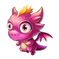 | [Burning Dragon](pets/burning-dragon.html) | Advance&nbsp;III&nbsp;★0 | Mighty | Warfare |
|  | [Forest Elf](pets/forest-elf.html) | Advance&nbsp;III&nbsp;★0 | Heal | Warfare |
| 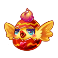 | [Ku Ku](pets/ku-ku.html) | Advance&nbsp;III&nbsp;★0 | Mighty | Warfare |
|  | [Jade Rabbit](pets/jade-rabbit.html) | Advance&nbsp;III&nbsp;★0 | Barrage | Warfare |
|  | [Evil Angel](pets/evil-angel.html) | Advance&nbsp;III&nbsp;★0 | Barrage | Warfare |
|  | [Cupid](pets/cupid.html) | Advance&nbsp;III&nbsp;★0 | Heal | Warfare |
| 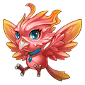 | [Phoenix](pets/phoenix.html) | Advance&nbsp;III&nbsp;★0 | Mighty | Warfare |
|  | [Xmas Elf](pets/xmas-elf.html) | Advance&nbsp;III&nbsp;★0 | Barrage | Warfare |
|  | [Hades](pets/hades.html) | Advance&nbsp;III&nbsp;★0 | Barrage | Warfare |
|  | [Zabiwaka](pets/zabiwaka.html) | Advance&nbsp;III&nbsp;★0 | Barrage | Warfare |
|  | [Wu Gang](pets/wu-gang.html) | Advance&nbsp;III&nbsp;★0 | Barrage | Warfare |
|  | [Bear Yoki](pets/bear-yoki.html) | Advance&nbsp;III&nbsp;★0 | Barrage | Warfare |
|  | [Pigbaby](pets/pigbaby.html) | Advance&nbsp;III&nbsp;★0 | Mighty | Warfare |
|  | [Demon Fox](pets/demon-fox.html) | Advance&nbsp;III&nbsp;★0 | Barrage | Warfare |
|  | [Azure](pets/azure.html) | Advance&nbsp;III&nbsp;★0 | Barrage | Rising Dragon |
|  | [Ivory](pets/ivory.html) | Advance&nbsp;III&nbsp;★0 | Barrage | Tigers shook the sky |
|  | [Rosefinch](pets/rosefinch.html) | Advance&nbsp;III&nbsp;★0 | Barrage | Phoenix Blaze |
|  | [Bull Knight](pets/bull-knight.html) | Advance&nbsp;III&nbsp;★0 | Barrage | Warp Strike |
| 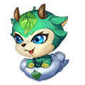 | [Bai Ozawa](pets/bai-ozawa.html) | Advance&nbsp;III&nbsp;★0 | Heal All | Jade Spirit Guardian |
|  | [Shellie](pets/shellie.html) | Advance&nbsp;III&nbsp;★0 | Barrage | Mountainlike |
|  | [Ah Kow](pets/ah-kow.html) | Advance&nbsp;III&nbsp;★0 | Furor | Warfare |
| 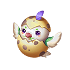 | [Dove](pets/dove.html) | Advance&nbsp;III&nbsp;★0 | Heal | Holy Guardian |
|  | [Mao](pets/mao.html) | Advance&nbsp;III&nbsp;★0 | Mighty | Immortal Wish |
|  | [Chen](pets/chen.html) | Advance&nbsp;III&nbsp;★0 | Team Inranged | Loong Roar's Wrath |
|  | [Hunting Falcon](pets/hunting-falcon.html) | Advance&nbsp;III&nbsp;★0 | Barrage | Warfare |
|  | [Mushy](pets/mushy.html) | Advance&nbsp;III&nbsp;★0 | Barrage | Warfare |
| 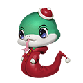 | [Vipis](pets/vipis.html) | Advance&nbsp;III&nbsp;★0 | Team Inranged | Longevity |
|  | [Little Noon](pets/little-noon.html) | Advance&nbsp;III&nbsp;★0 | Team Inranged | Spirit Steed Treads Clouds |
| 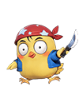 | [Chippy · Ape](pets/chippy-ape.html) | Advance&nbsp;III&nbsp;★0 | Mighty | Warfare |

## Grade A

| | Pet | Max star | Battle skill | Pet attack skill |
|---|---|---|---|---|
|  | [Ghost King](pets/ghost-king.html) | Base&nbsp;★5 | Barrage | Warfare |
|  | [Demon King](pets/demon-king.html) | Base&nbsp;★5 | Mighty | Warfare |
| 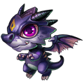 | [Black Drake](pets/black-drake.html) | Base&nbsp;★5 | Barrage | Warfare |
|  | [Gifted Cat](pets/gifted-cat.html) | Base&nbsp;★5 | Mighty | Warfare |
| 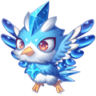 | [Ice Falcon](pets/ice-falcon.html) | Base&nbsp;★5 | Barrage | Warfare |
| 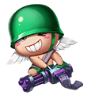 | [Cannon Shooter](pets/cannon-shooter.html) | Base&nbsp;★5 | Barrage | Warfare |

## Grade B

| | Pet | Max star | Battle skill | Pet attack skill |
|---|---|---|---|---|
|  | [Sky Pony](pets/sky-pony.html) | Base&nbsp;★5 | Mighty | Warfare |
| 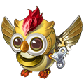 | [Mecha Owl](pets/mecha-owl.html) | Base&nbsp;★5 | Mighty | Warfare |
| 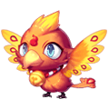 | [Firehawk](pets/firehawk.html) | Base&nbsp;★5 | Heal | Warfare |
|  | [Fire Bunny](pets/fire-bunny.html) | Base&nbsp;★5 | Mighty | Warfare |
|  | [Dumbo](pets/dumbo.html) | Base&nbsp;★5 | Heal | Warfare |
| 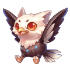 | [Hawk Baby](pets/hawk-baby.html) | Base&nbsp;★5 | Heal | Warfare |

## Grade C

| | Pet | Max star | Battle skill | Pet attack skill |
|---|---|---|---|---|
|  | [Water Polly](pets/water-polly.html) | Base&nbsp;★5 | Heal | Warfare |
| 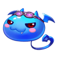 | [Blue Bat](pets/blue-bat.html) | Base&nbsp;★5 | Heal | Warfare |
|  | [Nether Lamp](pets/nether-lamp.html) | Base&nbsp;★5 | Heal | Warfare |
|  | [Creamery Fairy](pets/creamery-fairy.html) | Base&nbsp;★5 | Heal | Warfare |

