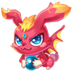
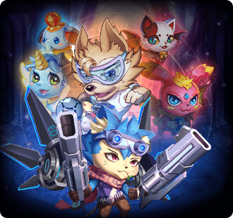
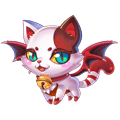

[← All pets](../pets.html)

# Fire Bunny

| Base | Advance I | Advance II | Advance III |
|---|---|---|---|
|  |  |  |  |

A bunny covered in fire.

## Info

| Detail | Value |
|---|---|
| Grade | **B** |
| Growth factor | 14,000 |
| Talent range by quality | Q1: 20-30, Q2: 25-50, Q3: 45-60, Q4: 55-80, Q5: 75-100, Q6: 95-125 |
| Max star | Base&nbsp;★5 (level cap 100) |
| Battle skill (yours, costs SP) |  [Mighty](../pet-skills.html#mighty) |
| Pet attack skill |  [Warfare](../pet-skills.html#warfare) |
| Summon | Diamond Summon (B Pet, 4.75%); Gold Summon (B Pet, 2.24%) |

## Combos

Each combo has slots: fill every slot with a pet you own (a different pet per slot; any form listed in a slot counts), then press **Deploy** on the combo in the game's combo book. Combos that come in tiers can't be deployed at a lower tier while you qualify for a higher one. All combos: [Pet combos](../pet-combos.html).

| Portrait | Combo | Slots | Bonus | Effect |
|---|---|---|---|---|
|  | **Fierce beast** | Slot 1:  [Squirrel](squirrel.html) Slot 2:  [Zabiwaka](zabiwaka.html) Slot 3:  [Gifted Cat](gifted-cat.html) Slot 4:  [Dumbo](dumbo.html) Slot 5:  [Fire Bunny](fire-bunny.html) Slot 6:  [Sky Pony](sky-pony.html) | ATK +500 HP +5,000 Crit +500 DMG+ +500 AGI +200 BP +7,850 | Rage Beast: Rage +10 at the end of your round. |

## Stats by star

Fixed stats the pet has at each star level. Levelling adds more on top, scaled by the pet's talent and growth factor. "Essence" is the pet essence needed to reach the next star; "Skill level" is the level of both default skills.

| Star | Level cap | ATK | DEF | HP | Crit | Anti-crit | DMG+ | DMG- | AGI | BP | Skill level | Essence to next star |
|---|---|---|---|---|---|---|---|---|---|---|---|---|
| Base&nbsp;★0 | 20 | 156 | 117 | 584 | 58 | 46 | 39 | 39 | 74 | 2,079 | 1 | 20,000 |
| Base&nbsp;★1 | 40 | 312 | 234 | 1,169 | 117 | 91 | 78 | 78 | 148 | 4,159 | 2 | 40,000 |
| Base&nbsp;★2 | 60 | 390 | 292 | 1,461 | 146 | 114 | 98 | 98 | 184 | 5,194 | 3 | 60,000 |
| Base&nbsp;★3 | 80 | 467 | 350 | 1,753 | 175 | 137 | 117 | 117 | 221 | 6,225 | 4 | 100,000 |
| Base&nbsp;★4 | 100 | 623 | 467 | 2,338 | 234 | 182 | 156 | 156 | 295 | 8,304 | 5 | 200,000 |
| Base&nbsp;★5 | 100 | 779 | 584 | 2,922 | 292 | 228 | 195 | 195 | 368 | 10,377 | 5 | - |
