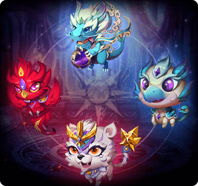

[← All pets](../pets.html)

# Holy - Frozen Tiger

| Base | Advance I | Advance II | Advance III |
|---|---|---|---|
|  |  |  |  |

One of the four legendary sacred beasts, possessing the power of freezing thousands of miles of extreme cold, it can instantly freeze any item into ice cubes. Because of the thousand-year-old battle of the gods, it was sealed to the heavens by the strong of the gods. The far north star, still being sealed, has become the brightest white tiger star in the night sky

## Info

| Detail | Value |
|---|---|
| Grade | **Holy Ghost** |
| Growth factor | 18,000 |
| Talent range by quality | Q1: 20-30, Q2: 25-50, Q3: 45-60, Q4: 55-80, Q5: 75-100, Q6: 125-175 |
| Max star | Holy&nbsp;Ghost&nbsp;★10 (level cap 700) |
| Battle skill (yours, costs SP) |  [Barrage](../pet-skills.html#barrage) |
| Pet attack skill |  [Tigers shook the sky](../pet-skills.html#tigers-shook-the-sky) |
| Awakened from |  [Ice White Tiger](ice-white-tiger.html) |

## Pet equipment

| Weapon | Wing | Accessory | Armor |
|---|---|---|---|
|  Holy - Ice Soul Blade |  Holy - Ice Soul Bracer |  Holy - Ice Soul Circlet |  Holy - Ice Soul Belt |

Stats at every level and upgrade costs: [Pet equipment](../pet-equipment.html#set-holy-frozen-tiger).

## Combos

Each combo has slots: fill every slot with a pet you own (a different pet per slot; any form listed in a slot counts), then press **Deploy** on the combo in the game's combo book. Combos that come in tiers can't be deployed at a lower tier while you qualify for a higher one. All combos: [Pet combos](../pet-combos.html).

| Portrait | Combo | Slots | Bonus | Effect |
|---|---|---|---|---|
|  | **Early-Power of the Four Saints** | Slot 1:  [Azure](azure.html) /  [Thunderfury Drake](thunderfury-drake.html) /  [Holy - Thunderfury Drake](holy-thunderfury-drake.html) Slot 2:  [Ivory](ivory.html) /  [Ice White Tiger](ice-white-tiger.html) /  [Holy - Frozen Tiger](holy-frozen-tiger.html) Slot 3:  [Rosefinch](rosefinch.html) /  [Rosefinch(LD)](rosefinch-ld.html) /  [Holy - Rosefinch](holy-rosefinch.html) Slot 4:  [Shellie](shellie.html) /  [Mount Xuanwu](mount-xuanwu.html) /  [Holy - Mount Xuanwu](holy-mount-xuanwu.html) | ATK +1,640 DEF +1,230 HP +14,758 BP +16,849 | Early-Four Saints:Elemental damage caused by the player increased by 3% |
|  | **Pole-Power of the Four Saints** | Slot 1:  [Thunderfury Drake](thunderfury-drake.html) /  [Holy - Thunderfury Drake](holy-thunderfury-drake.html) Slot 2:  [Ice White Tiger](ice-white-tiger.html) /  [Holy - Frozen Tiger](holy-frozen-tiger.html) Slot 3:  [Rosefinch(LD)](rosefinch-ld.html) /  [Holy - Rosefinch](holy-rosefinch.html) Slot 4:  [Mount Xuanwu](mount-xuanwu.html) /  [Holy - Mount Xuanwu](holy-mount-xuanwu.html) | ATK +2,733 DEF +2,049 HP +24,597 BP +28,082 | Pole-Four Saints:Elemental damage caused by players increased by 5% |
|  | **True - Mythic Power** | Slot 1:  [Holy - Thunderfury Drake](holy-thunderfury-drake.html) Slot 2:  [Holy - Rosefinch](holy-rosefinch.html) Slot 3:  [Holy - Mount Xuanwu](holy-mount-xuanwu.html) Slot 4:  [Holy - Frozen Tiger](holy-frozen-tiger.html) | ATK +5,466 DEF +4,098 HP +49,194 BP +56,158 | True - Mythic Beasts: Elemental DMG dealt by player increases by 5%, elemental DMG taken by player reduces by 5%. |

## Stats by star

Fixed stats the pet has at each star level. Levelling adds more on top, scaled by the pet's talent and growth factor. "Essence" is the pet essence needed to reach the next star; "Skill level" is the level of both default skills.

| Star | Level cap | ATK | DEF | HP | Crit | Anti-crit | DMG+ | DMG- | AGI | BP | Skill level | Essence to next star |
|---|---|---|---|---|---|---|---|---|---|---|---|---|
| Base&nbsp;★0 | 520 | 0 | 0 | 0 | 0 | 0 | 0 | 0 | 0 | 0 | 5 | 50,000 |
| Holy&nbsp;Ghost&nbsp;★0 | 520 | 7,577 | 5,508 | 36,784 | 3,165 | 2,595 | 1,923 | 1,597 | 1,400 | 92,053 | 5 | 240,000 |
| Holy&nbsp;Ghost&nbsp;★1 | 540 | 7,667 | 5,582 | 36,997 | 3,221 | 2,623 | 1,941 | 1,735 | 1,400 | 93,337 | 5 | 300,000 |
| Holy&nbsp;Ghost&nbsp;★2 | 560 | 7,758 | 5,655 | 37,211 | 3,277 | 2,650 | 1,959 | 1,752 | 1,400 | 94,256 | 5 | 380,000 |
| Holy&nbsp;Ghost&nbsp;★3 | 580 | 7,849 | 5,729 | 37,424 | 3,333 | 2,678 | 2,098 | 1,771 | 1,400 | 95,549 | 5 | 460,000 |
| Holy&nbsp;Ghost&nbsp;★4 | 600 | 7,940 | 5,802 | 37,637 | 3,389 | 2,705 | 2,116 | 1,789 | 1,400 | 96,471 | 5 | 540,000 |
| Holy&nbsp;Ghost&nbsp;★5 | 620 | 8,030 | 5,876 | 37,850 | 3,445 | 2,912 | 2,135 | 1,808 | 1,400 | 97,758 | 5 | 620,000 |
| Holy&nbsp;Ghost&nbsp;★6 | 640 | 8,121 | 5,949 | 38,063 | 3,501 | 2,940 | 2,153 | 1,826 | 1,400 | 98,682 | 5 | 700,000 |
| Holy&nbsp;Ghost&nbsp;★7 | 660 | 8,212 | 6,023 | 38,277 | 3,556 | 2,967 | 2,171 | 1,965 | 1,400 | 99,968 | 5 | 780,000 |
| Holy&nbsp;Ghost&nbsp;★8 | 680 | 8,303 | 6,096 | 38,490 | 3,613 | 2,995 | 2,189 | 1,982 | 1,400 | 100,891 | 5 | 860,000 |
| Holy&nbsp;Ghost&nbsp;★9 | 700 | 8,394 | 6,170 | 38,703 | 3,669 | 3,022 | 2,264 | 2,001 | 1,400 | 101,990 | 5 | 940,000 |
| Holy&nbsp;Ghost&nbsp;★10 | 700 | 8,394 | 6,170 | 38,703 | 3,669 | 3,022 | 2,264 | 2,001 | 1,400 | 101,990 | 5 | - |
