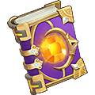
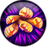
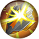

# Rune Book

On the Rune screen every rune page from **Rune Page 2** on has a book in the middle of its slots. Once every slot of the page holds a rune, the book opens the **Rune Book** of that page: 8 stats that you raise by **Carve** with one of 4 kinds of sigils. Sigils come from smelting Orange runes and from the sources listed below.

- [Rules](#rules) · [Sigils](#sigils) · [Books and their stats](#books) · [Levels and frames](#levels) · [Smelt Rune](#smelt) · [Unknown](#unknown)

## Rules

- The Rune screen opens at **level 22**. A page tab can be opened once your level reaches the page's first slot level (table below). Rune Page 4, Rune Page 5, Rune Page 6 open from level 22.
- **Opening a book:** every slot of the page must hold a rune. Until then the book says "Rune slots are not full"; when the page is full the book lights up. The lines from the book to its nearest slots light up as those slots are filled.
- **Carve:** pick one of the 4 sigils (you need at least 1 of it, else "Need more materials") and press Carve. Each press uses **exactly 1 sigil** of that kind, whatever the stat levels are. Which stats go up, and by how much, is random:  Sigil 1 has a chance to boost **1**,  Sigil 2 has a chance to boost **2**,  Sigil 3 has a chance to boost **3**,  Sigil 4 has a chance to boost **4** of the 8 stats (game text: "Sigil smelted from runes, has a chance to boost 1 Sigil Book stats."). A stat that the carve tried but did not raise shows the failure effect.
- Each stat of a book has its own level, from **0** to **60**. Its frame colour goes up one tier every 10 levels (6 tiers, see [Levels and frames](#levels)).
- **A finished book:** when all 8 stats are at level 60 the book can't be carved any more ("Sigil Book is complete. Failed to carve again").
- **Quick Mode** (tick box): needs military rank **Second Lt.** or higher ("Can only be used after reaching Second Lt. Rank"). After a confirmation ("The system will keep Carving with the placed Sigil Stones until they run out or the Sigil reaches the maximum level.") Carve repeats every 2 seconds with the chosen sigil until you press **Stop Carving**, the sigils run out or the book is finished.
- The book's stats are added to your rune stats (the stat list on the Rune screen) and the book shows the **BP** of its 8 stats.
- Each page has its own book; sigils can be used on any open book.
- Game help text: "Spend Sigils to carve Sigil Book." "Each carving has a chance to boost stats in Sigil Libram." "Stats cannot be further boosted after reaching Red tier." "Sigil Book is complete when all stats are Orange and it cannot be further carved."

## Sigils

| Sigil | Quality | Stats it can boost per carve | Where from |
|---|---|---|---|
|  Sigil 1 | Green | 1 (with a chance) | Store Purchase Team Expedition - Goblin Port Team Expedition - Sky Battle Event Smelt Rune Team Expedition: [Sky Battle](team-expedition/sky-battle.html), Easy, stage **Sky Battle-1**: 3.73% drop chance Team Expedition: [Sky Battle](team-expedition/sky-battle.html), Easy, stage **Sky Battle-2**: 3.53% drop chance Team Expedition: [Sky Battle](team-expedition/sky-battle.html), Normal, stage **Sky Battle-2**: 3.77% drop chance Team Expedition: [Sky Battle](team-expedition/sky-battle.html), Hard, stage **Sky Battle-2**: 4.18% drop chance Team Expedition: [Dragon Nest](team-expedition/dragon-nest.html), Easy, stage **Dragon Nest-2**: 3.36% drop chance Team Expedition: [Dragon Nest](team-expedition/dragon-nest.html), Normal, stage **Dragon Nest-2**: 1.98% drop chance |
|  Sigil 2 | Blue | 2 (with a chance) | Store Purchase Team Expedition - Goblin Port Team Expedition - Sky Battle Quest Reward Event Smelt Rune Team Expedition: [Sky Battle](team-expedition/sky-battle.html), Easy, stage **Sky Battle-1**: 1.87% drop chance Team Expedition: [Dragon Nest](team-expedition/dragon-nest.html), Easy, stage **Dragon Nest-2**: 1.68% drop chance Team Expedition: [Dragon Nest](team-expedition/dragon-nest.html), Normal, stage **Dragon Nest-2**: 1.49% drop chance Team Expedition: [Dragon Nest](team-expedition/dragon-nest.html), Hard, stage **Dragon Nest-2**: 2.80% drop chance Team Expedition: [Sea Vortex](team-expedition/sea-vortex.html), Easy, stage **Sea Vortex -2**: 2.57% drop chance Team Expedition: [Sea Vortex](team-expedition/sea-vortex.html), Normal, stage **Sea Vortex -2**: 1.90% drop chance Team Expedition: [Sea Vortex](team-expedition/sea-vortex.html), Hard, stage **Sea Vortex -2**: 3.45% drop chance Team Expedition: [Phantom of the Opera](team-expedition/phantom-of-the-opera.html), Easy, stage **Phantom of the Opera -2**: 2.68% drop chance Team Expedition: [Lost Forest](team-expedition/lost-forest.html), Easy, stage **Lost Forest - 2**: 2.76% drop chance Team Expedition: [Lost Forest](team-expedition/lost-forest.html), Normal, stage **Lost Forest - 2**: 1.76% drop chance Team Expedition: [Lost Forest](team-expedition/lost-forest.html), Hard, stage **Lost Forest - 2**: 2.78% drop chance Team Expedition: [Sea train](team-expedition/sea-train.html), Easy, stage **Sea Train 2**: 2.61% drop chance Team Expedition: [Lost Battlefield](team-expedition/lost-battlefield.html), Easy, stage **Lost Battlefield - 2**: 2.58% drop chance Weekly Trove, "Trove level is Lv30": normal reward ×5 (30% chance), advanced reward ×10 (30% chance) |
|  Sigil 3 | Purple | 3 (with a chance) | Secret Merchant Quest Reward Event Smelt Rune Team Expedition: [Snow Castle](team-expedition/snow-castle.html), Hard, stage **Snow Castle 2**: 1.52% drop chance Team Expedition: [Shadowy Domain](team-expedition/shadowy-domain.html), Normal, stage **Shadowy Domain 2**: 2.67% drop chance Team Expedition: [Shadowy Domain](team-expedition/shadowy-domain.html), Hard, stage **Shadowy Domain 2**: 2.88% drop chance Weekly Trove, "Trove level is Lv60": normal reward ×10 (30% chance), advanced reward ×15 (30% chance) |
|  Sigil 4 | Orange | 4 (with a chance) | Secret Merchant Event Smelt Rune Weekly Trove, "Trove level is Lv100": normal reward ×15 (30% chance), advanced reward ×20 (30% chance) |

## Books and their stats

Each book has 8 stats, each from level 0 to 60. **Slots to fill** = the page's slots (by the level they open at) that must all hold a rune before the book opens.

| Page | Page opens at | Slots to fill | Stats in the book |
|---|---|---|---|
| **Rune Page 2** | level 30 | 15 slots, levels 30 - 44 |  ATK  DEF  HP  CRIT  ACRIT  DMG+  DMG-  Burst DMG- |
| **Rune Page 3** | level 45 | 15 slots, levels 45 - 59 |  STR  END  CON  LUCK  TOU  PEN  DEX  Burst DMG+ |
| **Rune Page 4** | level 60 | 15 slots, levels 60 - 74 |  ATK  DEF  HP  CON  CRIT  ACRIT  DMG Up (%)  DMG Down (%) |
| **Rune Page 5** | level 75 | 15 slots, levels 75 - 89 |  CRIT  ACRIT  ATK  DMG+  STR  PEN  Burst DMG+  DEF |
| **Rune Page 6** | level 90 | 15 slots, levels 90 - 100 |  END  LUCK  TOU  DEX  DMG-  Burst DMG-  DMG Up (%)  DMG Down (%) |

5 books, 40 stats. (%) = shown as a percentage in the game (value / 100). The page before Rune Page 2 (Rune Page 1, the rank slots) has no book.

## Levels and frames

The frame around a stat shows its tier: tier = level / 10 rounded up (at least 1, at most 6). Inside a tier a ring fills by 10% per level and the full frame of the tier shows at its last level. **Stat levels in a book** and **in all books** count every stat at the end of the tier (running total to max).

| Tier | Frame | Stat levels | Ring at each level | Stat levels in a book | In all 5 books |
|---|---|---|---|---|---|
| 1 (White) |  | 0 - 10 | level 0: empty; 1 - 9: 10% - 90%; 10: full | 80 | 400 |
| 2 (Green) |  | 11 - 20 | 11 - 19: 10% - 90%; 20: full | 160 | 800 |
| 3 (Blue) |  | 21 - 30 | 21 - 29: 10% - 90%; 30: full | 240 | 1,200 |
| 4 (Purple) |  | 31 - 40 | 31 - 39: 10% - 90%; 40: full | 320 | 1,600 |
| 5 (Orange) |  | 41 - 50 | 41 - 49: 10% - 90%; 50: full | 400 | 2,000 |
| 6 (Red) |  | 51 - 60 | 51 - 59: 10% - 90%; 60: full | 480 | 2,400 |

To max: 480 stat levels per book, 2,400 for all books. Each carve costs 1 sigil; how many levels one carve adds is random, so the number of sigils to max can't be given.

## Smelt Rune

- Where: the **Smelt Rune** tab of the rune workshop (the **Alchemy Room>>>** link on the Rune screen; tabs Craft Rune / Smelt Rune).
- The tab's bag lists the runes in your bag with rune quality 5 or higher; equipped runes are not in the bag. Pick one and press **Smelt**: it uses 1 rune and gives a random number of sigils of random kinds.
- Game help text: "Unequipped Orange runes can be smelted." "When smelted, Orange runes will turn to varied number of Sigil of all kinds."

| Rune quality | Runes that can be smelted |
|---|---|
| 5 |  ATK Rune  HP Rune  DEF Rune  Blade Rune  Aegis Rune  Lucky Rune  Blood Rune  Sharp Rune  God of War Rune  Knight Runes  Armored Runes  Starlight Rune |
| 6 |  Blade Rune  Aegis Rune  Blood Rune  Sharp Rune  God of War Rune  Knight Runes  Armored Runes  Starlight Rune |
| 7 |  God of War Rune  Knight Runes  Armored Runes  Starlight Rune |

## Unknown

- The stat value at each level, and how many levels a carve adds.
- The chance that a carve raises a stat (the help text only says "chance").
- How many sigils, and which kinds, a smelt gives.
- When a book counts as complete: the help text says when all stats are Orange, and also that stats stop at Red. Stats go up to level 60 (Red).
- The book has no set or milestone bonus: only the 8 stats.
