# Sky of City

Each entry costs the stage's own ticket. Clearing a stage unlocks the next one and a chest you can open once. Stage list:

<a class="wiki-card" href="#sky-9000101">Trial LandLevel 30, recommended BP 65,743.</a>
<a class="wiki-card" href="#sky-9000201">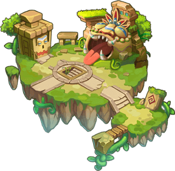Ancient AltarLevel 30, recommended BP 96,649.</a>
<a class="wiki-card" href="#sky-9000301">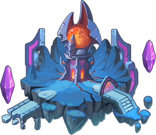Fortress of DeathLevel 30, recommended BP 128,890.</a>
<a class="wiki-card" href="#sky-9000401">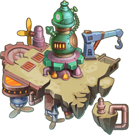City of TechLevel 30, recommended BP 152,240.</a>
<a class="wiki-card" href="#sky-9000501">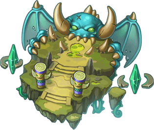Devil's HouseLevel 30, recommended BP 201,194.</a>
<a class="wiki-card" href="#sky-9000601">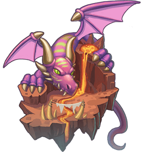Dragon NestLevel 30, recommended BP 308,541.</a>
<a class="wiki-card" href="#sky-9000701">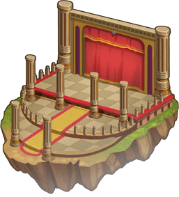Phantom of the OperaLevel 30, recommended BP 456,304.</a>
<a class="wiki-card" href="#sky-9000801">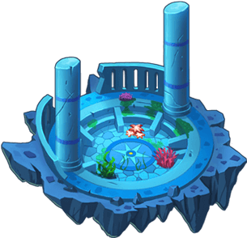Lost CityLevel 30, recommended BP 555,838.</a>
<a class="wiki-card" href="#sky-9000901">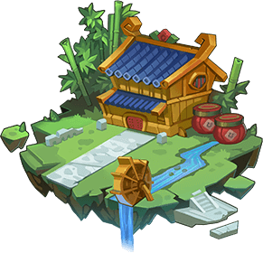Maze Zen HouseLevel 30, recommended BP 660,417.</a>
<a class="wiki-card" href="#sky-9001001">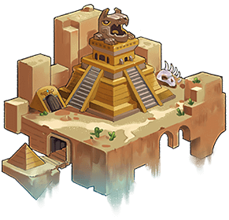Desert RuinsLevel 30, recommended BP 864,996.</a>
<a class="wiki-card" href="#sky-9001101">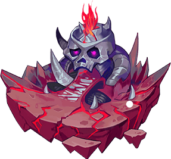Orcish BastionLevel 30, recommended BP 1,114,996.</a>
<a class="wiki-card" href="#sky-9001201">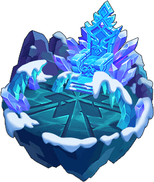Snow PalaceLevel 30, recommended BP 1,684,996.</a>
<a class="wiki-card" href="#sky-9001301">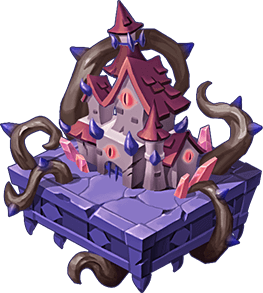Shadowy DomainLevel 30, recommended BP 2,041,662.</a>
<a class="wiki-card" href="#sky-9001401">Sea trainLevel 30, recommended BP 2,540,550.</a>
<a class="wiki-card" href="#sky-9001501">Lost BattlefieldLevel 30, recommended BP 4,685,046.</a>

## Trial Land

Since the airship the SS Explorer got lost in a storm and discovered Sky of City, many months passed and explorers flocked there at heavy casualties. The Guardian Swordsman.Deron swore that only those who defeat him can explore the ruins.

- Needs player level **30**.
- Ticket:  Ticket: Trial Land
- Recommended BP: **65,743**
- Defeat Guardian Swordsman Deron
- Lose: Allied Team Annihilated Number of Turns >40

**Monsters:**  Guardian Swordsman.Deron

**HP:** not recorded yet

**Drops:**

| Item | Number | Probability |
|---|---|---|
| 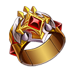 Valor Gloves | 1 | 2.00% |
|  Valor Manual | 1 | 2.00% |
|  Magic Dust | 2 - 3 | 4.00% |
|  OmniEssence | 1 - 2 | 6.00% |
|  Elemental Gem | 1 | 6.00% |
|  Emerald | 2 | 6.00% |
|  Emerald | 3 | 4.00% |
|  Emerald | 4 | 3.00% |
|  Jewelry | 2 | 5.00% |
|  Jewelry | 3 | 4.00% |
|  Jewelry | 4 | 3.00% |
| 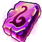 Enhance Stone V | 2 - 4 | 5.00% |
|  Refine Stone III | 2 | 10.00% |
|  Refine Stone IV | 2 | 7.00% |
|  Advanced Target | 1 - 2 | 8.00% |
|  Sharijah's Wings | 1 | 2.00% |
|  Upgrade Stone | 1 - 3 | 6.00% |
|  Earl Pendant | 1 | 4.00% |
|  Death Shackles | 1 | 3.00% |
| 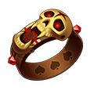 Ring of Greed | 1 | 4.00% |
|  Heroic Forge Hammer | 1 | 2.00% |
|  Lv.4 Blessing Gem | 1 - 4 | 1.00% |
|  Lv.3 Blessing Gem | 3 - 5 | 3.00% |

**First-clear chest:**  Agate ×5,  Magic Dust ×5,  Coin ×200,000

## Ancient Altar

You have finally earned Deron's approval to go to the depth. But all that can be seen are some ancient ruins. Could this be an illusion? The sound of beating drums can be heard from the mist, along with a bloody aura...

- Needs player level **30** and clearing **Trial Land**.
- Ticket:  Ticket: Ancient Altar
- Recommended BP: **96,649**
- Defeat Evil Priest
- Lose: Allied Team Annihilated Number of Turns >40

**Monsters:**  Frost Priest ·  Forest High Priest ·  Evil Priest

**HP:** not recorded yet

**Drops:**

| Item | Number | Probability |
|---|---|---|
|  Valor Ring | 1 | 2.00% |
|  Valor Medal | 1 | 2.00% |
|  Magic Dust | 2 - 5 | 4.00% |
|  OmniEssence | 2 - 5 | 6.00% |
|  Elemental Gem | 1 - 3 | 6.00% |
|  Earth's Core | 1 | 4.00% |
|  Agate | 2 | 5.00% |
|  Agate | 3 | 4.00% |
|  Agate | 4 | 3.00% |
|  Crystal | 2 | 4.00% |
|  Crystal | 3 | 4.00% |
|  Crystal | 4 | 4.00% |
|  Enhance Stone V | 2 - 4 | 5.00% |
|  Refine Stone III | 2 | 9.00% |
|  Refine Stone IV | 2 | 7.00% |
|  Advanced Target | 1 - 2 | 8.00% |
|  Sharijah's Wings | 1 | 2.00% |
|  Upgrade Stone | 1 - 3 | 6.00% |
|  Lv.3 Blessing Gem | 1 - 2 | 2.00% |
|  Lv.4 Blessing Gem | 1 - 3 | 1.00% |
|  Lv.5 Blessing Gem | 1 | 1.00% |
|  Heroic Forge Hammer | 1 | 2.00% |
|  Marshal Medal | 1 | 3.00% |
| 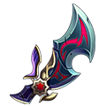 Demon Blade | 1 | 3.00% |
|  Lava Necklace | 1 | 2.00% |
|  Amethyst | 1 | 1.00% |

**First-clear chest:**  Emerald ×5,  OmniEssence ×5,  Coin ×200,000

## Fortress of Death

The mist converges again, guiding you to a ghostly castle. A chilling aura hits you as the area remains deadly silent. Yet you seem to hear whispers of the dead?

- Needs player level **30** and clearing **Ancient Altar**.
- Ticket:  Ticket: Fortress of Death
- Recommended BP: **128,890**
- Defeat Reaper
- Lose: Allied Team Annihilated Number of Turns >40

**Monsters:**  Skeleton King ·  Ghost King ·  Reaper

**HP:** not recorded yet

**Drops:**

| Item | Number | Probability |
|---|---|---|
|  Valor Necklace | 1 | 2.00% |
|  Fearless Pendant | 1 | 2.00% |
|  Magic Dust | 2 - 3 | 4.00% |
|  OmniEssence | 1 - 2 | 6.00% |
|  Elemental Gem | 1 | 6.00% |
|  Earth's Core | 1 | 4.00% |
|  Agate | 2 | 4.00% |
|  Crystal | 3 | 4.00% |
|  Crystal | 4 | 3.00% |
|  Pearl | 2 | 5.00% |
|  Pearl | 3 | 4.00% |
|  Pearl | 4 | 3.00% |
|  Enhance Stone V | 2 - 4 | 5.00% |
|  Refine Stone III | 2 | 9.00% |
|  Refine Stone IV | 2 | 7.00% |
|  Advanced Target | 1 - 2 | 8.00% |
|  Sharijah's Wings | 1 | 2.00% |
|  Angel Wings | 1 | 2.00% |
|  Upgrade Stone | 1 - 3 | 6.00% |
|  Lv.5 Blessing Gem | 1 | 1.00% |
|  Lv.4 Blessing Gem | 1 - 2 | 2.00% |
|  Heroic Forge Hammer | 1 | 2.00% |
|  Flame Bead | 1 | 3.00% |
|  Origin Ring | 1 | 2.00% |
|  Cloud Bangle | 1 | 3.00% |
|  Amethyst | 1 | 1.00% |

**First-clear chest:**  Pearl ×5,  Elemental Gem ×5,  Coin ×200,000

## City of Tech

You seem to have entered into a special area, with none stop noises of machinery. A mechanical rumble comes from afar, a group of Goblins with Iron Beasts come on over.

- Needs player level **30** and clearing **Fortress of Death**.
- Ticket:  Ticket: City of Tech
- Recommended BP: **152,240**
- Defeat Goblin Doctor
- Lose: Allied Team Annihilated Number of Turns >40

**Monsters:** Walking Bomb ·  Ace Fighter ·  Battle Mecha T800

**HP:** not recorded yet

**Drops:**

| Item | Number | Probability |
|---|---|---|
|  Fearless Necklace | 1 | 2.00% |
|  Fearless Bracer | 1 | 2.00% |
|  Magic Dust | 2 - 3 | 4.00% |
|  OmniEssence | 1 - 2 | 6.00% |
|  Elemental Gem | 1 | 6.00% |
|  Earth's Core | 1 | 4.00% |
|  Emerald | 2 | 6.00% |
|  Emerald | 3 | 5.00% |
|  Emerald | 4 | 4.00% |
|  Pearl | 2 | 6.00% |
|  Pearl | 3 | 5.00% |
|  Pearl | 4 | 4.00% |
|  Enhance Stone V | 2 - 4 | 4.00% |
|  Refine Stone III | 2 | 6.00% |
|  Refine Stone IV | 2 | 7.00% |
|  Advanced Target | 1 - 2 | 8.00% |
|  Sharijah's Wings | 1 | 2.00% |
|  Angel Wings | 1 | 2.00% |
|  Upgrade Stone | 1 - 3 | 5.00% |
|  Lv.5 Blessing Gem | 1 | 1.00% |
|  Lv.4 Blessing Gem | 1 - 2 | 2.00% |
|  Amethyst | 1 | 1.00% |
|  Coral Bracer | 1 | 1.50% |
|  Octopus Necklace | 1 | 2.00% |
|  Wisdom Wrench | 1 | 3.50% |
|  Heroic Forge Hammer | 1 | 1.00% |

**First-clear chest:**  Crystal ×5,  Elemental Gem ×5,  Coin ×200,000

## Devil's House

A chaotic place, an ancient place, a mysterious place...This was all caused by that demon that walked from the flames, he stares at you with an odd grin.

- Needs player level **30** and clearing **City of Tech**.
- Ticket:  Ticket: Devil's House
- Recommended BP: **201,194**
- Completely Defeat Demon Hunter
- Lose: Allied Team Annihilated Number of Turns >40

**Monsters:** Demon R-Blade · Demon L-Blade ·  Demon King

**HP:** not recorded yet

**Drops:**

| Item | Number | Probability |
|---|---|---|
|  Fearless Ring | 1 | 2.50% |
|  Fearless Staff | 1 | 2.50% |
|  Magic Dust | 2 - 3 | 4.00% |
|  OmniEssence | 1 - 2 | 6.00% |
|  Elemental Gem | 1 | 6.00% |
|  Earth's Core | 1 | 5.00% |
|  Crystal | 2 | 6.00% |
|  Crystal | 3 | 5.00% |
|  Crystal | 4 | 4.00% |
|  Jewelry | 4 | 6.00% |
|  Jewelry | 2 | 5.00% |
|  Jewelry | 3 | 4.00% |
|  Enhance Stone V | 2 - 4 | 4.00% |
|  Refine Stone III | 2 | 5.00% |
|  Refine Stone IV | 2 | 7.00% |
|  Advanced Target | 1 - 2 | 8.00% |
|  Sharijah's Wings | 1 | 2.00% |
|  Angel Wings | 1 | 2.00% |
|  Upgrade Stone | 1 - 3 | 5.00% |
|  Lv.5 Blessing Gem | 1 - 2 | 1.00% |
|  Lv.4 Blessing Gem | 1 | 2.00% |
|  Jellyfish Ring | 1 | 1.50% |
|  Octopus Crown | 1 | 1.50% |
|  Little Trident | 1 | 2.00% |
|  Heroic Forge Hammer | 1 | 2.00% |
|  Amethyst | 1 | 1.00% |

**First-clear chest:**  Jewelry ×5,  Earth's Core ×2,  Coin ×200,000,  Diamond ×50

## Dragon Nest

The Dragon Nest is strewn with the bones of dragons, it seems the heroes have been surrounded by dragons.

- Needs player level **30** and clearing **Devil's House**.
- Ticket:  Ticket: Dragon Lair
- Recommended BP: **308,541**
- Defeat the Deathwing Black Dragon
- Lose: Allied Team Annihilated Number of Turns >40

**Monsters:** Lava Mob · Burning Rock

**HP:** not recorded yet

**Drops:**

| Item | Number | Probability |
|---|---|---|
|  Glory Circlet | 1 | 2.00% |
|  Glory Necklace | 1 | 2.00% |
|  Magic Dust | 2 - 3 | 4.00% |
|  OmniEssence | 1 - 2 | 6.00% |
|  Elemental Gem | 1 | 6.00% |
|  Earth's Core | 1 | 5.00% |
|  Crystal | 2 | 6.00% |
|  Crystal | 3 | 5.00% |
|  Crystal | 4 | 4.00% |
|  Jewelry | 4 | 6.00% |
|  Jewelry | 2 | 5.00% |
|  Jewelry | 3 | 4.00% |
|  Enhance Stone V | 2 - 4 | 4.00% |
|  Refine Stone III | 2 | 4.00% |
|  Refine Stone IV | 2 | 6.00% |
|  Advanced Target | 1 - 2 | 7.00% |
|  Angel Wings | 1 | 2.00% |
|  Devil Wings | 1 | 2.00% |
|  Upgrade Stone | 1 - 3 | 5.00% |
|  Lv.5 Blessing Gem | 1 - 2 | 1.50% |
|  Lv.4 Blessing Gem | 1 | 2.00% |
|  Amethyst | 1 | 1.00% |
|  Lava Necklace | 1 | 1.50% |
|  Cloud Bangle | 1 | 2.50% |
|  Origin Ring | 1 | 1.50% |
|  Flame Bead | 1 | 2.50% |
|  Wisdom Wrench | 1 | 1.50% |
|  Heroic Forge Hammer | 1 | 1.00% |

**First-clear chest:**  Jewelry ×5,  Earth's Core ×2,  Coin ×200,000,  Diamond ×50

## Phantom of the Opera

In the dim candle light, a shadow in the dark is approaching. A man riding a horse comes. And he has no... head!

- Needs player level **30** and clearing **Dragon Nest**.
- Ticket:  Ticket: Opera Phantom
- Recommended BP: **456,304**
- Defeat Conviction.Thomas
- Lose: Allied Team Annihilated Number of Turns >40

**Monsters:**  Conviction.Thomas · Lamp of Truth

**HP:** not recorded yet

**Drops:**

| Item | Number | Probability |
|---|---|---|
|  Legend Bracer | 1 | 0.10% |
|  Glory Ring | 1 | 1.00% |
|  Glory Bangle | 1 | 1.00% |
|  Magic Dust | 2 - 3 | 6.00% |
|  OmniEssence | 1 - 2 | 6.00% |
|  Elemental Gem | 1 | 6.00% |
|  Earth's Core | 1 | 6.00% |
|  Crystal | 2 | 5.00% |
|  Crystal | 3 | 4.00% |
|  Crystal | 4 | 6.00% |
|  Jewelry | 4 | 5.00% |
|  Jewelry | 2 | 4.00% |
|  Enhance Stone VIII | 2 - 3 | 4.00% |
|  Enhance Stone V | 2 - 4 | 5.00% |
|  Refine Stone III | 2 | 6.00% |
|  Refine Stone IV | 2 | 7.00% |
|  Advanced Target | 1 - 2 | 4.00% |
| 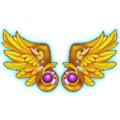 Holy Wings | 1 | 0.40% |
|  Devil Wings | 1 | 2.00% |
|  Upgrade Stone | 1 - 3 | 4.00% |
|  Lv.5 Blessing Gem | 1 - 2 | 1.00% |
|  Lv.4 Blessing Gem | 1 | 4.00% |
|  Octopus Necklace | 1 | 2.00% |
|  Coral Bracer | 1 | 1.50% |
|  Jellyfish Ring | 1 | 1.50% |
|  Octopus Crown | 1 | 1.50% |
|  Little Trident | 1 | 2.00% |
|  Heroic Forge Hammer | 1 | 2.00% |
|  Amethyst | 1 | 2.00% |

**First-clear chest:**  Agate ×5,  Earth's Core ×2,  Coin ×200,000,  Diamond ×50

## Lost City

After walking out of the theater, you walked to the bottom of the vortex. You could barely see anything, yet it was eerily quiet. When you went beyond the lowest spot, an ancient castle showed up.

- Needs player level **30** and clearing **Phantom of the Opera**.
- Ticket:  Ticket: Lost City
- Recommended BP: **555,838**
- Defeat Siren
- Lose: Allied Team Annihilated Number of Turns >40

**Monsters:**  Siren

**HP:** not recorded yet

**Drops:**

| Item | Number | Probability |
|---|---|---|
|  Legend Ring | 1 | 0.50% |
|  Legend Moss | 1 | 0.50% |
|  Glory Bead | 1 | 1.00% |
| 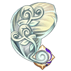 Legend Plume | 1 | 0.50% |
| 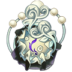 Legend Necklace | 1 | 0.50% |
|  Magic Dust | 2 - 3 | 6.00% |
|  OmniEssence | 1 - 2 | 6.00% |
|  Elemental Gem | 1 | 7.00% |
|  Earth's Core | 1 | 6.00% |
|  Crystal | 2 | 6.00% |
|  Crystal | 3 | 5.00% |
|  Crystal | 4 | 4.00% |
|  Jewelry | 4 | 4.00% |
|  Jewelry | 2 | 6.00% |
|  Jewelry | 3 | 5.00% |
|  Enhance Stone V | 2 - 4 | 3.00% |
|  Refine Stone III | 2 | 4.00% |
|  Refine Stone IV | 2 | 5.00% |
|  Advanced Target | 1 - 2 | 7.00% |
| 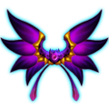 Phantom Wings | 1 | 2.00% |
|  Holy Wings | 1 | 2.00% |
|  Upgrade Stone | 1 - 3 | 5.00% |
|  Lv.5 Blessing Gem | 1 - 2 | 1.50% |
|  Lv.4 Blessing Gem | 1 | 4.00% |
|  Amethyst | 1 | 2.00% |
|  %s%sMateria%s | 1 | 0.50% |
|  %s%sMateria%s | 1 | 0.50% |
|  Abo Scarf | 1 | 1.00% |
|  Heroic Bracer | 1 | 1.00% |
|  Wild Ring | 1 | 1.00% |
|  Heroic Forge Hammer | 1 | 2.50% |

**First-clear chest:**  Emerald ×5,  Earth's Core ×2,  Coin ×200,000,  Diamond ×50

## Maze Zen House

Final battle with the enraged Bull King

- Needs player level **30** and clearing **Lost City**.
- Ticket:  Ticket: Maze Zen House
- Recommended BP: **660,417**
- Beat Bull King
- Lose: Allied Team Annihilated Number of Turns >40

**Monsters:**  Bull King

**HP:** not recorded yet

**Drops:**

| Item | Number | Probability |
|---|---|---|
|  Dragon Crystal | 1 | 0.60% |
|  Dragon Bracer | 1 | 0.60% |
|  Dragon Ring | 1 | 0.60% |
|  Magic Dust | 2 - 3 | 4.82% |
|  OmniEssence | 1 - 2 | 6.02% |
|  Elemental Gem | 1 | 6.02% |
|  Earth's Core | 1 | 4.82% |
|  Crystal | 2 | 7.23% |
|  Crystal | 3 | 6.02% |
|  Crystal | 4 | 4.82% |
|  Jewelry | 4 | 4.82% |
|  Jewelry | 2 | 7.23% |
|  Jewelry | 3 | 6.02% |
|  Refine Stone III | 2 | 5.42% |
|  Refine Stone IV | 2 | 6.02% |
|  Advanced Target | 1 - 2 | 2.41% |
|  Phantom Wings | 1 | 1.20% |
|  Holy Wings | 1 | 1.20% |
|  Upgrade Stone | 1 - 3 | 6.02% |
|  Lv.5 Blessing Gem | 1 - 2 | 1.20% |
|  Lv.4 Blessing Gem | 1 | 4.82% |
|  Amethyst | 1 | 2.41% |
|  %s%sMateria%s | 1 | 1.20% |
|  %s%sMateria%s | 1 | 1.20% |
|  Bamboo Hat | 1 | 1.20% |
|  Jasper Blades | 1 | 1.20% |
|  Abo Scarf | 1 | 1.20% |
|  Heroic Forge Hammer | 1 | 3.61% |

**First-clear chest:**  Pearl ×5,  Elemental Gem ×5,  Coin ×200,000,  Diamond ×50

## Desert Ruins

The ancient Desert Queen had been resurrected, a human sacrifice was underway

- Needs player level **30** and clearing **Maze Zen House**.
- Ticket:  Ticket: Desert Ruins
- Recommended BP: **864,996**
- Pharaoh and Queen died at the same time
- Lose: Allied Team Annihilated Number of Turns >40

**Monsters:**  Pharaoh

**HP:** not recorded yet

**Drops:**

| Item | Number | Probability |
|---|---|---|
|  Immortal Wings Blueprint | 1 | 0.30% |
|  Immortal Pendant Blueprint | 1 | 0.30% |
|  Dragon Earrings | 1 | 0.60% |
|  Dragon Necklace | 1 | 0.60% |
|  Dragon Ring | 1 | 0.60% |
|  Magic Dust | 2 - 3 | 3.57% |
|  OmniEssence | 1 - 2 | 4.76% |
|  Elemental Gem | 1 | 5.95% |
|  Earth's Core | 1 | 4.76% |
|  Crystal | 2 | 7.14% |
|  Crystal | 3 | 5.95% |
|  Crystal | 4 | 4.76% |
|  Jewelry | 4 | 5.83% |
|  Jewelry | 2 | 7.14% |
|  Jewelry | 3 | 5.95% |
|  Refine Stone III | 2 | 4.76% |
|  Refine Stone IV | 2 | 5.95% |
|  Advanced Target | 1 - 2 | 5.95% |
|  Phantom Wings | 1 | 1.19% |
|  Holy Wings | 1 | 1.19% |
|  Upgrade Stone | 1 - 3 | 5.95% |
|  Lv.5 Blessing Gem | 1 - 2 | 2.38% |
|  Lv.4 Blessing Gem | 1 | 7.14% |
|  Amethyst | 1 | 2.38% |
| 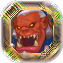 %s%sMateria%s | 1 | 0.06% |
|  %s%sMateria%s | 1 | 0.06% |
|  Gold Collar | 1 | 1.19% |
|  Tusk Collar | 1 | 1.19% |
|  Epic Forge Hammer | 1 | 2.38% |

**First-clear chest:**  Crystal ×5,  Elemental Gem ×5,  Coin ×200,000,  Diamond ×50

## Orcish Bastion

The next target of all-conquering Beastking is your head.

- Needs player level **30** and clearing **Desert Ruins**.
- Ticket:  Ticket: Orcish Bastion
- Recommended BP: **1,114,996**
- Beat Beastking
- Lose: Allied Team Annihilated Number of Turns >40

**Monsters:**  Beastking ·  Wargod

**HP:** not recorded yet

**Drops:**

| Item | Number | Probability |
|---|---|---|
|  Immortal Wings Blueprint | 1 | 0.30% |
|  Immortal Pendant Blueprint | 1 | 0.30% |
|  Dragon Crystal | 1 | 0.49% |
|  Dragon Bracer | 1 | 0.49% |
|  Dragon Earrings | 1 | 0.49% |
|  Dragon Necklace | 1 | 0.49% |
|  Dragon Ring | 1 | 0.49% |
|  Magic Dust | 2 - 3 | 3.66% |
|  OmniEssence | 1 - 2 | 4.88% |
|  Elemental Gem | 1 | 6.10% |
|  Earth's Core | 1 | 5.98% |
|  Crystal | 2 | 7.32% |
|  Crystal | 3 | 6.10% |
|  Crystal | 4 | 6.10% |
|  Jewelry | 4 | 6.10% |
|  Jewelry | 2 | 7.32% |
|  Jewelry | 3 | 6.10% |
|  Refine Stone III | 2 | 2.44% |
|  Refine Stone IV | 2 | 6.10% |
|  Advanced Target | 1 - 2 | 3.66% |
|  Phantom Wings | 1 | 1.22% |
|  Holy Wings | 1 | 1.22% |
|  Upgrade Stone | 1 - 3 | 6.10% |
|  Lv.5 Blessing Gem | 1 - 2 | 1.22% |
|  Lv.4 Blessing Gem | 1 | 4.88% |
|  Amethyst | 1 | 2.44% |
|  %s%sMateria%s | 1 | 0.06% |
|  %s%sMateria%s | 1 | 0.06% |
|  Gold Bracer | 1 | 1.22% |
|  Fang Bracer | 1 | 1.22% |
|  Ring of Skin | 1 | 1.22% |
|  Primal Force | 1 | 1.22% |
|  Epic Forge Hammer | 1 | 3.05% |

**First-clear chest:**  Jewelry ×5,  Earth's Core ×2,  Coin ×200,000,  Diamond ×50

## Snow Palace

There's a mysterious power in the tundra

- Needs player level **30** and clearing **Orcish Bastion**.
- Ticket: 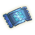 Ticket: Snow Palace
- Recommended BP: **1,684,996**
- Defeat all monsters
- Lose: Allied Team Annihilated Number of Turns >40

**Monsters:**  Frozen Knight · Ice Sword ·  Ice Queen

**HP:** not recorded yet

**Drops:**

| Item | Number | Probability |
|---|---|---|
|  Immortal Wings Blueprint | 1 | 0.31% |
|  Immortal Pendant Blueprint | 1 | 0.31% |
|  Immortal Wings | 1 | 0.06% |
|  Immortal Pendant | 1 | 0.06% |
|  Immortal Ring | 1 | 0.06% |
|  Magic Dust | 2 - 3 | 3.70% |
|  OmniEssence | 1 - 2 | 4.94% |
|  Elemental Gem | 1 | 6.17% |
|  Earth's Core | 1 | 4.94% |
|  Crystal | 2 | 7.41% |
|  Crystal | 3 | 6.17% |
|  Crystal | 4 | 4.94% |
|  Jewelry | 4 | 4.94% |
|  Jewelry | 2 | 7.41% |
|  Jewelry | 3 | 6.17% |
|  Refine Stone III | 2 | 6.17% |
|  Refine Stone IV | 2 | 6.17% |
|  Advanced Target | 1 - 2 | 3.33% |
|  Phantom Wings | 1 | 1.23% |
|  Holy Wings | 1 | 1.23% |
|  Upgrade Stone | 1 - 3 | 6.17% |
|  Lv.5 Blessing Gem | 1 - 2 | 2.47% |
|  Lv.4 Blessing Gem | 1 | 4.44% |
|  Amethyst | 1 | 1.85% |
|  %s%sMateria%s | 1 | 1.23% |
|  %s%sMateria%s | 1 | 0.06% |
|  Gold Bracer | 1 | 1.23% |
|  Fang Bracer | 1 | 1.23% |
|  Ring of Skin | 1 | 1.23% |
|  Primal Force | 1 | 1.23% |
|  Epic Forge Hammer | 1 | 3.09% |

**First-clear chest:**  Jewelry ×5,  Earth's Core ×2,  Coin ×200,000,  Diamond ×50

## Shadowy Domain

Dark forces kept invading the Darkest Realm

- Needs player level **30** and clearing **Snow Palace**.
- Ticket: 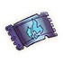 Shadowy Domain Ticket
- Recommended BP: **2,041,662**
- Defeat 4 Emperor Dragons
- Lose: Allied Team Annihilated Number of Turns >40

**Monsters:**  Ice Dragon (4 Emperor Dragons) ·  Flame Dragon (4 Emperor Dragons) ·  Holy Dragon (4 Emperor Dragons)

**HP:** not recorded yet

**Drops:**

| Item | Number | Probability |
|---|---|---|
|  Hades Earrings Blueprint | 1 | 0.01% |
|  Hades Necklace Blueprint | 1 | 0.01% |
|  Immortal Ring | 1 | 0.06% |
|  Immortality | 1 | 0.06% |
|  Immortal Tale | 1 | 0.06% |
|  Magic Dust | 2 - 3 | 3.70% |
|  OmniEssence | 1 - 2 | 4.94% |
|  Elemental Gem | 1 | 6.17% |
|  Earth's Core | 1 | 4.94% |
|  Crystal | 2 | 7.41% |
|  Crystal | 3 | 6.17% |
|  Crystal | 4 | 6.17% |
|  Jewelry | 4 | 6.17% |
|  Jewelry | 2 | 7.41% |
|  Jewelry | 3 | 6.17% |
|  Refine Stone III | 2 | 4.94% |
|  Refine Stone IV | 2 | 6.17% |
|  Advanced Target | 1 - 2 | 2.47% |
|  Recovery Wings | 1 | 1.23% |
| 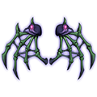 Deathwing | 1 | 1.23% |
|  Upgrade Stone | 1 - 3 | 6.17% |
|  Lv.5 Blessing Gem | 1 - 2 | 4.94% |
|  Lv.4 Blessing Gem | 1 | 2.20% |
|  Amethyst | 1 | 2.47% |
|  %s%sMateria%s | 1 | 1.23% |
|  %s%sMateria%s | 1 | 0.06% |
|  Gold Bracer | 1 | 1.23% |
|  Fang Bracer | 1 | 1.23% |
|  Ring of Skin | 1 | 1.23% |
|  Primal Force | 1 | 1.23% |
|  Epic Forge Hammer | 1 | 2.47% |

**First-clear chest:**  Jewelry ×5,  Earth's Core ×2,  Coin ×200,000,  Diamond ×50

## Sea train

In the rough sea, a ghost train on the sea suddenly appeared. It takes an invitation letter from the Kingdom of the Deep Sea Murloc to ride it.

- Needs player level **30** and clearing **Shadowy Domain**.
- Ticket: 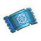 Ticket: Sea Train
- Recommended BP: **2,540,550**
- Defeat Captain Crocodile
- Lose: Allied Team Annihilated Number of Turns >40

**Monsters:**  Captain Crocodile ·  Crocodile Warrior

**HP:** not recorded yet

**Drops:**

| Item | Number | Probability |
|---|---|---|
|  Hades Ring Blueprint | 1 | 0.01% |
|  Hades Bracer Blueprint | 1 | 0.01% |
|  Immortal Wings | 1 | 0.06% |
|  Immortal Pendant | 1 | 0.06% |
|  Immortal Ring | 1 | 0.06% |
|  Immortality | 1 | 0.06% |
|  Immortal Tale | 1 | 0.06% |
|  Magic Dust | 2 - 3 | 4.88% |
|  OmniEssence | 1 - 2 | 4.88% |
|  Elemental Gem | 1 | 6.10% |
|  Earth's Core | 1 | 6.10% |
|  Crystal | 2 | 7.32% |
|  Crystal | 3 | 6.10% |
|  Crystal | 4 | 4.88% |
|  Jewelry | 4 | 4.88% |
|  Jewelry | 2 | 7.32% |
|  Jewelry | 3 | 6.10% |
|  Refine Stone III | 2 | 2.44% |
|  Refine Stone IV | 2 | 6.10% |
|  Advanced Target | 1 - 2 | 3.66% |
|  Recovery Wings | 1 | 1.22% |
|  Deathwing | 1 | 1.22% |
|  Upgrade Stone | 1 - 3 | 6.10% |
|  Lv.5 Blessing Gem | 1 - 2 | 4.88% |
|  Lv.4 Blessing Gem | 1 | 3.27% |
|  Amethyst | 1 | 2.44% |
|  %s%sMateria%s | 1 | 1.83% |
|  %s%sMateria%s | 1 | 0.06% |
|  Covert Codex | 1 | 1.22% |
|  Pharaoh Staff | 1 | 1.22% |
|  Ring of Skin | 1 | 1.22% |
|  Primal Force | 1 | 1.22% |
|  Epic Forge Hammer | 1 | 3.05% |

**First-clear chest:**  Jewelry ×5,  Earth's Core ×2,  Coin ×200,000,  Diamond ×50

## Lost Battlefield

It seemed as if the earth shook with the roar. The boss had finally come.

- Needs player level **30** and clearing **Sea train**.
- Ticket:  Ticket: Lost Battlefield
- Recommended BP: **4,685,046**
- Defeat Head Tec
- Lose: Allied Team Annihilated Number of Turns >40

**Monsters:**  Judge ·  Head Tec

**HP:** not recorded yet

**Drops:**

| Item | Number | Probability |
|---|---|---|
|  Hades Earrings Blueprint | 1 | 0.02% |
|  Hades Necklace Blueprint | 1 | 0.02% |
|  Hades Ring Blueprint | 1 | 0.02% |
|  Hades Bracer Blueprint | 1 | 0.02% |
|  Hades Power Blueprint | 1 | 0.02% |
|  Immortal Wings | 1 | 0.08% |
|  Immortal Pendant | 1 | 0.08% |
|  Immortal Ring | 1 | 0.08% |
|  Immortality | 1 | 0.08% |
|  Immortal Tale | 1 | 0.08% |
|  Elemental Gem | 1 | 9.02% |
|  Earth's Core | 1 | 9.02% |
|  Crystal | 4 | 15.04% |
|  Jewelry | 4 | 15.04% |
|  Refine Stone IV | 1 | 7.52% |
|  Advanced Target | 1 | 7.52% |
| 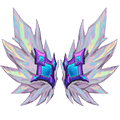 Fate Wings | 1 | 0.15% |
|  Lv.5 Blessing Gem | 1 | 6.54% |
|  Amethyst | 1 - 2 | 7.52% |
|  %s%sMateria%s | 1 | 2.56% |
| 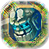 %s%sMateria%s | 1 | 0.08% |
|  Covert Codex | 1 | 3.01% |
|  Ring of Skin | 1 | 3.01% |
|  Primal Force | 1 | 3.01% |
|  Pharaoh Staff | 1 | 3.01% |
|  Warcry | 1 | 3.01% |
|  Epic Forge Hammer | 1 | 4.51% |

**First-clear chest:**  Jewelry ×5,  Earth's Core ×2,  Coin ×200,000,  Diamond ×50

