# Team Expedition

Team dungeons for up to 3 players. Every dungeon has 3 difficulties (Easy, Normal, Hard) with 2 stages each. Each stage page lists its monsters, the boss HP where it has been recorded, and every possible drop with its chance.

<a class="wiki-card" href="team-expedition/old-ruins.html">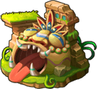Old RuinsLevel 8. At the ruins of a once-thriving forest city, a mysterious force suddenly transported the warriors into the sky. When they opened their eyes…</a>
<a class="wiki-card" href="team-expedition/forest-altar.html">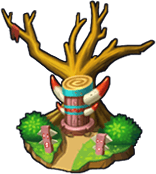Forest AltarLevel 14. The Demon Queen disappeared close to the Altar, as the ancient Spirits were woken up from all the commotion.</a>
<a class="wiki-card" href="team-expedition/dark-castle.html">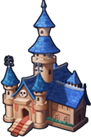Dark CastleLevel 22. The heroes discover a castle in the dark forest, it must have something to do with the Demon Queen.</a>
<a class="wiki-card" href="team-expedition/demon-forest.html">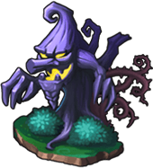Demon ForestLevel 29. The Demon King's forces have entered the Battle Continent, waiting for the right moment in the woods. We must find out what his plan is and the Demon Queen's whereabouts.</a>
<a class="wiki-card" href="team-expedition/goblin-port.html">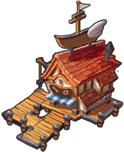Goblin PortLevel 34. Fight to the death with the Goblin Doctors who have appeared at Goblin Port.</a>
<a class="wiki-card" href="team-expedition/sky-battle.html">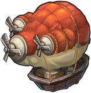Sky BattleLevel 42. The Goblins will soon escape on their Goblin Airship. Stop them!</a>
<a class="wiki-card" href="team-expedition/dragon-nest.html">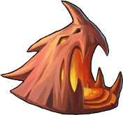Dragon NestLevel 50. There's a huge opening in the side of the cliff, could this be the entrance into the so-called Dragon Nest?</a>
<a class="wiki-card" href="team-expedition/sea-vortex.html">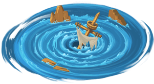Sea VortexLevel 56. A mysterious whirlpool has suddenly appeared at sea, cutting off the sailing routes between two continents. Go there to investigate.</a>
<a class="wiki-card" href="team-expedition/phantom-of-the-opera.html">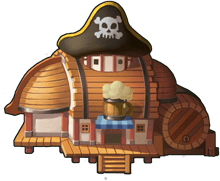Phantom of the OperaLevel 62. In celebration of the wine fest, the warriors have gathered in this pirate-themed bar, drinking and singing! You drank too much... making you hallucinate!</a>
<a class="wiki-card" href="team-expedition/lost-forest.html">Lost ForestLevel 66.</a>
<a class="wiki-card" href="team-expedition/desert-ruins.html">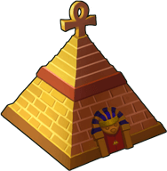Desert RuinsLevel 71. There was an ancient castle in the vast Desert Ruins, and the mysterious statues around it seemed alive</a>
<a class="wiki-card" href="team-expedition/burning-canyon.html">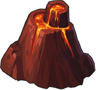Burning CanyonLevel 76. Savage roars suddenly sounded in the canyon, beware of the Orcs</a>
<a class="wiki-card" href="team-expedition/snow-castle.html">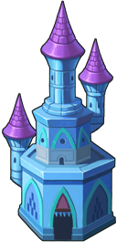Snow CastleLevel 80.</a>
<a class="wiki-card" href="team-expedition/shadowy-domain.html">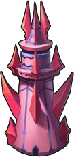Shadowy DomainLevel 85. Dark forces kept invading the Darkest Realm</a>
<a class="wiki-card" href="team-expedition/sea-train.html">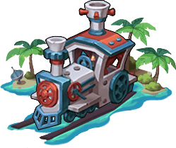Sea trainLevel 90. A ghost train suddenly appeared in the depths of Douhai</a>
<a class="wiki-card" href="team-expedition/lost-battlefield.html">Lost BattlefieldLevel 95. Dangers were everywhere in Lost Battlefield. Be very careful!</a>

