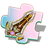
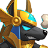
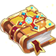
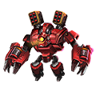

[← Team Expedition](../team-expedition.html)

# Desert Ruins

There was an ancient castle in the vast Desert Ruins, and the mysterious statues around it seemed alive

- Needs player level **71**.
- 3 difficulties (Easy, Normal, Hard), each with 2 stages.
- HP is shown for the stages where it has been recorded in real battles.

## Easy

### Desert Ruins - 1

- Kill all monsters
- Lose: Allied Team Annihilated Number of Turns >40
- Recommended BP: **831,163** · 3 normal, 1 boss monster(s)

**Monsters:** Sphinx ·  Pharaoh

**HP:** not recorded yet

**Drops:**

| Item | Number | Probability |
|---|---|---|
|  Coin | 10,000 | 25.00% |
|  Coin | 8,000 | 30.00% |
|  Coin | 5,000 | 10.00% |
|  Coin | 6,000 | 35.00% |

### Desert Ruins - 2

- Kill Pharaoh
- Lose: Allied Team Annihilated Number of Turns >40
- Recommended BP: **860,722** · 1 elite, 1 boss monster(s)

**Monsters:**  Pharaoh

**HP:** not recorded yet

**Drops:**

| Item | Number | Probability |
|---|---|---|
|  Legendry Stone | 1 - 2 | 1.77% |
|  Marine Coral | 2 - 4 | 4.44% |
|  Coral Bracer | 1 | 1.77% |
|  Glory Circlet | 1 | 1.06% |
|  Magic Stone IV | 2 | 2.66% |
|  Magic Stone III | 2 | 4.44% |
|  Advanced Target | 2 | 1.77% |
|  Practice Fruit (S) | 2 - 3 | 3.19% |
|  Crystal Identification Scroll | 1 - 2 | 2.66% |
|  Moon Shard | 2 | 1.77% |
|  Inferior Inscription Ink | 2 | 3.55% |
|  Potential Gem | 2 - 3 | 2.66% |
|  Inscr. Crystal III | 1 | 0.35% |
|  Lv.4 Blessing Gem | 1 - 3 | 2.66% |
|  Hammer of Artificer | 1 - 2 | 4.44% |
|  Colored crystal | 2 | 1.33% |
|  APT Pill II | 1 - 2 | 0.89% |
|  Raul Crystal Lv.2 | 2 - 4 | 7.10% |
|  Mount Coin | 1 - 2 | 1.77% |
|  Amethyst | 1 - 4 | 2.66% |
|  APT Pill | 1 - 3 | 2.66% |
|  SP Gacha | 1 - 2 | 2.66% |
|  Intricate Code Case | 1 - 2 | 0.44% |
|  Excalibur-Pixel Sword Skin Shard | 1 | 1.33% |
|  Hell-Scarlet Purgatory Skin Shard | 1 | 1.33% |
|  Lv.2 Orb Bag | 2 | 3.11% |
|  Bronze Medal | 1 - 2 | 0.89% |
|  Mech Wreck I | 1 - 2 | 1.77% |
|  Recast stone Pack | 1 | 2.66% |
|  Fire Materia Essence | 2 - 3 | 2.66% |
|  Basic Monster Crystal | 3 - 5 | 4.44% |
|  Advanced Monster Crystal | 2 - 3 | 2.66% |
|  Magic Adhesive | 1 - 2 | 3.55% |
|  Sand of time | 2 - 3 | 4.44% |
|  Seal Gem | 1 - 2 | 6.21% |
|  Lv.2 Orb Bag | 1 - 2 | 3.55% |
|  Transparent Shield Chapter Shard | 1 - 2 | 2.66% |

## Normal

### Desert Ruins - 1

- Kill Kobold
- Lose: Allied Team Annihilated Number of Turns >40
- Recommended BP: **879,352** · 3 normal, 1 boss monster(s)

**Monsters:**  Kobold ·  Pharaoh

**HP:** not recorded yet

**Drops:**

| Item | Number | Probability |
|---|---|---|
|  Coin | 10,000 | 35.00% |
|  Coin | 8,000 | 20.00% |
|  Coin | 15,000 | 35.00% |
|  Coin | 20,000 | 10.00% |

### Desert Ruins - 2

- Kill Pharaoh
- Lose: Allied Team Annihilated Number of Turns >40
- Recommended BP: **899,352** · 1 elite, 1 boss monster(s)

**Monsters:**  Pharaoh

**HP:** not recorded yet

**Drops:**

| Item | Number | Probability |
|---|---|---|
|  Skill Book V | 1 | 2.23% |
|  Epic Code Case | 1 | 0.89% |
|  Pharaoh Staff | 1 | 0.45% |
|  Gold Bracer | 1 | 0.45% |
|  Magic Stone IV | 2 | 2.68% |
|  Upgrade Stone | 1 - 3 | 2.68% |
|  Normal Inscription Ink | 1 - 3 | 2.68% |
|  SP Gacha | 1 - 2 | 1.79% |
|  APT Pill | 2 - 3 | 4.47% |
|  Excalibur Shard | 2 - 3 | 1.34% |
|  Moon Shard | 2 | 1.79% |
|  Practice Fruit (S) | 1 - 3 | 2.68% |
|  Lv.4 Blessing Gem | 2 - 3 | 2.68% |
|  Lv.5 Blessing Gem | 1 - 2 | 1.79% |
|  Potential Gem | 2 - 3 | 2.68% |
|  Alloy Legplates | 1 | 0.45% |
|  Raul Crystal Lv.2 | 2 - 4 | 5.36% |
|  Mech Wreck I | 1 - 2 | 2.23% |
|  Hammer of Artificer | 1 - 2 | 4.47% |
|  Refine Stone III | 2 | 2.68% |
|  Inscr. Crystal III | 1 | 0.40% |
|  Amethyst | 1 - 2 | 2.68% |
|  Magic Stone III | 1 - 3 | 2.68% |
|  Excalibur-Pixel Sword Skin Shard | 1 - 2 | 0.89% |
|  Hell-Scarlet Purgatory Skin Shard | 1 - 2 | 0.89% |
|  Trainee Medal | 1 - 2 | 1.34% |
|  Rider Tome | 1 - 3 | 2.68% |
|  Meridian Blueprint | 1 - 3 | 2.68% |
|  Recast stone Pack | 1 | 2.68% |
|  Legendry Stone | 1 - 3 | 1.79% |
|  Mech Wreck II | 1 | 1.79% |
|  Fire Materia Essence | 2 - 3 | 2.68% |
|  Basic Monster Crystal | 2 - 5 | 3.57% |
|  Advanced Monster Crystal | 2 - 3 | 2.68% |
|  Rare Monster Crystal | 1 | 1.79% |
|  Magic Adhesive | 1 - 2 | 3.57% |
|  Sand of time | 2 - 3 | 4.47% |
|  Seal Gem | 1 - 2 | 4.47% |
|  Lv.2 Orb Bag | 1 - 2 | 3.57% |
|  Inscription Soul | 1 - 2 | 2.68% |
|  Transparent Shield Chapter Shard | 1 - 2 | 1.79% |
|  Ambush Master Chapter Shard | 1 - 2 | 1.79% |

## Hard

### Desert Ruins - 1

- Kill Queen
- Lose: Allied Team Annihilated Number of Turns >40
- Recommended BP: **938,415** · 3 normal, 1 boss monster(s)

**Monsters:**  Queen ·  Pharaoh

**HP:** not recorded yet

**Drops:**

| Item | Number | Probability |
|---|---|---|
|  Coin | 15,000 | 35.00% |
|  Coin | 10,000 | 20.00% |
|  Coin | 20,000 | 35.00% |
|  Coin | 25,000 | 10.00% |

### Desert Ruins - 2

- Beat at the same time
- Lose: Any player dies; Fight for over 40 Turns
- Recommended BP: **957,480** · 1 elite, 1 boss monster(s)

**Monsters:**  Pharaoh ·  Queen

**HP:** not recorded yet

**Drops:**

| Item | Number | Probability |
|---|---|---|
|  Sphinx | 1 | 0.18% |
|  Wraith: Skeleton Scale | 1 | 0.09% |
|  Discrete Inscription | 1 - 2 | 1.82% |
|  Legend Code Case | 1 | 0.91% |
|  Ticket: Devil's House | 1 | 1.82% |
|  Ticket: Dragon Lair | 1 | 1.82% |
|  Ring of Skin | 1 | 0.46% |
|  Teck.1 Booster | 1 | 0.36% |
|  Magic Stone IV | 2 | 4.56% |
|  Raul Crystal Lv.3 | 2 | 4.56% |
|  Crystal Identification Scroll | 1 - 2 | 3.65% |
|  Hammer of Artificer | 1 - 2 | 4.56% |
|  Moon Shard | 1 - 2 | 1.82% |
|  Aurora Plume | 1 | 1.37% |
|  Lv.4 Blessing Gem | 2 - 3 | 2.74% |
|  Lv.5 Blessing Gem | 1 - 3 | 1.82% |
|  Meridian Blueprint | 1 - 3 | 2.74% |
|  Exquisite Inscription Ink | 1 - 2 | 1.82% |
|  Skill Book V | 1 - 2 | 1.37% |
|  Hammer of Artificer | 1 - 3 | 2.74% |
|  Excalibur-Pixel Sword Skin Shard | 1 - 2 | 1.37% |
|  Excalibur Shard | 2 - 3 | 2.74% |
|  Hell-Scarlet Purgatory Skin Shard | 1 - 2 | 0.91% |
|  Mount Coin | 1 | 1.82% |
|  Inscription Catalyst | 2 | 1.82% |
|  Clear Ticket | 1 - 2 | 4.10% |
|  Dark Materia Essence | 1 - 2 | 2.74% |
|  Advanced Monster Crystal | 1 - 2 | 3.65% |
|  Rare Monster Crystal | 1 - 2 | 1.82% |
|  Magic Adhesive | 1 - 3 | 4.56% |
|  Sand of time | 2 - 4 | 4.56% |
|  Love Letter | 1 | 1.09% |
|  Advanced Monster Crystal | 1 - 2 | 2.74% |
|  Legendary Monster Crystal | 1 | 0.46% |
|  Seal crystal | 1 | 1.82% |
|  Splendid Medal | 1 | 1.37% |
|  Mech Wreck II | 1 | 2.74% |
|  Mech Wreck III | 1 | 1.82% |
|  Bronze Medal | 1 | 1.82% |
|  Recast stone Pack | 1 | 2.74% |
|  Basic Monster Crystal | 2 - 4 | 4.56% |
|  Potential Gem | 2 - 3 | 3.65% |
|  Inscr. Crystal IV | 1 | 0.23% |
|  Enhancer Needle | 1 - 2 | 0.91% |
|  Ambush Master Chapter Shard | 1 | 2.74% |

