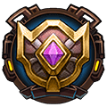
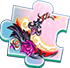
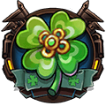
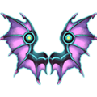
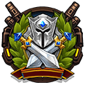
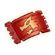

[← Team Expedition](../team-expedition.html)

# Dragon Nest

There's a huge opening in the side of the cliff, could this be the entrance into the so-called Dragon Nest?

- Needs player level **50**.
- 3 difficulties (Easy, Normal, Hard), each with 2 stages.
- HP is shown for the stages where it has been recorded in real battles.

## Easy

### Dragon Nest-1

- Defeat Life Control.Red Dragon
- Lose: Allied Team Annihilated Number of Turns >40
- Recommended BP: **241,112** · 5 normal, 3 elite monster(s)

**Monsters:**  Life Control.Red Dragon ·  Life Guard.Green Dragon

**HP:** not recorded yet

**Drops:**

| Item | Number | Probability |
|---|---|---|
|  Coin | 10,000 | 25.00% |
|  Coin | 8,000 | 30.00% |
|  Coin | 5,000 | 10.00% |
|  Coin | 6,000 | 35.00% |

### Dragon Nest-2

- Defeat all monsters
- Lose: Allied Team Annihilated Number of Turns >40
- Recommended BP: **247,369** · 2 elite monster(s)

**Monsters:**  Time Guard.Bronze Dragon

**HP:** not recorded yet

**Drops:**

| Item | Number | Probability |
|---|---|---|
|  Octopus Necklace | 1 | 2.52% |
|  Bronze Medal | 1 | 2.52% |
|  Lava Necklace | 1 | 2.52% |
|  Chicken Mines Shard | 2 | 2.52% |
|  Sigil 1 | 1 - 3 | 3.36% |
|  Ion-Quantum Destiny Skin Shard | 1 | 0.84% |
|  Normal Code Case | 1 | 2.52% |
|  Scythe - Night Rose Skin Shard | 1 | 0.84% |
|  Magic Stone III | 1 - 2 | 5.04% |
|  Advanced Target | 2 - 3 | 4.20% |
|  Upgrade Stone | 1 - 2 | 6.38% |
|  Normal Target | 2 - 3 | 4.20% |
|  Grimm Gloves Shard | 2 - 3 | 4.20% |
|  Refine Stone I | 2 - 3 | 4.20% |
|  Refine Stone II | 2 - 3 | 4.20% |
|  Refine Stone III | 2 | 3.36% |
|  Refine Stone IV | 1 - 2 | 2.52% |
|  Hardness | 2 - 3 | 5.04% |
|  Lv.3 Blessing Gem | 3 - 4 | 4.20% |
|  Lv.4 Blessing Gem | 2 - 3 | 2.52% |
|  Pet Manual | 3 - 4 | 3.36% |
|  Colored crystal | 1 - 2 | 1.26% |
|  Magic Stone III | 2 | 5.04% |
|  Flame Plume | 1 - 2 | 4.20% |
|  Blue crystal | 3 - 4 | 2.52% |
|  APT Pill | 2 - 3 | 2.52% |
|  SP Gacha | 1 - 2 | 2.52% |
|  Down Plume | 2 - 3 | 1.68% |
|  Lv.1 Orb Bag | 2 - 3 | 5.04% |
|  Sigil 2 | 1 - 2 | 1.68% |
|  Rider Tome | 1 - 3 | 2.52% |

## Normal

### Dragon Nest-1

- Defeat all monsters
- Lose: Allied Team Annihilated Number of Turns >40
- Recommended BP: **259,952** · 5 normal, 3 elite monster(s)

**Monsters:**  Life Guard.Green Dragon

**HP:** not recorded yet

**Drops:**

| Item | Number | Probability |
|---|---|---|
|  Coin | 10,000 | 35.00% |
|  Coin | 8,000 | 20.00% |
|  Coin | 15,000 | 35.00% |
|  Coin | 20,000 | 10.00% |

### Dragon Nest-2

- Defeat Emerald Dream.Blue Dragon
- Lose: Allied Team Annihilated Number of Turns >40
- Recommended BP: **266,830** · 2 elite monster(s)

**Monsters:**  Emerald Dream.Blue Dragon

**HP:** not recorded yet

**Drops:**

| Item | Number | Probability |
|---|---|---|
|  Wraith: Shadowgourd | 1 | 0.20% |
|  Epic Code Case | 1 | 0.50% |
|  Ion-Quantum Destiny Skin Shard | 1 | 0.99% |
|  Mount Coin | 2 | 1.19% |
|  Octopus Necklace | 1 | 1.98% |
|  Lava Necklace | 1 | 1.98% |
|  Sigil 2 | 1 - 2 | 1.49% |
|  Scythe - Night Rose Skin Shard | 1 | 0.99% |
|  Skill Book III | 1 | 1.98% |
|  Upgrade Stone | 1 | 4.96% |
|  Down Plume | 2 - 3 | 4.96% |
|  SP Gacha | 1 | 1.98% |
|  APT Pill | 1 | 4.96% |
|  Grimm Gloves Shard | 1 - 2 | 7.93% |
|  Chicken Mines Shard | 2 | 5.95% |
|  Flame Plume | 1 - 2 | 2.97% |
|  Lv.4 Blessing Gem | 2 - 3 | 4.96% |
|  Lv.5 Blessing Gem | 1 - 2 | 4.96% |
|  Refine Stone I | 2 | 2.97% |
|  Skill Page | 1 | 1.98% |
|  Clear Ticket | 1 - 2 | 4.46% |
|  Pet Manual | 4 | 7.43% |
|  Refine Stone II | 2 | 3.17% |
|  Sigil 1 | 1 - 3 | 1.98% |
|  Advanced Target | 1 - 3 | 4.96% |
|  Refine Stone IV | 2 | 1.98% |
|  Magic Stone III | 1 | 2.97% |
|  Lv.2 Orb Bag | 1 - 3 | 7.93% |
|  Intricate Code Case | 1 - 2 | 0.79% |
|  Trainee Medal | 1 | 1.49% |
|  Rider Tome | 1 - 3 | 2.97% |

## Hard

### Dragon Nest-1

- Defeat all monsters
- Lose: Allied Team Annihilated Number of Turns >40
- Recommended BP: **287,433** · 5 normal, 3 elite monster(s)

**Monsters:**  Time Guard.Bronze Dragon

**HP:** not recorded yet

**Drops:**

| Item | Number | Probability |
|---|---|---|
|  Coin | 15,000 | 35.00% |
|  Coin | 10,000 | 20.00% |
|  Coin | 20,000 | 35.00% |
|  Coin | 25,000 | 10.00% |

### Dragon Nest-2

- Defeat the Deathwing Black Dragon
- Lose: Allied Team Annihilated Number of Turns >40
- Recommended BP: **294,310** · 2 elite monster(s)

**Monsters:** Lava Mob · Burning Rock

**HP:** not recorded yet

**Drops:**

| Item | Number | Probability |
|---|---|---|
|  Memorial Medal | 1 | 0.93% |
|  Wraith: Shadowgourd | 1 | 0.28% |
|  Devil Wings | 1 | 0.28% |
|  Heroic Bracer | 1 | 0.93% |
|  Splendid Medal | 1 | 1.87% |
|  Bronze Medal | 1 | 1.40% |
|  Trainee Medal | 1 | 1.40% |
|  Ion-Quantum Destiny Skin Shard | 1 - 2 | 1.40% |
|  Scythe - Night Rose Skin Shard | 1 - 2 | 1.40% |
|  Ticket: Devil's House | 1 | 0.47% |
|  Ticket: Dragon Lair | 1 | 0.93% |
|  Amethyst | 1 | 2.80% |
|  Octopus Necklace | 1 | 1.87% |
|  Amethyst | 1 | 1.40% |
|  Upgrade Stone | 2 - 3 | 4.67% |
|  Pet Manual | 2 | 5.60% |
|  Down Plume | 2 - 3 | 7.47% |
|  Chicken Mines Shard | 1 - 2 | 5.60% |
|  Grimm Gloves Shard | 2 | 7.47% |
|  Aurora Plume | 1 | 1.87% |
|  Lv.4 Blessing Gem | 2 - 3 | 4.67% |
|  Lv.5 Blessing Gem | 2 | 2.80% |
|  Clear Ticket | 1 - 2 | 4.67% |
|  Refine Stone II | 2 - 3 | 2.80% |
|  Refine Stone III | 2 - 3 | 2.33% |
|  Refine Stone IV | 2 | 1.87% |
|  SP Gacha | 1 - 2 | 1.87% |
|  Advanced Target | 2 | 7.47% |
|  Magic Stone III | 1 - 2 | 1.87% |
|  Flame Plume | 1 - 2 | 2.80% |
|  Skill Page | 1 | 0.93% |
|  Rider Tome | 1 - 3 | 3.73% |
|  Mount Coin | 1 | 0.93% |
|  Phoebe | 1 - 2 | 3.73% |
|  Hardness | 2 | 4.67% |
|  Sigil 2 | 1 - 2 | 2.80% |

