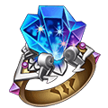
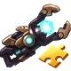
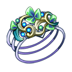
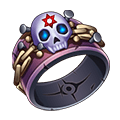
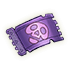

[← Team Expedition](../team-expedition.html)

# Goblin Port

Fight to the death with the Goblin Doctors who have appeared at Goblin Port.

- Needs player level **34**.
- 3 difficulties (Easy, Normal, Hard), each with 2 stages.
- HP is shown for the stages where it has been recorded in real battles.

## Easy

### Goblin Port -1

- Kill Goblin Gunner
- Lose: Allied Team Annihilated Number of Turns >40
- Recommended BP: **82,825** · 11 normal, 1 boss monster(s)

**Monsters:** Goblin Gunner · Lava Warrior ·  Goblin Doctor

**HP:** not recorded yet

**Drops:**

| Item | Number | Probability |
|---|---|---|
|  Coin | 10,000 | 25.00% |
|  Coin | 8,000 | 30.00% |
|  Coin | 5,000 | 10.00% |
|  Coin | 6,000 | 35.00% |

### Goblin Port -2

- Goblin Doctor Death
- Lose: Allied Team Annihilated Number of Turns >40
- Recommended BP: **89,481** · 2 normal, 2 boss monster(s)

**Monsters:** Goblin Gunner · Lava Warrior ·  Goblin Doctor

**HP:** not recorded yet

**Drops:**

| Item | Number | Probability |
|---|---|---|
|  Origin Ring | 1 | 1.86% |
|  Thunder Shard | 1 - 2 | 1.86% |
|  Skill Book II | 1 | 0.74% |
|  Elf Bracer | 1 | 2.79% |
|  Marshal Medal | 1 | 2.79% |
|  Death Shackles | 1 | 2.79% |
|  Magic Stone III | 1 | 7.45% |
|  Advanced Target | 1 - 2 | 2.79% |
|  Upgrade Stone | 1 | 7.08% |
|  Normal Target | 2 | 6.52% |
|  Ion Cannon Shard | 2 | 4.66% |
|  Normal Code Case | 1 | 0.93% |
|  Refine Stone III | 1 - 2 | 2.79% |
|  Lv.3 Blessing Gem | 2 - 3 | 5.59% |
|  Lv.4 Blessing Gem | 1 - 2 | 2.79% |
|  Intricate Code Case | 1 | 0.93% |
|  Pet Manual | 2 | 6.52% |
|  APT Pill II | 1 - 2 | 2.79% |
|  Upgrade Stone | 2 | 4.66% |
|  Refine Stone I | 2 - 3 | 5.59% |
|  Refine Stone II | 2 - 3 | 3.72% |
|  APT Pill | 1 - 3 | 2.79% |
|  SP Gacha | 1 | 0.93% |
|  Aeolus Axe Shard | 2 | 4.66% |
|  Blue crystal | 1 - 2 | 2.79% |
|  Lv.1 Orb Bag | 1 - 2 | 3.72% |
|  Refine Stone IV | 1 - 2 | 0.93% |
|  Down Plume | 2 - 3 | 6.52% |

## Normal

### Goblin Port -1

- Goblin Doctor Death
- Lose: Allied Team Annihilated Number of Turns >40
- Recommended BP: **109,215** · 11 normal, 1 boss monster(s)

**Monsters:**  Goblin Merchant · Lava Warrior ·  Goblin Doctor

**HP:** not recorded yet

**Drops:**

| Item | Number | Probability |
|---|---|---|
|  Coin | 10,000 | 35.00% |
|  Coin | 8,000 | 20.00% |
|  Coin | 15,000 | 35.00% |
|  Coin | 20,000 | 10.00% |

### Goblin Port -2

- Kill Goblin Merchant
- Lose: Allied Team Annihilated Number of Turns >40
- Recommended BP: **112,220** · 2 normal, 2 boss monster(s)

**Monsters:**  Goblin Merchant · Lava Warrior ·  Goblin Doctor

**HP:** not recorded yet

**Drops:**

| Item | Number | Probability |
|---|---|---|
|  Normal Code Case | 1 | 1.12% |
|  Thunder Shard | 1 - 2 | 2.23% |
|  Intricate Code Case | 1 | 0.56% |
|  Skill Book II | 1 | 1.12% |
|  Origin Ring | 1 | 2.23% |
|  Flame Bead | 1 | 3.35% |
|  Refine Stone III | 1 - 2 | 2.79% |
|  Upgrade Stone | 1 | 5.59% |
|  Down Plume | 2 - 3 | 7.82% |
|  SP Gacha | 1 | 3.35% |
|  APT Pill | 1 | 5.59% |
|  Colored crystal | 1 | 2.23% |
|  Ion Cannon Shard | 2 | 8.94% |
|  Flame Plume | 1 - 2 | 4.47% |
|  Clear Ticket | 1 - 2 | 5.03% |
|  Lv.4 Blessing Gem | 1 - 2 | 3.35% |
|  Refine Stone I | 2 | 2.23% |
|  Heroic Forge Hammer | 1 | 2.23% |
|  Aurora Plume | 1 | 1.45% |
|  Pet Manual | 4 | 8.94% |
|  Refine Stone II | 2 | 3.58% |
|  Advanced Target | 1 | 5.59% |
|  Magic Stone III | 1 - 3 | 3.35% |
|  Enhance Stone VIII | 1 - 2 | 2.23% |
|  Amethyst | 1 | 1.68% |
|  Refine Stone IV | 1 - 2 | 3.35% |
|  APT Pill II | 1 - 2 | 2.23% |
|  Lv.2 Orb Bag | 1 - 2 | 3.35% |

## Hard

### Goblin Port -1

- Kill Goblin Merchant
- Lose: Allied Team Annihilated Number of Turns >40
- Recommended BP: **133,874** · 11 normal, 1 boss monster(s)

**Monsters:**  Goblin Merchant ·  Goblin Doctor ·  Goblin Marshal

**HP:** Goblin Merchant 679,454 · total **679,454**

**Drops:**

| Item | Number | Probability |
|---|---|---|
|  Coin | 15,000 | 35.00% |
|  Coin | 10,000 | 20.00% |
|  Coin | 20,000 | 35.00% |
|  Coin | 25,000 | 10.00% |

### Goblin Port -2

- Kill Goblin Marshal
- Lose: Allied Team Annihilated Number of Turns >40
- Recommended BP: **140,245** · 2 normal, 2 boss monster(s)

**Monsters:**  Goblin Merchant ·  Goblin Doctor ·  Goblin Marshal

**HP:** Goblin Doctor 9,633, Goblin Marshal 931,565, Green Circle 10,293, Red Circle 10,293 · total **961,784**

**Drops:**

| Item | Number | Probability |
|---|---|---|
|  Intricate Code Case | 1 | 0.84% |
|  Wraith: Devil Codex | 1 | 0.52% |
|  Abo Scarf | 1 | 1.57% |
|  Octopus Necklace | 1 | 2.10% |
|  Octopus Crown | 1 | 2.62% |
|  Jellyfish Ring | 1 | 3.15% |
|  Ticket: City of Tech | 1 | 1.57% |
|  Ticket: Fortress of Death | 1 | 1.57% |
|  Amethyst | 1 | 1.26% |
|  Heroic Forge Hammer | 1 | 3.15% |
|  Lv.3 Orb Bag | 1 | 2.10% |
|  Upgrade Stone | 2 | 6.30% |
|  Pet Manual | 2 - 3 | 6.30% |
|  Down Plume | 2 - 3 | 6.30% |
|  APT Pill II | 1 - 2 | 2.10% |
|  G Mage Gatling Shard | 2 | 6.30% |
|  Aurora Plume | 1 | 1.57% |
|  Lv.4 Blessing Gem | 2 - 3 | 7.35% |
|  Lv.5 Blessing Gem | 2 | 3.15% |
|  Clear Ticket | 1 - 2 | 4.72% |
|  Refine Stone II | 2 - 3 | 3.15% |
|  Refine Stone III | 2 | 2.62% |
|  Refine Stone IV | 1 - 2 | 2.10% |
|  SP Gacha | 1 - 2 | 4.20% |
|  Thunder Shard | 2 | 3.15% |
|  Flame Plume | 1 - 2 | 3.15% |
|  Advanced Target | 2 | 5.25% |
|  Magic Stone III | 1 | 2.10% |
|  Magic Stone II | 2 | 7.35% |
|  Normal Code Case | 1 | 1.36% |
|  Skill Book III | 1 | 1.05% |

