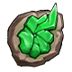
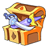
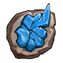
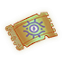
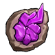
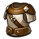

[← Team Expedition](../team-expedition.html)

# Lost Battlefield

Dangers were everywhere in Lost Battlefield. Be very careful!

- Needs player level **95**.
- 3 difficulties (Easy, Normal, Hard), each with 2 stages.
- HP is shown for the stages where it has been recorded in real battles.

## Easy

### Lost Battlefield - 1

- Defeat all monsters
- Lose: Allied Team Annihilated Number of Turns >40
- Recommended BP: **2,770,713** · 4 normal, 1 elite monster(s)

**Monsters:**  Monitor Type M

**HP:** not recorded yet

**Drops:**

| Item | Number | Probability |
|---|---|---|
|  Coin | 20,000 | 21.05% |
|  Coin | 10,000 | 31.58% |
|  Coin | 5,000 | 10.53% |
|  Coin | 15,000 | 36.84% |

### Lost Battlefield - 2

- Defeat all monsters
- Lose: Allied Team Annihilated Number of Turns >40
- Recommended BP: **3,324,855** · 4 normal, 1 elite monster(s)

**Monsters:**  Monitor Type G

**HP:** not recorded yet

**Drops:**

| Item | Number | Probability |
|---|---|---|
|  Sigil 2 | 1 - 2 | 2.58% |
|  Troll Bone Blueprint | 1 - 3 | 0.86% |
|  Primal Force | 1 | 0.60% |
|  Monitor | 1 | 0.60% |
|  Red Magic Stone | 1 - 3 | 2.58% |
|  Green Equipment Slag | 1 - 3 | 2.58% |
|  Spiritual Power Crystal | 1 - 3 | 2.58% |
|  Practice Fruit (S) | 2 | 2.58% |
|  Blue crystal | 1 - 2 | 2.58% |
|  Efreet Shard | 2 | 3.45% |
|  Inferior Inscription Ink | 2 - 4 | 3.45% |
|  Refine Stone II | 1 - 3 | 2.58% |
|  Inscr. Crystal VI | 1 | 0.86% |
|  Lv.4 Blessing Gem | 2 - 4 | 2.58% |
|  Marine Coral | 2 - 4 | 4.31% |
|  Colored crystal | 2 | 1.29% |
|  APT Pill II | 2 - 3 | 0.86% |
|  Raul Crystal Lv.2 | 2 - 4 | 3.45% |
|  Mount Coin | 1 - 2 | 2.58% |
|  Amethyst | 1 - 2 | 2.58% |
|  Inscription Catalyst | 1 - 3 | 3.45% |
|  Intricate Code Case | 1 - 2 | 0.86% |
|  Endurance Seal Shard | 1 | 1.72% |
|  Skin Shards Selection Chest 1 | 1 | 1.72% |
|  Lv.2 Orb Bag | 2 - 3 | 3.01% |
|  Bronze Medal | 1 | 1.29% |
|  Mech Wreck I | 1 - 2 | 2.58% |
|  Recast stone Pack | 1 | 3.45% |
|  Dark Materia Essence | 2 - 3 | 2.58% |
|  Basic Monster Crystal | 2 - 3 | 2.58% |
|  Advanced Monster Crystal | 1 - 2 | 1.72% |
|  Magic Adhesive | 1 - 2 | 3.45% |
|  Sand of time | 2 - 3 | 4.31% |
|  Seal Gem | 1 - 3 | 4.31% |
|  Apple | 1 - 3 | 3.45% |
|  Restraint Chapter Shard | 1 - 2 | 1.03% |
|  Power Surge Chapter Shard | 1 - 2 | 2.58% |
|  Ordinary Magic Carving Knife | 1 - 3 | 2.58% |
|  Constitution Seal Shard | 1 | 0.86% |
|  Dexterity Seal Shard | 1 | 0.86% |
|  Shard of Will | 2 - 3 | 3.45% |
|  Spiritual Power Crystal | 1 - 2 | 2.58% |

## Normal

### Lost Battlefield - 1

- Defeat all monsters
- Lose: Allied Team Annihilated Number of Turns >40
- Recommended BP: **3,890,690** · 4 normal, 1 elite monster(s)

**Monsters:**  Monitor Type M ·  Striker

**HP:** not recorded yet

**Drops:**

| Item | Number | Probability |
|---|---|---|
|  Coin | 10,000 | 35.00% |
|  Coin | 8,000 | 20.00% |
|  Coin | 15,000 | 35.00% |
|  Coin | 20,000 | 10.00% |

### Lost Battlefield - 2

- Defeat all monsters
- Lose: Allied Team Annihilated Number of Turns >40
- Recommended BP: **4,279,759** · 4 normal, 1 elite monster(s)

**Monsters:**  Hunter

**HP:** not recorded yet

**Drops:**

| Item | Number | Probability |
|---|---|---|
|  Teck.1 Energy Reactor | 1 | 0.36% |
|  Epic Code Case | 1 | 0.89% |
|  Primal Force | 1 | 0.71% |
|  Troll Fang Blueprint | 1 | 0.89% |
|  Aurora Plume | 2 - 1 | 2.67% |
|  Inscription Soul | 1 - 2 | 2.67% |
|  Normal Inscription Ink | 1 - 2 | 2.67% |
|  SP Gacha | 1 - 2 | 1.78% |
|  Spiritual Power Crystal | 1 - 3 | 2.67% |
|  Anti-riot Seal Shard | 1 | 1.60% |
|  Denim Hood | 1 | 2.67% |
|  Practice Fruit (S) | 1 - 3 | 2.67% |
|  Endurance Seal Shard | 1 | 0.89% |
|  Lv.5 Blessing Gem | 2 | 1.78% |
|  Silver | 2 | 2.67% |
|  Balrog Shard | 1 | 0.44% |
|  Raul Crystal Lv.2 | 2 - 4 | 3.56% |
|  Mech Wreck I | 1 - 2 | 2.22% |
|  Discrete Inscription | 1 - 2 | 1.78% |
|  Refine Stone III | 2 | 2.67% |
|  Inscr. Crystal VI | 1 | 0.36% |
|  Amethyst | 2 | 2.67% |
|  Spiritual Power Crystal | 1 - 2 | 2.67% |
|  Ordinary Magic Carving Knife | 1 - 3 | 2.67% |
|  Skin Shards Selection Chest 1 | 1 - 2 | 0.89% |
|  Trainee Medal | 1 - 2 | 1.33% |
|  Rider Tome | 1 - 3 | 2.67% |
|  Crystal ball | 1 - 3 | 0.89% |
|  Blue Equipment Slag | 1 - 3 | 1.78% |
|  Recast stone Pack | 1 | 3.56% |
|  Mech Wreck II | 1 - 2 | 1.33% |
|  Dark Materia Essence | 2 - 3 | 2.67% |
|  Basic Monster Crystal | 2 - 5 | 3.56% |
|  Advanced Monster Crystal | 2 - 3 | 3.56% |
|  Rare Monster Crystal | 1 | 1.78% |
|  Magic Adhesive | 1 - 2 | 3.56% |
|  Sand of time | 2 - 4 | 3.56% |
|  Seal Gem | 2 - 3 | 3.56% |
|  Restraint Chapter Shard | 1 - 2 | 1.33% |
|  Power Surge Chapter Shard | 1 - 2 | 3.11% |
|  Red Magic Stone | 1 - 3 | 2.67% |
|  Hammer of Artificer | 1 - 2 | 2.67% |
|  Constitution Seal Shard | 1 | 0.89% |
|  Dexterity Seal Shard | 1 | 0.89% |
|  Shard of Will | 2 - 3 | 4.45% |
|  Spiritual Power Crystal | 1 - 2 | 2.67% |

## Hard

### Lost Battlefield - 1

- Defeat all monsters
- Lose: Allied Team Annihilated Number of Turns >40
- Recommended BP: **4,371,133** · 4 normal, 1 elite monster(s)

**Monsters:**  Judge

**HP:** not recorded yet

**Drops:**

| Item | Number | Probability |
|---|---|---|
|  Coin | 15,000 | 35.00% |
|  Coin | 10,000 | 20.00% |
|  Coin | 20,000 | 35.00% |
|  Coin | 25,000 | 10.00% |

### Lost Battlefield - 2

- Defeat all monsters
- Lose: Allied Team Annihilated Number of Turns >40
- Recommended BP: **4,808,246** · 4 normal, 1 elite monster(s)

**Monsters:**  Head Tec

**HP:** not recorded yet

**Drops:**

| Item | Number | Probability |
|---|---|---|
|  Mech Dragon | 1 | 0.10% |
|  Immortal Tale Blueprint | 1 | 0.10% |
|  Crystal Identification Scroll | 1 - 2 | 3.97% |
|  Legend Code Case | 1 | 0.99% |
|  Lost Mech Helmet | 1 | 0.50% |
|  Wraith: Skeleton Scale | 1 | 0.10% |
|  Crystal ball | 1 - 2 | 2.98% |
|  Sheet music | 1 - 2 | 1.98% |
|  Warcry | 1 | 0.50% |
|  Exquisite Inscription Ink | 1 - 2 | 2.48% |
|  Ticket: Maze Zen House | 1 | 1.98% |
|  Ticket: Desert Ruins | 1 | 1.98% |
|  Purple Equipment Slag | 1 - 2 | 2.98% |
|  Meridian Blueprint | 1 - 3 | 2.98% |
|  Discrete Inscription | 1 - 2 | 1.98% |
|  Aurora Plume | 1 | 1.49% |
|  Endurance Seal Shard | 1 | 0.99% |
|  Lv.5 Blessing Gem | 2 | 1.98% |
|  Red Magic Stone | 2 - 3 | 3.97% |
|  Exquisite Inscription Ink | 1 - 2 | 1.98% |
|  Skin Shards Selection Chest 1 | 1 - 2 | 1.49% |
|  Amethyst | 1 | 0.99% |
|  Omni Skin Shard | 1 | 0.69% |
|  Mount Coin | 1 - 2 | 2.98% |
|  Inscription Catalyst | 1 - 3 | 2.98% |
|  Recast stone Pack | 1 | 3.97% |
|  Balrog Shard | 2 | 2.48% |
|  Advanced Monster Crystal | 1 - 2 | 3.97% |
|  Rare Monster Crystal | 1 - 2 | 1.98% |
|  Clear Ticket | 2 - 3 | 4.46% |
|  Sand of time | 1 - 2 | 3.97% |
|  Raul Crystal Lv.3 | 1 - 3 | 5.38% |
|  Legendary Monster Crystal | 1 | 0.50% |
|  Seal crystal | 1 - 2 | 1.98% |
|  Splendid Medal | 1 | 0.99% |
|  Mech Wreck II | 1 - 2 | 2.98% |
|  Mech Wreck III | 1 | 1.98% |
|  Purple Hero Obsessiveness | 1 | 0.79% |
|  Inscription Soul | 1 - 2 | 1.98% |
|  Potential Gem | 1 - 3 | 3.97% |
|  Inscr. Crystal VI | 1 | 0.30% |
|  Enhancer Needle | 1 - 2 | 1.98% |
|  Restraint Chapter Shard | 1 | 1.98% |
|  Firepower Chapter Shard | 1 | 1.98% |
|  Crystal ball | 1 | 2.98% |
|  DMG- Seal Shard | 1 | 0.30% |
|  Exquisite Magic Carving Knife | 1 - 2 | 2.98% |
|  Onslaught Seal Shard | 1 | 0.50% |
|  Soldier Armor | 1 | 0.50% |

