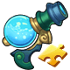
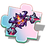
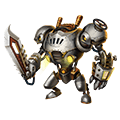
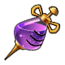

[← Team Expedition](../team-expedition.html)

# Lost Forest

- Needs player level **66**.
- 3 difficulties (Easy, Normal, Hard), each with 2 stages.
- HP is shown for the stages where it has been recorded in real battles.

## Easy

### Lost Forest - 1

- Defeat All Monsters
- Lose: Allied Team Annihilated Number of Turns >40
- Recommended BP: **672,555** · 9 normal, 1 boss monster(s)

**Monsters:** Ice Claws · Nightmare ·  Tutor

**HP:** not recorded yet

**Drops:**

| Item | Number | Probability |
|---|---|---|
|  Coin | 10,000 | 25.00% |
|  Coin | 8,000 | 30.00% |
|  Coin | 5,000 | 10.00% |
|  Coin | 6,000 | 35.00% |

### Lost Forest - 2

- Defeat Master
- Lose: Allied Team Annihilated Number of Turns >40
- Recommended BP: **681,328** · 2 elite, 1 boss monster(s)

**Monsters:**  Tutor

**HP:** not recorded yet

**Drops:**

| Item | Number | Probability |
|---|---|---|
|  Sigil 2 | 1 - 2 | 2.76% |
|  Marine Coral | 2 - 4 | 4.60% |
|  Coral Bracer | 1 | 1.84% |
|  Flame Bead | 1 | 1.84% |
|  Magic Stone IV | 1 - 2 | 2.76% |
|  Magic Stone III | 1 - 3 | 4.60% |
|  Advanced Target | 2 | 1.84% |
|  Practice Fruit (S) | 1 - 2 | 3.31% |
|  Blue crystal | 2 | 2.76% |
|  Torrent Shard | 1 | 3.68% |
|  Refine Stone I | 2 | 4.60% |
|  Refine Stone II | 4 | 2.76% |
|  Lv.3 Blessing Gem | 3 - 4 | 3.68% |
|  Lv.4 Blessing Gem | 1 - 3 | 2.76% |
|  Pet Manual | 4 | 2.76% |
|  Colored crystal | 2 | 1.38% |
|  APT Pill II | 1 - 2 | 0.92% |
|  Raul Crystal Lv.2 | 2 - 3 | 4.60% |
|  Mount Coin | 1 - 2 | 1.84% |
|  Amethyst | 1 - 4 | 2.76% |
|  Legendry Stone | 1 - 3 | 2.76% |
|  SP Gacha | 1 - 2 | 3.68% |
|  Intricate Code Case | 1 - 2 | 0.46% |
|  Hell-Scarlet Purgatory Skin Shard | 1 | 1.38% |
|  Boomerang-Shining Feather Skin Shard | 1 | 1.38% |
|  Lv.1 Orb Bag | 2 - 3 | 4.14% |
|  Bronze Medal | 1 - 2 | 0.92% |
|  Mech Wreck I | 1 - 2 | 1.84% |
|  Recast stone Pack | 1 | 1.84% |
|  Dark Materia Essence | 2 - 3 | 2.76% |
|  Basic Monster Crystal | 3 - 5 | 4.60% |
|  Advanced Monster Crystal | 2 - 3 | 2.76% |
|  Magic Adhesive | 1 - 2 | 3.68% |
|  Sand of time | 1 - 3 | 4.60% |
|  Mech Wreck II | 1 - 2 | 1.38% |
|  Lv.2 Orb Bag | 1 - 2 | 3.68% |

## Normal

### Lost Forest - 1

- Defeat Kungfu Panda
- Lose: Allied Team Annihilated Number of Turns >40
- Recommended BP: **725,327** · 9 normal, 1 boss monster(s)

**Monsters:**  Tutor ·  Kungfu Panda

**HP:** not recorded yet

**Drops:**

| Item | Number | Probability |
|---|---|---|
|  Coin | 10,000 | 35.00% |
|  Coin | 8,000 | 20.00% |
|  Coin | 15,000 | 35.00% |
|  Coin | 20,000 | 10.00% |

### Lost Forest - 2

- Defeat All Monsters
- Lose: Allied Team Annihilated Number of Turns >40
- Recommended BP: **734,149** · 2 elite, 1 boss monster(s)

**Monsters:**  Tutor ·  Kungfu Panda

**HP:** not recorded yet

**Drops:**

| Item | Number | Probability |
|---|---|---|
|  Sigil 2 | 1 - 3 | 1.76% |
|  Epic Code Case | 1 | 0.71% |
|  Origin Ring | 1 | 1.76% |
|  Little Trident | 1 | 2.20% |
|  Jellyfish Ring | 1 | 2.20% |
|  Magic Stone IV | 1 - 2 | 2.65% |
|  Upgrade Stone | 2 | 2.65% |
|  Pet Manual | 2 - 5 | 2.65% |
|  SP Gacha | 1 - 2 | 1.76% |
|  Skill Book IV | 1 | 4.41% |
|  Earth's Core | 2 - 3 | 1.76% |
|  Torrent Shard | 2 | 2.65% |
|  Practice Fruit (S) | 1 - 3 | 2.65% |
|  Lv.4 Blessing Gem | 2 - 3 | 2.65% |
|  Lv.5 Blessing Gem | 1 - 2 | 1.76% |
|  Potential Gem | 2 - 3 | 2.65% |
|  Alloy Pauldron | 1 | 0.53% |
|  Raul Crystal Lv.2 | 2 - 3 | 5.29% |
|  Mech Wreck I | 1 - 2 | 2.20% |
|  Refine Stone II | 2 | 1.76% |
|  Refine Stone III | 2 | 2.65% |
|  Advanced Target | 1 - 2 | 4.41% |
|  Amethyst | 2 | 2.65% |
|  Magic Stone III | 1 - 3 | 2.65% |
|  Hell-Scarlet Purgatory Skin Shard | 1 | 1.32% |
|  Boomerang-Shining Feather Skin Shard | 1 | 1.32% |
|  Trainee Medal | 1 - 2 | 0.88% |
|  Rider Tome | 1 - 3 | 2.65% |
|  Marine Coral | 2 - 4 | 4.41% |
|  Recast stone Pack | 1 | 1.76% |
|  Legendry Stone | 1 - 3 | 1.76% |
|  Mech Wreck II | 1 | 1.32% |
|  Light Materia Essence | 2 - 3 | 4.41% |
|  Basic Monster Crystal | 2 - 5 | 4.41% |
|  Advanced Monster Crystal | 2 - 3 | 3.53% |
|  Rare Monster Crystal | 1 - 2 | 1.76% |
|  Magic Adhesive | 1 - 2 | 3.53% |
|  Sand of time | 2 - 4 | 4.41% |
|  Lv.2 Orb Bag | 2 - 3 | 3.53% |

## Hard

### Lost Forest - 1

- Defeat All Monsters
- Lose: Allied Team Annihilated Number of Turns >40
- Recommended BP: **778,391** · 9 normal, 1 boss monster(s)

**Monsters:**  Tutor ·  Kungfu Panda ·  Bull King

**HP:** not recorded yet

**Drops:**

| Item | Number | Probability |
|---|---|---|
|  Coin | 15,000 | 35.00% |
|  Coin | 10,000 | 20.00% |
|  Coin | 20,000 | 35.00% |
|  Coin | 25,000 | 10.00% |

### Lost Forest - 2

- HP of players and the Bull King is <30%
- Lose: Any player dies; Fight for over 40 Turns
- Recommended BP: **787,266** · 2 elite, 1 boss monster(s)

**Monsters:**  Bull King

**HP:** not recorded yet

**Drops:**

| Item | Number | Probability |
|---|---|---|
|  Sigil 2 | 1 - 3 | 2.78% |
|  Legend Code Case | 1 | 1.11% |
|  Ticket: Devil's House | 1 | 1.85% |
|  Ticket: Dragon Lair | 1 | 1.85% |
|  Wraith: Silent Manuscript | 1 | 0.09% |
|  Gold Collar | 1 | 0.46% |
|  Wild Ring | 1 | 0.93% |
|  Teck.1 Booster | 1 | 0.28% |
|  Magic Stone IV | 1 - 2 | 3.71% |
|  Raul Crystal Lv.3 | 2 - 3 | 3.71% |
|  Potential Needle | 2 - 3 | 3.71% |
|  Clear Ticket | 1 - 2 | 4.17% |
|  Torrent Shard | 2 - 3 | 1.85% |
|  Aurora Plume | 1 | 1.39% |
|  Lv.4 Blessing Gem | 3 - 4 | 2.78% |
|  Lv.5 Blessing Gem | 1 - 3 | 1.85% |
|  Potential Gem | 2 - 3 | 3.71% |
|  Meridian Blueprint | 1 - 3 | 2.78% |
|  Skill Book IV | 1 - 2 | 3.71% |
|  SP Gacha | 1 - 2 | 3.71% |
|  Hell-Scarlet Purgatory Skin Shard | 1 - 2 | 1.39% |
|  Hell Shard | 1 - 2 | 2.78% |
|  Luckbringer Shard | 2 | 1.11% |
|  Mount Coin | 1 - 2 | 2.78% |
|  Recast stone Pack | 1 | 1.85% |
|  Mech Wreck III | 1 - 2 | 1.85% |
|  Dark Materia Essence | 2 - 3 | 2.78% |
|  Advanced Monster Crystal | 1 - 3 | 2.78% |
|  Rare Monster Crystal | 1 - 2 | 2.32% |
|  Magic Adhesive | 1 - 3 | 4.63% |
|  Sand of time | 2 | 4.63% |
|  %s%sMateria%s | 1 | 0.56% |
|  Advanced Monster Crystal | 1 - 2 | 2.78% |
|  Seal crystal | 1 - 2 | 2.32% |
|  Splendid Medal | 1 | 2.32% |
|  Mech Wreck II | 1 - 2 | 1.85% |
|  Mech Wreck III | 1 | 1.85% |
|  Boomerang-Shining Feather Skin Shard | 1 | 1.85% |
|  Splendid Medal | 1 | 2.78% |
|  Basic Monster Crystal | 2 - 4 | 4.63% |
|  Potential Gem | 1 - 2 | 3.71% |

