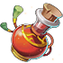
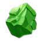
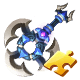
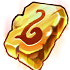

[← Team Expedition](../team-expedition.html)

# Old Ruins

At the ruins of a once-thriving forest city, a mysterious force suddenly transported the warriors into the sky. When they opened their eyes…

- Needs player level **8**.
- 3 difficulties (Easy, Normal, Hard), each with 2 stages.
- HP is shown for the stages where it has been recorded in real battles.

## Easy

### Old Ruins -1

- Defeat all monsters
- Lose: Allied Team Annihilated Number of Turns >40
- Recommended BP: **2,894** · 10 normal, 1 boss monster(s)

**Monsters:** Bush Mob · Bush Mage

**HP:** not recorded yet

**Drops:**

| Item | Number | Probability |
|---|---|---|
|  Coin | 2,000 | 15.00% |
|  Coin | 4,000 | 35.00% |
|  Coin | 6,000 | 35.00% |
|  Coin | 8,000 | 15.00% |

### Old Ruins -2

- Defeat Ancient Stomper
- Lose: Allied Team Annihilated Turns > 100 Turns
- Recommended BP: **4,852** · 2 normal, 1 elite, 1 boss monster(s)

**Monsters:** Bush Mob ·  Ancient Stomper

**HP:** not recorded yet

**Drops:**

| Item | Number | Probability |
|---|---|---|
|  Bazooka Shard | 2 | 5.83% |
|  Upgrade Stone | 1 - 2 | 9.71% |
|  Down Plume | 2 | 4.85% |
|  Magic Stone I | 1 | 9.71% |
|  Flame Plume | 1 - 2 | 5.83% |
|  Enhance Stone III | 2 | 7.77% |
|  Bazooka Shard | 1 - 2 | 9.71% |
|  Lv.3 Blessing Gem | 2 | 4.85% |
|  Pet Manual | 2 | 6.80% |
|  APT Pill | 1 - 2 | 6.80% |
|  APT Pill II | 1 | 3.88% |
|  SP Gacha | 1 | 5.83% |
|  Lv.2 Blessing Gem | 2 - 3 | 7.77% |
|  Aeolus Axe Shard | 1 | 4.85% |
|  Down Plume | 1 - 2 | 5.83% |

## Normal

### Old Ruins -1

- Defeat all monsters
- Lose: Allied Team Annihilated Number of Turns >40
- Recommended BP: **6,892** · 10 normal, 1 boss monster(s)

**Monsters:** Bush Mage ·  Ancient Stomper

**HP:** Ancient Stomper 9,070, Bush Mage 3,279 (x2) · total **15,628**

**Drops:**

| Item | Number | Probability |
|---|---|---|
|  Coin | 5,000 | 50.00% |
|  Coin | 7,000 | 35.00% |
|  Coin | 9,000 | 10.00% |
|  Coin | 12,000 | 5.00% |

### Old Ruins -2

- Defeat Wood Elf
- Lose: Allied Team Annihilated Turns > 100 Turns
- Recommended BP: **8,271** · 2 normal, 1 elite, 1 boss monster(s)

**Monsters:**  Wood Elf

**HP:** Wood Elf 21,244 · total **21,244**

**Drops:**

| Item | Number | Probability |
|---|---|---|
|  Magic Stone I | 1 | 13.46% |
|  Lv.3 Blessing Gem | 2 | 5.77% |
|  Bazooka Shard | 2 - 3 | 5.77% |
|  Upgrade Stone | 1 - 2 | 9.62% |
|  Lv.2 Blessing Gem | 2 - 3 | 6.73% |
|  Enhance Stone III | 2 - 3 | 6.73% |
|  Enhance Stone IV | 2 | 7.69% |
|  Enhance Stone VIII | 2 | 4.81% |
|  Pet Manual | 2 | 6.73% |
|  APT Pill | 2 | 4.81% |
|  APT Pill II | 2 | 1.44% |
|  APT Pill II | 1 | 2.40% |
|  SP Gacha | 1 | 6.73% |
|  Aeolus Axe Shard | 1 - 2 | 5.77% |
|  Flame Plume | 1 - 2 | 3.85% |
|  Down Plume | 1 - 3 | 7.69% |

