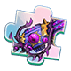

[← Team Expedition](../team-expedition.html)

# Phantom of the Opera

In celebration of the wine fest, the warriors have gathered in this pirate-themed bar, drinking and singing! You drank too much... making you hallucinate!

- Needs player level **62**.
- 3 difficulties (Easy, Normal, Hard), each with 2 stages.
- HP is shown for the stages where it has been recorded in real battles.

## Easy

### Phantom of the Opera -1

- Defeat Ghost Card.Trieste
- Lose: Allied Team Annihilated Number of Turns >40
- Recommended BP: **505,579** · 2 elite monster(s)

**Monsters:**  Ghost Card.Trieste

**HP:** not recorded yet

**Drops:**

| Item | Number | Probability |
|---|---|---|
|  Coin | 10,000 | 25.00% |
|  Coin | 8,000 | 30.00% |
|  Coin | 5,000 | 10.00% |
|  Coin | 6,000 | 35.00% |

### Phantom of the Opera -2

- Defeat Conjurer.Amanda
- Lose: Allied Team Annihilated Number of Turns >40
- Recommended BP: **514,085** · 3 elite monster(s)

**Monsters:**  Conjurer.Amanda

**HP:** not recorded yet

**Drops:**

| Item | Number | Probability |
|---|---|---|
|  Sigil 2 | 1 - 2 | 2.68% |
|  Skill Book IV | 1 | 1.78% |
|  Falcon Shard | 1 - 2 | 2.68% |
|  Clear Ticket | 1 - 2 | 3.93% |
|  Little Trident | 1 | 1.78% |
|  Origin Ring | 1 | 1.78% |
|  Magic Stone IV | 1 - 2 | 2.68% |
|  Magic Stone III | 1 - 2 | 4.46% |
|  Advanced Target | 2 - 3 | 1.78% |
|  Upgrade Stone | 1 - 2 | 3.57% |
|  Blue crystal | 2 | 2.68% |
|  98K Shard | 1 | 3.57% |
|  Refine Stone I | 2 - 3 | 4.46% |
|  Refine Stone II | 2 - 4 | 2.68% |
|  Down Plume | 1 - 3 | 3.57% |
|  Lv.4 Blessing Gem | 2 - 3 | 2.68% |
|  Pet Manual | 4 | 3.57% |
|  Blue crystal | 2 | 2.68% |
|  APT Pill II | 1 - 2 | 0.89% |
|  Raul Crystal Lv.2 | 2 - 4 | 4.46% |
|  Mount Coin | 1 - 2 | 1.78% |
|  Amethyst | 1 - 4 | 2.68% |
|  APT Pill | 1 - 3 | 2.68% |
|  SP Gacha | 1 - 2 | 3.57% |
|  Intricate Code Case | 1 - 2 | 0.45% |
|  Boomerang-Shining Feather Skin Shard | 1 | 1.34% |
|  G Mage Gatling - Star Whisper Shard | 1 | 1.34% |
|  Normal Code Case | 1 | 1.07% |
|  Bronze Medal | 1 - 2 | 0.89% |
|  Mech Wreck I | 1 - 2 | 1.78% |
|  Recast stone Pack | 1 | 2.23% |
|  Light Materia Essence | 1 - 2 | 4.46% |
|  Basic Monster Crystal | 2 - 4 | 4.46% |
|  Advanced Monster Crystal | 2 - 3 | 2.68% |
|  Magic Adhesive | 1 - 2 | 3.57% |
|  Sand of time | 1 - 3 | 4.01% |
|  Lv.2 Orb Bag | 1 - 2 | 2.68% |

## Normal

### Phantom of the Opera -1

- Defeat Tango Lovers
- Lose: Allied Team Annihilated Number of Turns >40
- Recommended BP: **552,203** · 2 elite monster(s)

**Monsters:**  Mad Love.Dusta ·  Lover.Tricia

**HP:** not recorded yet

**Drops:**

| Item | Number | Probability |
|---|---|---|
|  Coin | 10,000 | 35.00% |
|  Coin | 8,000 | 20.00% |
|  Coin | 15,000 | 35.00% |
|  Coin | 20,000 | 10.00% |

### Phantom of the Opera -2

- Defeat King of Beasts.Reksa
- Lose: Allied Team Annihilated Number of Turns >40
- Recommended BP: **572,539** · 3 elite monster(s)

**Monsters:**  King of Beasts.Reksa

**HP:** not recorded yet

**Drops:**

| Item | Number | Probability |
|---|---|---|
|  Splendid Medal | 1 - 2 | 1.19% |
|  Alloy Pauldron | 1 | 0.55% |
|  Skill Book IV | 1 | 1.10% |
|  Epic Code Case | 1 | 0.73% |
|  Origin Ring | 1 | 2.74% |
|  Little Trident | 1 | 2.74% |
|  Jellyfish Ring | 1 | 2.29% |
|  Magic Stone IV | 1 - 2 | 1.83% |
|  Upgrade Stone | 1 - 2 | 2.74% |
|  Legendry Stone | 1 - 2 | 2.74% |
|  SP Gacha | 1 - 2 | 2.74% |
|  APT Pill | 1 | 4.57% |
|  98K Shard | 1 - 2 | 2.74% |
|  Falcon Shard | 1 - 2 | 1.83% |
|  Flame Plume | 1 - 2 | 2.74% |
|  Lv.4 Blessing Gem | 1 - 3 | 2.74% |
|  Lv.5 Blessing Gem | 1 - 2 | 1.83% |
|  Clear Ticket | 1 - 2 | 4.11% |
|  Lv.2 Orb Bag | 1 - 2 | 2.74% |
|  Raul Crystal Lv.2 | 2 - 3 | 4.57% |
|  Mech Wreck I | 1 - 2 | 2.29% |
|  Refine Stone II | 2 | 1.83% |
|  Refine Stone III | 2 | 2.74% |
|  Advanced Target | 1 - 2 | 3.66% |
|  Amethyst | 1 - 2 | 2.74% |
|  Magic Stone III | 1 - 3 | 2.74% |
|  Boomerang-Shining Feather Skin Shard | 1 | 0.91% |
|  G Mage Gatling - Star Whisper Shard | 1 - 2 | 0.91% |
|  Trainee Medal | 1 - 2 | 0.91% |
|  Rider Tome | 1 - 3 | 2.74% |
|  Lv.2 Orb Bag | 1 - 2 | 2.74% |
|  Recast stone Pack | 1 | 2.29% |
|  Mech Wreck III | 1 - 2 | 0.91% |
|  Mech Wreck II | 1 | 1.37% |
|  Light Materia Essence | 2 - 3 | 4.57% |
|  Basic Monster Crystal | 2 - 5 | 4.57% |
|  Advanced Monster Crystal | 2 - 3 | 2.74% |
|  Rare Monster Crystal | 1 | 1.83% |
|  Magic Adhesive | 1 - 2 | 3.66% |
|  Sand of time | 2 - 3 | 4.57% |

## Hard

### Phantom of the Opera -1

- Defeat Bad Omen.Cicero
- Lose: Allied Team Annihilated Number of Turns >40
- Recommended BP: **644,332** · 2 elite monster(s)

**Monsters:**  Bad Omen.Cicero

**HP:** not recorded yet

**Drops:**

| Item | Number | Probability |
|---|---|---|
|  Coin | 15,000 | 35.00% |
|  Coin | 10,000 | 20.00% |
|  Coin | 20,000 | 35.00% |
|  Coin | 25,000 | 10.00% |

### Phantom of the Opera -2

- Defeat Conviction.Thomas
- Lose: Allied Team Annihilated Number of Turns >40
- Recommended BP: **644,332** · 3 elite monster(s)

**Monsters:**  Conviction.Thomas

**HP:** not recorded yet

**Drops:**

| Item | Number | Probability |
|---|---|---|
|  Wraith: Silent Manuscript | 1 | 0.10% |
|  Omni Skin Shard | 1 | 1.43% |
|  Skill Book IV | 1 | 1.43% |
|  Legend Code Case | 1 | 0.95% |
|  Jasper Blades | 1 | 0.43% |
|  %s%sMateria%s | 1 | 0.38% |
|  %s%sMateria%s | 1 | 0.95% |
|  Mech Wreck III | 1 | 1.43% |
|  Ticket: Devil's House | 1 | 1.43% |
|  Ticket: Dragon Lair | 1 | 1.91% |
|  Octopus Crown | 1 | 2.38% |
|  Magic Stone IV | 1 - 2 | 1.91% |
|  Upgrade Stone | 1 - 3 | 4.76% |
|  98K Shard | 2 | 4.76% |
|  APT Pill | 2 - 3 | 4.76% |
|  Skill Page | 1 | 2.86% |
|  Aurora Plume | 1 | 1.43% |
|  Lv.4 Blessing Gem | 3 - 4 | 2.86% |
|  Lv.5 Blessing Gem | 2 - 3 | 1.91% |
|  Magic Stone III | 1 - 2 | 3.81% |
|  Clear Ticket | 1 - 2 | 4.29% |
|  Refine Stone II | 2 | 3.81% |
|  SP Gacha | 1 - 2 | 3.81% |
|  Falcon Shard | 1 - 2 | 1.91% |
|  Hell Shard | 1 - 2 | 2.86% |
|  Boomerang-Shining Feather Skin Shard | 1 | 1.91% |
|  Mount Coin | 1 - 2 | 1.91% |
|  Recast stone Pack | 1 | 2.38% |
|  Love Letter | 1 | 1.43% |
|  Light Materia Essence | 2 - 3 | 2.86% |
|  Advanced Monster Crystal | 1 - 3 | 4.76% |
|  Rare Monster Crystal | 1 - 2 | 1.91% |
|  Magic Adhesive | 1 - 2 | 5.72% |
|  Sand of time | 2 - 4 | 4.76% |
|  Raul Crystal Lv.3 | 1 - 3 | 4.76% |
|  Seal crystal | 1 - 2 | 1.91% |
|  Splendid Medal | 1 | 1.43% |
|  Mech Wreck II | 1 - 2 | 1.43% |
|  Mech Wreck I | 1 - 2 | 2.86% |
|  G Mage Gatling - Star Whisper Shard | 1 - 2 | 1.43% |

