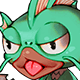
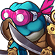
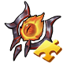
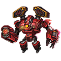

[← Team Expedition](../team-expedition.html)

# Sea train

A ghost train suddenly appeared in the depths of Douhai

- Needs player level **90**.
- 3 difficulties (Easy, Normal, Hard), each with 2 stages.
- HP is shown for the stages where it has been recorded in real battles.

## Easy

### Sea Train 1

- Defeat all monsters
- Lose: Allied Team Annihilated Number of Turns >40
- Recommended BP: **2,141,336** · 4 normal, 1 elite monster(s)

**Monsters:**  Murloc pitcher ·  Tortoise Gunner

**HP:** not recorded yet

**Drops:**

| Item | Number | Probability |
|---|---|---|
|  Coin | 20,000 | 21.05% |
|  Coin | 10,000 | 31.58% |
|  Coin | 5,000 | 10.53% |
|  Coin | 15,000 | 36.84% |

### Sea Train 2

- Defeat all monsters
- Lose: Allied Team Annihilated Number of Turns >40
- Recommended BP: **2,206,023** · 3 normal monster(s)

**Monsters:**  Murloc pitcher ·  Crocodile Warrior

**HP:** not recorded yet

**Drops:**

| Item | Number | Probability |
|---|---|---|
|  Sigil 2 | 1 - 2 | 2.61% |
|  Inscription Catalyst | 1 - 3 | 3.48% |
|  Fang Bracer | 1 | 0.52% |
|  Monitor | 1 | 0.52% |
|  Red Magic Stone | 1 | 1.31% |
|  Potential Gem | 3 - 1 | 2.61% |
|  Advanced Target | 2 - 3 | 1.74% |
|  Practice Fruit (S) | 2 | 3.14% |
|  Blue crystal | 2 | 2.61% |
|  Chicken Mines-Ocean Wave Duck Skin Shard | 1 - 2 | 1.74% |
|  Inferior Inscription Ink | 4 | 3.48% |
|  Refine Stone II | 1 - 2 | 2.61% |
|  Inscr. Crystal V | 1 | 0.35% |
|  Lv.4 Blessing Gem | 4 | 2.61% |
|  Marine Coral | 2 - 4 | 4.36% |
|  Colored crystal | 2 | 1.74% |
|  APT Pill II | 2 | 0.87% |
|  Raul Crystal Lv.2 | 2 - 4 | 4.36% |
|  Mount Coin | 1 - 2 | 1.74% |
|  Amethyst | 1 - 2 | 2.61% |
|  APT Pill | 2 - 3 | 2.61% |
|  SP Gacha | 1 - 2 | 3.48% |
|  Intricate Code Case | 1 - 2 | 0.87% |
|  Lucky Seal Shard | 1 | 1.31% |
|  Boomerang-Free Skin Shard | 1 | 1.31% |
|  Balrog Shard | 1 - 2 | 1.31% |
|  Lv.2 Orb Bag | 2 | 3.48% |
|  Bronze Medal | 1 | 1.31% |
|  Mech Wreck I | 1 | 1.74% |
|  Recast stone Pack | 1 | 3.05% |
|  Earth Materia Essence | 2 - 3 | 2.61% |
|  Basic Monster Crystal | 2 - 3 | 4.36% |
|  Advanced Monster Crystal | 1 - 2 | 2.61% |
|  Magic Adhesive | 1 - 2 | 3.48% |
|  Sand of time | 1 - 3 | 4.36% |
|  Seal Gem | 1 - 2 | 4.36% |
|  Apple | 1 - 2 | 3.48% |
|  Ambush Master Chapter Shard | 1 - 2 | 2.61% |
|  Transparent Shield Chapter Shard | 1 - 2 | 3.48% |
|  Ordinary Magic Carving Knife | 1 - 3 | 1.74% |
|  Resilience Seal Shard | 1 | 0.70% |
|  Endurance Seal Shard | 1 | 0.70% |

## Normal

### Sea Train 1

- Defeat all monsters
- Lose: Allied Team Annihilated Number of Turns >40
- Recommended BP: **2,270,709** · 4 normal, 1 elite monster(s)

**Monsters:**  Murloc pitcher ·  Siren Girl · organ

**HP:** not recorded yet

**Drops:**

| Item | Number | Probability |
|---|---|---|
|  Coin | 10,000 | 35.00% |
|  Coin | 8,000 | 20.00% |
|  Coin | 15,000 | 35.00% |
|  Coin | 20,000 | 10.00% |

### Sea Train 2

- Defeat all monsters
- Lose: Allied Team Annihilated Number of Turns >40
- Recommended BP: **2,335,396** · 3 normal monster(s)

**Monsters:**  Tortoise Gunner ·  Ninja Turtles ·  Ninja Turtles (Clone)

**HP:** not recorded yet

**Drops:**

| Item | Number | Probability |
|---|---|---|
|  Teck.1 Booster | 1 | 0.35% |
|  Epic Code Case | 1 | 0.87% |
|  Primal Force | 1 | 0.52% |
|  Troll Eye Blueprint | 1 | 0.87% |
|  Meridian Blueprint | 3 - 1 | 2.60% |
|  Upgrade Stone | 2 | 2.60% |
|  Normal Inscription Ink | 1 - 2 | 2.60% |
|  SP Gacha | 1 - 2 | 1.74% |
|  Potential Gem | 2 - 3 | 2.60% |
|  Lucky Seal Shard | 1 | 1.74% |
|  Luckbringer Shard | 2 | 2.60% |
|  Practice Fruit (S) | 1 - 3 | 2.60% |
|  Lv.4 Blessing Gem | 2 - 3 | 2.60% |
|  Lv.5 Blessing Gem | 1 - 2 | 1.74% |
|  Refine Stone I | 2 | 2.60% |
|  Alloy Back Armor | 1 | 0.87% |
|  Raul Crystal Lv.2 | 2 - 3 | 2.60% |
|  Mech Wreck I | 1 - 3 | 2.60% |
|  Discrete Inscription | 1 - 2 | 1.74% |
|  Refine Stone III | 2 | 2.60% |
|  Inscr. Crystal V | 1 | 0.35% |
|  Amethyst | 2 | 2.60% |
|  Inscription Soul | 1 - 2 | 2.60% |
|  Ordinary Magic Carving Knife | 1 - 3 | 2.60% |
|  Boomerang-Free Skin Shard | 1 - 2 | 0.87% |
|  Trainee Medal | 1 - 2 | 1.56% |
|  Rider Tome | 1 - 3 | 2.60% |
|  Crystal ball | 1 - 2 | 2.60% |
|  Legendry Stone | 1 - 3 | 1.74% |
|  Recast stone Pack | 1 | 3.04% |
|  Mech Wreck II | 1 - 2 | 1.74% |
|  Earth Materia Essence | 2 - 3 | 2.60% |
|  Basic Monster Crystal | 2 - 5 | 2.60% |
|  Advanced Monster Crystal | 2 - 3 | 2.60% |
|  Rare Monster Crystal | 1 | 1.74% |
|  Magic Adhesive | 1 - 3 | 3.04% |
|  Sand of time | 2 - 3 | 3.47% |
|  Seal Gem | 2 - 3 | 3.47% |
|  Transparent Shield Chapter Shard | 1 - 2 | 3.47% |
|  Satellite Tracking Chapter Shard | 1 - 2 | 3.47% |
|  Raul Crystal Lv.3 | 1 - 3 | 2.60% |
|  Lv.2 Orb Bag | 1 - 3 | 2.60% |
|  Red Magic Stone | 1 | 2.60% |
|  Hammer of Artificer | 1 - 3 | 2.60% |
|  Resilience Seal Shard | 1 | 0.87% |
|  DMG- Seal Shard | 1 | 0.87% |

## Hard

### Sea Train 1

- Defeat all monsters
- Lose: Allied Team Annihilated Number of Turns >40
- Recommended BP: **2,400,083** · 4 normal, 1 elite monster(s)

**Monsters:**  Murloc pitcher ·  Tortoise Gunner ·  Queen of Shells

**HP:** not recorded yet

**Drops:**

| Item | Number | Probability |
|---|---|---|
|  Coin | 15,000 | 35.00% |
|  Coin | 10,000 | 20.00% |
|  Coin | 20,000 | 35.00% |
|  Coin | 25,000 | 10.00% |

### Sea Train 2

- Defeat all monsters
- Lose: Allied Team Annihilated Number of Turns >40
- Recommended BP: **2,464,769** · 3 normal monster(s)

**Monsters:**  Captain Crocodile ·  Crocodile Warrior · The weather ·  Efreet

**HP:** not recorded yet

**Drops:**

| Item | Number | Probability |
|---|---|---|
|  Jade Kirin | 1 | 0.10% |
|  Immortality Blueprint | 1 | 0.10% |
|  Troll Sting Blueprint | 1 - 2 | 0.95% |
|  Legend Code Case | 1 | 0.95% |
|  Lost Mech Helmet | 1 | 0.48% |
|  Wraith: Skeleton Scale | 1 | 0.10% |
|  Red Magic Stone | 1 - 2 | 2.86% |
|  Crystal Identification Scroll | 1 - 3 | 2.86% |
|  Fang Bracer | 1 | 0.48% |
|  Exquisite Inscription Ink | 1 - 2 | 1.91% |
|  Ticket: Maze Zen House | 1 | 1.91% |
|  Ticket: Lost City | 1 | 1.91% |
|  Satellite Tracking Chapter Shard | 1 - 3 | 2.86% |
|  Meridian Blueprint | 1 - 3 | 2.86% |
|  Skin Shards Selection Chest 1 | 1 - 2 | 1.91% |
|  Aurora Plume | 1 - 2 | 1.43% |
|  Lv.4 Blessing Gem | 2 - 3 | 2.86% |
|  Lv.5 Blessing Gem | 2 | 2.86% |
|  Exquisite Inscription Ink | 1 - 3 | 1.91% |
|  Boomerang-Free Skin Shard | 1 - 2 | 1.91% |
|  Discrete Inscription | 1 - 2 | 1.91% |
|  Omni Skin Shard | 1 | 0.95% |
|  Mount Coin | 1 - 2 | 2.86% |
|  Inscription Catalyst | 1 - 4 | 2.86% |
|  Recast stone Pack | 1 | 3.82% |
|  Earth Materia Essence | 2 | 2.86% |
|  Advanced Monster Crystal | 2 - 3 | 3.82% |
|  Rare Monster Crystal | 1 - 2 | 1.91% |
|  Magic Adhesive | 1 - 3 | 3.82% |
|  Sand of time | 2 - 4 | 4.77% |
|  Raul Crystal Lv.3 | 1 - 3 | 3.82% |
|  Legendary Monster Crystal | 1 | 0.76% |
|  Seal crystal | 1 - 3 | 1.91% |
|  Splendid Medal | 1 | 1.43% |
|  Mech Wreck II | 1 - 2 | 2.39% |
|  Mech Wreck III | 1 | 1.43% |
|  Hammer of Artificer | 1 - 3 | 2.86% |
|  Clear Ticket | 2 - 3 | 4.29% |
|  Potential Gem | 1 - 3 | 3.82% |
|  Inscr. Crystal VI | 1 | 0.19% |
|  Enhancer Needle | 1 - 2 | 1.91% |
|  Super-Heavy Ammo Chapter Shard | 1 | 1.91% |
|  Reprisal Chapter Shard | 1 | 1.91% |
|  Crystal ball | 1 | 2.86% |
|  Anti-riot Seal Shard | 1 | 0.95% |
|  Exquisite Magic Carving Knife | 1 | 2.86% |
|  DMG- Seal Shard | 1 | 0.95% |
|  DMG+ Seal Shard | 1 | 0.95% |

