[← Team Expedition](../team-expedition.html)

# Sea Vortex

A mysterious whirlpool has suddenly appeared at sea, cutting off the sailing routes between two continents. Go there to investigate.

- Needs player level **56**.
- 3 difficulties (Easy, Normal, Hard), each with 2 stages.
- HP is shown for the stages where it has been recorded in real battles.

## Easy

### Sea Vortex -1

- Defeat all monsters
- Lose: Allied Team Annihilated Number of Turns >40
- Recommended BP: **341,057** · 6 normal, 2 elite monster(s)

**Monsters:** 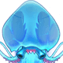 Thund. Jellies · Light. Jellies · Elect. Jellies

**HP:** not recorded yet

**Drops:**

| Item | Number | Probability |
|---|---|---|
|  Coin | 10,000 | 25.00% |
|  Coin | 8,000 | 30.00% |
|  Coin | 5,000 | 10.00% |
|  Coin | 6,000 | 35.00% |

### Sea Vortex -2

- Defeat all monsters
- Lose: Allied Team Annihilated Number of Turns >40
- Recommended BP: **348,419** · 5 normal, 1 elite, 1 boss monster(s)

**Monsters:**  Cambarus

**HP:** not recorded yet

**Drops:**

| Item | Number | Probability |
|---|---|---|
|  Bronze Medal | 1 - 2 | 2.57% |
| 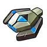 Mech Wreck I | 1 - 2 | 3.43% |
|  Amethyst | 1 - 3 | 2.57% |
|  Scythe - Night Rose Skin Shard | 1 | 1.72% |
| 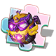 Chicken Mines-Ocean Wave Duck Skin Shard | 1 | 1.72% |
|  Mount Coin | 1 - 2 | 2.57% |
| 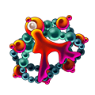 Coral Bracer | 1 | 2.57% |
|  Jellyfish Ring | 1 | 1.72% |
|  Refine Stone III | 2 | 3.43% |
|  Magic Stone III | 1 - 2 | 6.86% |
|  Advanced Target | 2 | 2.57% |
|  Upgrade Stone | 1 - 2 | 6.52% |
|  Blue crystal | 2 | 2.57% |
| 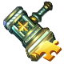 Holy Hammer Shard | 2 | 3.43% |
|  Refine Stone I | 2 | 4.29% |
|  Refine Stone II | 4 | 2.57% |
|  Lv.3 Blessing Gem | 3 - 4 | 6.00% |
|  Lv.4 Blessing Gem | 1 - 3 | 2.57% |
|  Skill Book III | 1 - 2 | 0.69% |
|  Pet Manual | 3 - 4 | 3.43% |
|  Colored crystal | 1 | 1.29% |
|  APT Pill II | 1 - 3 | 0.86% |
| 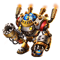 Raul Crystal Lv.2 | 2 - 4 | 6.86% |
|  Flame Plume | 1 - 3 | 3.77% |
|  APT Pill | 1 - 3 | 2.57% |
|  SP Gacha | 1 - 2 | 3.43% |
|  Intricate Code Case | 1 | 0.69% |
|  Scythe - Night Rose Skin Shard | 1 | 1.29% |
|  Lv.1 Orb Bag | 2 - 3 | 5.15% |
|  Down Plume | 2 - 3 | 1.29% |
|  Rider Tome | 1 - 3 | 2.57% |
|  Sigil 2 | 1 - 2 | 2.57% |
|  Clear Ticket | 1 - 2 | 3.86% |

## Normal

### Sea Vortex -1

- Defeat Hermit Crab King
- Lose: Allied Team Annihilated Number of Turns >40
- Recommended BP: **385,289** · 6 normal, 2 elite monster(s)

**Monsters:** 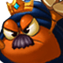 Hermit Crab King · Hermit Crab

**HP:** not recorded yet

**Drops:**

| Item | Number | Probability |
|---|---|---|
|  Coin | 10,000 | 35.00% |
|  Coin | 8,000 | 20.00% |
|  Coin | 15,000 | 35.00% |
|  Coin | 20,000 | 10.00% |

### Sea Vortex -2

- Defeat the Multi-eyed Central Eye
- Lose: Allied Team Annihilated Number of Turns >40
- Recommended BP: **392,653** · 5 normal, 1 elite, 1 boss monster(s)

**Monsters:**  The Multi-eyed

**HP:** not recorded yet

**Drops:**

| Item | Number | Probability |
|---|---|---|
| 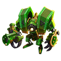 Alloy Helmet | 1 | 0.38% |
|  Mech Wreck I | 1 - 2 | 2.85% |
|  Epic Code Case | 1 | 0.67% |
|  Trainee Medal | 1 - 2 | 1.90% |
|  Chicken Mines-Ocean Wave Duck Skin Shard | 1 | 1.90% |
|  Skill Book III | 2 - 3 | 1.90% |
|  Coral Bracer | 1 | 1.90% |
|  Wild Ring | 1 | 0.48% |
|  Cloud Bangle | 1 | 1.90% |
| 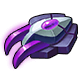 Mech Wreck II | 1 | 2.38% |
|  Scythe - Night Rose Skin Shard | 1 | 1.43% |
|  Splendid Medal | 1 | 1.24% |
|  SP Gacha | 1 - 2 | 1.90% |
|  Down Plume | 2 - 3 | 4.76% |
| 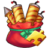 Luckbringer Shard | 2 | 5.71% |
|  Holy Hammer Shard | 2 | 4.76% |
|  Flame Plume | 1 - 3 | 2.85% |
|  Lv.4 Blessing Gem | 1 - 3 | 5.71% |
|  Lv.5 Blessing Gem | 1 - 2 | 3.33% |
|  Clear Ticket | 1 - 2 | 4.28% |
|  Phoebe | 1 - 2 | 3.81% |
|  Raul Crystal Lv.2 | 2 - 3 | 5.71% |
|  Upgrade Stone | 1 - 2 | 4.76% |
|  Refine Stone II | 2 | 3.04% |
|  Refine Stone III | 2 | 3.81% |
|  Advanced Target | 1 - 2 | 4.76% |
|  Amethyst | 2 | 2.85% |
|  Magic Stone III | 1 - 2 | 2.85% |
|  Intricate Code Case | 1 | 0.95% |
| 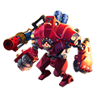 Raul Crystal Lv.1 | 2 - 3 | 7.61% |
|  Sigil 2 | 1 - 3 | 1.90% |
|  Rider Tome | 1 - 3 | 2.85% |
|  Lv.2 Orb Bag | 1 - 3 | 2.85% |

## Hard

### Sea Vortex -1

- Defeat Hermit Crab King
- Lose: Allied Team Annihilated Number of Turns >40
- Recommended BP: **445,864** · 6 normal, 2 elite monster(s)

**Monsters:**  Hermit Crab King · Hermit Crab

**HP:** not recorded yet

**Drops:**

| Item | Number | Probability |
|---|---|---|
|  Coin | 15,000 | 35.00% |
|  Coin | 10,000 | 20.00% |
|  Coin | 20,000 | 35.00% |
|  Coin | 25,000 | 10.00% |

### Sea Vortex -2

- Defeat Siren
- Lose: Allied Team Annihilated Number of Turns >40
- Recommended BP: **454,069** · 5 normal, 1 elite, 1 boss monster(s)

**Monsters:**  Siren

**HP:** not recorded yet

**Drops:**

| Item | Number | Probability |
|---|---|---|
|  Legend Code Case | 1 | 0.57% |
| 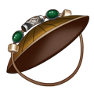 Bamboo Hat | 1 | 0.57% |
|  Wraith: Shadowgourd | 1 | 0.23% |
|  Scythe - Night Rose Skin Shard | 1 - 2 | 1.72% |
|  Chicken Mines-Ocean Wave Duck Skin Shard | 1 - 2 | 1.72% |
|  Splendid Medal | 1 - 2 | 1.72% |
|  Memorial Medal | 1 | 0.92% |
| 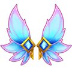 Love Wings | 1 | 0.17% |
|  Love Letter | 1 | 1.38% |
|  Mech Wreck II | 1 - 2 | 1.72% |
|  Ticket: Devil's House | 1 | 1.72% |
|  Ticket: Dragon Lair | 1 | 1.38% |
|  Coral Bracer | 1 | 1.15% |
| 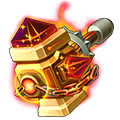 Epic Forge Hammer | 1 | 1.15% |
|  Upgrade Stone | 1 - 2 | 5.74% |
|  Luckbringer Shard | 1 - 2 | 3.45% |
|  Magic Stone III | 1 - 2 | 4.60% |
|  Skill Page | 1 | 2.30% |
|  Down Plume | 2 - 3 | 6.89% |
|  SP Gacha | 1 - 2 | 3.45% |
|  Aurora Plume | 1 | 2.30% |
|  Lv.4 Blessing Gem | 2 - 3 | 4.60% |
|  Lv.5 Blessing Gem | 1 - 2 | 2.30% |
|  Holy Hammer Shard | 2 | 5.74% |
|  Refine Stone II | 1 - 3 | 4.60% |
|  Refine Stone III | 1 - 2 | 4.60% |
|  Refine Stone IV | 1 - 2 | 2.30% |
|  Clear Ticket | 1 - 2 | 4.60% |
|  Lv.2 Orb Bag | 1 - 2 | 5.74% |
| 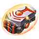 Mech Wreck III | 1 | 1.72% |
|  Sigil 2 | 1 - 3 | 3.45% |
|  Rider Tome | 1 - 3 | 6.32% |
|  Raul Crystal Lv.3 | 1 - 3 | 5.74% |
| 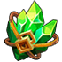 Seal crystal | 1 | 3.45% |

