[← Team Expedition](../team-expedition.html)

# Shadowy Domain

Dark forces kept invading the Darkest Realm

- Needs player level **85**.
- 3 difficulties (Easy, Normal, Hard), each with 2 stages.
- HP is shown for the stages where it has been recorded in real battles.

## Easy

### Shadowy Domain 1

- Defeat all monsters
- Lose: Allied Team Annihilated Number of Turns >40
- Recommended BP: **1,795,487** · 2 normal, 2 elite monster(s)

**Monsters:**  Dark Crow

**HP:** not recorded yet

**Drops:**

| Item | Number | Probability |
|---|---|---|
| 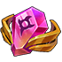 Legendry Stone | 2 | 2.62% |
|  Inscription Catalyst | 1 - 3 | 3.49% |
| 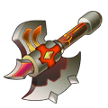 Warcry | 1 | 0.52% |
|  Monitor | 1 | 0.52% |
|  Red Magic Stone | 1 - 2 | 1.75% |
|  Magic Stone IV | 2 - 3 | 2.62% |
| 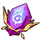 Discrete Inscription | 2 | 2.62% |
| 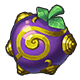 Practice Fruit (S) | 2 | 2.62% |
|  Blue crystal | 1 - 2 | 2.62% |
|  Moon Shard | 2 | 3.49% |
|  Inferior Inscription Ink | 2 - 4 | 3.49% |
|  Refine Stone II | 1 - 2 | 2.62% |
|  Inscr. Crystal IV | 1 | 0.35% |
|  Lv.5 Blessing Gem | 2 - 3 | 2.62% |
| 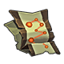 Meridian Blueprint | 2 - 3 | 2.62% |
| 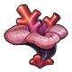 Marine Coral | 2 - 4 | 4.36% |
|  APT Pill II | 2 | 1.75% |
|  Raul Crystal Lv.3 | 2 - 4 | 4.36% |
|  Mount Coin | 1 - 2 | 1.75% |
|  Amethyst | 1 - 3 | 2.62% |
|  Aurora Plume | 1 | 2.62% |
|  SP Gacha | 1 - 2 | 3.49% |
|  Intricate Code Case | 1 - 2 | 0.87% |
|  Power Seal Shard | 1 | 1.75% |
| 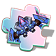 Boomerang-Free Skin Shard | 1 | 1.31% |
| 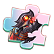 Hell-Decimated Skin Shard | 1 - 2 | 3.49% |
|  Bronze Medal | 1 | 1.31% |
|  Mech Wreck I | 1 - 2 | 2.62% |
|  Green Recast Gem | 2 - 3 | 2.62% |
|  Wind Materia Essence | 2 - 3 | 2.62% |
|  Basic Monster Crystal | 3 - 4 | 3.49% |
|  Advanced Monster Crystal | 1 - 2 | 2.62% |
| 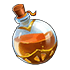 Magic Adhesive | 1 - 2 | 2.62% |
|  Sand of time | 1 - 3 | 4.36% |
| 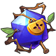 Seal Gem | 2 - 3 | 3.49% |
|  Silver | 1 - 2 | 3.49% |
| 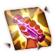 Stimulant Chapter Shard | 1 - 2 | 2.62% |
|  Gunslinger Chapter Shard | 1 - 2 | 2.62% |
| 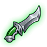 Ordinary Magic Carving Knife | 2 - 3 | 2.62% |

### Shadowy Domain 2

- Defeat all monsters
- Lose: Allied Team Annihilated Number of Turns >40
- Recommended BP: **1,821,876** · 4 elite monster(s)

**Monsters:**  Toxin Dragon · 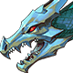 Ice Dragon

**HP:** not recorded yet

**Drops:**

| Item | Number | Probability |
|---|---|---|
|  Legendry Stone | 2 | 2.61% |
|  Inscription Catalyst | 1 - 3 | 3.48% |
|  Warcry | 1 | 0.52% |
|  Monitor | 1 | 0.52% |
|  Red Magic Stone | 1 - 2 | 1.74% |
|  Magic Stone IV | 2 - 3 | 2.61% |
|  Discrete Inscription | 2 | 2.61% |
|  Practice Fruit (S) | 2 | 2.61% |
|  Blue crystal | 1 - 2 | 2.61% |
|  Moon Shard | 2 | 3.48% |
|  Inferior Inscription Ink | 2 - 4 | 3.48% |
|  Refine Stone II | 1 - 2 | 2.61% |
|  Inscr. Crystal IV | 1 | 0.35% |
|  Lv.5 Blessing Gem | 2 - 3 | 2.61% |
|  Meridian Blueprint | 2 - 3 | 2.61% |
|  Marine Coral | 2 - 4 | 4.34% |
|  APT Pill II | 2 | 1.74% |
|  Raul Crystal Lv.3 | 2 - 4 | 4.34% |
|  Mount Coin | 1 - 2 | 1.74% |
|  Amethyst | 1 - 3 | 2.61% |
|  Aurora Plume | 1 | 2.61% |
|  SP Gacha | 1 - 2 | 3.48% |
|  Intricate Code Case | 1 - 2 | 0.87% |
|  Power Seal Shard | 1 | 1.74% |
|  Boomerang-Free Skin Shard | 1 | 1.30% |
|  Hell-Decimated Skin Shard | 1 - 2 | 3.48% |
|  Bronze Medal | 1 | 1.30% |
|  Mech Wreck I | 1 - 2 | 2.61% |
| 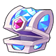 Recast stone Pack | 1 | 3.04% |
|  Wind Materia Essence | 2 - 3 | 2.61% |
|  Basic Monster Crystal | 3 - 4 | 3.48% |
|  Advanced Monster Crystal | 1 - 2 | 2.61% |
|  Magic Adhesive | 1 - 2 | 2.61% |
|  Sand of time | 1 - 3 | 4.34% |
|  Seal Gem | 2 - 3 | 3.48% |
|  Silver | 1 - 2 | 3.48% |
|  Stimulant Chapter Shard | 1 - 2 | 2.61% |
|  Gunslinger Chapter Shard | 1 - 2 | 2.61% |
|  Ordinary Magic Carving Knife | 2 - 3 | 2.61% |

## Normal

### Shadowy Domain 1

- Defeat all monsters
- Lose: Allied Team Annihilated Number of Turns >40
- Recommended BP: **1,841,876** · 2 normal, 2 elite monster(s)

**Monsters:**  Toxin Dragon ·  Ice Dragon

**HP:** not recorded yet

**Drops:**

| Item | Number | Probability |
|---|---|---|
|  Coin | 10,000 | 35.00% |
|  Coin | 8,000 | 20.00% |
|  Coin | 15,000 | 35.00% |
|  Coin | 20,000 | 10.00% |

### Shadowy Domain 2

- Defeat all monsters
- Lose: Allied Team Annihilated Number of Turns >40
- Recommended BP: **1,876,424** · 4 elite monster(s)

**Monsters:**  Lava Dragon ·  Holy Dragon

**HP:** not recorded yet

**Drops:**

| Item | Number | Probability |
|---|---|---|
|  Sigil 3 | 1 - 2 | 2.67% |
|  Epic Code Case | 1 | 0.89% |
| 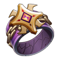 Primal Force | 1 | 0.71% |
| 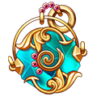 Glory Bead | 1 | 0.89% |
|  Magic Stone IV | 2 - 3 | 2.67% |
|  Upgrade Stone | 2 - 3 | 2.67% |
|  Normal Inscription Ink | 1 - 2 | 2.67% |
|  SP Gacha | 1 - 2 | 1.78% |
|  APT Pill | 2 - 3 | 2.67% |
|  Power Seal Shard | 1 | 1.78% |
|  Moon Shard | 2 | 2.67% |
|  Recast stone Pack | 1 | 3.12% |
|  Lv.4 Blessing Gem | 2 - 4 | 2.67% |
|  Lv.5 Blessing Gem | 2 | 2.67% |
|  Potential Gem | 2 - 3 | 2.67% |
|  Booster | 1 | 0.62% |
|  Raul Crystal Lv.2 | 2 - 4 | 3.57% |
|  Mech Wreck I | 1 - 2 | 2.67% |
|  Discrete Inscription | 1 - 2 | 1.78% |
|  Refine Stone III | 2 | 2.67% |
|  Inscr. Crystal IV | 1 | 0.36% |
|  Amethyst | 2 | 2.67% |
|  Inscription Soul | 1 - 2 | 2.67% |
|  Ordinary Magic Carving Knife | 1 - 3 | 3.57% |
|  Hell-Decimated Skin Shard | 1 - 2 | 0.89% |
|  Trainee Medal | 1 - 2 | 1.60% |
|  Rider Tome | 2 - 3 | 2.67% |
|  Paper crane | 2 - 3 | 3.57% |
|  Legendry Stone | 2 - 3 | 1.78% |
|  Boomerang-Free Skin Shard | 1 - 2 | 1.34% |
|  Mech Wreck II | 1 - 2 | 1.34% |
|  Wind Materia Essence | 2 - 3 | 2.67% |
|  Basic Monster Crystal | 2 - 4 | 3.57% |
|  Advanced Monster Crystal | 2 - 3 | 2.67% |
| 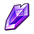 Rare Monster Crystal | 1 - 2 | 1.78% |
|  Magic Adhesive | 2 - 3 | 2.67% |
|  Sand of time | 2 - 4 | 3.57% |
|  Seal Gem | 2 - 4 | 3.57% |
|  Ambush Master Chapter Shard | 1 | 3.57% |
|  Gunslinger Chapter Shard | 1 | 3.57% |
|  Red Magic Stone | 1 - 2 | 2.67% |
| 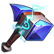 Hammer of Artificer | 1 - 3 | 2.67% |

## Hard

### Shadowy Domain 1

- Defeat all monsters
- Lose: Allied Team Annihilated Number of Turns >40
- Recommended BP: **2,048,569** · 2 normal, 2 elite monster(s)

**Monsters:**  Black Archmage · Black Archmage Summonee

**HP:** not recorded yet

**Drops:**

| Item | Number | Probability |
|---|---|---|
|  Coin | 15,000 | 35.00% |
|  Coin | 10,000 | 20.00% |
|  Coin | 20,000 | 35.00% |
|  Coin | 25,000 | 10.00% |

### Shadowy Domain 2

- Defeat all monsters
- Lose: Allied Team Annihilated Number of Turns >40
- Recommended BP: **2,105,368** · 4 elite monster(s)

**Monsters:**  Viper Dragon (4 Emperor Dragons) ·  Ice Dragon (4 Emperor Dragons) ·  Flame Dragon (4 Emperor Dragons) ·  Holy Dragon (4 Emperor Dragons)

**HP:** not recorded yet

**Drops:**

| Item | Number | Probability |
|---|---|---|
|  Mutant Hippo | 1 | 0.10% |
|  Immortal Ring Blueprint | 1 | 0.10% |
|  Sigil 3 | 1 - 2 | 2.88% |
|  Legend Code Case | 1 | 0.96% |
|  Lost Mech Helmet | 1 | 0.48% |
| 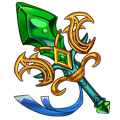 Wraith: Skeleton Scale | 1 | 0.10% |
|  Magic Stone IV | 2 - 3 | 3.84% |
|  Star stone | 1 - 3 | 1.92% |
|  Primal Force | 1 | 0.77% |
|  Exquisite Inscription Ink | 1 | 2.88% |
|  Ticket: Opera Phantom | 1 | 1.92% |
|  Ticket: Lost City | 1 | 1.92% |
| 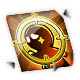 Satellite Tracking Chapter Shard | 1 - 2 | 2.88% |
|  Meridian Blueprint | 1 - 3 | 2.88% |
|  Troll Boomerang Shard | 2 | 1.92% |
|  Aurora Plume | 1 | 1.44% |
|  Recast stone Pack | 1 | 3.84% |
|  Lv.5 Blessing Gem | 1 | 1.92% |
|  Exquisite Inscription Ink | 1 - 3 | 0.96% |
|  Hell-Decimated Skin Shard | 1 - 2 | 1.44% |
|  Hell Shard | 1 - 2 | 1.44% |
|  Omni Skin Shard | 1 | 0.96% |
|  Mount Coin | 1 - 2 | 1.92% |
|  Inscription Catalyst | 2 - 3 | 1.92% |
|  Inscription Soul | 1 - 2 | 1.92% |
|  Ice Materia Essence | 2 | 2.88% |
|  Advanced Monster Crystal | 1 - 3 | 3.84% |
|  Rare Monster Crystal | 1 - 2 | 1.92% |
|  Clear Ticket | 1 - 3 | 4.31% |
|  Sand of time | 2 - 4 | 5.75% |
|  Raul Crystal Lv.3 | 2 - 3 | 3.84% |
|  Legendary Monster Crystal | 1 | 0.48% |
|  Seal crystal | 1 | 1.92% |
|  Splendid Medal | 1 | 1.92% |
|  Mech Wreck II | 1 - 2 | 1.92% |
|  Mech Wreck III | 1 | 1.44% |
|  Boomerang-Free Skin Shard | 1 - 2 | 1.44% |
|  Crystal Identification Scroll | 1 - 3 | 3.84% |
|  Discrete Inscription | 1 - 2 | 1.92% |
|  Potential Gem | 2 - 3 | 3.84% |
|  Inscr. Crystal V | 1 | 0.19% |
| 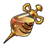 Enhancer Needle | 1 - 2 | 0.96% |
|  Safe Landing Chapter Shard | 1 - 2 | 3.84% |
|  Fortitude Chapter Shard | 1 | 3.84% |
|  Paper crane | 1 - 3 | 2.88% |
|  Power Seal Shard | 1 - 2 | 0.96% |
| 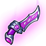 Exquisite Magic Carving Knife | 1 - 3 | 2.88% |

