[← Team Expedition](../team-expedition.html)

# Sky Battle

The Goblins will soon escape on their Goblin Airship. Stop them!

- Needs player level **42**.
- 3 difficulties (Easy, Normal, Hard), each with 2 stages.
- HP is shown for the stages where it has been recorded in real battles.

## Easy

### Sky Battle-1

- Defeat all monsters
- Lose: Allied Team Annihilated Number of Turns >40
- Recommended BP: **162,807** · 11 normal, 2 boss monster(s)

**Monsters:** Goblin Tank · Goblin Gunner · Goblin Slave

**HP:** not recorded yet

**Drops:**

| Item | Number | Probability |
|---|---|---|
|  Sigil 2 | 1 - 2 | 1.87% |
|  Skill Book III | 1 | 0.93% |
|  Mount Coin | 1 | 0.75% |
|  Sigil 1 | 1 - 3 | 3.73% |
|  Flame Bead | 1 | 1.87% |
| 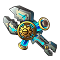 Wisdom Wrench | 1 | 1.87% |
| 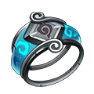 Cloud Bangle | 1 | 1.87% |
|  Skill Page | 1 | 1.87% |
|  Magic Stone III | 1 - 2 | 9.33% |
| 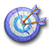 Advanced Target | 1 - 2 | 2.80% |
|  Upgrade Stone | 1 - 2 | 7.09% |
|  Normal Target | 2 - 3 | 4.66% |
| 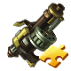 G Mage Gatling Shard | 1 | 7.46% |
| 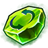 Refine Stone I | 2 | 7.46% |
| 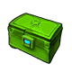 Normal Code Case | 1 | 0.93% |
| 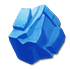 Lv.3 Blessing Gem | 2 - 4 | 5.60% |
| 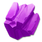 Lv.4 Blessing Gem | 2 - 3 | 2.80% |
|  Pet Manual | 4 | 3.73% |
| 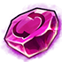 Refine Stone III | 2 | 2.80% |
|  Phoebe | 1 - 2 | 3.73% |
|  Hardness | 1 - 2 | 4.66% |
|  Blue crystal | 2 | 2.80% |
|  Refine Stone II | 2 - 4 | 3.73% |
|  APT Pill | 2 - 3 | 2.80% |
| 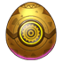 SP Gacha | 1 - 2 | 1.68% |
|  Candy Cannon Shard | 2 | 4.66% |
|  Vigor Pill (S) | 1 - 2 | 2.80% |
|  Down Plume | 1 - 2 | 3.73% |

### Sky Battle-2

- Destroy All Goblin Tanks
- Lose: Allied Team Annihilated Number of Turns >40
- Recommended BP: **164,655** · 4 normal, 1 elite, 1 boss monster(s)

**Monsters:** Goblin Tank ·  Goblin Aircraft

**HP:** not recorded yet

**Drops:**

| Item | Number | Probability |
|---|---|---|
|  Chicken Mines Shard | 1 - 2 | 1.77% |
|  Skill Book III | 1 | 0.88% |
|  Mount Coin | 1 | 0.71% |
|  Sigil 1 | 1 - 3 | 3.53% |
|  Flame Bead | 1 | 1.77% |
|  Wisdom Wrench | 1 | 1.77% |
|  Cloud Bangle | 1 | 1.77% |
|  Skill Page | 1 | 1.77% |
|  Magic Stone III | 1 - 2 | 8.83% |
|  Advanced Target | 1 - 2 | 2.65% |
|  Upgrade Stone | 1 - 2 | 6.71% |
|  Normal Target | 2 - 3 | 4.42% |
|  G Mage Gatling Shard | 1 | 7.07% |
|  Refine Stone I | 2 | 7.07% |
|  Normal Code Case | 1 | 0.88% |
|  Lv.3 Blessing Gem | 2 - 4 | 5.30% |
|  Lv.4 Blessing Gem | 2 - 3 | 2.65% |
|  Pet Manual | 4 | 3.53% |
|  Refine Stone III | 2 | 2.65% |
|  Phoebe | 1 - 2 | 3.53% |
|  Hardness | 1 - 2 | 4.42% |
|  Blue crystal | 2 | 2.65% |
|  Refine Stone II | 2 - 4 | 3.53% |
|  APT Pill | 2 - 3 | 2.65% |
|  SP Gacha | 1 - 2 | 1.59% |
|  Candy Cannon Shard | 2 | 4.42% |
|  Vigor Pill (S) | 1 - 2 | 2.65% |
|  Down Plume | 2 - 3 | 6.18% |
|  Flame Plume | 1 - 2 | 2.65% |

## Normal

### Sky Battle-1

- Defeat Goblin Aircraft
- Lose: Allied Team Annihilated Number of Turns >40
- Recommended BP: **182,651** · 11 normal, 2 boss monster(s)

**Monsters:**  Goblin Aircraft · Walking Bomb ·  Goblin Stomper ·  Goblin Doctor

**HP:** not recorded yet

**Drops:**

| Item | Number | Probability |
|---|---|---|
|  Coin | 10,000 | 35.00% |
|  Coin | 8,000 | 20.00% |
|  Coin | 15,000 | 35.00% |
|  Coin | 20,000 | 10.00% |

### Sky Battle-2

- Defeat Goblin Stomper
- Lose: Allied Team Annihilated Number of Turns >40
- Recommended BP: **184,732** · 4 normal, 1 elite, 1 boss monster(s)

**Monsters:**  Goblin Stomper ·  Goblin Doctor

**HP:** not recorded yet

**Drops:**

| Item | Number | Probability |
|---|---|---|
| 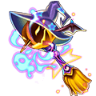 Wraith: Shadowgourd | 1 | 0.38% |
|  Skill Book III | 1 | 1.42% |
|  Normal Code Case | 1 | 1.13% |
|  Candy Cannon Shard | 1 - 2 | 2.83% |
|  Chicken Mines Shard | 1 - 2 | 1.89% |
|  Sigil 1 | 1 - 3 | 3.77% |
|  Flame Bead | 1 | 1.89% |
| 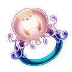 Jellyfish Ring | 1 | 1.89% |
|  Cloud Bangle | 1 | 2.83% |
| 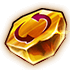 Refine Stone IV | 1 - 2 | 1.89% |
|  Upgrade Stone | 2 | 4.72% |
|  Down Plume | 2 - 3 | 4.72% |
|  SP Gacha | 1 - 2 | 1.89% |
|  APT Pill | 2 - 3 | 4.72% |
|  G Mage Gatling Shard | 1 | 7.55% |
|  Flame Plume | 1 - 3 | 2.83% |
| 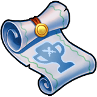 Clear Ticket | 1 - 2 | 4.25% |
|  Lv.4 Blessing Gem | 1 - 3 | 2.83% |
|  Refine Stone I | 2 | 1.89% |
|  Mount Coin | 1 | 0.94% |
|  Aurora Plume | 1 | 7.55% |
|  Pet Manual | 4 | 7.08% |
|  Refine Stone II | 2 | 3.02% |
|  Advanced Target | 1 - 2 | 5.19% |
|  Magic Stone III | 1 - 3 | 2.83% |
|  Phoebe | 1 - 2 | 3.77% |
|  Hardness | 2 | 3.77% |
|  Skill Page | 1 | 1.51% |
| 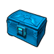 Intricate Code Case | 1 | 0.57% |
|  Vigor Pill (S) | 1 - 2 | 3.77% |
|  Rider Tome | 1 - 3 | 4.72% |

## Hard

### Sky Battle-1

- Defeat Goblin Doctor
- Lose: Allied Team Annihilated Number of Turns >40
- Recommended BP: **212,063** · 11 normal, 2 boss monster(s)

**Monsters:**  Goblin Doctor ·  Goblin Aircraft ·  Goblin Stomper

**HP:** not recorded yet

**Drops:**

| Item | Number | Probability |
|---|---|---|
|  Coin | 15,000 | 35.00% |
|  Coin | 10,000 | 20.00% |
|  Coin | 20,000 | 35.00% |
|  Coin | 25,000 | 10.00% |

### Sky Battle-2

- Defeat Goblin Doctor
- Lose: Allied Team Annihilated Number of Turns >40
- Recommended BP: **215,413** · 4 normal, 1 elite, 1 boss monster(s)

**Monsters:**  Goblin Doctor ·  Goblin Aircraft ·  Goblin Stomper · Walking Bomb

**HP:** not recorded yet

**Drops:**

| Item | Number | Probability |
|---|---|---|
|  Wraith: Shadowgourd | 1 | 0.21% |
| 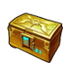 Legend Code Case | 1 | 0.52% |
| 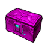 Epic Code Case | 1 | 0.52% |
|  Intricate Code Case | 1 | 0.52% |
| 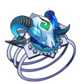 Wild Ring | 1 | 0.52% |
|  Chicken Mines Shard | 1 - 2 | 2.09% |
|  Sigil 1 | 1 - 3 | 4.18% |
|  Flame Bead | 1 | 2.61% |
|  Ticket: Devil's House | 1 | 1.04% |
| 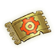 Ticket: City of Tech | 1 | 1.04% |
|  Cloud Bangle | 1 | 2.09% |
|  Skill Page | 1 | 1.57% |
|  Magic Stone III | 1 | 4.18% |
|  Upgrade Stone | 3 | 5.22% |
|  Pet Manual | 2 | 6.27% |
|  Down Plume | 2 - 3 | 8.36% |
|  G Mage Gatling Shard | 1 - 2 | 5.22% |
|  Aurora Plume | 1 | 1.57% |
|  Lv.4 Blessing Gem | 2 - 3 | 5.22% |
| 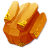 Lv.5 Blessing Gem | 2 | 3.13% |
|  Clear Ticket | 1 - 2 | 4.70% |
|  Refine Stone II | 2 - 3 | 3.13% |
|  Refine Stone III | 2 - 3 | 2.61% |
|  Refine Stone IV | 1 - 2 | 2.09% |
|  SP Gacha | 1 - 2 | 3.13% |
|  Advanced Target | 2 | 5.75% |
|  Lv.2 Orb Bag | 1 - 2 | 4.18% |
|  Rider Tome | 1 - 3 | 5.22% |
|  Mount Coin | 1 | 1.57% |
|  Skill Book III | 1 | 1.04% |
|  Amethyst | 1 | 3.13% |
|  Phoebe | 1 - 2 | 5.22% |
|  Candy Cannon Shard | 1 - 2 | 2.09% |

