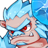
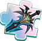

[← Team Expedition](../team-expedition.html)

# Snow Castle

- Needs player level **80**.
- 3 difficulties (Easy, Normal, Hard), each with 2 stages.
- HP is shown for the stages where it has been recorded in real battles.

## Easy

### Snow Castle 1

- Defeat all monsters
- Lose: Allied Team Annihilated Number of Turns >40
- Recommended BP: **1,274,951** · 2 elite monster(s)

**Monsters:**  Snow Field Guardian

**HP:** not recorded yet

**Drops:**

| Item | Number | Probability |
|---|---|---|
|  Coin | 20,000 | 21.05% |
|  Coin | 10,000 | 31.58% |
|  Coin | 5,000 | 10.53% |
|  Coin | 15,000 | 36.84% |

### Snow Castle 2

- Defeat all monsters
- Lose: Allied Team Annihilated Number of Turns >40
- Recommended BP: **1,274,951** · 1 elite, 1 boss monster(s)

**Monsters:**  Snowman Guard

**HP:** not recorded yet

**Drops:**

| Item | Number | Probability |
|---|---|---|
|  Legendry Stone | 2 | 1.77% |
|  Inscription Catalyst | 2 - 3 | 3.54% |
|  Warcry | 1 | 0.62% |
|  Monitor | 1 | 0.62% |
|  Red Magic Stone | 1 - 2 | 1.77% |
|  Magic Stone IV | 2 - 3 | 2.65% |
|  Discrete Inscription | 1 - 2 | 1.77% |
|  Practice Fruit (S) | 2 - 3 | 3.18% |
|  Blue crystal | 2 | 2.65% |
|  Devotion Shard | 2 | 3.54% |
|  Normal Inscription Ink | 2 | 3.54% |
|  Refine Stone II | 1 - 2 | 2.65% |
|  Inscr. Crystal IV | 1 | 0.35% |
|  Lv.4 Blessing Gem | 4 | 3.54% |
|  Potential Gem | 2 | 2.65% |
|  Crystal Identification Scroll | 2 | 1.33% |
|  APT Pill II | 2 | 0.88% |
|  Raul Crystal Lv.2 | 2 - 3 | 3.54% |
|  Mount Coin | 1 - 2 | 2.21% |
|  Amethyst | 1 - 2 | 2.65% |
|  Marine Coral | 2 - 4 | 4.42% |
|  Inscription Soul | 2 | 2.65% |
|  Intricate Code Case | 1 - 2 | 0.88% |
|  Eternal Winter Skin Shard | 1 - 2 | 1.59% |
|  Hell-Decimated Skin Shard | 1 - 2 | 1.59% |
|  Lv.2 Orb Bag | 2 - 3 | 3.54% |
|  Bronze Medal | 1 | 1.41% |
|  Mech Wreck I | 1 - 2 | 2.65% |
|  Recast stone Pack | 1 | 3.09% |
|  Ice Materia Essence | 2 - 3 | 2.65% |
|  Basic Monster Crystal | 2 - 4 | 4.42% |
|  Advanced Monster Crystal | 1 - 3 | 2.65% |
|  Magic Adhesive | 1 - 2 | 3.54% |
|  Sand of time | 2 - 3 | 4.42% |
|  Seal Gem | 1 - 2 | 4.42% |
|  Potential Needle | 1 - 3 | 3.54% |
|  Safe Landing Chapter Shard | 1 | 4.42% |
|  Gunslinger Chapter Shard | 1 | 2.65% |

## Normal

### Snow Castle 1

- Defeat all monsters
- Lose: Allied Team Annihilated Number of Turns >40
- Recommended BP: **1,404,183** · 2 elite monster(s)

**Monsters:**  Snowman Guard

**HP:** not recorded yet

**Drops:**

| Item | Number | Probability |
|---|---|---|
|  Coin | 10,000 | 35.00% |
|  Coin | 8,000 | 20.00% |
|  Coin | 15,000 | 35.00% |
|  Coin | 20,000 | 10.00% |

### Snow Castle 2

- Defeat all monsters
- Lose: Allied Team Annihilated Number of Turns >40
- Recommended BP: **1,404,183** · 1 elite, 1 boss monster(s)

**Monsters:**  Frozen Knight · Ice Sword

**HP:** not recorded yet

**Drops:**

| Item | Number | Probability |
|---|---|---|
|  Skill Book V | 1 | 2.13% |
|  Epic Code Case | 1 | 0.85% |
|  Fang Bracer | 1 | 0.43% |
|  Glory Bangle | 1 | 0.85% |
|  Magic Stone IV | 2 - 3 | 2.56% |
|  Inscription Soul | 1 - 2 | 2.56% |
|  Normal Inscription Ink | 1 - 2 | 2.56% |
|  SP Gacha | 1 - 2 | 1.70% |
|  APT Pill | 2 - 3 | 4.26% |
|  Earth's Core | 2 - 3 | 1.70% |
|  Luckbringer Shard | 2 | 2.56% |
|  Practice Fruit (S) | 2 - 3 | 2.56% |
|  Lv.4 Blessing Gem | 2 - 3 | 3.41% |
|  Lv.5 Blessing Gem | 2 | 1.70% |
|  Meridian Blueprint | 1 - 3 | 2.56% |
|  Alloy Frame | 1 | 0.68% |
|  Raul Crystal Lv.2 | 2 - 4 | 4.26% |
|  Mech Wreck I | 2 | 2.13% |
|  Discrete Inscription | 1 - 2 | 1.70% |
|  Refine Stone III | 2 | 2.56% |
|  Inscr. Crystal IV | 1 | 0.34% |
|  Amethyst | 2 | 2.56% |
|  Potential Gem | 2 - 3 | 2.56% |
|  Eternal Winter Skin Shard | 1 - 2 | 1.02% |
|  Hell-Decimated Skin Shard | 1 - 2 | 1.02% |
|  Trainee Medal | 1 - 2 | 1.53% |
|  Rider Tome | 1 - 3 | 2.56% |
|  Candy Cannon Shard | 2 - 3 | 2.98% |
|  Legendry Stone | 2 - 3 | 1.70% |
|  Recast stone Pack | 1 | 2.98% |
|  Mech Wreck II | 1 - 2 | 1.28% |
|  Ice Materia Essence | 2 - 3 | 2.56% |
|  Basic Monster Crystal | 2 - 5 | 4.26% |
|  Advanced Monster Crystal | 2 - 3 | 3.41% |
|  Rare Monster Crystal | 1 - 2 | 1.70% |
|  Magic Adhesive | 1 - 3 | 3.41% |
|  Sand of time | 2 - 4 | 4.26% |
|  Seal Gem | 2 - 4 | 4.26% |
|  Safe Landing Chapter Shard | 1 | 4.26% |
|  Gunslinger Chapter Shard | 1 | 2.56% |
|  Red Magic Stone | 1 | 2.56% |
|  Hammer of Artificer | 1 - 2 | 2.56% |

## Hard

### Snow Castle 1

- Defeat all monsters
- Lose: Allied Team Annihilated Number of Turns >40
- Recommended BP: **1,535,282** · 2 elite monster(s)

**Monsters:**  Snow Field Guardian ·  Snowman Guard

**HP:** not recorded yet

**Drops:**

| Item | Number | Probability |
|---|---|---|
|  Coin | 15,000 | 35.00% |
|  Coin | 10,000 | 20.00% |
|  Coin | 20,000 | 35.00% |
|  Coin | 25,000 | 10.00% |

### Snow Castle 2

- Defeat all monsters
- Lose: Allied Team Annihilated Number of Turns >40
- Recommended BP: **1,535,282** · 1 elite, 1 boss monster(s)

**Monsters:**  Ice Queen

**HP:** not recorded yet

**Drops:**

| Item | Number | Probability |
|---|---|---|
|  Crystal Pioneer | 1 | 0.10% |
|  Immortal Pendant Blueprint | 1 | 0.10% |
|  Sigil 3 | 1 - 2 | 1.52% |
|  Legend Code Case | 1 | 1.01% |
|  Teck.1 Energy Reactor | 1 | 0.30% |
|  Wraith: Skeleton Scale | 1 | 0.05% |
|  Crystal Identification Scroll | 1 - 3 | 4.05% |
|  Tusk Collar | 1 | 0.61% |
|  Primal Force | 1 | 0.61% |
|  Exquisite Inscription Ink | 1 - 2 | 3.04% |
|  Ticket: Devil's House | 1 | 1.22% |
|  Ticket: Opera Phantom | 1 | 1.52% |
|  Ticket: Lost City | 1 | 1.52% |
|  Transparent Shield Chapter Shard | 1 | 3.04% |
|  Skill Book V | 1 - 2 | 1.52% |
|  Troll Boomerang Shard | 1 | 2.03% |
|  Energy Reactor | 1 | 0.51% |
|  Lv.4 Blessing Gem | 2 | 3.04% |
|  Lv.5 Blessing Gem | 2 | 2.03% |
|  Meridian Blueprint | 1 - 3 | 3.04% |
|  Exquisite Inscription Ink | 1 - 2 | 1.01% |
|  Eternal Winter Skin Shard | 1 - 2 | 1.01% |
|  Hell Shard | 2 | 1.52% |
|  Omni Skin Shard | 1 | 0.71% |
|  Mount Coin | 1 - 2 | 2.03% |
|  Inscription Catalyst | 1 - 3 | 3.04% |
|  Clear Ticket | 1 - 2 | 4.56% |
|  Ice Materia Essence | 2 | 3.04% |
|  Advanced Monster Crystal | 1 - 2 | 4.56% |
|  Rare Monster Crystal | 1 | 2.03% |
|  Magic Adhesive | 1 | 5.07% |
|  Sand of time | 2 - 4 | 5.07% |
|  Discrete Inscription | 1 - 2 | 2.03% |
|  Love Letter | 1 | 1.52% |
|  Legendary Monster Crystal | 1 | 0.81% |
|  Seal crystal | 1 - 2 | 3.04% |
|  Splendid Medal | 1 | 1.52% |
|  Mech Wreck II | 1 | 2.03% |
|  Mech Wreck III | 1 | 1.52% |
|  Hell-Decimated Skin Shard | 1 | 1.52% |
|  Recast stone Pack | 1 | 3.55% |
|  Basic Monster Crystal | 2 - 4 | 4.05% |
|  Potential Gem | 1 - 2 | 4.05% |
|  Inscr. Crystal IV | 1 | 0.20% |
|  Enhancer Needle | 1 - 2 | 1.52% |
|  Gunslinger Chapter Shard | 1 | 4.05% |
|  Power Surge Chapter Shard | 1 | 4.05% |

