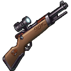
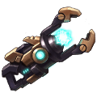
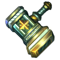
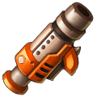
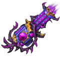

# Weapons

## How weapons work

- Every weapon is made from its own **shards**. Collect 20 shards to craft it (S0), then spend more shards to advance it, up to **S13**. Advancing costs only shards, no gold.
- The weapon gets a new look at S4 and S8, and its Ultimate gets stronger at S4, S8 and S12 (from S12 the Ultimate also gains an upgraded effect).
- Each weapon has an **Angle Range**: the angles you can aim it at in battle.
- At S13 a weapon can be crafted into an **Artifact** ([see below](#artifact)). Every advance also gives Fightwill for the **Horcrux** ([see below](#horcrux)).

### Advance cost (same for every weapon)

| Level | S0 | S1 | S2 | S3 | S4 | S5 | S6 | S7 | S8 | S9 | S10 | S11 | S12 | S13 | Total |
|---|---|---|---|---|---|---|---|---|---|---|---|---|---|---|---|
| Shards | 20 | 5 | 10 | 15 | 20 | 25 | 30 | 35 | 40 | 45 | 50 | 55 | 60 | 65 | **475** |

## All weapons

### Grade S

| | Weapon | Angle Range | Ultimate | Shards from | Artifact |
|---|---|---|---|---|---|
|  | [Efreet](weapons/efreet.html) | 50° - 80° | Nuclear Strike | Ladder Reward | G Efreet |
|  | [Hell](weapons/hell.html) | 20° - 55° | Power of Death | Event | G Hell |
|  | [Excalibur](weapons/excalibur.html) | 35° - 65° | Holy Jury | Event | G Emperor Sword |
|  | [Troll Boomerang](weapons/troll-boomerang.html) | 20° - 70° | Troll Bash | Event | G Troll Boomerang |
|  | [Balrog](weapons/balrog.html) | 20° - 70° | Burning in flames | Event | God Balrog |

### Grade A

| | Weapon | Angle Range | Ultimate | Shards from | Artifact |
|---|---|---|---|---|---|
|  | [Ion Cannon](weapons/ion-cannon.html) | 20° - 50° | Particle Seal | Team Expedition - Demon Forest Secret Merchant Quest Reward | G Ion Cannon |
|  | [Moon](weapons/moon.html) | 25° - 55° | Fireworks | Event Rewards | G Moon |
|  | [98K](weapons/98k.html) | 30° - 65° | Deadly Sniper | Event | G 98K |
|  | [Candy Cannon](weapons/candy-cannon.html) | 20° - 55° | Sugar Bomb | Event | G Candy Cannon |
|  | [Luckbringer](weapons/luckbringer.html) | 15° - 45° | Lucky Star | Event | G Luckbringer |
|  | [Thunder](weapons/thunder.html) | 25° - 55° | Thunder Jail | Event | G Thunder |
|  | [Torrent](weapons/torrent.html) | 20° - 50° | Bubble | Event | G Torrent |
|  | [Falcon](weapons/falcon.html) | 15° - 45° | Hawkeye | Event | G Falcon |
|  | [Devoted](weapons/devoted.html) | 30° - 58° | One Shot | Event | G Devotion |
|  | [Chicken Mines](weapons/chicken-mines.html) | 20° - 70° | Chicken God | Event | G Chicken Mines |

### Grade B

| | Weapon | Angle Range | Ultimate | Shards from | Artifact |
|---|---|---|---|---|---|
|  | [Holy Hammer](weapons/holy-hammer.html) | 20° - 50° | Purify Mind | 7 Day Party Gift Quest Reward | G Holy Hammer |
|  | [Grimm Gloves](weapons/grimm-gloves.html) | 20° - 50° | Heavy Punch | Free Arena Secret Merchant Quest Reward | G Grimm Gloves |
|  | [Aeolus Axe](weapons/aeolus-axe.html) | 30° - 60° | Windfury | Team Expedition - Forest Altar Secret Merchant Quest Reward | G Aeolus Axe |
|  | [Reaper Scythe](weapons/reaper-scythe.html) | 35° - 75° | Death Mark | Team Expedition - Dark Castle Secret Merchant Quest Reward | G Reaper Scythe |
|  | [G Mage Gatling](weapons/g-mage-gatling.html) | 35° - 65° | Gatling Gun | Rank Pack | G Mage Gatling |

### Grade C

| | Weapon | Angle Range | Ultimate | Shards from | Artifact |
|---|---|---|---|---|---|
|  | [Bazooka](weapons/bazooka.html) | 20° - 65° | Focus Attack | Team Expedition - Old Ruins Store Purchase Quest Reward | - |

## Angle and damage

- A weapon's Angle Range only limits where you can aim. **No weapon stat depends on the firing angle.**
- The angle bonus comes from the Inscription skill **High-Arc Thrower**: more damage for every degree of firing angle, +0.1% per degree up to 10% (level 1), +0.2% per degree up to 20% (level 2), +0.4% per degree up to 40% (level 3).
- **Efreet**'s 6th artifact slot raises its maximum angle: Max Weapon Shoot Angel +5, Throw DMG +30%; Max Weapon Shoot Angel +10, Throw DMG +40%; Max Weapon Shoot Angel +20, Throw DMG +50%.

## Artifact (Craft Artifact)

- Artifact crafting unlocks at S13 weapons.
- Each Artifact has 6 talent slots, upgradeable 3 times each.
- Crafting consumes Weapon Shards and Artifact Essence.
- Fully upgrading all 6 talent slots to upgrade the Artifact to True God weapon.
- Found in the Smithy; unlocks at player level 45. Every weapon except Bazooka can become an Artifact.
- Maxing all 6 slots turns the weapon into its True God form (for example **G Holy Hammer**) with a new look and an **Artifact Skill** from slot 6.
-  **Artifact Essence**: Obtained via Daily Quest; can be used for Super Weapon Forge.

### Slot cost (same for every weapon)

Weapon shards + Artifact Essence for each slot level:

| Slot | Level 1 | Level 2 | Level 3 |
|---|---|---|---|
| 1 | 31 shards + 3,348 essence | 50 shards + 6,400 essence | 63 shards + 9,954 essence |
| 2 | 56 shards + 6,048 essence | 95 shards + 12,160 essence | 147 shards + 23,226 essence |
| 3 | 100 shards + 13,800 essence | 158 shards + 20,224 essence | 188 shards + 29,704 essence |
| 4 | 135 shards + 18,580 essence | 168 shards + 24,504 essence | 210 shards + 33,180 essence |
| 5 | 135 shards + 21,580 essence | 168 shards + 26,504 essence | 210 shards + 34,180 essence |
| 6 | 135 shards + 24,580 essence | 168 shards + 29,504 essence | 210 shards + 35,180 essence |

All 6 slots to level 3: **2,427 shards + 372,656 Artifact Essence** per weapon. Each weapon's slot stats are on its own page.

## Horcrux

- Advance a weapon once to get one Fightwill
- Spend Fightwill to upgrade Horcrux and gain stats boost.
- The Horcrux is shared by all your weapons. Fightwill to max it: **230**.

| Level | Fightwill | ATK | HP | DEF | Luck | Toughness | DMG+ | DMG- | AGI |
|---|---|---|---|---|---|---|---|---|---|
| 0 | - | 9 | 32 | 6 | - | - | - | - | - |
| 1 | 3 | 20 | 54 | 13 | - | - | - | - | - |
| 2 | 3 | 31 | 134 | 19 | - | - | - | - | - |
| 3 | 3 | 42 | 202 | 26 | - | - | - | - | - |
| 4 | 3 | 53 | 202 | 33 | - | - | - | - | - |
| 5 | 3 | 64 | 202 | 39 | - | - | - | - | - |
| 6 | 4 | 75 | 270 | 45 | 15 | - | 6 | - | - |
| 7 | 4 | 86 | 334 | 52 | 25 | - | 8 | - | - |
| 8 | 4 | 97 | 404 | 59 | 35 | - | 12 | - | - |
| 9 | 4 | 108 | 472 | 66 | 45 | - | 12 | - | - |
| 10 | 4 | 119 | 472 | 72 | 55 | - | 12 | - | - |
| 11 | 4 | 130 | 536 | 79 | 65 | - | 21 | - | - |
| 12 | 4 | 141 | 536 | 85 | 75 | 36 | 21 | 21 | 8 |
| 13 | 4 | 152 | 536 | 92 | 85 | 49 | 21 | 27 | 12 |
| 14 | 4 | 163 | 536 | 98 | 95 | 62 | 21 | 33 | 17 |
| 15 | 4 | 174 | 604 | 105 | 105 | 75 | 24 | 39 | 25 |
| 16 | 5 | 185 | 674 | 112 | 115 | 88 | 24 | 45 | 25 |
| 17 | 5 | 196 | 674 | 118 | 125 | 101 | 34 | 51 | 35 |
| 18 | 5 | 207 | 764 | 125 | 135 | 114 | 55 | 57 | 35 |
| 19 | 5 | 218 | 828 | 131 | 145 | 127 | 61 | 63 | 35 |
| 20 | 5 | 229 | 918 | 138 | 155 | 140 | 72 | 69 | 42 |
| 21 | 5 | 240 | 918 | 145 | 165 | 153 | 72 | 75 | 50 |
| 22 | 5 | 251 | 918 | 151 | 175 | 166 | 72 | 81 | 58 |
| 23 | 5 | 262 | 986 | 158 | 185 | 179 | 72 | 87 | 58 |
| 24 | 5 | 273 | 1,052 | 164 | 195 | 192 | 72 | 93 | 66 |
| 25 | 5 | 284 | 1,120 | 171 | 205 | 205 | 72 | 99 | 66 |
| 26 | 5 | 295 | 1,120 | 178 | 215 | 218 | 72 | 105 | 66 |
| 27 | 5 | 306 | 1,120 | 184 | 225 | 231 | 92 | 111 | 66 |
| 28 | 5 | 317 | 1,188 | 191 | 235 | 244 | 92 | 117 | 73 |
| 29 | 5 | 328 | 1,252 | 197 | 245 | 257 | 92 | 123 | 76 |
| 30 | 5 | 339 | 1,252 | 204 | 255 | 270 | 92 | 129 | 83 |
| 31 | 5 | 350 | 1,342 | 211 | 265 | 283 | 93 | 135 | 83 |
| 32 | 5 | 361 | 1,412 | 217 | 275 | 296 | 94 | 141 | 83 |
| 33 | 5 | 372 | 1,412 | 224 | 285 | 309 | 95 | 147 | 83 |
| 34 | 5 | 383 | 1,480 | 230 | 295 | 322 | 96 | 153 | 83 |
| 35 | 5 | 394 | 1,566 | 237 | 315 | 335 | 97 | 159 | 83 |
| 36 | 5 | 405 | 1,566 | 244 | 335 | 348 | 98 | 165 | 95 |
| 37 | 5 | 416 | 1,634 | 250 | 355 | 361 | 99 | 171 | 103 |
| 38 | 5 | 427 | 1,702 | 257 | 375 | 374 | 118 | 177 | 103 |
| 39 | 5 | 438 | 1,702 | 263 | 395 | 387 | 118 | 183 | 103 |
| 40 | 5 | 449 | 1,792 | 270 | 415 | 400 | 118 | 189 | 103 |
| 41 | 5 | 460 | 1,792 | 277 | 435 | 413 | 118 | 195 | 103 |
| 42 | 5 | 471 | 1,858 | 283 | 455 | 426 | 118 | 201 | 103 |
| 43 | 5 | 482 | 1,926 | 290 | 475 | 439 | 128 | 207 | 111 |
| 44 | 5 | 493 | 2,016 | 296 | 495 | 452 | 128 | 213 | 116 |
| 45 | 5 | 504 | 2,016 | 303 | 515 | 465 | 128 | 219 | 124 |
| 46 | 5 | 515 | 2,052 | 310 | 535 | 478 | 128 | 225 | 124 |
| 47 | 5 | 526 | 2,052 | 316 | 555 | 491 | 145 | 231 | 124 |
| 48 | 5 | 537 | 2,088 | 323 | 575 | 504 | 145 | 237 | 132 |
| 49 | 5 | 548 | 2,175 | 329 | 595 | 517 | 145 | 243 | 145 |
| 50 | 5 | 559 | 2,211 | 336 | 599 | 530 | 260 | 249 | 145 |

## Skins (Conjure Artifact)

- Conjure Rules:
- Requires a S13 weapon to unlock Conjure.
- Activate weapon skins using Skin Shards or Omni Skin Shards.
- Activated skins provide attribute bonuses and special effects.
- Advance skins to unlock phase effects.
- Higher-tier skins have up to 4 special effects.

| Skin | Weapon | Stats bonus | Activate | Each phase |
|---|---|---|---|---|
|  Quantum Destiny | [Ion Cannon](weapons/ion-cannon.html) | ATK +73, CRIT +48, DMG+ +45, Burst DMG+ +45 | 250 Ion-Quantum Destiny Skin Shard | 1,250 Ion-Quantum Destiny Skin Shard |
|  Scarlet Purgatory | [Hell](weapons/hell.html) | ATK +97, CRIT +48, DMG+ +42, Burst DMG+ +41 | 250 Hell-Scarlet Purgatory Skin Shard | 1,250 Hell-Scarlet Purgatory Skin Shard |
|  Shining Feather | [Troll Boomerang](weapons/troll-boomerang.html) | ATK +101, CRIT +42, DMG+ +43, Burst DMG+ +46 | 250 Boomerang-Shining Feather Skin Shard | 1,250 Boomerang-Shining Feather Skin Shard |
|  Ocean Wave Duck | [Chicken Mines](weapons/chicken-mines.html) | ATK +108, CRIT +49, DMG+ +47, Burst DMG+ +46 | 250 Chicken Mines-Ocean Wave Duck Skin Shard | 1,250 Chicken Mines-Ocean Wave Duck Skin Shard |
|  Pixel Sword | [Excalibur](weapons/excalibur.html) | ATK +111, CRIT +42, DMG+ +45, Burst DMG+ +41 | 300 Excalibur-Pixel Sword Skin Shard | 1,500 Excalibur-Pixel Sword Skin Shard |
|  Decimated | [Hell](weapons/hell.html) | ATK +111, CRIT +42, DMG+ +45, Burst DMG+ +41 | 300 Hell-Decimated Skin Shard | 1,500 Hell-Decimated Skin Shard |
|  Freed | [Troll Boomerang](weapons/troll-boomerang.html) | ATK +111, CRIT +42, DMG+ +45, Burst DMG+ +41 | 300 Boomerang-Free Skin Shard | 1,500 Boomerang-Free Skin Shard |
|  Dark night rose | [Reaper Scythe](weapons/reaper-scythe.html) | ATK +111, CRIT +42, DMG+ +45, Burst DMG+ +41 | 250 Scythe - Night Rose Skin Shard | 1,250 Scythe - Night Rose Skin Shard |
|  Starry Sky Invitation | [Torrent](weapons/torrent.html) | ATK +111, CRIT +42, DMG+ +45, Burst DMG+ +41 | 250 Torrent-Starry Sky Invitation Shards | 1,250 Torrent-Starry Sky Invitation Shards |
|  Fervent Blues | [Balrog](weapons/balrog.html) | ATK +111, CRIT +42, DMG+ +45, Burst DMG+ +41 | 250 Fervent Blues Skin Shard | 1,250 Fervent Blues Skin Shard |
|  Eternal Winter | [Excalibur](weapons/excalibur.html) | ATK +111, CRIT +42, DMG+ +45, Burst DMG+ +41 | 250 Eternal Winter Skin Shard | 1,250 Eternal Winter Skin Shard |
|  Star Whisper | [G Mage Gatling](weapons/g-mage-gatling.html) | ATK +111, CRIT +42, DMG+ +45, Burst DMG+ +41 | 250 G Mage Gatling - Star Whisper Shard | 1,250 G Mage Gatling - Star Whisper Shard |
