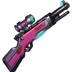
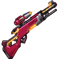
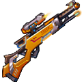

[← All weapons](../weapons.html)

# 98K

| S0 - S3 | S4 - S7 | S8 - S13 | Artifact |
|---|---|---|---|
|  |  |  |  |

The most wanted weapon everyone dreams of.

## Info

| Detail | Value |
|---|---|
| Grade | **A** |
| Angle Range | 30° - 65° |
| Ultimate |  Deadly Sniper |
| Shard |  98K Shard |
| Where to Get | Event |
| Artifact | Yes: becomes **G 98K** when all 6 slots are maxed ([how](../weapons.html#artifact)) |

## Ultimate: Deadly Sniper

Fires a highly penetrating bullet, dealing base damage. If it hits precisely, the damage increases significantly.

| Levels | Base DMG | Additional |
|---|---|---|
| S0 - S3 | 120% | If a precision hit is achieved, damage increases by 130%. |
| S4 - S7 | 130% | If a precision hit is achieved, damage increases by 150%. |
| S8 - S11 | 140% | If a precision hit is achieved, damage increases by 180%. |
| S12 - S13 | 150% | Guarantees 100% Crit for this attack; precision hits increase damage by 200%. |

## Stats by level

Shards: the 98K Shard needed to reach that level (S0 = crafting the weapon).

| Level | Shards | Total shards | Weapon DMG | ATK | CRIT | DMG+ | Burst DMG+ | BP |
|---|---|---|---|---|---|---|---|---|
| **S0** | 20 | 20 | 12 - 62 | - | 15 | 20 | - | 276 |
| **S1** | 5 | 25 | 34 - 94 | - | 26 | 35 | - | 439 |
| **S2** | 10 | 35 | 55 - 133 | - | 55 | 55 | - | 674 |
| **S3** | 15 | 50 | 67 - 157 | - | 75 | 72 | - | 837 |
| **S4** | 20 | 70 | 100 - 215 | - | 112 | 99 | - | 1,166 |
| **S5** | 25 | 95 | 117 - 268 | - | 161 | 104 | - | 1,438 |
| **S6** | 30 | 125 | 156 - 318 | - | 210 | 135 | - | 1,779 |
| **S7** | 35 | 160 | 187 - 393 | - | 269 | 174 | - | 2,239 |
| **S8** | 40 | 200 | 220 - 470 | - | 335 | 201 | - | 2,683 |
| **S9** | 45 | 245 | 255 - 613 | - | 359 | 235 | - | 3,262 |
| **S10** | 50 | 295 | 290 - 660 | - | 399 | 275 | - | 3,603 |
| **S11** | 55 | 350 | 440 - 787 | - | 445 | 315 | - | 4,196 |
| **S12** | 60 | 410 | 520 - 925 | - | 499 | 385 | - | 4,928 |
| **S13** | 65 | 475 | 640 - 1,025 | - | 585 | 458 | - | 5,619 |

## Artifact slots

Needs the weapon at S13. Each slot has 3 levels and is crafted in order; the values below are the slot's total at that level. Cost per level: weapon shards + Artifact Essence.

| Slot | Level 1 | Level 2 | Level 3 |
|---|---|---|---|
| **1. Precise Snipe** | 98K CRIT +128% <small>31 shards + 3,348 essence</small> | 98K CRIT +256% <small>50 shards + 6,400 essence</small> | 98K CRIT +427% <small>63 shards + 9,954 essence</small> |
| **2. Double Ejector** | 98K DMG+ +233% <small>56 shards + 6,048 essence</small> | 98K DMG+ +437% <small>95 shards + 12,160 essence</small> | 98K DMG+ +800% <small>147 shards + 23,226 essence</small> |
| **3. Blade Safe** | 98K Weapon DMG +1788-2212 <small>100 shards + 13,800 essence</small> | 98K Weapon DMG +3294-3372 <small>158 shards + 20,224 essence</small> | 98K Weapon DMG +4715-5285 <small>188 shards + 29,704 essence</small> |
| **4. Aim Optics** | 98K HP +18000 <small>135 shards + 18,580 essence</small> | 98K HP +26000 <small>168 shards + 24,504 essence</small> | 98K HP +36000 <small>210 shards + 33,180 essence</small> |
| **5. Deadly Bullet** | 98K DEF +2727 <small>135 shards + 21,580 essence</small> | 98K DEF +3939 <small>168 shards + 26,504 essence</small> | 98K DEF +5455 <small>210 shards + 34,180 essence</small> |
| **6. Classic Legend** | Ultimate has 20% chance to trigger one more bullet with 30% reduced DMG <small>135 shards + 24,580 essence</small> | Ultimate has 30% chance to trigger one more bullet with 25% reduced DMG <small>168 shards + 29,504 essence</small> | Ultimate has 40% chance to trigger one more bullet with 20% reduced DMG <small>210 shards + 35,180 essence</small> |
