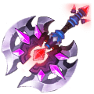
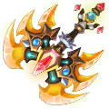

[← All weapons](../weapons.html)

# Aeolus Axe

| S0 - S3 | S4 - S7 | S8 - S13 | Artifact |
|---|---|---|---|
|  |  |  |  |

An axe once possessed by the legendary axe, it is extremely precious

## Info

| Detail | Value |
|---|---|
| Grade | **B** |
| Angle Range | 30° - 60° |
| Ultimate |  Windfury |
| Shard |  Aeolus Axe Shard |
| Where to Get | Team Expedition - Forest Altar Secret Merchant Quest Reward |
| Artifact | Yes: becomes **G Aeolus Axe** when all 6 slots are maxed ([how](../weapons.html#artifact)) |

## Ultimate: Windfury

Throws 3 times consecutively, each hit dealing base damage to the target and reducing a certain amount of the target's Rage with each shell.

| Levels | Base DMG | Additional |
|---|---|---|
| S0 - S3 | 80% | Each shell reduces the target's rage by 30 points. |
| S4 - S7 | 85% | Each shell reduces the target's rage by 33 points. |
| S8 - S11 | 90% | Each shell reduces the target's rage by 36 points. |
| S12 - S13 | 100% | Each shell reduces the target's rage by 40 points; for every 90 points of rage reduced, next round's damage increases by 10%, up to a maximum of 20%. |

## Stats by level

Shards: the Aeolus Axe Shard needed to reach that level (S0 = crafting the weapon).

| Level | Shards | Total shards | Weapon DMG | ATK | CRIT | DMG+ | Burst DMG+ | BP |
|---|---|---|---|---|---|---|---|---|
| **S0** | 20 | 20 | 5 - 63 | 9 | - | - | 6 | 237 |
| **S1** | 5 | 25 | 34 - 87 | 19 | - | - | 18 | 378 |
| **S2** | 10 | 35 | 55 - 133 | 25 | - | - | 33 | 581 |
| **S3** | 15 | 50 | 67 - 138 | 52 | - | - | 45 | 721 |
| **S4** | 20 | 70 | 100 - 196 | 62 | - | - | 52 | 949 |
| **S5** | 25 | 95 | 117 - 217 | 105 | - | - | 75 | 1,223 |
| **S6** | 30 | 125 | 156 - 298 | 134 | - | - | 87 | 1,598 |
| **S7** | 35 | 160 | 187 - 383 | 158 | - | - | 119 | 2,028 |
| **S8** | 40 | 200 | 250 - 460 | 188 | - | - | 142 | 2,427 |
| **S9** | 45 | 245 | 290 - 603 | 215 | - | - | 160 | 2,999 |
| **S10** | 50 | 295 | 290 - 650 | 252 | - | - | 224 | 3,454 |
| **S11** | 55 | 350 | 440 - 777 | 285 | - | - | 232 | 3,968 |
| **S12** | 60 | 410 | 480 - 850 | 371 | - | - | 253 | 4,534 |
| **S13** | 65 | 475 | 530 - 915 | 455 | - | - | 287 | 5,108 |

## Artifact slots

Needs the weapon at S13. Each slot has 3 levels and is crafted in order; the values below are the slot's total at that level. Cost per level: weapon shards + Artifact Essence.

| Slot | Level 1 | Level 2 | Level 3 |
|---|---|---|---|
| **1. Cursed Axe** | Aeolus Axe Burst DMG +174% <small>31 shards + 3,348 essence</small> | Aeolus Axe Burst DMG +348% <small>50 shards + 6,400 essence</small> | Aeolus Axe Burst DMG +580% <small>63 shards + 9,954 essence</small> |
| **2. Hell Roar** | Aeolus Axe ATK +213% <small>56 shards + 6,048 essence</small> | Aeolus Axe ATK +400% <small>95 shards + 12,160 essence</small> | Aeolus Axe ATK +733% <small>147 shards + 23,226 essence</small> |
| **3. Divine Weapon** | Aeolus Axe Weapon DMG +1689-2311 <small>100 shards + 13,800 essence</small> | Aeolus Axe Weapon DMG +3181-3485 <small>158 shards + 20,224 essence</small> | Aeolus Axe Weapon DMG +4903-5097 <small>188 shards + 29,704 essence</small> |
| **4. Legion Breaker** | Aeolus Axe HP +18000 <small>135 shards + 18,580 essence</small> | Aeolus Axe HP +26000 <small>168 shards + 24,504 essence</small> | Aeolus Axe HP +36000 <small>210 shards + 33,180 essence</small> |
| **5. Ash Herald** | Aeolus Axe Anti Crit +4500 <small>135 shards + 21,580 essence</small> | Aeolus Axe Anti Crit +6500 <small>168 shards + 26,504 essence</small> | Aeolus Axe Anti Crit +9000 <small>210 shards + 34,180 essence</small> |
| **6. God Slayer** | Ultimate DMG +10%, regular attack generates no Rage after precise shots <small>135 shards + 24,580 essence</small> | Ultimate DMG +13%, regular attack generates no Rage after precise shots <small>168 shards + 29,504 essence</small> | Ultimate DMG +15%, regular attack generates no Rage after precise shots <small>210 shards + 35,180 essence</small> |
