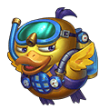

[← All weapons](../weapons.html)

# Chicken Mines

| S0 - S3 | S4 - S7 | S8 - S13 | Artifact |
|---|---|---|---|
|  |  |  |  |

Watch out for my chicken blast! Boom! Boom! Boom!

## Info

| Detail | Value |
|---|---|
| Grade | **A** |
| Angle Range | 20° - 70° |
| Ultimate |  Chicken God |
| Shard |  Chicken Mines Shard |
| Where to Get | Event |
| Artifact | Yes: becomes **G Chicken Mines** when all 6 slots are maxed ([how](../weapons.html#artifact)) |

## Ultimate: Chicken God

Upon hitting the target, deals massive base damage and scatters 3 Chick Bombs randomly near the impact point. The bombs remain hidden for 2 rounds and deal base damage when triggered by any target.

| Levels | Base DMG | Additional |
|---|---|---|
| S0 - S3 | 240% | Chick Bombs deal 140% damage when they contact enemies. |
| S4 - S7 | 260% | Chick Bombs deal 145% damage when they contact enemies. |
| S8 - S11 | 280% | Chick Bombs deal 150% damage when they contact enemies. |
| S12 - S13 | 300% | Chick Bombs deal 160% damage when they contact enemies. |

## Stats by level

Shards: the Chicken Mines Shard needed to reach that level (S0 = crafting the weapon).

| Level | Shards | Total shards | Weapon DMG | ATK | CRIT | DMG+ | Burst DMG+ | BP |
|---|---|---|---|---|---|---|---|---|
| **S0** | 20 | 20 | 63 - 80 | - | 22 | 27 | - | 365 |
| **S1** | 5 | 25 | 67 - 107 | - | 35 | 32 | - | 487 |
| **S2** | 10 | 35 | 84 - 169 | - | 43 | 50 | - | 743 |
| **S3** | 15 | 50 | 89 - 174 | - | 76 | 78 | - | 908 |
| **S4** | 20 | 70 | 118 - 247 | - | 101 | 107 | - | 1,264 |
| **S5** | 25 | 95 | 141 - 277 | - | 151 | 130 | - | 1,523 |
| **S6** | 30 | 125 | 172 - 378 | - | 187 | 163 | - | 1,997 |
| **S7** | 35 | 160 | 223 - 485 | - | 239 | 183 | - | 2,482 |
| **S8** | 40 | 200 | 260 - 583 | - | 309 | 211 | - | 3,000 |
| **S9** | 45 | 245 | 302 - 764 | - | 327 | 257 | - | 3,717 |
| **S10** | 50 | 295 | 360 - 824 | - | 407 | 292 | - | 4,162 |
| **S11** | 55 | 350 | 404 - 986 | - | 470 | 352 | - | 4,954 |
| **S12** | 60 | 410 | 509 - 1,078 | - | 546 | 436 | - | 5,634 |
| **S13** | 65 | 475 | 720 - 1,161 | - | 681 | 614 | - | 6,687 |

## Artifact slots

Needs the weapon at S13. Each slot has 3 levels and is crafted in order; the values below are the slot's total at that level. Cost per level: weapon shards + Artifact Essence.

| Slot | Level 1 | Level 2 | Level 3 |
|---|---|---|---|
| **1. Quantum Boost** | Chicken Mines CRIT +1500 <small>31 shards + 3,348 essence</small> | Chicken Mines CRIT +3000 <small>50 shards + 6,400 essence</small> | Chicken Mines CRIT +5000 <small>63 shards + 9,954 essence</small> |
| **2. Magnetic Ejection** | Chicken Mines DMG+ +1120 <small>56 shards + 6,048 essence</small> | Chicken Mines DMG+ +2100 <small>95 shards + 12,160 essence</small> | Chicken Mines DMG+ +3850 <small>147 shards + 23,226 essence</small> |
| **3. Super Jet** | Chicken Mines Weapon DMG +1878-2323 <small>100 shards + 13,800 essence</small> | Chicken Mines Weapon DMG +3254-3541 <small>158 shards + 20,224 essence</small> | Chicken Mines Weapon DMG +5232-5549 <small>188 shards + 29,704 essence</small> |
| **4. Ether Red Armor** | Chicken Mines HP +18,900 <small>135 shards + 18,580 essence</small> | Chicken Mines HP +27300 <small>168 shards + 24,504 essence</small> | Chicken Mines HP +37800 <small>210 shards + 33,180 essence</small> |
| **5. Alloy Goggles** | Chicken Mines DEF +3150 <small>135 shards + 21,580 essence</small> | Chicken Mines DEF +4550 <small>168 shards + 26,504 essence</small> | Chicken Mines DEF +6300 <small>210 shards + 34,180 essence</small> |
| **6. Fly Chick** | Ultimate DMG +10%, add 1 extra splashed chick bombs, each deals 180% damage <small>135 shards + 24,580 essence</small> | Ultimate DMG +15%, add 1 extra splashed chick bombs, each deals 200% damage <small>168 shards + 29,504 essence</small> | Ultimate DMG +20%, add 2 extra splashed chick bombs, each deals 220% damage <small>210 shards + 35,180 essence</small> |

## Skins (Conjure Artifact)

| Skin | Stats bonus | Activate | Each of 4 phases |
|---|---|---|---|
|  **Ocean Wave Duck** | ATK +108 CRIT +49 DMG+ +47 Burst DMG+ +46 | 250 Chicken Mines-Ocean Wave Duck Skin Shard | 1,250 Chicken Mines-Ocean Wave Duck Skin Shard |
