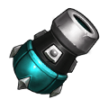

[← All weapons](../weapons.html)

# Efreet

| S0 - S3 | S4 - S7 | S8 - S13 | Artifact |
|---|---|---|---|
|  |  |  |  |

A high-tech device produced in the Battle Continent, it's not too stable but has incredible power

## Info

| Detail | Value |
|---|---|
| Grade | **S** |
| Angle Range | 50° - 80° |
| Ultimate |  Nuclear Strike |
| Shard |  Efreet Shard |
| Where to Get | Ladder Reward |
| Artifact | Yes: becomes **G Efreet** when all 6 slots are maxed ([how](../weapons.html#artifact)) |

## Ultimate: Nuclear Strike

Fires 3 consecutive standard shells, each dealing base damage with a chance to trigger a nuclear explosion, creating a wide-area crater.

| Levels | Base DMG | Additional |
|---|---|---|
| S0 - S3 | 75% | The shells have a 40% chance to cause a nuclear explosion. |
| S4 - S7 | 85% | The shells have a 45% chance to cause a nuclear explosion. |
| S8 - S11 | 95% | The shells have a 55% chance to cause a nuclear explosion. |
| S12 - S13 | 105% | The shells have a 65% chance to cause a nuclear explosion. |

## Stats by level

Shards: the Efreet Shard needed to reach that level (S0 = crafting the weapon).

| Level | Shards | Total shards | Weapon DMG | ATK | CRIT | DMG+ | Burst DMG+ | BP |
|---|---|---|---|---|---|---|---|---|
| **S0** | 20 | 20 | 25 - 45 | - | 13 | - | 7 | 182 |
| **S1** | 5 | 25 | 54 - 63 | - | 28 | - | 22 | 311 |
| **S2** | 10 | 35 | 85 - 103 | - | 46 | - | 30 | 491 |
| **S3** | 15 | 50 | 99 - 105 | - | 72 | - | 55 | 624 |
| **S4** | 20 | 70 | 133 - 161 | - | 112 | - | 63 | 896 |
| **S5** | 25 | 95 | 144 - 189 | - | 154 | - | 88 | 1,139 |
| **S6** | 30 | 125 | 205 - 249 | - | 185 | - | 111 | 1,450 |
| **S7** | 35 | 160 | 254 - 335 | - | 211 | - | 142 | 1,853 |
| **S8** | 40 | 200 | 289 - 419 | - | 257 | - | 178 | 2,305 |
| **S9** | 45 | 245 | 320 - 573 | - | 297 | - | 198 | 2,907 |
| **S10** | 50 | 295 | 330 - 610 | - | 388 | - | 243 | 3,335 |
| **S11** | 55 | 350 | 485 - 730 | - | 394 | - | 283 | 3,827 |
| **S12** | 60 | 410 | 525 - 797 | - | 431 | - | 378 | 4,387 |
| **S13** | 65 | 475 | 584 - 857 | - | 495 | - | 459 | 4,938 |

## Artifact slots

Needs the weapon at S13. Each slot has 3 levels and is crafted in order; the values below are the slot's total at that level. Cost per level: weapon shards + Artifact Essence.

| Slot | Level 1 | Level 2 | Level 3 |
|---|---|---|---|
| **1. Dragon Cannon** | Efreet CRIT +152% <small>31 shards + 3,348 essence</small> | Efreet CRIT +303% <small>50 shards + 6,400 essence</small> | Efreet CRIT +505% <small>63 shards + 9,954 essence</small> |
| **2. Life Reaper** | Efreet Burst DMG +232% <small>56 shards + 6,048 essence</small> | Efreet Burst DMG +435% <small>95 shards + 12,160 essence</small> | Efreet Burst DMG +799% <small>147 shards + 23,226 essence</small> |
| **3. Arc Ball** | Efreet Weapon DMG +1789-2211 <small>100 shards + 13,800 essence</small> | Efreet Weapon DMG +3099-3567 <small>158 shards + 20,224 essence</small> | Efreet Weapon DMG +4983-5017 <small>188 shards + 29,704 essence</small> |
| **4. Reverse Dragonscale** | Efreet DMG- +3000 <small>135 shards + 18,580 essence</small> | Efreet DMG- +4333 <small>168 shards + 24,504 essence</small> | Efreet DMG- +6000 <small>210 shards + 33,180 essence</small> |
| **5. Burst Out** | Efreet HP +18,000 <small>135 shards + 21,580 essence</small> | Efreet HP +26000 <small>168 shards + 26,504 essence</small> | Efreet HP +36000 <small>210 shards + 34,180 essence</small> |
| **6. Steel Cannon** | Max Weapon Shoot Angel +5, Throw DMG +30% <small>135 shards + 24,580 essence</small> | Max Weapon Shoot Angel +10, Throw DMG +40% <small>168 shards + 29,504 essence</small> | Max Weapon Shoot Angel +20, Throw DMG +50% <small>210 shards + 35,180 essence</small> |
