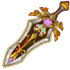
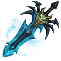

[← All weapons](../weapons.html)

# Excalibur

| S0 - S3 | S4 - S7 | S8 - S13 | Artifact |
|---|---|---|---|
|  |  |  |  |

The imperial tool wielded by legendary hero Astoria, the most powerful and noble sword of the Holy King and the symbol of King Arthur. Unfortunately, it was lost in the battle of ancient times, and the existing one is a replica made from people's thoughts. It was crystallized inside the continent and considered to be one of the ultimate artifacts

## Info

| Detail | Value |
|---|---|
| Grade | **S** |
| Angle Range | 35° - 65° |
| Ultimate |  Holy Jury |
| Shard |  Excalibur Shard |
| Where to Get | Event |
| Artifact | Yes: becomes **G Emperor Sword** when all 6 slots are maxed ([how](../weapons.html#artifact)) |

## Ultimate: Holy Jury

Throws the mighty Imperial Sword, clearing the target's accumulated Sigils and dealing massive base damage + additional damage equal to 25% ATK × the number of Sigils. Passive: Each hit applies 1 Sigil to the target, lasting for 3 rounds.

| Levels | Base DMG | Additional |
|---|---|---|
| S0 - S3 | 225% | Ultimate skill attacks trigger up to 6 stacks of Sword Sigils. |
| S4 - S7 | 240% | Ultimate skill attacks trigger up to 13 stacks of Sword Sigils. |
| S8 - S11 | 255% | Ultimate skill attacks trigger up to 20 stacks of Sword Sigils. |
| S12 - S13 | 270% | Ultimate skill attacks trigger up to 27 stacks of Sword Sigils. |

## Stats by level

Shards: the Excalibur Shard needed to reach that level (S0 = crafting the weapon).

| Level | Shards | Total shards | Weapon DMG | ATK | CRIT | DMG+ | Burst DMG+ | BP |
|---|---|---|---|---|---|---|---|---|
| **S0** | 20 | 20 | 25 - 87 | - | 30 | - | 68 | 525 |
| **S1** | 5 | 25 | 40 - 91 | - | 35 | - | 86 | 601 |
| **S2** | 10 | 35 | 62 - 140 | - | 42 | - | 101 | 807 |
| **S3** | 15 | 50 | 58 - 149 | - | 49 | - | 148 | 989 |
| **S4** | 20 | 70 | 60 - 204 | - | 56 | - | 188 | 1,288 |
| **S5** | 25 | 95 | 99 - 242 | - | 63 | - | 228 | 1,536 |
| **S6** | 30 | 125 | 156 - 352 | - | 70 | - | 247 | 1,937 |
| **S7** | 35 | 160 | 187 - 425 | - | 77 | - | 334 | 2,431 |
| **S8** | 40 | 200 | 278 - 556 | - | 84 | - | 364 | 2,928 |
| **S9** | 45 | 245 | 330 - 644 | - | 91 | - | 466 | 3,512 |
| **S10** | 50 | 295 | 388 - 748 | - | 98 | - | 539 | 4,057 |
| **S11** | 55 | 350 | 437 - 863 | - | 105 | - | 655 | 4,764 |
| **S12** | 60 | 410 | 522 - 964 | - | 112 | - | 792 | 5,492 |
| **S13** | 65 | 475 | 678 - 1,061 | - | 119 | - | 940 | 6,241 |
| **G Emperor Sword** | - | - | 953 - 1,788 | - | 175 | - | 1,098 | 9,008 |

## Artifact slots

Needs the weapon at S13. Each slot has 3 levels and is crafted in order; the values below are the slot's total at that level. Cost per level: weapon shards + Artifact Essence.

| Slot | Level 1 | Level 2 | Level 3 |
|---|---|---|---|
| **1. King Strike** | Excalibur Burst DMG +1067 <small>31 shards + 3,348 essence</small> | Excalibur Burst DMG +2000 <small>50 shards + 6,400 essence</small> | Excalibur Burst DMG +3667 <small>63 shards + 9,954 essence</small> |
| **2. Scourge Rage** | Excalibur CRIT +1500 <small>56 shards + 6,048 essence</small> | Excalibur CRIT +3000 <small>95 shards + 12,160 essence</small> | Excalibur CRIT +5000 <small>147 shards + 23,226 essence</small> |
| **3. Holy Sword Heart** | Excalibur Weapon DMG +1915-2439 <small>100 shards + 13,800 essence</small> | Excalibur Weapon DMG +3319-3618 <small>158 shards + 20,224 essence</small> | Excalibur Weapon DMG +5336-5626 <small>188 shards + 29,704 essence</small> |
| **4. Imperial Red Armor** | Excalibur HP +18900 <small>135 shards + 18,580 essence</small> | Excalibur HP +27300 <small>168 shards + 24,504 essence</small> | Excalibur HP +37800 <small>210 shards + 33,180 essence</small> |
| **5. Star Favor** | Excalibur DMG+ +1120 <small>135 shards + 21,580 essence</small> | Excalibur DMG+ +2100 <small>168 shards + 26,504 essence</small> | Excalibur DMG+ +3850 <small>210 shards + 34,180 essence</small> |
| **6. Feather Slash** | Throw out a powerful imperial holy sword, upon dealing DMG to the target, clear stacked holy sword mark on target and deal DMG equals 300% ATK + 25% ATK x marks. Passive: Each time it hits, leave a mark that lasts for 4 turns on target; holy sword mark DMG +10% <small>135 shards + 24,580 essence</small> | Throw out a powerful imperial holy sword, upon dealing DMG to the target, clear stacked holy sword mark on target and deal DMG equals 320% ATK + 25% ATK x marks. Passive: Each time it hits, leave a mark that lasts for 4 turns on target; holy sword mark DMG +15% <small>168 shards + 29,504 essence</small> | Throw out a powerful imperial holy sword, upon dealing DMG to the target, clear stacked holy sword mark on target and deal DMG equals 320% ATK + 25% ATK x marks. Passive: each time it hits, leave a mark that lasts for 4 turns on target; holy sword mark DMG +20% <small>210 shards + 35,180 essence</small> |

## Skins (Conjure Artifact)

| Skin | Stats bonus | Activate | Each of 4 phases |
|---|---|---|---|
|  **Pixel Sword** | ATK +111 CRIT +42 DMG+ +45 Burst DMG+ +41 | 300 Excalibur-Pixel Sword Skin Shard | 1,500 Excalibur-Pixel Sword Skin Shard |
|  **Eternal Winter** | ATK +111 CRIT +42 DMG+ +45 Burst DMG+ +41 | 250 Eternal Winter Skin Shard | 1,250 Eternal Winter Skin Shard |
