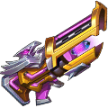
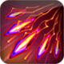

[← All weapons](../weapons.html)

# Falcon

| S0 - S3 | S4 - S7 | S8 - S13 | Artifact |
|---|---|---|---|
|  |  |  |  |

The king in the sky, moody in nature, thus DMG is random

## Info

| Detail | Value |
|---|---|
| Grade | **A** |
| Angle Range | 15° - 45° |
| Ultimate |  Hawkeye |
| Shard |  Falcon Shard |
| Where to Get | Event |
| Artifact | Yes: becomes **G Falcon** when all 6 slots are maxed ([how](../weapons.html#artifact)) |

## Ultimate: Hawkeye

Fires a series of shells, each dealing base damage.

| Levels | Base DMG | Additional |
|---|---|---|
| S0 - S3 | 90% | Fires 2-3 shells in succession. |
| S4 - S7 | 100% | Fires 3-4 shells in succession. |
| S8 - S11 | 105% | Fires 3-5 shells in succession. |
| S12 - S13 | 110% | Fires 3-5 shells in succession; if a target is killed, restores 20% HP. |

## Stats by level

Shards: the Falcon Shard needed to reach that level (S0 = crafting the weapon).

| Level | Shards | Total shards | Weapon DMG | ATK | CRIT | DMG+ | Burst DMG+ | BP |
|---|---|---|---|---|---|---|---|---|
| **S0** | 20 | 20 | 37 - 76 | 34 | - | - | 22 | 407 |
| **S1** | 5 | 25 | 50 - 102 | 34 | - | - | 27 | 500 |
| **S2** | 10 | 35 | 78 - 161 | 34 | - | - | 36 | 704 |
| **S3** | 15 | 50 | 81 - 166 | 60 | - | - | 48 | 840 |
| **S4** | 20 | 70 | 116 - 235 | 80 | - | - | 59 | 1,146 |
| **S5** | 25 | 95 | 129 - 264 | 120 | - | - | 71 | 1,401 |
| **S6** | 30 | 125 | 176 - 360 | 140 | - | - | 84 | 1,794 |
| **S7** | 35 | 160 | 227 - 462 | 188 | - | - | 96 | 2,295 |
| **S8** | 40 | 200 | 271 - 555 | 245 | - | - | 116 | 2,822 |
| **S9** | 45 | 245 | 355 - 728 | 267 | - | - | 135 | 3,471 |
| **S10** | 50 | 295 | 384 - 785 | 340 | - | - | 168 | 3,981 |
| **S11** | 55 | 350 | 459 - 939 | 373 | - | - | 191 | 4,621 |
| **S12** | 60 | 410 | 502 - 1,027 | 433 | - | - | 232 | 5,206 |
| **S13** | 65 | 475 | 540 - 1,106 | 541 | - | - | 407 | 6,325 |

## Artifact slots

Needs the weapon at S13. Each slot has 3 levels and is crafted in order; the values below are the slot's total at that level. Cost per level: weapon shards + Artifact Essence.

| Slot | Level 1 | Level 2 | Level 3 |
|---|---|---|---|
| **1. Lock On** | Falcon ATK +84% <small>31 shards + 3,348 essence</small> | Falcon ATK +168% <small>50 shards + 6,400 essence</small> | Falcon ATK +280% <small>63 shards + 9,954 essence</small> |
| **2. Leap Up** | Falcon Burst DMG +264% <small>56 shards + 6,048 essence</small> | Falcon Burst DMG +491% <small>95 shards + 12,160 essence</small> | Falcon Burst DMG +901% <small>147 shards + 23,226 essence</small> |
| **3. Lean Charge** | Falcon Weapon DMG +1602-2398 <small>100 shards + 13,800 essence</small> | Falcon Weapon DMG +3315-3351 <small>158 shards + 20,224 essence</small> | Falcon Weapon DMG +4835-5165 <small>188 shards + 29,704 essence</small> |
| **4. No Fear** | Falcon ACRIT +4500 <small>135 shards + 18,580 essence</small> | Falcon ACRIT +6500 <small>168 shards + 24,504 essence</small> | Falcon ACRIT +9000 <small>210 shards + 33,180 essence</small> |
| **5. Born to Die** | Falcon DMG- +3000 <small>135 shards + 21,580 essence</small> | Falcon DMG- +4333 <small>168 shards + 26,504 essence</small> | Falcon DMG- +6000 <small>210 shards + 34,180 essence</small> |
| **6. Eagle Strike** | Drawing 3 bombs, each shell deals 35% CRIT DMG; 4 bombs, each shell restores HP equal to 8MG; if you draw 5 shells, an extra shell is added <small>135 shards + 24,580 essence</small> | Drawing 3 bombs, each shell deals 55% CRIT DMG; 4 bombs, each shell restores HP equal to 11MG; if you draw 5 shells, an extra shell is added <small>168 shards + 29,504 essence</small> | Drawing 3 bombs, each shell deals 100% CRIT DMG; 4 bombs, each shell restores HP equals 15MG; 5 shells, adds one extra bomb <small>210 shards + 35,180 essence</small> |
