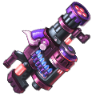

[← All weapons](../weapons.html)

# G Mage Gatling

| S0 - S3 | S4 - S7 | S8 - S13 | Artifact |
|---|---|---|---|
|  |  |  |  |

A fusion of magic and technology, it's the Battle Continent's technological product

## Info

| Detail | Value |
|---|---|
| Grade | **B** |
| Angle Range | 35° - 65° |
| Ultimate |  Gatling Gun |
| Shard |  G Mage Gatling Shard |
| Where to Get | Rank Pack |
| Artifact | Yes: becomes **G Mage Gatling** when all 6 slots are maxed ([how](../weapons.html#artifact)) |

## Ultimate: Gatling Gun

Fires a series of bullets, each dealing base damage. These bullets do not create craters.

| Levels | Base DMG | Additional |
|---|---|---|
| S0 - S3 | 60% | Fires 5 bullets in succession. |
| S4 - S7 | 65% | Fires 6 bullets in succession. |
| S8 - S11 | 70% | Fires 7 bullets in succession. |
| S12 - S13 | 78% | Gatling Mech,Fire 7 consecutive bullets |

## Stats by level

Shards: the G Mage Gatling Shard needed to reach that level (S0 = crafting the weapon).

| Level | Shards | Total shards | Weapon DMG | ATK | CRIT | DMG+ | Burst DMG+ | BP |
|---|---|---|---|---|---|---|---|---|
| **S0** | 20 | 20 | 5 - 63 | - | - | 10 | 6 | 237 |
| **S1** | 5 | 25 | 35 - 84 | - | - | 23 | 17 | 372 |
| **S2** | 10 | 35 | 55 - 133 | - | - | 31 | 30 | 582 |
| **S3** | 15 | 50 | 67 - 137 | - | - | 42 | 61 | 720 |
| **S4** | 20 | 70 | 100 - 195 | - | - | 53 | 84 | 996 |
| **S5** | 25 | 95 | 116 - 218 | - | - | 65 | 126 | 1,227 |
| **S6** | 30 | 125 | 156 - 298 | - | - | 77 | 157 | 1,596 |
| **S7** | 35 | 160 | 187 - 383 | - | - | 89 | 203 | 2,025 |
| **S8** | 40 | 200 | 250 - 460 | - | - | 107 | 242 | 2,427 |
| **S9** | 45 | 245 | 290 - 603 | - | - | 125 | 271 | 2,997 |
| **S10** | 50 | 295 | 290 - 650 | - | - | 155 | 347 | 3,456 |
| **S11** | 55 | 350 | 440 - 777 | - | - | 175 | 370 | 3,966 |
| **S12** | 60 | 410 | 480 - 850 | - | - | 215 | 446 | 4,533 |
| **S13** | 65 | 475 | 530 - 915 | - | - | 312 | 475 | 5,106 |

## Artifact slots

Needs the weapon at S13. Each slot has 3 levels and is crafted in order; the values below are the slot's total at that level. Cost per level: weapon shards + Artifact Essence.

| Slot | Level 1 | Level 2 | Level 3 |
|---|---|---|---|
| **1. Multi-tube Rotation** | G Mage Gatling DMG+ +160% <small>31 shards + 3,348 essence</small> | G Mage Gatling DMG+ +321% <small>50 shards + 6,400 essence</small> | G Mage Gatling DMG+ +534% <small>63 shards + 9,954 essence</small> |
| **2. Steel Chamber** | G Mage Gatling Burst DMG +224% <small>56 shards + 6,048 essence</small> | G Mage Gatling Burst DMG +421% <small>95 shards + 12,160 essence</small> | G Mage Gatling Burst DMG +772% <small>147 shards + 23,226 essence</small> |
| **3. Closure Tail** | G Mage Gatling Weapon DMG +1607-2393 <small>100 shards + 13,800 essence</small> | G Mage Gatling Weapon DMG +3185-3484 <small>158 shards + 20,224 essence</small> | G Mage Gatling Weapon DMG +4771-5229 <small>188 shards + 29,704 essence</small> |
| **4. Strike Igniter** | G Mage Gatling HP +18,000 <small>135 shards + 18,580 essence</small> | G Mage Gatling HP +26000 <small>168 shards + 24,504 essence</small> | G Mage Gatling HP +36000 <small>210 shards + 33,180 essence</small> |
| **5. Fast Cooling** | G Mage Gatling DEF +2727 <small>135 shards + 21,580 essence</small> | G Mage Gatling DEF +3939 <small>168 shards + 26,504 essence</small> | G Mage Gatling DEF +5455 <small>210 shards + 34,180 essence</small> |
| **6. Automation** | Can use Ultimate on allies, restores HP equal to 30% DMG <small>135 shards + 24,580 essence</small> | Can use Ultimate on allies, restores HP equal to 45% DMG <small>168 shards + 29,504 essence</small> | Can use Ultimate on allies, restores HP equal to 60% DMG <small>210 shards + 35,180 essence</small> |

## Skins (Conjure Artifact)

| Skin | Stats bonus | Activate | Each of 4 phases |
|---|---|---|---|
|  **Star Whisper** | ATK +111 CRIT +42 DMG+ +45 Burst DMG+ +41 | 250 G Mage Gatling - Star Whisper Shard | 1,250 G Mage Gatling - Star Whisper Shard |
