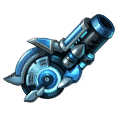
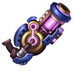
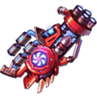

[← All weapons](../weapons.html)

# Ion Cannon

| S0 - S3 | S4 - S7 | S8 - S13 | Artifact |
|---|---|---|---|
|  |  |  |  |

Modified from a bazooka, it is much more powerful than a regular bazooka

## Info

| Detail | Value |
|---|---|
| Grade | **A** |
| Angle Range | 20° - 50° |
| Ultimate |  Particle Seal |
| Shard |  Ion Cannon Shard |
| Where to Get | Team Expedition - Demon Forest Secret Merchant Quest Reward |
| Artifact | Yes: becomes **G Ion Cannon** when all 6 slots are maxed ([how](../weapons.html#artifact)) |

## Ultimate: Particle Seal

Deals massive base damage to the target and seals their skills, preventing the use of abilities for a set duration.

| Levels | Base DMG | Additional |
|---|---|---|
| S0 - S3 | 180% | Seals the target's skills for 1 rounds. |
| S4 - S7 | 190% | Seals the target's skills for 1 rounds. |
| S8 - S11 | 200% | Seals the target's skills for 2 rounds. |
| S12 - S13 | 220% | Seals the target's skills for 2 rounds. |

## Stats by level

Shards: the Ion Cannon Shard needed to reach that level (S0 = crafting the weapon).

| Level | Shards | Total shards | Weapon DMG | ATK | CRIT | DMG+ | Burst DMG+ | BP |
|---|---|---|---|---|---|---|---|---|
| **S0** | 20 | 20 | 33 - 34 | - | 8 | 11 | - | 151 |
| **S1** | 5 | 25 | 55 - 64 | - | 19 | 27 | - | 311 |
| **S2** | 10 | 35 | 78 - 113 | - | 22 | 44 | - | 515 |
| **S3** | 15 | 50 | 83 - 120 | - | 54 | 67 | - | 669 |
| **S4** | 20 | 70 | 140 - 155 | - | 72 | 89 | - | 876 |
| **S5** | 25 | 95 | 154 - 181 | - | 108 | 118 | - | 1,113 |
| **S6** | 30 | 125 | 207 - 237 | - | 125 | 156 | - | 1,429 |
| **S7** | 35 | 160 | 265 - 315 | - | 169 | 175 | - | 1,808 |
| **S8** | 40 | 200 | 313 - 389 | - | 220 | 206 | - | 2,225 |
| **S9** | 45 | 245 | 437 - 464 | - | 240 | 232 | - | 2,568 |
| **S10** | 50 | 295 | 453 - 500 | - | 306 | 291 | - | 2,985 |
| **S11** | 55 | 350 | 584 - 643 | - | 335 | 317 | - | 3,550 |
| **S12** | 60 | 410 | 657 - 697 | - | 389 | 390 | - | 4,039 |
| **S13** | 65 | 475 | 686 - 773 | - | 486 | 456 | - | 4,659 |

## Artifact slots

Needs the weapon at S13. Each slot has 3 levels and is crafted in order; the values below are the slot's total at that level. Cost per level: weapon shards + Artifact Essence.

| Slot | Level 1 | Level 2 | Level 3 |
|---|---|---|---|
| **1. Command & Conquer** | Ion Cannon CRIT +154% <small>31 shards + 3,348 essence</small> | Ion Cannon CRIT +309% <small>50 shards + 6,400 essence</small> | Ion Cannon CRIT +514% <small>63 shards + 9,954 essence</small> |
| **2. Charged Hydrogen** | Ion Cannon DMG+ +234% <small>56 shards + 6,048 essence</small> | Ion Cannon DMG+ +438% <small>95 shards + 12,160 essence</small> | Ion Cannon DMG+ +804% <small>147 shards + 23,226 essence</small> |
| **3. Energy Charge** | Ion Cannon Weapon DMG +1565-2435 <small>100 shards + 13,800 essence</small> | Ion Cannon Weapon DMG +3256-3410 <small>158 shards + 20,224 essence</small> | Ion Cannon Weapon DMG +4734-5266 <small>188 shards + 29,704 essence</small> |
| **4. Adv. Deployment** | Ion Cannon HP +18,000 <small>135 shards + 18,580 essence</small> | Ion Cannon HP +26000 <small>168 shards + 24,504 essence</small> | Ion Cannon HP +36000 <small>210 shards + 33,180 essence</small> |
| **5. Instant Vaporize** | Ion Cannon DEF +2727 <small>135 shards + 21,580 essence</small> | Ion Cannon DEF +3939 <small>168 shards + 26,504 essence</small> | Ion Cannon DEF +5455 <small>210 shards + 34,180 essence</small> |
| **6. Sustained Operation** | Ultimate DMG +10%, regular attack generates 30 extra Rage after precise hits <small>135 shards + 24,580 essence</small> | Ultimate DMG +15%, regular attack generates 50 extra Rage after precise hits <small>168 shards + 29,504 essence</small> | Ultimate DMG +20%, regular attack generates 100 extra Rage after precise hits <small>210 shards + 35,180 essence</small> |

## Skins (Conjure Artifact)

| Skin | Stats bonus | Activate | Each of 4 phases |
|---|---|---|---|
|  **Quantum Destiny** | ATK +73 CRIT +48 DMG+ +45 Burst DMG+ +45 | 250 Ion-Quantum Destiny Skin Shard | 1,250 Ion-Quantum Destiny Skin Shard |
