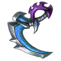
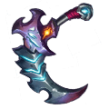

[← All weapons](../weapons.html)

# Reaper Scythe

| S0 - S3 | S4 - S7 | S8 - S13 | Artifact |
|---|---|---|---|
|  |  |  |  |

The grim reaper's scythe that was taken from the Dark Continent, legend has it that it can summon the reaper himself

## Info

| Detail | Value |
|---|---|
| Grade | **B** |
| Angle Range | 35° - 75° |
| Ultimate |  Death Mark |
| Shard |  Reaper Scythe Shard |
| Where to Get | Team Expedition - Dark Castle Secret Merchant Quest Reward |
| Artifact | Yes: becomes **G Reaper Scythe** when all 6 slots are maxed ([how](../weapons.html#artifact)) |

## Ultimate: Death Mark

Inflicts base damage on the target and reduces their DEF for 2 rounds.

| Levels | Base DMG | Additional |
|---|---|---|
| S0 - S3 | 130% | Reduces the target's DEF by 10%. |
| S4 - S7 | 140% | Reduces the target's DEF by 13%. |
| S8 - S11 | 150% | Reduces the target's DEF by 16%. |
| S12 - S13 | 160% | Reduces the target's 20% defence; activates the 'Reaper's Guard' form, applying a Corrosion Mark to the hit target and dealing an additional 100% damage to the target. |

## Stats by level

Shards: the Reaper Scythe Shard needed to reach that level (S0 = crafting the weapon).

| Level | Shards | Total shards | Weapon DMG | ATK | CRIT | DMG+ | Burst DMG+ | BP |
|---|---|---|---|---|---|---|---|---|
| **S0** | 20 | 20 | 15 - 55 | - | - | 8 | 7 | 210 |
| **S1** | 5 | 25 | 43 - 75 | - | - | 21 | 19 | 345 |
| **S2** | 10 | 35 | 75 - 113 | - | - | 34 | 27 | 522 |
| **S3** | 15 | 50 | 89 - 115 | - | - | 55 | 48 | 654 |
| **S4** | 20 | 70 | 123 - 171 | - | - | 83 | 55 | 927 |
| **S5** | 25 | 95 | 134 - 199 | - | - | 109 | 82 | 1,170 |
| **S6** | 30 | 125 | 198 - 259 | - | - | 128 | 105 | 1,476 |
| **S7** | 35 | 160 | 244 - 325 | - | - | 157 | 136 | 1,854 |
| **S8** | 40 | 200 | 279 - 429 | - | - | 175 | 174 | 2,334 |
| **S9** | 45 | 245 | 310 - 583 | - | - | 200 | 196 | 2,937 |
| **S10** | 50 | 295 | 310 - 630 | - | - | 257 | 245 | 3,396 |
| **S11** | 55 | 350 | 475 - 742 | - | - | 274 | 271 | 3,861 |
| **S12** | 60 | 410 | 515 - 807 | - | - | 334 | 331 | 4,416 |
| **S13** | 65 | 475 | 574 - 867 | - | - | 385 | 404 | 4,968 |

## Artifact slots

Needs the weapon at S13. Each slot has 3 levels and is crafted in order; the values below are the slot's total at that level. Cost per level: weapon shards + Artifact Essence.

| Slot | Level 1 | Level 2 | Level 3 |
|---|---|---|---|
| **1. Drift Out** | Reaper Scythe DMG+ +130% <small>31 shards + 3,348 essence</small> | Reaper Scythe DMG+ +260% <small>50 shards + 6,400 essence</small> | Reaper Scythe DMG+ +433% <small>63 shards + 9,954 essence</small> |
| **2. Dark Curse** | Reaper Scythe Burst DMG +264% <small>56 shards + 6,048 essence</small> | Reaper Scythe Burst DMG +495% <small>95 shards + 12,160 essence</small> | Reaper Scythe Burst DMG +907% <small>147 shards + 23,226 essence</small> |
| **3. Life Reaper** | Reaper Scythe Weapon DMG +1519-2481 <small>100 shards + 13,800 essence</small> | Reaper Scythe Weapon DMG +3058-3608 <small>158 shards + 20,224 essence</small> | Reaper Scythe Weapon DMG +4729-5271 <small>188 shards + 29,704 essence</small> |
| **4. Cursed Treasure** | Reaper Scythe ACRIT +4500 <small>135 shards + 18,580 essence</small> | Reaper Scythe ACRIT +6500 <small>168 shards + 24,504 essence</small> | Reaper Scythe ACRIT +9000 <small>210 shards + 33,180 essence</small> |
| **5. Bloody Edge** | Reaper Scythe DEF +2727 <small>135 shards + 21,580 essence</small> | Reaper Scythe DEF +3939 <small>168 shards + 26,504 essence</small> | Reaper Scythe DEF +5455 <small>210 shards + 34,180 essence</small> |
| **6. Slaughter Angel** | Regular attack DMG +15% against targets with sundered armor <small>135 shards + 24,580 essence</small> | Regular attack DMG +25% against targets with sundered armor <small>168 shards + 29,504 essence</small> | Regular attack DMG +35% against targets with sundered armor <small>210 shards + 35,180 essence</small> |

## Skins (Conjure Artifact)

| Skin | Stats bonus | Activate | Each of 4 phases |
|---|---|---|---|
|  **Dark night rose** | ATK +111 CRIT +42 DMG+ +45 Burst DMG+ +41 | 250 Scythe - Night Rose Skin Shard | 1,250 Scythe - Night Rose Skin Shard |
