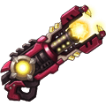

[← All weapons](../weapons.html)

# Thunder

| S0 - S3 | S4 - S7 | S8 - S13 | Artifact |
|---|---|---|---|
|  |  |  |  |

The latest weapon of the Academy. It attacks enemies with thunderbolts like the god of thunder!

## Info

| Detail | Value |
|---|---|
| Grade | **A** |
| Angle Range | 25° - 55° |
| Ultimate |  Thunder Jail |
| Shard |  Thunder Shard |
| Where to Get | Event |
| Artifact | Yes: becomes **G Thunder** when all 6 slots are maxed ([how](../weapons.html#artifact)) |

## Ultimate: Thunder Jail

Fires a bullet with a 400-yard explosion radius, dealing massive base damage to the target. All players in the explosion area are grounded, unable to fly or move for a set duration. (The shell does not create craters.)

| Levels | Base DMG | Additional |
|---|---|---|
| S0 - S3 | 420% | Immobilization effect lasts for 1 rounds. |
| S4 - S7 | 450% | Immobilization effect lasts for 1 rounds. |
| S8 - S11 | 480% | Immobilization effect lasts for 2 rounds. |
| S12 - S13 | 520% | Immobilization effect lasts for 2 rounds. |

## Stats by level

Shards: the Thunder Shard needed to reach that level (S0 = crafting the weapon).

| Level | Shards | Total shards | Weapon DMG | ATK | CRIT | DMG+ | Burst DMG+ | BP |
|---|---|---|---|---|---|---|---|---|
| **S0** | 20 | 20 | 45 - 82 | - | 30 | 26 | - | 384 |
| **S1** | 5 | 25 | 48 - 90 | - | 32 | 31 | - | 427 |
| **S2** | 10 | 35 | 71 - 142 | - | 42 | 48 | - | 654 |
| **S3** | 15 | 50 | 84 - 158 | - | 54 | 74 | - | 804 |
| **S4** | 20 | 70 | 104 - 225 | - | 72 | 102 | - | 1,125 |
| **S5** | 25 | 95 | 124 - 251 | - | 108 | 124 | - | 1,341 |
| **S6** | 30 | 125 | 160 - 343 | - | 125 | 155 | - | 1,744 |
| **S7** | 35 | 160 | 206 - 460 | - | 182 | 174 | - | 2,266 |
| **S8** | 40 | 200 | 288 - 559 | - | 220 | 201 | - | 2,720 |
| **S9** | 45 | 245 | 333 - 702 | - | 260 | 245 | - | 3,361 |
| **S10** | 50 | 295 | 376 - 812 | - | 312 | 278 | - | 3,894 |
| **S11** | 55 | 350 | 417 - 918 | - | 365 | 335 | - | 4,489 |
| **S12** | 60 | 410 | 456 - 969 | - | 426 | 415 | - | 5,004 |
| **S13** | 65 | 475 | 545 - 1,053 | - | 544 | 585 | - | 6,002 |

## Artifact slots

Needs the weapon at S13. Each slot has 3 levels and is crafted in order; the values below are the slot's total at that level. Cost per level: weapon shards + Artifact Essence.

| Slot | Level 1 | Level 2 | Level 3 |
|---|---|---|---|
| **1. Power Hit** | Thunder CRIT +138% <small>31 shards + 3,348 essence</small> | Thunder CRIT +276% <small>50 shards + 6,400 essence</small> | Thunder CRIT +460% <small>63 shards + 9,954 essence</small> |
| **2. Absolute Seal** | Thunder DMG+ +182% <small>56 shards + 6,048 essence</small> | Thunder DMG+ +342% <small>95 shards + 12,160 essence</small> | Thunder DMG+ +627% <small>147 shards + 23,226 essence</small> |
| **3. Endless Loop** | Thunder Weapon DMG +1597-2403 <small>100 shards + 13,800 essence</small> | Thunder Weapon DMG +3215-3451 <small>158 shards + 20,224 essence</small> | Thunder Weapon DMG +4907-5093 <small>188 shards + 29,704 essence</small> |
| **4. Comeback Kid** | Thunder DEF +3000 <small>135 shards + 18,580 essence</small> | Thunder DEF +4333 <small>168 shards + 24,504 essence</small> | Thunder DEF +6000 <small>210 shards + 33,180 essence</small> |
| **5. Tail Hit** | Thunder HP +18,000 <small>135 shards + 21,580 essence</small> | Thunder HP +26000 <small>168 shards + 26,504 essence</small> | Thunder HP +36000 <small>210 shards + 34,180 essence</small> |
| **6. Peerless Sweep** | Ultimate restores 20% DMG worth of HP <small>135 shards + 24,580 essence</small> | Ultimate restores 30% DMG worth of HP <small>168 shards + 29,504 essence</small> | Ultimate restores 40% DMG worth of HP <small>210 shards + 35,180 essence</small> |
