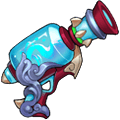

[← All weapons](../weapons.html)

# Torrent

| S0 - S3 | S4 - S7 | S8 - S13 | Artifact |
|---|---|---|---|
|  |  |  |  |

Can't you see? The water from the yellow river rises to the heavens as torrents surge to the sea with no return.

## Info

| Detail | Value |
|---|---|
| Grade | **A** |
| Angle Range | 20° - 50° |
| Ultimate |  Bubble |
| Shard |  Torrent Shard |
| Where to Get | Event |
| Artifact | Yes: becomes **G Torrent** when all 6 slots are maxed ([how](../weapons.html#artifact)) |

## Ultimate: Bubble

Fires 5 consecutive shells. If they hit enemies, each shell deals base damage and grants the team a shield based on a percentage of max HP. (Ultimate shells do not create craters. Shields last for 2 rounds.)

| Levels | Base DMG | Additional |
|---|---|---|
| S0 - S3 | 50% | When there is 1 team member, shield ratio is 28%; with 2 members, shield ratio is 16%; with 3 members, shield ratio is 10%. |
| S4 - S7 | 55% | When there is 1 team member, shield ratio is 29%; with 2 members, shield ratio is 17%; with 3 members, shield ratio is 11%. |
| S8 - S11 | 60% | When there is 1 team member, shield ratio is 31%; with 2 members, shield ratio is 18%; with 3 members, shield ratio is 12%. |
| S12 - S13 | 68% | When there is 1 team member, shield ratio is 33%; with 2 members, shield ratio is 20%; with 3 members, shield ratio is 13%. |

## Stats by level

Shards: the Torrent Shard needed to reach that level (S0 = crafting the weapon).

| Level | Shards | Total shards | Weapon DMG | ATK | CRIT | DMG+ | Burst DMG+ | BP |
|---|---|---|---|---|---|---|---|---|
| **S0** | 20 | 20 | 60 - 87 | - | - | 17 | 19 | 369 |
| **S1** | 5 | 25 | 64 - 91 | - | - | 20 | 24 | 405 |
| **S2** | 10 | 35 | 80 - 129 | - | - | 36 | 42 | 621 |
| **S3** | 15 | 50 | 85 - 153 | - | - | 48 | 64 | 795 |
| **S4** | 20 | 70 | 112 - 189 | - | - | 78 | 86 | 1,059 |
| **S5** | 25 | 95 | 134 - 228 | - | - | 96 | 107 | 1,293 |
| **S6** | 30 | 125 | 164 - 285 | - | - | 126 | 139 | 1,650 |
| **S7** | 35 | 160 | 212 - 345 | - | - | 162 | 188 | 2,085 |
| **S8** | 40 | 200 | 248 - 403 | - | - | 211 | 235 | 2,547 |
| **S9** | 45 | 245 | 288 - 451 | - | - | 297 | 269 | 3,051 |
| **S10** | 50 | 295 | 343 - 562 | - | - | 325 | 302 | 3,567 |
| **S11** | 55 | 350 | 385 - 642 | - | - | 387 | 346 | 4,125 |
| **S12** | 60 | 410 | 485 - 725 | - | - | 431 | 376 | 4,596 |
| **S13** | 65 | 475 | 686 - 1,013 | - | - | 495 | 402 | 5,730 |

## Artifact slots

Needs the weapon at S13. Each slot has 3 levels and is crafted in order; the values below are the slot's total at that level. Cost per level: weapon shards + Artifact Essence.

| Slot | Level 1 | Level 2 | Level 3 |
|---|---|---|---|
| **1. Against Current** | Torrent DMG+ +101% <small>31 shards + 3,348 essence</small> | Torrent DMG+ +202% <small>50 shards + 6,400 essence</small> | Torrent DMG+ +337% <small>63 shards + 9,954 essence</small> |
| **2. Rapid Flow** | Torrent Burst DMG +265% <small>56 shards + 6,048 essence</small> | Torrent Burst DMG +497% <small>95 shards + 12,160 essence</small> | Torrent Burst DMG +912% <small>147 shards + 23,226 essence</small> |
| **3. Geyser Impulse** | Torrent Weapon DMG +1785-2215 <small>100 shards + 13,800 essence</small> | Torrent Weapon DMG +3234-3432 <small>158 shards + 20,224 essence</small> | Torrent Weapon DMG +4871-5129 <small>188 shards + 29,704 essence</small> |
| **4. Wind Flight** | Torrent DMG- +3000 <small>135 shards + 18,580 essence</small> | Torrent DMG- +4333 <small>168 shards + 24,504 essence</small> | Torrent DMG- +6000 <small>210 shards + 33,180 essence</small> |
| **5. Meteor Energy** | Torrent HP +18,000 <small>135 shards + 21,580 essence</small> | Torrent HP +26000 <small>168 shards + 26,504 essence</small> | Torrent HP +36000 <small>210 shards + 34,180 essence</small> |
| **6. Star Glitter** | Using Ultimate restores 6% HP instantly <small>135 shards + 24,580 essence</small> | Using Ultimate restores 10% HP instantly <small>168 shards + 29,504 essence</small> | Using Ultimate restores 15% HP instantly <small>210 shards + 35,180 essence</small> |

## Skins (Conjure Artifact)

| Skin | Stats bonus | Activate | Each of 4 phases |
|---|---|---|---|
|  **Starry Sky Invitation** | ATK +111 CRIT +42 DMG+ +45 Burst DMG+ +41 | 250 Torrent-Starry Sky Invitation Shards | 125 Torrent-Starry Sky Invitation Shards |
