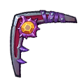
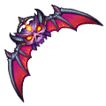
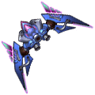

[← All weapons](../weapons.html)

# Troll Boomerang

| S0 - S3 | S4 - S7 | S8 - S13 | Artifact |
|---|---|---|---|
|  |  |  |  |

The weapon used by the first warrior of the Continent, defeated countless warriors in the arena. With it, there is no unwinnable battle!

## Info

| Detail | Value |
|---|---|
| Grade | **S** |
| Angle Range | 20° - 70° |
| Ultimate |  Troll Bash |
| Shard |  Troll Boomerang Shard |
| Where to Get | Event |
| Artifact | Yes: becomes **G Troll Boomerang** when all 6 slots are maxed ([how](../weapons.html#artifact)) |

## Ultimate: Troll Bash

Launches a Troll Boomerang, dealing base damage and not consuming SP for ultimate skill use. When hitting enemies, it scatters 3 small darts randomly near the impact point. Each dart deals damage upon contact with any target. If the boomerang misses, gain 5% ATK (stackable, up to 20%).

| Levels | Base DMG | Additional |
|---|---|---|
| S0 - S3 | 120% | Splashing darts deal 160% damage when contacting enemies. |
| S4 - S7 | 130% | Splashing darts deal 165% damage when contacting enemies. |
| S8 - S11 | 140% | Splashing darts deal 170% damage when contacting enemies. |
| S12 - S13 | 150% | Splashing darts deal 180% damage when contacting enemies. |

## Stats by level

Shards: the Troll Boomerang Shard needed to reach that level (S0 = crafting the weapon).

| Level | Shards | Total shards | Weapon DMG | ATK | CRIT | DMG+ | Burst DMG+ | BP |
|---|---|---|---|---|---|---|---|---|
| **S0** | 20 | 20 | 75 - 97 | - | 29 | 33 | - | 448 |
| **S1** | 5 | 25 | 85 - 123 | - | 46 | 41 | - | 584 |
| **S2** | 10 | 35 | 98 - 189 | - | 56 | 58 | - | 853 |
| **S3** | 15 | 50 | 106 - 208 | - | 91 | 90 | - | 1,076 |
| **S4** | 20 | 70 | 139 - 282 | - | 136 | 125 | - | 1,493 |
| **S5** | 25 | 95 | 169 - 316 | - | 182 | 156 | - | 1,780 |
| **S6** | 30 | 125 | 195 - 411 | - | 206 | 180 | - | 2,185 |
| **S7** | 35 | 160 | 249 - 524 | - | 256 | 205 | - | 2,699 |
| **S8** | 40 | 200 | 292 - 628 | - | 331 | 236 | - | 3,254 |
| **S9** | 45 | 245 | 331 - 816 | - | 362 | 279 | - | 4,009 |
| **S10** | 50 | 295 | 391 - 883 | - | 438 | 324 | - | 4,497 |
| **S11** | 55 | 350 | 446 - 1,048 | - | 496 | 375 | - | 5,261 |
| **S12** | 60 | 410 | 543 - 1,179 | - | 568 | 453 | - | 6,032 |
| **S13** | 65 | 475 | 805 - 1,267 | - | 713 | 636 | - | 7,135 |

## Artifact slots

Needs the weapon at S13. Each slot has 3 levels and is crafted in order; the values below are the slot's total at that level. Cost per level: weapon shards + Artifact Essence.

| Slot | Level 1 | Level 2 | Level 3 |
|---|---|---|---|
| **1. Whirling blow** | Troll Boomerang's critical damage bonus +1067 <small>31 shards + 3,348 essence</small> | Troll Boomerang's critical damage bonus +2000 <small>50 shards + 6,400 essence</small> | Troll Boomerang's critical damage bonus +3667 <small>63 shards + 9,954 essence</small> |
| **2. Gravity strike** | Basic Attack of Troll Boomerang +1210 <small>56 shards + 6,048 essence</small> | Basic Attack of Troll Boomerang +2200 <small>95 shards + 12,160 essence</small> | Basic Attack of Troll Boomerang +4050 <small>147 shards + 23,226 essence</small> |
| **3. Troll Power** | Troll Boomerang weapon damage +3350-4080 <small>100 shards + 13,800 essence</small> | Troll Boomerang weapon damage +5800-6685 <small>158 shards + 20,224 essence</small> | Troll Boomerang weapon damage +8730-9830 <small>188 shards + 29,704 essence</small> |
| **4. Source of Trolls** | HP of Troll Boomerang +31000 <small>135 shards + 18,580 essence</small> | HP of Troll Boomerang +44500 <small>168 shards + 24,504 essence</small> | HP of Troll Boomerang +61000 <small>210 shards + 33,180 essence</small> |
| **5. The Troll Sea** | Troll Boomerang DMG+ +1120 <small>135 shards + 21,580 essence</small> | Troll Boomerang DMG+ +2100 <small>168 shards + 26,504 essence</small> | Troll Boomerang DMG+ +3850 <small>210 shards + 34,180 essence</small> |
| **6. Magic Slash** | Ultimate damage increased by 10%, and when hitting the target, there is a 20% chance to chaotic the target (players in chaotic state attack themselves, the effect lasts for 1 turn) <small>135 shards + 24,580 essence</small> | Ultimate damage increased by 12%, and when hitting the target, there is a 25% chance to chaotic the target (players in chaotic state attack themselves, the effect lasts for 1 turn) <small>168 shards + 29,504 essence</small> | Ultimate damage increased by 15%, and when hitting the target, there is a 30% chance to chaotic the target (players in chaotic state attack themselves, the effect lasts for 1 turn) <small>210 shards + 35,180 essence</small> |

## Skins (Conjure Artifact)

| Skin | Stats bonus | Activate | Each of 4 phases |
|---|---|---|---|
|  **Shining Feather** | ATK +101 CRIT +42 DMG+ +43 Burst DMG+ +46 | 250 Boomerang-Shining Feather Skin Shard | 1,250 Boomerang-Shining Feather Skin Shard |
|  **Freed** | ATK +111 CRIT +42 DMG+ +45 Burst DMG+ +41 | 300 Boomerang-Free Skin Shard | 1,500 Boomerang-Free Skin Shard |
